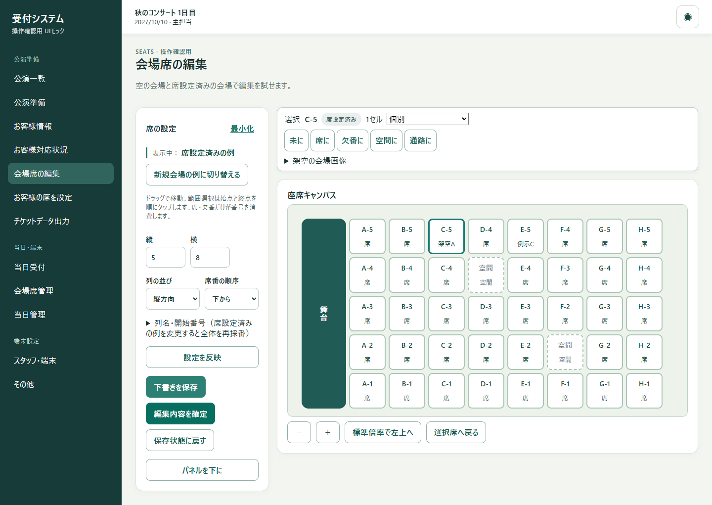
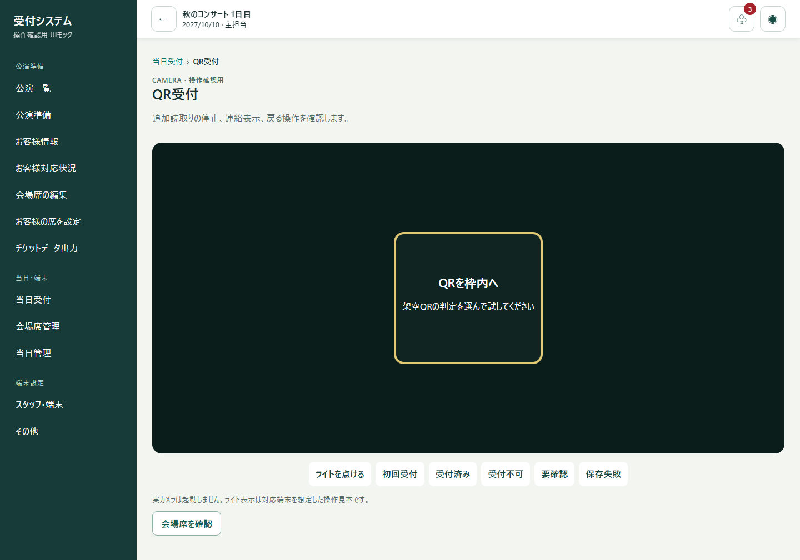
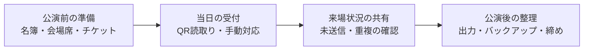

# コンサート受付システム

個人コンサートの名簿・座席管理と当日のQR受付を、できるだけ無料で支援することを目指すWebアプリ（PWA）です。
主催者からの相談を受け、開発者1名で要件定義から設計・実装・テストまで担当しています。

**[操作デモを開く（ログイン不要）](https://eu0207.github.io/concert-reception-system/)**

**デモは架空データのUIモックです。製品は開発中で、本番利用はできません。**

[モックの操作例](mock/mock-guide.md)

**画面見本**

| 会場席の編集 | QR受付の画面 |
|---|---|
|  |  |

## この開発で取り組んだこと

- **業務課題の整理と合意**：表計算と手書きによる管理の課題を整理し、[要件定義書](docs/client/requirements.md)と[受入条件書](docs/client/acceptance-criteria.md)を作成して承認を得ました。
- **通信停止を想定した設計**：端末内への暗号化保存と、復旧後の再送・重複確認を設計しました。保存基盤から段階的に実装しています。
- **費用を抑える技術選定**：通常無料を目指すPWA＋Firebase構成を採用し、[ADR](docs/development/decisions/ADR-001-product-platform.md)へ判断理由を記録しました。
- **変更と品質の管理**：要件・設計・テストを[IDで対応付け](docs/development/traceability-matrix.md)、Issue → ブランチ → Pull Requestの流れで変更を管理しています。

Codexを調査・文書作成と実装の支援に使い、提案の採否と検証結果を開発者が確認しています。業務要件と受入判断は依頼者が行います。

## 現在の開発フェーズ（2026年11月17日）

要件定義と予定した設計は承認済みです。座席計算・端末保存・認可などの基盤を実装・検証し、業務画面との結合を進めています。
製品全体のテストと受入はこれからで、本番利用はできません。→ [詳しい開発状況・テスト状況](docs/status.md)

## 主な機能

以下は**完成時に提供する機能の範囲**です。製品の実装状況は[詳しい開発状況](docs/status.md)に記載しています。

| 場面 | 主な機能 | 解決したいこと |
|---|---|---|
| 公演前 | Excel名簿の取込み、会場席の作成、お客様の座席配置 | 準備情報を整理し、転記と確認の手間を減らす |
| チケット準備 | QR付きチケット、座席表、当日運営表の出力 | 受付に必要な資料をそろえる |
| 当日の受付 | QR判定、手動受付、再入場と座席変更への対応 | 通常受付と例外対応を同じ画面の流れで扱う |
| 通信停止・復旧 | 端末内への記録、再送、複数端末の重複・競合確認 | 記録を失わず、受付を継続する |
| 運用管理 | スタッフ・端末の権限、操作履歴、バックアップと締め処理 | 操作範囲を制御し、公演後も安全に管理する |

チケット販売と実際の印刷・送付は対象外です。チケットデータの出力と送付状況の記録は対象です。その他の対象外範囲は[提供範囲と権利](docs/project-scope.md#対象外の機能制約)を参照してください。

## 技術構成

| 用途 | 技術 | 採用理由・現在の範囲 |
|---|---|---|
| 画面・業務ロジック | TypeScript、HTML、CSS | 型検査を行い、計算と画面・保存を分離する。ReactなどのUIフレームワークは使用していない |
| 開発・ビルド | Vite、Node.js、pnpm | 開発サーバーとビルド、固定版の依存管理 |
| アプリ形式 | PWA、Service Worker | ブラウザーから利用し、静的資産をオフラインでも開く。受付のオフライン同期は製品への実装・結合が残る |
| 認証・共有 | Firebase Authentication、Realtime Database | 独自サーバーの運用を抑え、認証と複数端末のデータ共有を行う。保存基盤から段階的に実装 |
| 端末内保存 | IndexedDB、Web Crypto API | 端末内の業務データを公演・端末ごとに暗号化して保存 |
| 保護 | RTDB Security Rules、App Check | Rulesは実装・エミュレーター検証中。App Checkの実環境適用は後続作業 |
| 会場画像 | heic-to、ブラウザーの画像処理API | HEIC／HEIFを含む画像の調整・表示 |
| 試験 | Node.js標準テスト、Playwright、Firebase Emulator Suite | 共通計算、ブラウザー操作、認可・保存の確認 |
| 本番配信 | Firebase Hosting（設計上の採用） | 本番の配備・運用は未実施 |

技術選定の理由は[ADR-001](docs/development/decisions/ADR-001-product-platform.md)、共有DBと保存方式の変更は[ADR-007](docs/development/decisions/ADR-007-seat-edit-commit-boundary.md)に記録しています。QR読取りと帳票生成の製品ライブラリは後続実装で確定します。

## 開発背景

年に1回、個人コンサートを開催する主催者から、アナログな管理作業を減らしたいという相談を受けて開発を始めました。表計算と紙による転記の手間、受付状況の共有、不安定な会場回線への対応が主な課題です。

通常運用は無料枠で成立する構成を優先し、有料契約やカード登録を既定にしません。完成版での無料運用の成立は[運用検証](https://github.com/EU0207/concert-reception-system/issues/220)で確認します。

## 開発資料

| 資料 | 参照先 |
|---|---|
| 要件・受入条件 | [要件定義書](docs/client/requirements.md)・[受入条件書](docs/client/acceptance-criteria.md) |
| 基本設計 | [基本設計計画書](docs/development/basic-design/basic-design-plan.md)・[システム構成設計](docs/development/basic-design/system-architecture.md) |
| 詳細設計 | [詳細設計一覧](docs/document-guide.md#詳細設計)・[会場席の設計](docs/development/detailed-design/seat-management-detail-design.md) |
| 技術判断 | [ADR案内](docs/development/decisions/adr-guide.md) |
| テスト・進捗 | [テスト方針](docs/development/basic-design/test-strategy.md)・[開発状況と試験記録](docs/status.md) |
| 全体の案内 | [ドキュメント案内](docs/document-guide.md)・[用語集](docs/development/glossary.md) |

製品コードは `src/`、試験は `tests/`、操作モックは `mock/`、技術検証は `poc/` にあります。開発文書の構成は[開発文書の案内](docs/development/index.md)を参照してください。

## 権利・利用について

公開ライセンスは未採用です。開発者と主催者の取り決めや利用方針は[提供範囲と権利](docs/project-scope.md#権利利用について)を参照してください。
