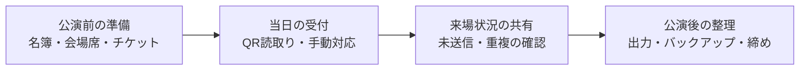

# コンサート受付システム

**紙と表計算によるコンサート運営を、準備から当日の受付まで支援するWebアプリです。**

来場者と座席の管理、QRコード受付を一つの流れにまとめます。通信が不安定な会場でも受付を続け、復旧後に複数端末の記録を統合することを目指しています。

**ミッションは、主催者ができるだけ費用を掛けずに利用できることです。** 通常運用は無料枠で成立する構成を優先し、有料契約やカード登録を既定にしません。完成版での無料運用の成立は、[運用検証](https://github.com/EU0207/concert-reception-system/issues/220)で確認します。

> **開発中：現在は製品の実装・結合を進めています。本番利用はできません。** 
> 操作体験用のUIモックと、開発途中の製品アプリは別のものです。

[概要](#プロジェクト概要) · [操作デモ](#操作デモ) · [開発状況](#開発状況) · [技術構成](#技術構成) · [開発資料](#開発資料)

## プロジェクト概要

### 開発の背景

年に1回、個人コンサートを開催する主催者から、**「アナログな管理作業を減らし、当日の会場運営を楽にしたい」**という相談を受けて開発を始めました。

従来は来場者や座席を表計算で管理し、当日の来場状況を紙に手書きしていました。次の課題を改善することが目的です。

- **準備の手間**：名簿と座席を別々に管理し、確認や転記が発生する。
- **受付状況の把握**：複数の担当者が、来場済み・未来場の状況を共有しにくい。
- **会場の通信環境**：安定した回線を前提にできず、通信停止時の運用も必要になる。

### 主な機能

以下は**完成時に提供する機能の範囲**です。製品の実装状況は[開発状況](#開発状況)に記載しています。

| 場面 | 主な機能 | 解決したいこと |
|---|---|---|
| 公演前 | Excel名簿の取込み、会場席の作成、お客様の座席配置 | 準備情報を整理し、転記と確認の手間を減らす |
| チケット準備 | QR付きチケット、座席表、当日運営表の出力 | 受付に必要な資料をそろえる |
| 当日の受付 | QR判定、手動受付、再入場と座席変更への対応 | 通常受付と例外対応を同じ画面の流れで扱う |
| 通信停止・復旧 | 端末内への記録、再送、複数端末の重複・競合確認 | 記録を失わず、受付を継続する |
| 運用管理 | スタッフ・端末の権限、操作履歴、バックアップと締め処理 | 操作範囲を制御し、公演後も安全に管理する |

### 対象外の機能・制約

以下は、承認済みの要件で対象外としている範囲です。開発途中のため未実装の機能とは区別しています。

| 区分 | 対象外の範囲 |
|---|---|
| 販売・金銭 | チケット販売、オンライン決済、返金。領収書発行とお釣り計算 |
| 印刷・送付 | チケットなどの実際の印刷、郵送・発送、来場者へのメールなどの送信 |
| 顧客管理 | 住所・電話番号・メールアドレスを含む完全な購入者名簿の管理 |
| 本人確認・不正防止 | 公的身分証による厳密な本人確認、QRコード複製の完全防止 |
| 受付単位 | グループ単位でまとめて入場扱いにする一括受付 |
| 汎用化・提供範囲 | 企業向け専用機能、コンサート以外を前提とした汎用化。現時点での第三者への利用許諾と個別運用支援 |

**チケットデータの出力と、送付状況の記録は対象です。** 実際の印刷や送付は主催者が行います。受付に必要な購入者名や座席情報は管理しますが、住所録などを含む顧客管理システムは提供しません。

詳細は[要件定義書の対象外範囲](docs/client/requirements.md#対象外として決定済み)を参照してください。

## 操作デモ

**GitHub Pages：公開準備中** 
公開予定URL：[https://eu0207.github.io/concert-reception-system/](https://eu0207.github.io/concert-reception-system/)

現時点では上記URLから利用できません。公開後は、インストールやログインなしでPC・スマートフォンから試せます。

### 操作例

| 操作内容 | メニューと操作 |
|---|---|
| 会場の座席を作る | 「会場席の編集」→「新規会場の例に切り替える」→範囲を選択→「席に」 |
| お客様へ席を割り当てる | 「お客様の席を設定」→席未設定のお客様を選択→座席を選択 |
| 当日の受付を体験する | 「当日受付」→「カメラを開く」→架空QRの判定を選択→「次へ」 |

### デモの構成と利用範囲

HTML・CSS・JavaScriptで作成した静的なUIモックです。GitHub Pagesでモックだけを配信し、製品アプリやFirebase設定は含めません。

- 架空のお客様6人と端末4台の見本を使います。実在する情報は入力しないでください。
- 操作結果はメモリー内だけに保持し、ページの再読み込みで初期状態へ戻ります。
- QR判定と帳票出力は模擬動作です。実カメラの使用やPDF・Excelファイルの生成は行いません。
- Firebaseへの接続、実際の認証と端末間同期は行いません。

詳しい操作は[UIモック操作手順](mock/mock-guide.md)を参照してください。

### 実機操作動画

**未公開です。** 製品の完成後、架空データを使った実機操作動画をYouTubeへ掲載し、ここにリンクを追加する予定です。

## 開発状況

### 現在の開発フェーズ

**製品の実装と、実装済み部品の結合・テストを進めています。** 要件定義と予定した設計は承認済みですが、製品全体のテストと受入はこれからです。本番利用はできません。

更新日：2026年11月17日。mainへの統合状況を基準とし、レビュー中の変更は区別しています。

### 工程別の進捗

| 工程 | 状況 | 成果・残作業 |
|---|---|---|
| 要件定義 | 承認済み | 要件定義書と受入条件書を作成 |
| 基本設計 | 承認済み | システム構成、画面と運用方式を設計 |
| UIモック | 作成・確認済み | 架空データで操作確認し、結果を[引継ぎ台帳](docs/development/ui-mock/ui-mock-production-handoff.md)へ記録 |
| 詳細設計 | 予定した設計は承認済み | 実装中に生じた変更・追補は個別に管理 |
| 実装・単体テスト | 進行中 | 共通計算と保存基盤から順次実装・検証 |
| 結合・システムテスト | 部品間の結合テストは一部実施 | 製品全体の結合・システム試験は未実施 |
| 受入テスト | 未実施 | 完成版の運用検証と依頼者による最終判定が残る |

### 機能別の実装状況

| 範囲 | 状況 | 確認できる成果・残作業 |
|---|---|---|
| 座席・配置の共通計算 | 実装済み | [座席計算](docs/development/technical-validation/seat-domain-unit-test-results.md)と[配置計算](docs/development/technical-validation/assignment-domain-handoff.md)の単体試験 |
| 共通画面・PWA・座席編集 | 実装途中 | ローカルで会場席を編集可能。製品全体との結合と実機確認が残る（[#258](https://github.com/EU0207/concert-reception-system/issues/258)、[#105](https://github.com/EU0207/concert-reception-system/issues/105)） |
| 端末保存・会場画像 | 一部実装済み | 暗号化した[下書き保存・復元](docs/development/technical-validation/seat-local-storage-results.md)、[画像の追加・回転・拡大表示](docs/development/technical-validation/venue-image-results.md)。確定保存との結合などが残る |
| 認可・共有保存 | 基盤実装済み | 本人・端末認可と[共有保存・別端末復元](docs/development/technical-validation/shared-seat-draft-results.md)をローカルのFirebaseエミュレーターで検証。実認証画面・業務操作との結合が残る |
| 本人認証画面 | レビュー中 | ログイン・メール確認・再認証を実装した[PR #297](https://github.com/EU0207/concert-reception-system/pull/297)。main未統合 |
| QR受付・同期・帳票・運用画面 | 未完了 | 製品としての機能実装と機能間の結合が残る |

### テストの実施状況

**単体テストや部品間の結合テストは、実装と並行して行っています。** 部品の試験合格を、製品全体の合格とは扱いません。

| テストの範囲 | 現在の状況 | 記録・計画 |
|---|---|---|
| 業務計算の単体テスト | 座席計算・配置計算の実装範囲で実施済み | [座席計算](docs/development/technical-validation/seat-domain-unit-test-results.md)・[配置計算](docs/development/technical-validation/assignment-domain-handoff.md) |
| 実装済み画面のブラウザーテスト | 座席編集・画像操作などで実施済み。実スマートフォンの確認とは区別 | [会場画像の試験記録](docs/development/technical-validation/venue-image-results.md) |
| 保存・認可部品の結合テスト | ローカルのFirebaseエミュレーターで一部実施済み | [共有保存・別端末復元](docs/development/technical-validation/shared-seat-draft-results.md) |
| 製品全体の結合・システムテスト | 未実施 | [試験Issue #265](https://github.com/EU0207/concert-reception-system/issues/265) |
| 完成版の運用・受入テスト | 未実施 | [無料運用検証 #220](https://github.com/EU0207/concert-reception-system/issues/220)・[最終受入判定 #266](https://github.com/EU0207/concert-reception-system/issues/266) |

現在の作業は[未完了のIssue一覧](https://github.com/EU0207/concert-reception-system/issues?q=is%3Aissue%20is%3Aopen)、要件との対応は[トレーサビリティ表](docs/development/traceability-matrix.md)で追跡できます。

## 技術構成

| 用途 | 技術 | 採用理由・現在の範囲 |
|---|---|---|
| 画面・業務ロジック | TypeScript、HTML、CSS | 型検査を行い、計算と画面・保存を分離する。ReactなどのUIフレームワークは使用していない |
| 開発・ビルド | Vite、Node.js、pnpm | 開発サーバーとビルド、固定版の依存管理 |
| アプリ形式 | PWA、Service Worker | ブラウザーから利用し、静的資産をオフラインでも開く。受付のオフライン同期は別途実装中 |
| 認証・共有 | Firebase Authentication、Realtime Database | 独自サーバーの運用を抑え、認証と複数端末のデータ共有を行う。保存基盤から段階的に実装 |
| 端末内保存 | IndexedDB、Web Crypto API | 端末内の業務データを公演・端末ごとに暗号化して保存 |
| 保護 | RTDB Security Rules、App Check | Rulesは実装・エミュレーター検証中。App Checkの実環境適用は後続作業 |
| 会場画像 | heic-to、ブラウザーの画像処理API | HEIC／HEIFを含む画像の調整・表示 |
| 試験 | Node.js標準テスト、Playwright、Firebase Emulator Suite | 共通計算、ブラウザー操作、認可・保存の確認 |
| 本番配信 | Firebase Hosting（設計上の採用） | 本番の配備・運用は未実施 |

技術選定の理由は[ADR-001](docs/development/decisions/ADR-001-product-platform.md)、共有DBと保存方式の変更は[ADR-007](docs/development/decisions/ADR-007-seat-edit-commit-boundary.md)に記録しています。QR読取りと帳票生成の製品ライブラリは後続実装で確定します。

## 開発の進め方

- 開発者が要件整理から実装・試験まで担当し、業務要件と受入判断は依頼者が確認します。
- Issueで完了条件を定め、専用ブランチとPull Requestで変更を確認します。
- 重要な技術判断をADRへ記録し、要件・設計・試験をIDで対応付けます。
- Codexを調査・文書作成と実装の支援に使い、提案の採否と検証結果を開発者が確認します。

## 開発資料

### 要件・設計・テストの資料

| 資料の区分 | 主な内容・参照先 |
|---|---|
| 要件・受入条件 | [要件定義書](docs/client/requirements.md)・[受入条件書](docs/client/acceptance-criteria.md) |
| 基本設計 | [基本設計計画書](docs/development/basic-design/basic-design-plan.md)・[システム構成設計](docs/development/basic-design/system-architecture.md) |
| 詳細設計 | [詳細設計一覧](docs/document-guide.md#詳細設計)。[会場席の設計](docs/development/detailed-design/seat-management-detail-design.md)・[受付の保存と中断復帰](docs/development/detailed-design/reception-recovery-detail-design.md)など |
| 技術判断 | [ADR案内](docs/development/decisions/adr-guide.md) |
| テスト方針・記録 | [テスト方針](docs/development/basic-design/test-strategy.md)・[実施状況](#テストの実施状況) |
| 文書案内・用語 | [ドキュメント案内](docs/document-guide.md)・[用語集](docs/development/glossary.md) |

### リポジトリの構成

| フォルダ | 内容 |
|---|---|
| `src/` | 製品コード。画面、業務計算と保存・外部接続を分離 |
| `tests/` | 単体試験、ブラウザー試験とエミュレーター試験 |
| `mock/` | 架空データで操作する静的UIモック |
| `docs/` | 要件・設計・試験記録と技術判断 |
| `poc/` | 限定条件での技術検証コードと記録。製品実装とは区別 |
| `firebase/` | データベースのアクセス制御ルールと生成元 |
| `config/`・`public/` | 設定例と製品アプリの静的資産 |
| `scripts/`・`.github/` | 開発用スクリプトとGitHubの配信・管理設定 |
| `third-party-notices/` | 第三者資産のライセンス表示 |

## 権利・利用について

本システムは主催者へ無償提供する予定で、開発者がシステムの所有と公開の権利を持つ取り決めで開発しています。依頼者の環境と第三者向けの評価環境は分離します。

**現時点では公開ライセンスを採用していません。** リポジトリの閲覧用公開と、第三者への改変・再配布の利用許諾は別に扱います。第三者資産のライセンスは各資産の表示に従います。
