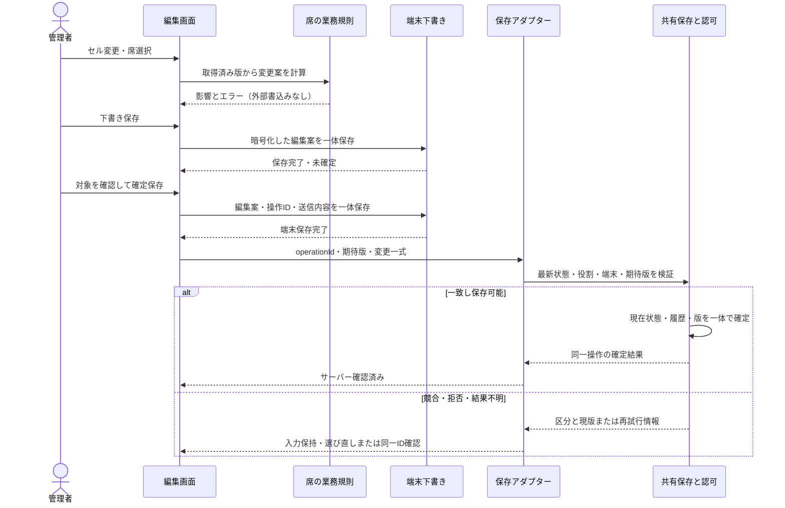

# 会場席作成・席設定の詳細設計

## 要点

状態：**In Review**。論理契約と検証計画はレビュー承認済み。追加結果は検証単位ごとにレビューする。物理保存方式と依存契約の確定は未完了。本番実装・試験は未実施。

- セルID・座席ID・表示番号を分け、採番や席替えでも対象を保持する。
- 編集案は画面内で計算する。下書きは端末保存、共有と確定は別操作（承認済みCONF-074）。交換は両者を一体で確定する。
- 発券後は移動・交換のみ。通常の席替えはQRを維持し、未設定化は不参加処理で旧QRを無効化する（承認済みCONF-070）。

**未決定：** PR #187でGD91-73の225シナリオをレビュー承認・統合済み。V1 #165・V2 #166は完了。[容量・費用と回収の判定](../technical-validation/seat-capacity-validation.md)を#167で継続する。最大10,000セルを製品上限にせず、安全な回収と参照上限を閉じてから#168で採否を判断する。本番未着手。

**容量・費用方針（2026-10-12開発者指示）：** 通常無料を必須とし、最低600人・目標1,000人で全業務を評価する。1公演1,000人超の無料枠維持は開発側の保証対象外。人数と席数・セル数を分け、1,000席に通路・余白を加えた構成も確認する。従来の500人・1,000セルへの縮小案は撤回。現PoCの500人検査を単純に引き上げて合格扱いにしない。

**拡張方針（2026-10-12開発者指示）：** 将来3,000人へ増やす際に画面・業務処理の全面改修を避けるため、保存データと目録を追加できる構造を本番採用前に評価する。[分割と拡張の契約](#人数増加に備える分割と拡張)を#167・168の条件に加える。今回は3,000人の検証を行わず、将来増設しやすい設計条件として扱う。正式対応・課金導入の承認ではない。

**無料運用の案内：** 登録・座席準備とQR発行は数日前から進め、前日までに完了する。当日は受付と急な追加・変更に絞る案内を準備画面・公演前チェックへ表示する。枠の回復予定は日本時間で示し、前夜と翌朝を別の無料枠と推測しない。[表示案と概算](../technical-validation/seat-capacity-validation.md#無料運用の日程と画面案内)を正本とする。600人・1,000人の無料成立は検証中で、本番画面は未実装。

**業務回答：** [CONF-071](#conf-071-業務回答と変更設計)で2点を承認済み。交換理由は初回本番受付開始前は不要、開始後は停止中も必須。番号・位置の個別編集は理由付きでお客様未割当席だけに許可する。行列拡張と舞台左／上の技術設計は引き続きIn Review。

**区画と印刷：** [CONF-072](../ui-mock/ui-mock-client-response.md#conf-072-自由な区画名と区画単位の印刷)を正式回答として受領。自由な名前の区画ごとに座席表を作り、1区画A4横1枚とする。左上に区画名、フッターに「現在ページ/総ページ」を表示する。技術設計とT31・32はIn Review。

**当日の個別追加：** [CONF-073](../ui-mock/ui-mock-client-response.md#conf-073-横方向の拡張と当日の個別追加席)で非席4種別からの席追加を受領。横方向の拡張も対応する。既存番号を保持する手入力席と緊急表示を設計する。2026-10-06にCONF-073-C・Dの推奨案承認を受領。枝番・文字を許可し、緊急表示は席構成の変更に限定する。タップ時に理由も表示する。技術設計はIn Review。

**全体スライド：** [CONF-075](../ui-mock/ui-mock-client-response.md#conf-075-座席表全体のスライド)と訂正CONF-075-Cを適用する。未セルを使う余白調整として、席番号・IDと割当を保持し、理由入力・保存は不要。当日も主担当・代理がオンラインで一括確定する。[操作契約](#座席表全体のスライドconf-075)とT42～45を正本とし、[検証経緯](../technical-validation/seat-save-validation.md#検証索引)を分離する。物理方式の採否と本番試験は未完了。

| 確認箇所 | 確認する内容 |
|---|---|
| [データ・採番](#dd-91-02-データ契約と不変条件)、[採番例](#架空例) | 席／欠番／空間を区別し、逆順でもIDと列名順を保つか |
| [席設定](#dd-91-04-席設定取消し交換)、[異常時](#dd-91-06-画面状態と異常時) | 発券済みの保護、片側交換の拒否、失敗時の入力保持が具体的か |
| [開始条件](#dd-91-08-実装順と承認ゲート)、[試験ケース](#dd-91-09-試験ケース) | 未確定の保存方式と依存契約を開始条件にし、各操作の期待結果を追跡できるか |
| [検証の現在地](#検証の現在地)、[検証記録](../technical-validation/seat-save-validation.md#現在の結果と残作業) | 最新の限定結果と採用前の残作業を確認する。過去の比較は検証記録から必要なIDだけ読む |

## この文書について

| 項目 | 内容 |
|---|---|
| 目的 | Issue #91の承認内容を、データ契約、操作と異常時へ展開し、試験ケースを同じ文書で追跡する |
| 読者 | 開発者、設計担当者、テスト担当者 |
| 関連Issue | [#91](https://github.com/EU0207/concert-reception-system/issues/91)、[#93](https://github.com/EU0207/concert-reception-system/issues/93) |
| 設計ID | DD-91-01～DD-91-09 |
| 状態 | In Review |
| 承認情報 | 2026-10-06、開発者がPR #109の内容コミット`83c74a81c0cfec28f08e801add24651d4d60ac71`をレビュー承認。論理契約・操作条件、試験条件とタスク分割（#101の検証計画を含む）が対象。物理保存方式・ADR-007の採否は検証後に確定し、設計全体の完了と区別する |
| PR #113承認 | 2026-10-06、開発者が内容コミット`483692d43433212aff4a479f8d508de8373a6d6e`をレビュー承認。限定検証結果、CONF-074の端末下書き契約・操作と試験条件、段階分割が対象。共有確定の物理方式採用、未実施試験の合格と設計全体の完了は含まない |
| PR #114承認 | 2026-10-06、開発者が内容コミット`0676d4b4323b60f19d4226e7be08b1d59f7532c3`をレビュー承認。GD91-02の限定検証結果と候補Eの優先検証方針が対象。物理方式の採用、残作業の完了と本番試験の合格は含まない |
| PR #115承認 | 2026-10-07、開発者が内容コミット`d49dc816c6707700b1c2cadff6a13f8e1ec9084e`をレビュー承認。GD91-03の個別編集の限定結果と構成文書の容量課題が対象。構成集約文書をそのまま採用せず分割を検証する。物理方式の採用と本番試験の合格は含まない |
| PR #116承認 | 2026-10-07、開発者が内容コミット`24ecbbe2315a1a3d3cffc1b0c353d0b37f0d3b7d`をレビュー承認。GD91-04の構成分割と一体確定の限定検証が対象。物理方式の採用、残作業の完了と本番試験の合格は含まない |
| PR #117承認 | 2026-10-07、開発者が内容コミット`0fbdab3e51fd8a8d8a504e752e6c7d99b8de2692`をレビュー承認。GD91-05の軽量版と構成差分受信の限定検証が対象。物理方式の採用、合同Rulesと端末復帰の完了、本番試験の合格は含まない |
| PR #118承認 | 2026-10-07、開発者が内容コミット`b81b1a7dc3264b75f3aae3d2d29a34834e63bf72`をレビュー承認。GD91-06の席構成と席設定の合同検証が対象。物理方式の採用、初期作成・券QR・正式認証の完了と本番試験の合格は含まない |
| PR #119承認 | 2026-10-07、開発者が内容コミット`995d5470fc54b35b0827c5f9ad934201c7fd2b36`をレビュー承認。GD91-07の初期作成・拡張の計算結果、CONF-075の操作契約・試験計画とタスク追跡が対象。設計文書のMarkdown記法整理も含む。スライド計算候補・物理保存方式の採用と未実施試験の合格は含まない |
| PR #120承認 | 2026-10-07、開発者が内容コミット`5b064ce8084bfcd184642d80fe05607bb9fcdca7`をレビュー承認。GD91-08の全体スライド計算の限定結果と、CONF-075-Cの理由入力・保存を不要とする仕様訂正が対象。既存席の緊急追加理由は保持。物理保存方式の採用と未実施試験の合格は含まない |
| PR #121承認 | 2026-10-07、開発者が内容コミット`66b5da5f6e1835e30532ea7871ee048f1604821e`をレビュー承認。GD91-09の世代保存境界の限定結果と、全件複写の採用非推奨・移動量保持候補の比較方針が対象。保存方式の採用と未実施試験の合格は含まない |
| PR #122承認 | 2026-10-07、開発者が内容コミット`0c04d0eb63542ecf2e097b59216f9d6c59e94bc3`をレビュー承認。GD91-10の移動量保存の限定結果と、1要求・2書込みの候補を優先する方針が対象。初期集計と全編集への接続は未検証。保存方式の採用と未実施試験の合格は含まない |
| PR #123承認 | 2026-10-07、開発者が内容コミット`9f0758aa5075d0a7bfb3938d6b59779d4a316c90`をレビュー承認。GD91-11の初期集計と移動量保存への接続の限定結果、区切りをまたぐID重複の既知制約が対象。初期構成全体の保証と全編集への接続は未完了。保存方式の採用と未実施試験の合格は含まない |
| PR #124承認 | 2026-10-07、開発者が内容コミット`fccabf49c8cf5f030a4e955ba2bb72921e89d158`をレビュー承認。GD91-12の初期集計と同一区画内のセル・座席ID重複拒否の限定結果、正式なSeat参照検査の未実装が対象。初期構成全体の保証と全編集への接続は未完了。保存方式の採用と未実施試験の合格は含まない |
| PR #125承認 | 2026-10-07、開発者が内容コミット`8970e0410f05eebd4df15138ebb9a52b8dff70a6`をレビュー承認。GD91-13の自動Seat対応の限定結果と計算量・初期保存効率の課題、単純な1セル保存の採用非推奨が対象。列設定の初期生成と採番順は未保証。初期構成全体の保証と全編集への接続は未完了。保存方式の採用と未実施試験の合格は含まない |
| PR #126承認 | 2026-10-08、開発者が内容コミット`be2d004110c864f6f465d558156ff7ef2715cd42`をレビュー承認。GD91-14のセル・席属性の検査分担と初期保存の効率化の限定結果、分離候補を優先して合同検証する方針が対象。準備片の破棄・再作成、列設定の初期生成・採番順と全編集への接続は未完了。保存方式の採用と未実施試験の合格は含まない |
| PR #127承認 | 2026-10-08、開発者が内容コミット`554ac6e626f990557a5f84f5813974742ef58276`をレビュー承認。GD91-15の作業世代を分けた初期準備の中断・再作成の限定結果が対象。中断は3書込み、初期保存は966書込み。物理回収・保持条件、列設定の初期生成・採番順と全編集への接続は未完了。保存方式の採用と未実施試験の合格は含まない |
| PR #128承認 | 2026-10-08、開発者が内容コミット`675a601692c73321e47700b61cfe25fdb1c11cb5`をレビュー承認。GD91-16の列設定の通常作成と初期採番順の限定結果が対象。930セルは初期1,232要求・1,507書込み、スライド2書込み。追加検査のコストを含む。手入力席・全編集と正式認可への接続、物理回収は未完了。保存方式の採用と未実施試験の合格は含まない |
| PR #129承認 | 2026-10-08、開発者が内容コミット`cb21a52f05b24d4dad8c9bc82df9e1a71c9d05a0`をレビュー承認。GD91-17の初回列設定とID台帳作成の一体化が対象。開始の静的参照は19から14、930セルは初期1,232要求・1,506書込み。正式認可・全編集と回収は未完了。保存方式の採用と未実施試験の合格は含まない。 |
| PR #130承認 | 2026-10-08、開発者が内容コミット`7da8cdee78cf53a82fe774c64387ca32f3033b79`をレビュー承認。GD91-18の公開対象を保持する別世代の準備・中断の限定結果が対象。準備7段階で旧データを保持し、中断は3書込み。公開対象の差替え・全編集と正式認可、回収は未完了。保存方式の採用と未実施試験の合格は含まない。 |
| PR #131承認 | 2026-10-08、開発者が内容コミット`0621a3ce92cacea58606d5c88fe8762272cb255e`をレビュー承認。GD91-19の反映前検査と操作別の保存計画の限定結果が対象。計算単体53件で操作外の変更を拒否し、通常スライドは移動量更新を優先する候補。最新状態・正式認可との一体保存、全編集と差替え・回収は未完了。保存方式の採用と未実施試験の合格は含まない。 |
| PR #132承認 | 2026-10-08、開発者が内容コミット`d5a467a2ee8ebf7111170495603fcb1a55755fd5`をレビュー承認。GD91-20の共通版・履歴と移動量の一体保存の限定結果が対象。Emulatorの78シナリオで1要求・3書込みを確認。初期作成と共通版発行、全編集・正式認可全体と差替え・回収は未完了。保存方式の採用と未実施試験の合格は含まない。 |
| PR #133承認 | 2026-10-08、開発者が内容コミット`ce63b9b86934f5b80e6022419a078956fbeef946`をレビュー承認。GD91-21の初期完了・公開先と共通版の一体発行、その後のスライド保存への接続の限定結果が対象。Emulatorの69シナリオ（正常・拒否67件、比較2件）で初回発行4書込みとスライド3書込みを確認。正式認可と全業務の版発行、席ID・割当の照合と全編集、差替え・回収は未完了。保存方式の採用と未実施試験の合格は含まない。 |
| PR #134承認 | 2026-10-08、開発者が内容コミット`2bceeb234fd82415ee94e9d1326c9d88c155d6c4`をレビュー承認。GD91-22の本人セッション発行と保存時の認可の限定結果が対象。Emulatorの81シナリオ（正常・拒否78件、比較3件）で初回発行4書込みとスライド3書込みを確認。認可追加後の3セル片では初期1,652要求・2,017書込みへ増加。正式認可と全業務の版発行、席ID・割当の照合と全編集、差替え・回収は未完了。保存方式の採用と未実施試験の合格は含まない。 |
| PR #135承認 | 2026-10-09、開発者が内容コミット`1d3fe9cd040fa4451209a3445655284b5df8ae64`をレビュー承認。GD91-23の席ID集合と割当正本、業務正本からの版取得の机上設計が対象。初回5文書の接続候補の参照予算は20・各書込み最大8。DD91-T47～50と合同Rulesは未実施。保存方式の採用と本番実装、未実施試験の合格は含まない。 |
| PR #136承認 | 2026-10-09、開発者が内容コミット`06a518ef276f2ce4c1671c10d544b438c1508932`をレビュー承認。GD91-24の席ID集合の通常作成と空の割当表の初回5文書保存の限定結果が対象。Emulatorの25シナリオ（正常・拒否24件、比較1件）で部分送信30通りを拒否。初期1,652要求・2,018書込み、スライド3書込み。業務正本の通常発行と500人実割当、正式認可全体は未接続。保存方式の採用と本番実装、未実施試験の合格は含まない。 |
| PR #137承認 | 2026-10-09、開発者が内容コミット`6cc723125d1909fd71ca67bf783ea2f8c658e9b7`をレビュー承認。GD91-25の業務更新と構成版の分離、正本と小さな索引の接続契約が対象。通常割当の最小参照予算15・各書込み最大9は未実装の机上値。T51～53と業務正本の通常発行、500人実割当は未実施。正式認可全体と物理方式の採用、本番実装の承認と未実施試験の合格は含まない。 |
| PR #138承認 | 2026-10-09、開発者が内容コミット`828012ee55ed278428e88ea31eee241567073247`をレビュー承認。GD91-26の最小来場者の通常登録と500人実割当、移動交換・スライドの限定結果が対象。19シナリオ（比較2件）、通常登録4書込み・割当とスライド各3書込みを確認。名簿先行の初期化と券・QR、不参加の共同結合、正式認可全体は未完了。保存方式の採用と本番実装、未実施試験の合格は含まない。 |
| PR #139承認 | 2026-10-09、開発者が内容コミット`5eb56a6abcfe98de30aa1cf439502e2cae11cd48`をレビュー承認。GD91-27の共通版・空索引の先行初期化契約とT54～57の検証計画が対象。名簿先行と構成先行を許可し、初回公開で既存業務版を保持する案。初期化4・公開5書込みは未実装の候補。Rules成立性と新形式の試験は未実施。方式全体の採用、本番実装と未実施試験の合格は含まない。 |
| PR #140承認 | 2026-10-09、開発者が内容コミット`965c9240831ab31d56e66cf07560e2a32955be73`をレビュー承認。GD91-28の共通初期化・両準備順と各500人の実割当を含む22シナリオの限定結果が対象。初期化4・公開5書込みと既存業務版の保持を確認した。券QRと不参加、正式認可全体の接続は未実施。方式全体の採用、本番実装と未実施試験の合格は含まない。 |
| PR #141承認 | 2026-10-09、開発者が内容コミット`6f513af0e8561a21d24b2408dc49906793acdcd7`をレビュー承認。GD91-29の券QR・不参加の共同保存契約、来場cycleとT58～63の検証計画が対象。チェックとQR資格を分け、席交換のQR維持と不参加の原子性、復帰時の旧資格保護を具体化した。書込み数は未実測の候補で、合同Rules・SDKと実機は未検証。方式全体の採用、本番実装と未実施試験の合格は含まない。 |
| PR #142承認 | 2026-10-09、開発者が内容コミット`4e00ec484f6799f38b2e16312de8928849c2f640`をレビュー承認。GD91-30の初回資格6・券チェック4書込みと、500人の生成・発券後保護の限定14シナリオが対象。初回資格の静的参照予算は20で余裕がない。再発行と不参加・復帰、正式認可全体は未実施。方式全体の採用、本番実装と未実施試験の合格は含まない。 |
| PR #143承認 | 2026-10-09、開発者が内容コミット`0efe7cae78a26b144d06243e83ce07e0b45e6436`をレビュー承認。GD91-31の再発行8書込みと旧資格・旧コードの無効化、参照分担変更の限定21シナリオが対象。初回資格17・再発行20参照。停止確認は申告入力を前提とし、全端末の実運用確認は未実施。不参加・復帰と正式認可全体、SDKと実機は未接続。方式全体の採用、本番実装と未実施試験の合格は含まない。 |
| PR #144承認 | 2026-10-09、開発者が内容コミット`d9b35b4606b06152de3aeb96f837db3c695fe630`をレビュー承認。GD91-32の有効QR・席ありの不参加9書込みと復帰4書込み、新cycleと既存操作IDの拒否修正の限定30シナリオが対象。仕様・主要試験と検証記録の分離も承認。不参加20・復帰19参照。券未作成・QRなしと未配置の分岐、正式認可全体と実機運用は未確認。方式全体の採用、本番実装と未実施試験の合格は含まない。 |
| PR #145承認 | 2026-10-09、開発者が内容コミット`f944c94c5e11a971faa82007a2d3cba66a47fa9d`をレビュー承認。GD91-33の券未作成の不参加を席あり5・席なし4書込みで確定する限定38シナリオとDD91-T64が対象。構成未作成と通常更新への迂回拒否を確認。静的参照は18・16、文書最大10・9。QRなしの既存券と正式認可全体、SDK・画面と実機は未確認。方式全体の採用、本番実装と未実施試験の合格は含まない。 |
| PR #146承認 | 2026-10-09、開発者が内容コミット`04fb102541fc57aed68dd324d7d274361703b5fb`をレビュー承認。GD91-34のQRなし既存券の不参加を席あり7・席なし6書込みで確定する限定48シナリオとDD91-T65が対象。構成未作成、追加確認と復帰、新cycleを確認。静的参照は16・15、文書最大5・6。正式認可全体と受付同期、SDK・画面と実機は未確認。方式全体の採用、本番実装と未実施試験の合格は含まない。 |
| PR #147承認 | 2026-10-09、開発者が内容コミット`6887871c3c2837654941081e207c3b004e5e705a`をレビュー承認。GD91-35の正式認可との差分、合同検証A～Dと試験案DD91-T66～69が対象。本人証跡・役割準備から隔離検証を行う。机上照合と計画の承認であり、新しいRules動作、方式全体の採用、本番実装と実機の合格は含まない。 |
| PR #148承認 | 2026-10-09、開発者が内容コミット`9328e430a29b66db3ef98e443da58c353a3b7ffa`をレビュー承認。GD91-36の本人証跡・役割準備と保存回帰57シナリオ、DD91-T66・67・69の限定結果が対象。固定時計のRules境界を含むが、実Google再認証と端末保存の完全性は未確認。方式全体の採用、本番実装と実機の合格は含まない。 |
| PR #149承認 | 2026-10-10、開発者が内容コミット`16a1f68548137028551d89f26fd1e946473a1930`をレビュー承認。GD91-37の公演状態・役割別取得範囲とDD91-T68の限定結果が対象。Auth・Firestore Emulatorの自動結合試験9シナリオを確認。準備完了・隔離受領と実業務保存への接続は未確認。方式全体の採用、本番実装と実機の合格は含まない。 |
| PR #150承認 | 2026-10-10、開発者が内容コミット`0730d6f48e87975bcd444fd57737a4aae1acd4f8`をレビュー承認。GD91-38の準備版確認・隔離受領とDD91-T66・68の限定結果が対象。自動結合試験18シナリオを確認。端末保存の完全性と実キュー、配布の正本との一体公開と全保存への合同接続は未確認。方式全体の採用、本番実装と実機の合格は含まない。 |
| PR #151承認 | 2026-10-10、開発者が内容コミット`522a50b80589154e97de1a24d5a8623e3a66807c`をレビュー承認。GD91-39の表示名最小正本との一体公開・本人当日履歴とDD91-T68の限定結果が対象。自動結合試験24シナリオを確認（B09は単独公開拒否へ改訂）。既存業務形式8への接続と目録発行、端末保存は未確認。方式全体の採用、本番実装と実機の合格は含まない。 |
| PR #152承認 | 2026-10-10、開発者が内容コミット`732b32d89b5ea9bc0eae22c962e163b237ba5839`をレビュー承認。GD91-40の正本分割・端末内合成と参照共用の接続契約が対象。5書込み・19参照は未実装の目標。机上設計と静的照合を承認し、新Rules・合同回帰の合格、方式全体の採用と本番開始は含まない。 |
| PR #153承認 | 2026-10-10、開発者が内容コミット`0e3602c4c6c61be827ddead0bae98131f7ec5160`をレビュー承認。GD91-41の形式9の通常登録・表示名変更とDD91-T69の限定結果が対象。自動結合試験9シナリオ、当日5書込み・静的19参照を確認。既存48保存の同一Rules回帰、目録・端末保存と方式採用、本番実装・実機の合格は含まない。 |
| PR #154承認 | 2026-10-10、開発者が内容コミット`841aa0cc66639ae0b5d318c232e3d10a43c0b87f`をレビュー承認。GD91-42の形式10の業務保存回帰とDD91-T69の限定結果が対象。既存48保存・認可9件と追加6件、計63シナリオを確認。登録・当日表示名変更は静的20参照。全編集・複数区画と端末保存、方式採用と本番実装・実機の合格は含まない。 |
| PR #155承認 | 2026-10-10、開発者が内容コミット`9144f30565e49e46af1a6892a30b8779ff4cb371`をレビュー承認。GD91-43の区画追加・差替えの公開契約と計算24件、静的照合が対象。新しいRulesの成立性、複数区画のサーバー結合と回収、方式採用と本番実装・実機の合格は含まない。 |
| PR #156承認 | 2026-10-10、開発者が内容コミット`5452356890abc9d74864f16b0f0b41e02f1cbef9`をレビュー承認。GD91-44の完成候補を前提とする一体公開20件と静的19参照が対象。構成準備からの完成証明、全編集・複数区画の業務回帰と回収、方式採用と本番実装・実機の合格は含まない。 |
| PR #157承認 | 2026-10-11、開発者が内容コミット`b1231e3aabb99d6e75e0f026ae97fac5cb741c1f`をレビュー承認。GD91-45の初回1区画の構成準備・候補発行・一体公開18件と静的照合が対象。別区画追加・差替えの変更対象証明、全編集の業務回帰と回収、方式採用と本番実装・実機の合格は含まない。 |
| PR #158承認 | 2026-10-11、開発者が内容コミット`c3918e05ffa431826383613f739ea3a48d1072ad`をレビュー承認。GD91-46の区画別構成準備・新規追加28件（初回18件回帰・追加10件）と静的照合が対象。差替えの変更対象証明、全編集の業務回帰と回収、方式採用と本番実装・実機の合格は含まない。 |
| PR #159承認 | 2026-10-11、開発者が内容コミット`88753cc28a22351971fba92fccd6ff5a20ab02df`をレビュー承認。GD91-47の同じ形・列設定の区画差替え44件（既存28件回帰・差替え16件）と静的照合が対象。形・列設定が変わる差替えと手動席番、全業務回帰と回収、方式採用と本番実装・実機の合格は含まない。 |
| PR #160承認 | 2026-10-11、開発者が内容コミット`e766208609f3b5805fbeaec3f88f956fd56656ab`をレビュー承認。GD91-48の論理比較契約・計算単体36件と静的照合が対象。保存済み構成の完成証明、物理形式・保存費用、方式採用と本番実装・実機の合格は含まない。 |
| PR #161承認 | 2026-10-11、開発者が内容コミット`0fd964ce2615e919a7d3d5351cfe50eeb3a6f722`をレビュー承認。GD91-49の保存・復元20件、3形状の容量・文書数比較と静的照合が対象。サーバー完成証明・新方式の総費用、方式採用と本番実装・実機の合格は含まない。 |
| PR #162承認 | 2026-10-11、開発者が内容コミット`74858ed444a6259c44d00e0f14c46cae7fce5002`をレビュー承認。GD91-50の3候補×6正常入力の診断と段階化方針、静的照合が対象。一括検査は未成立で、業務試験の合格や方式採用を承認したものではない。完成証明・総費用と本番実装・実機の合格は含まない。 |
| PR #163承認 | 2026-10-11、開発者が内容コミット`c68e6a613c93fb944f1c258509fead0212c1b68c`をレビュー承認。GD91-51の小片内の局所検査25件と費用、静的照合が対象。全体一意性・採番と完成証明、公開までの総費用・全業務回帰は含まない。方式採用・本番実装と実機の合格は未承認。 |
| PR #164承認 | 2026-10-11、開発者が内容コミット`8da242f3635d55aec8402fcbe5550d7489dde450`をレビュー承認。GD91-52の4段階の局所検査28件、3段階候補の上限診断と費用比較、静的照合が対象。全体一意性・採番と完成証明、公開までの総費用・全業務回帰は含まない。方式採用・本番実装と実機の合格は未承認。 |
| PR #169承認 | 2026-10-11、開発者が内容コミット`00716365338698661f29586b9fedac19f1719beb`をレビュー承認。GD91-53の残作業4単位・依存順と既存完了条件の対応が対象。新たな動作試験の合格、方式採用・本番開始の承認は含まない。 |
| PR #170承認 | 2026-10-11、開発者が内容コミット`1f389b542d984b22d12fc7bef88b7cf4c688c5ab`をレビュー承認。GD91-54の区画内ID・採番検査28件と局所回帰28件、500席の限定費用が対象。完成候補・形変更と旧席全件比較、方式採用・本番開始は含まない。 |
| PR #171承認 | 2026-10-11、開発者が内容コミット`135258648837b8098c21ce0e4990665d003b2de8`をレビュー承認。GD91-55の列目録・席情報発行と旧席比較18件、全体28件・局所28件と500席の限定費用が対象。旧目録の正規発行・非席履歴と公開接続、方式採用・本番開始は含まない。 |
| PR #172承認 | 2026-10-11、開発者が内容コミット`732b25a41600556dc28c1ba97033d5cc48b6b3e8`をレビュー承認。GD91-56の旧全セル目録・非席履歴18件、比較18件・全体28件・局所28件と500席の限定費用が対象。専用編集・完成候補と公開接続、方式採用・本番開始は含まない。 |
| PR #173承認 | 2026-10-11、開発者が内容コミット`1d53f99ac366353fc989980390f9f1482c292777`をレビュー承認。GD91-57の完成候補18件と既存回帰92件、500席の限定費用と主題別記録への整理が対象。専用編集・一体公開と方式採用、本番開始は含まない。 |
| PR #174承認 | 2026-10-11、開発者が内容コミット`93c77445785ab0db296d8c176fa233405bb15620`をレビュー承認。GD91-58の一体公開19件と既存回帰110件、500席・2区画と限定費用が対象。専用編集の業務許可・合同回帰、方式採用・本番開始は含まない。 |
| PR #175承認 | 2026-10-11、開発者が内容コミット`828437974eea16d32efa43b4815cfb5cf0d1e361`をレビュー承認。GD91-59の追加14件と既存証拠によるV1 #165の4条件の完了判定が対象。業務合同回帰・費用回収と方式採用は#166～168に残す。本番開始を含まない。 |
| PR #176承認 | 2026-10-11、開発者が内容コミット`6156093292885b204eedaee6ee1619a53888d286`をレビュー承認。GD91-60の本人認可・公演状態接続と47件の結果が対象。競合10回中7回の双方未確定と明示再操作の制約を維持。#166の第2～4条件、SDKと実機、方式採用と本番開始は含まない。 |
| PR #177承認 | 2026-10-11、開発者が内容コミット`6681547e4665e66eefbb9ec69254ca042860b05b`をレビュー承認。GD91-61の構成公開・公演開始に限るSDK14件と設計判断が対象。全業務保存・実ブラウザーと端末永続化、実機は未完了。方式全体の採用と本番開始は含まない。 |
| PR #178承認 | 2026-10-11、開発者が内容コミット`1f5c1afde10963846d458d220f0617641d89a40b`をレビュー承認。GD91-62の通常登録・入金と未発券の手動席設定20件、同じ正本への接続判断が対象。500人は登録だけ・4席の試験。発券済み・専用編集と全配置、共有下書き・実機は未完了。方式全体の採用と本番開始は含まない。 |
| PR #179承認 | 2026-10-11、開発者が内容コミット`5b31702de50079f8241ec819ee3569c92d2f95a5`をレビュー承認。GD91-63の席あり券・QRと不参加32件、部分集合980通りと同じ正本への接続判断が対象。4席・単一区画。券未作成・席なしと全500人更新、SDK・実機は未完了。方式全体の採用と本番開始は含まない。 |
| PR #180承認 | 2026-10-12、開発者が内容コミット`1442aacf6b10ce6408e44b973dc7740843a56735`をレビュー承認。GD91-64の券未作成・席なし24件と既存32件の回帰、部分集合1,190通りが対象。4席・単一区画。初回公開と全500人更新、SDK・実機は未完了。方式全体の採用と本番開始は含まない。 |
| PR #181承認 | 2026-10-12、開発者が内容コミット`6e7e6b7d6143996c1a5d1459a28d1b6175ad722b`をレビュー承認。GD91-65の通常初期化・初回公開20件と既存56件の回帰、部分集合1,210通りが対象。4席・単一区画。自動配置・専用編集と全500人更新、SDK・実機は未完了。方式全体の採用と本番開始は含まない。 |
| PR #184承認 | 2026-10-12、開発者が内容コミット`d4ef2d878635280d6e1c8b36f21ca55e015b5767`をレビュー承認。GD91-66の自動配置・グループ固定の純粋計算27件と保存への引継ぎ契約が対象。500人・2区画も計算のみ。保存接続・認可と実機、方式全体の採用と本番開始は含まない。 |
| PR #185承認 | 2026-10-12、開発者が内容コミット`c9fd9b9853b53597a97b7cc1b4bd56d9aa70e96a`をレビュー承認。GD91-67の通常名簿の所属・順序と配置参照12件、既存76件の回帰が対象。500人は名簿登録のみ。グループ配置保存・実機と方式全体の採用、本番開始は含まない。 |
| PR #186承認 | 2026-10-12、開発者が内容コミット`05525e6ac1fca3d67de2f14d895525fbb0754a12`をレビュー承認。GD91-68・69の配置保存・全体スライドと500人・2区画、同じ候補の119件が対象。#166全体の完了・本番方式採用と実機の合格は含まない。 |
| PR #187承認 | 2026-10-12、開発者が内容コミット`948f1b89bf9e8d0eb76355a940849232ec2fe7b0`をレビュー承認。GD91-73の225件でV2 #166の4条件を完了。容量・回収は#167、採否は#168へ維持。本番方式採用と実機の合格は含まない。 |
| PR #188承認 | 2026-10-12、開発者が内容コミット`7cd08a71e1549f30630e21b1d71652feb9f588d2`をレビュー承認。GD91-74の9件と無料600人必須・1,000人目標の方針、前日準備案内と拡張設計条件を対象とする。同日の最新指示により3,000人の検証は今回行わない。#167の成立・回収と#168の方式採用は未完了。 |
| PR #193承認 | 2026-10-13、開発者が内容コミット`8d105b203283caedae4873afd8c69a7d271ccaaf`をレビュー承認。GD91-84の合同接続・診断用ノードの期限対策と、承認範囲内の外部比較が対象。全業務の無料成立と本番方式は未採用。 |
| 照合基準 | main `b88afb41c28d75ac900362072353a4dd7c50f351`。PR #88は2026-10-03に統合済み、統合コミット`67312c9ed7f915cb01e48336e30f8a98c27fa3fd` |
| 対象 | 公演ごとの会場席作成、席設定、表示名変更、移動・交換、帳票用データ契約 |
| 対象外 | 本番コード、外部環境構築、公開、画像登録基盤、発券基盤、受付・来場状態訂正の実装 |

現在の仕様と主要試験ケースは本書へ集約する。検証の結果・費用と比較履歴は[座席保存の技術検証記録](../technical-validation/seat-save-validation.md)へ分離し、実行手順と測定データは既存のpoc/GD91-xx/に保持する。実装分割と依存順は親Issue #91を正本とし、タスクごとに同じ内容の文書を追加しない。

本書と技術的な試験資料のレビューは開発者・設計担当者・テスト担当者が行い、技術上の承認判断は開発者が行う。依頼者には未決定の業務判断だけを平易に説明して確認し、詳細設計全体の技術レビュー・承認は求めない。承認済みの業務回答は維持し、再確認しない。

業務判断DD-91-B01は2026-10-03の[CONF-070](../ui-mock/ui-mock-client-response.md#conf-070-発券後の席設定解除)で解決した。2026-10-05のCONF-071でDD-91-B02・03も推奨案の承認を受領した。

## CONF-071 業務回答と変更設計

状態：**業務回答はApproved、技術設計はIn Review**。[依頼者の回答](../ui-mock/ui-mock-client-response.md#conf-071-席交換の理由当日の構成編集舞台位置)で理由の時点と編集対象を確定した。交換の旧「発券後は理由必須」は以下の時点判定に置き換える。「当日は個別追加のみ」「舞台左端」は行列拡張と舞台選択の変更前条件として照合し、変更後の実装根拠にしない。

| 変更案 | 保持する条件 | 確認・具体化する箇所 |
|---|---|---|
| 初回本番受付開始前の交換は理由不要、開始後は理由必須（停止中も維持） | 両者確認、版確認、両席の同時確定、QR・受付実績の保持。理由なしでも変更履歴は残す | DD-91-B02は承認済み。空席への移動・表示名変更の理由条件は維持 |
| 当日も行列を増やして席を追加 | 割当済みの番号とID、既存席との対応を保持。オンライン、主担当・代理、影響確認、端末更新を維持 | [拡張案](#行列拡張の変更案conf-071)。縮小や全席の再採番を許可するものではない |
| お客様未割当の席だけ、理由付きで番号・位置を編集 | 他の割当済み席を動かさず、履歴を保持 | DD-91-B03は承認済み。お客様への単独解除や固定解除ボタンを新設せず、CONF-070を維持 |
| 舞台を左／上から選択 | 席ID、番号、採番方向は舞台位置と独立。席番号は名前枠の左隣を維持 | [データ案](#舞台位置の変更案conf-071)、画面とPDF・Excelの共通投影（#108） |

DD91-T26～30は変更の試験案。T29は理由時点、T30は未割当席編集を分けて確認する。本番試験は全件未実施である。

## DD-91-01 正式情報との照合

| 根拠 | 承認済み条件と適用先 | 具体化する設計 | 試験 |
|---|---|---|---|
| [REQ-F-035・038・039](../../client/requirements.md)、[AC-025](../../client/acceptance-criteria.md) | 任意開始番号、欠番の補完禁止、舞台左端、階・区画と画像の連動。主担当・代理による会場照合 | DD-91-02・03・06 | T01～06、T19、T24 |
| [REQ-F-036、AC-026](../../client/acceptance-criteria.md)、[RES-005](../technical-validation/res-005-seat-allocation-desk-review.md) | 一般席、最大10人、人数降順、連続席、手動分割後の固定、発券後の自動配置禁止 | DD-91-04 | T07～10、T25 |
| [REQ-F-007・043、AC-003・035](../../client/acceptance-criteria.md) | 変更履歴、購入者名と表示名の分離、表示名6文字、旧受付の保持 | DD-91-02・04 | T11～13、T20 |
| [REQ-F-004、AC-002・022](../../client/acceptance-criteria.md) | 通常の座席変更ではQRを維持。紛失再発行とは分離 | DD-91-04・07 | T12、T20 |
| [REQ-F-045、AC-037](../../client/acceptance-criteria.md) | 同じ確定構成からPDF・Excel、舞台左端、席番左隣、確保席ラベル、A4横1ページ | DD-91-07 | T23 |
| [BD-02-02～05・09](../basic-design/logical-data-model.md) | ID分離、変更不能イベント、公演分離、不変条件 | DD-91-02・05 | T14～18、T21 |
| [BD-03-01・04・07](../basic-design/offline-sync-conflict-design.md) | 明示保存、基準版比較、オンライン限定座席変更、同一ID再試行、未更新端末の運用 | DD-91-05・07 | T14～18、T21～22 |
| [BD-04-04・07](../basic-design/authentication-authorization-design.md)、[BD-05](../basic-design/security-privacy-design.md) | 公演役割と端末認可、閲覧データ分離、直接API拒否 | DD-91-05・06 | T17～18 |
| [BD-06-01・08・10・15](../basic-design/screen-flow-wireframe-design.md)、[BD-07-08](../basic-design/file-output-report-design.md) | 未保存離脱、写真参照、キャンバス、当日個別追加、帳票共通構成 | DD-91-03・06・07 | T19、T22～24 |
| [引継ぎ台帳](../ui-mock/ui-mock-production-handoff.md) FB-08・09・14／MCT-08・09・14、CONF-061 | 初期「未」、5種別、番号消費、逆順、配置済み保護 | DD-91-02・03 | T01～06、T13 |
| 同台帳 FB-10・19・30／MCT-10・19・30、MCT-34、CONF-062 | 表示名・交換・取消し、未入金を禁止理由にしない、不参加、フォーカス、席設定の名称 | DD-91-04・06・07 | T07、T11～13、T19～21、T24 |
| 同台帳 MHD-03・05 | 座標と帳票共通構成、#93の取消し原子性、旧QR、履歴 | DD-91-02～07 | T14～18、T20～23 |
| CONF-072、REQ-F-035・038・045、AC-025・037 | 自由な区画名と独立した座席表、1区画1枚、左上名称とページ数 | DD-91-02・03・07 | T31・32 |
| CONF-073、REQ-F-035・038、AC-025 | 非席からの個別追加、手入力席と自動採番の分離、緊急表示。C・Dは推奨案承認済み | DD-91-02・03・05～07 | T04、T22、T27、T33～36 |
| CONF-075、REQ-F-035・038、AC-025・026・032 | 未の外周を使う全体スライド。当日も主担当・代理がオンラインで一括確定。CONF-075-Cで理由入力・保存を不要へ訂正 | DD-91-02・03・05～07 | T42～45 |

Txxは[本書の試験ケース](#dd-91-09-試験ケース)の`DD91-Txx`を指す。REQ-F-044・046、REQ-NF-013・014・020とAC-032・036・038を関連条件として維持する。来場状態の訂正はREQ-F-041・AC-029の別操作とし、席替えで受付実績をリセットしない。

### 旧本文との相違

基本設計の「座席・スペース」の2種別へ5種別を追加するが、座席以外をQR・割当の対象へ広げない。BD-07-08の「欠番はセル自体を生成しない」は、編集用欠番セルを永続化しない意味には使わない。編集座標は保持し、帳票では座席枠を描画しない。これはCONF-060の追補の適用である。

モックの1～30セルと74×72pxは確認用の値である。本番の上限・初期値・実機寸法の承認根拠には使わない。新規入力の推奨初期値はモック同様5×8とし、変更可能とする。1～30は暫定技術上限案であり、DD-91-T01の容量確認後に採否を決める。席数上限を来場者500人から逆算しない。

## DD-91-02 データ契約と不変条件

以下は製品に依存しない型の案である。IDは不透明なUUID v4とし、すべての公演所属レコードに`environmentId`と`performanceId`を持つ。購入者名や席番号をキーにしない。

| 型 | 項目・検証 | 意味 |
|---|---|---|
| LayoutSection | `sectionId`, `name`, `floorId?`, `displayOrder`, `rows`, `columns`, `axis: horizontal/vertical`, `seatOrder: forward/reverse`, `lineSettings[]`, `cells[]` | 自由な区画名と区画ごとの構成。座標は0始まり、画面は1始まり。舞台は左端の別表示要素 |
| LineSetting | `lineId`, `index`, `name`, `prefix`, `startNumber`, `nextAutomaticNumber`案 | 横なら行、縦なら列へ対応。開始番号は正の安全整数、接頭部と列名は英字・数字を扱う。接頭部と列名は分離。次番号は手入力席の追加では進めない |
| LayoutCell | `cellId`, `row`, `column`, `kind: unset/seat/gap/space/aisle`, `seatId?`, `consumedNumber?` | 位置と種別。gapは番号を消費し、手入力席へ変更しても消費番号を保持。space・aisle・unsetは番号なし |
| Seat | `seatId`, `sectionId`, `lineId`, `numberingMode`, `prefix?`, `number?`, `manualNumber?`, `displayOrder`, `category`, `usable`, `reservedLabel?`, `emergencyChange?`案 | automaticは接頭部＋整数、manualは別の表示番号。枝番・文字を許可。緊急表示は新設・番号・位置変更だけ。categoryは従来区分を維持 |
| SeatAssignment | `attendeeId`, `seatId`, `groupId?`, `fixed`, `revision` | 一人一席の現在関係。座席表示名はAttendee側に持ち、セルへ氏名を複製しない |
| Attendeeの参照項目 | `attendeeId`, `buyerId`, `rosterOrder`, `groupId?`, `attendancePlan`, `seatDisplayName` | #93・97と共通契約。購入者IDとグループIDは別。同名からIDを統合しない |
| Ticketの参照項目 | `ticketId`, `attendeeId`, `issued`, `sent`, `activeCredentialId`, `revision` | 発行チェックが未済でも有効QRまたは発行履歴があれば発券済み保護を外さない。#93・112で実体定義を整合させる |
| SeatEditCommand | `operationId`, `kind`, `expectedVersions`, `actorId`, `deviceId`, `beforeRefs`, `after`, `reason?` | 編集開始時の版を保持。確認画面の内容と送信内容を一致させる |
| SeatEditEvent | BD-03共通イベント項目、`operationId`, `before`, `after`, `groupEffects`, `result` | 確定した前後差分を追記。取消しは元イベント参照を持つ新イベント。QR生値は含めない |
| SeatMapProjection | `schemaVersion`, `layoutRevision`, `assignmentRevision`, `attendeeRevision`, `ticketRevision`, `sections`, `counts` | 一貫した確定版から画面・帳票を生成する共通入力。購入者名と任意項目を含めない |
| 公演管理の参照項目 | `performanceId`, `controlRevision`, `firstReceptionStartedAt?` | 初回本番受付開始の時刻。未開始はnull。一度設定した値は受付停止で消さない。席保存の期待版に公演管理版を含める技術案 |

本節のセル座標と列indexは、画面・帳票へ渡す論理上の位置を示す。GD91-10では保存済みの基準座標と区画の移動量から論理位置を作る候補を検証する。両者を混同して移動量を二重適用しない。保存構造の採用は未決定。

空欄の階・区画は表示上の「指定なし」へ対応させ、内部のsectionIdは必須とする。表示名の改行は保存値へ追加しない。文字数はUnicodeコードポイント単位とする技術案で、半角・全角空白を除いた1～6文字を検証する。未入力は許容し、空欄のままなら席設定時に略称入力を案内する。空白なしは3文字ごと、空白ありはその位置で2行表示する。空白が多く3行以上になる入力は保存値を保持し、表示では空白を除いて3文字ごとに折り返す案とする。切捨てはしない。

### 自由な区画名と独立した座席表（CONF-072）

区画名は「1階」「前方席」「バルコニー」等の自由入力とし、「○階」という書式や階番号を必須にしない。`name`は表示用、`sectionId`は変更しない識別子とする。名前変更で座席IDと割当を作り直さず、同名から区画を自動統合しない。`floorId`がある既存構成も保持し、名称だけから階や画像の対応を推測しない。

「新しい区画を作る」で新しいsectionIdを発行し、その区画の行列をunsetから作成する。他区画の席設定をコピー・削除せず、区画切替では既存構成を読み込む。切替時の未保存確認と、オンライン・役割・版確認は既存の席編集に従う。旧データの名前未指定は「指定なし」と表示し、新規作成時の未入力・空白だけは修正を案内する。名称の長さと構成容量の上限はGD91-01で具体化し、保存前とサーバー側で同じ検査を行う。

### 舞台位置の変更案（CONF-071）

LayoutSectionへ`stagePosition: left | top`を追加する案とする。既存データはleftとして読み、上への切替でセル座標や採番方向を回転・交換しない。区画ごとの確定値をSeatMapProjectionへ渡し、会場編集・当日閲覧・帳票で共用する。未保存の位置は確定帳票へ反映しない。舞台は座席セルと別の表示要素であり、席数を増減させない。

DD-91-B03の承認を踏まえ、個別編集の許可は最新の未割当状態で判定する。追加の`geometryEditable`フラグや専用の固定解除状態は設けない案とする。実会場で変更可能な対象を管理者が画像と照合し、旧新番号・位置を確認する。

自動席の表示番号は接頭部と整数番号を連結して作る。初期の接頭部は列名と区切り文字`-`から生成し、A列・開始1なら`prefix: A-`と`number: 1`から`A-1`を表示する。実会場に合わせた接頭部を明示変更できる。自動採番時のgapのconsumedNumberと自動seatのnumberは同じ採番結果から取得する。手入力席はmanualNumberを表示し、表示文字列を内部キーにせず、自動採番の整数へ変換しない。

### 不変条件

1. 同一区画の座標とcellIdは重複しない。既存セルの移動でIDを変えない。削除したセル・座席のIDを別の席へ再利用しない。
2. seatセルだけがSeatを参照し、一つのSeatは一つのセルに対応する。seat以外は割当・チケット・QR資格を持たない。
3. 自動席は従来の`公演＋階＋区画＋列＋接頭部＋番号`の一意性を維持する。CONF-073-Cに従い、手入力席との同一表示番号は同一区画・同一列で拒否する。同じ番号でも異なる区画は許容する。選択欄では階・区画を併記する。
4. 来場予定者一人に現在席は最大一つ、一席の現在割当も最大一人。不参加者は割当を持たない。
5. 確保済み・使用不可・特別席は自動配置から除外する。未割当の確保席にQRを作らない。
6. 入金状態を席設定の許可条件にしない。購入者名とQR資格を通常の表示名変更・席替えで変更しない。
7. 現在版と期待版が違えば業務変更を確定しない。理由付き操作の履歴、現在関係、版は論理上同時に確定する。
8. 履歴内の旧席・旧券状態は書き換えない。保持期限と削除はBD-02・BD-08へ従い、個人情報を恒久保持する別台帳は作らない。

## DD-91-03 作成・採番・構成変更

### 作成と採番

1. 既存区画を選ぶか、自由な名前の区画を新規作成し、縦横数を指定する。新規セルはすべてunset。個別選択、複数選択、矩形選択を可能とする。
2. セルを5種別へ変更し、横なら上から下の行順、縦なら左から右の列順へlineSettingsを対応付ける。
3. 各列の開始番号から、横は左→右、縦は上→下に走査する。reverseなら各列内だけ反転する。列名の並びとcellIdは変えない。
4. automaticのseat・gapで番号を1進める。manual席と他種別は進めない。通常の採番と当日の個別追加は分離し、表示番号の重複を検証する。
5. 変更前後の席番号、影響するお客様、件数をプレビューし、会場画像と実会場に照合して確定する。画像の自動解析は行わない。

CONF-073-Bにより、unsetは下書きと確定版の両方で非席として保持できる案とする。非席を受付・割当対象にはしない。自動採番の正数以外、範囲外座標、重複番号、数値オーバーフローは理由を示して拒否する。列名等の文字列上限はDD-91-T01で容量・既存席表との適合を検証し、未決のままアプリへ固定しない。

### 架空例

横方向A列、開始1、左からの入力が`席／欠番／空間／席／通路／席`の場合：

| 座標（行,列） | (0,0) | (0,1) | (0,2) | (0,3) | (0,4) | (0,5) |
|---|---|---|---|---|---|---|
| 通常順 | A-1 | 欠番2 | 番号なし | A-3 | 番号なし | A-4 |
| 逆順 | A-4 | 欠番3 | 番号なし | A-2 | 番号なし | A-1 |

実在席3、欠番1、空間1、通路1。自動配置対象は一般・利用可・未割当の席だけである。開始7なら通常順はA-7・欠番8・番号なし・A-9・番号なし・A-10。縦方向は同じ規則を列内へ適用する。

### 既存席の保護

| 対象 | 構成変更の扱い |
|---|---|
| 未設定の一般席 | 再採番案を表示し、確定までは旧版を維持する |
| 未発券の席設定済み席 | 自動では番号をずらさない。必要なら既存の確認付き席設定解除を先に確定する。最新の未割当状態を取得してから理由付き構成編集を行い、構成操作だけで割当を解除しない |
| 発券済み席 | 番号変更・種別変更・削除を一括操作で拒否する。個別の移動・交換へ案内し、元席構成の変更とは分ける。交換理由は初回本番受付開始の有無で判定 |
| 確保席・特別席 | ラベル・区分・利用可否を含む影響を確認する。割当があれば上記保護を適用する。空席でも区分を一般へ自動変更しない |
| 行列の縮小・方向変更 | 範囲外セル、変わる列対応、旧新番号を列挙する。影響解消なしに確定しない。発券済み対象があれば一括変更を拒否する |
| 当日運用中 | 全体再構成・全列逆順は禁止。主担当・代理による個別追加・変更だけをオンライン、理由付きで行う。既存セルと席番号を自動変更しない |

一部の保護席を避けて残りを黙って確定しない。操作全体を止め、対象を選び直して新しい変更案を確認する。当日の追加席は番号を明示入力し、欠番補完による新設とは扱わない。

### 行列拡張の変更案（CONF-071）

全体の再採番と、外周へ新しい行列を足す操作を分離する。行列の拡張案は既存セルの対応表と追加セルを生成し、確定前に番号の差分を表示する。既存cellId・seatIdと番号は維持する。割当参照と有効QRも変更しない。

| 追加方向 | 座標の扱い | 新しい番号 |
|---|---|---|
| 縦採番・上から | 下側へ行を追加。既存座標は不変 | 各列の末尾消費番号の次から、追加セルのseat・gapだけへ付与 |
| 縦採番・下から | 上側へ行を追加。既存rowを追加行数だけ一律増やす | 下側の既存席は不変。追加行を下から走査し、末尾番号の次から付与 |
| 横採番・左から／右から | 左からなら右側、右からなら左側へ列を追加。左側追加時は既存columnを一律増やす | 同じ規則を行内へ適用。既存番号を再計算しない |
| 採番列そのものの追加 | 新しいlineIdと列名・接頭部を指定。既存lineIdと列名を維持 | 新列の開始番号を指定。既存列と混ぜて採番しない |

新規セルはunsetとし、種別選択後に追加分だけ採番する。欠番は番号を消費し、空間・通路は消費しない。既存の欠番を自動で埋めない。拡張辺と列名は確認画面で明示し、割当済み席の相対配置を変える案を拒否する。

例：縦A列を下から採番し、上から`A-3／A-2／A-1`と並んでいる場合、上側へ1行追加してseatへ変更すると、上から`A-4／A-3／A-2／A-1`となる。旧3席のID・番号とお客様は不変。2行追加なら新しい上端がA-5、その下がA-4となる。これは原点の移動であり、旧3席どうしの距離・並びを変更しない。

当日の確定には理由と最新オンライン版を要求する案とする。構成版と共通投影を同じ確定境界で更新し、未更新端末はDD-91-07の更新確認を経て再開する。容量超過、座標・番号重複、旧版の要求は全体拒否し、旧確定版と入力を保持する。拡張後の上限とRules検証は#101へ追加する。

横採番の例：右から採番し、左から`A-3／A-2／A-1`と並ぶ行へ左側1列を追加してseatへ変更すると、左から`A-4／A-3／A-2／A-1`となる。左から採番する行なら、右側へ追加し`A-1／A-2／A-3／A-4`となる。縦と横の違いは走査軸だけであり、既存番号とIDを保持する条件は共通である。

### 座席表全体のスライド（CONF-075）

当初の業務条件はApproved。操作契約と試験計画はPR #119でレビュー承認済み。理由条件のCONF-075-Cへの改訂はPR #120でレビュー承認済み。計算候補の結果と保存方式の採否は別にレビューする。実会場の席を動かす操作ではなく、同一区画の格子内で余白を調整する。CONF-071-Cの割当済み席の個別位置編集は禁止を維持し、この例外を全体の平行移動だけへ限定する。

例：`A-1｜A-2｜未`を右へ1列ずらすと`未｜A-1｜A-2`。旧席どうしの並びと距離は変えない。追加セルの既定種別は未を維持し、スライドでは採番を行わない。

| 対象 | 操作・保持条件 |
|---|---|
| 範囲 | 選択中の1区画だけ。席・欠番と空間・通路を同じ量だけ動かす。一部の席だけを選んだ移動や区画間移動は対象外 |
| 方向 | 初期案は上下左右のボタンで1行／1列ずつ。採番方向と独立。移動先側の外周全体がunsetの場合だけ許可し、space・aisle・gapを空きと判定しない |
| 保持する席 | cellId・seatIdと番号、Seatの区分・利用可否と確保ラベルを保持。既存の緊急印・理由も保持し、余白調整だけで全席へ新しい印を付けない |
| 保持する関係 | 割当・券とQR参照、受付実績を変更しない。lineId・列名と次番号も対応する席へ追従。舞台left／topは座席セルと別の設定として維持 |
| 画面と保存 | 変更前後を表示して明示保存。未保存時は編集案だけ変更し、受付・発券と確定帳票へ混入させない。端末下書きはCONF-074に従う |
| 当日 | 主担当・代理とオンラインが必須。最新の役割・公演管理版と確定版で一括検査する。スライドの理由欄は設けず、理由を保存しない。操作履歴へ方向・移動量を記録。緊急席追加の用途を伝える理由は別操作として維持 |
| 拒否 | 外周に非未セルが1つでもある場合は全体拒否。無効な方向・斜め指定、旧版と権限失効も拒否。旧確定版・入力を保持し、自動で部分移動しない |

#### データと計算案

`SlideSeatMapCommand`案は`operationId`・`sectionId`、`direction`・`amount: 1`と`expectedVersions`を持つ。理由フィールドは設けず、下書き・確定要求とスライド履歴にもスライドの理由を保存しない。既存席の緊急追加理由は保持する。保存層で本人と端末を結合し、端末申告だけで許可しない。区画の行列数は変えず、全セル・全席のID集合も変えない。

当日の判定には公演日と会場タイムゾーンに基づくサーバー時刻を使う案とする。#111で公演管理版と共に検証する。端末時計や受付の開始／停止だけで当日判定を変えない。

1. 入力を複製し、移動先側の外周がすべてunsetで、座席参照・消費番号を持たないことを確認する。
2. 各セルの移動後座標を一時領域へ作る。非未セルは指定方向へ1だけ平行移動し、外周の未セルは反対側の空いた外周へ移す。重なった移動元を逐次上書きしない。
3. 採番列そのものが移る方向ではLineSettingのindexも同じ量だけ移す。外周の未列の設定は反対側へ移し、lineId・名前と次番号を作り直さない。
4. 座標の一意性とcell↔Seatの対応、旧席間の相対位置を検査する。保持対象の不変性を検査して変更案を返す。全セルが未で表示が変わらない場合は変更なしとし、保存要求を作らない。

これは移動後の論理座標を作る計算候補であり、全セルの保存値を書き換えることは要求しない。GD91-10では移動量から同じ論理結果を得る。未セルを反対側へ移すが、範囲外へ席を回り込ませる機能ではない。採番列が移る方向は、横採番なら上下、縦採番なら左右である。セルを座標へ固定して中身だけをコピーする案は既存cellIdの対応を変えるため採用候補にしない。計算候補の採否はT42・43の検証後にレビューする。

#### 保存と実装の追跡

GD91-06の個別編集Rulesを全体スライドへそのまま適用しない。GD91-09の全件複写は要求・書込み数が多いため、本番採用を推奨しない。#101ではGD91-10の移動量保存を優先候補とし、空き外周の集計を正しく作成・維持する条件を確認する。確定時は構成版と共通投影を同じ境界で更新し、未更新端末は差分更新完了前に本番受付へ戻さない。応答不明時は同一operationIdで結果照会し、再スライドや二重履歴を作らない。

実装は#102の計算と型、#104の保存、#105の画面の順に既存タスクへ組み込む。#108は同じ確定座標を画面・帳票へ渡す。対象技術設計のレビューと#101の保存成立性確認前には、本番コードを追加しない。T42・43の計算部分はGD91-08、保存の一部はGD91-09・10で限定確認。投影・画面結合と公演日判定、本番試験は未実施。

### 当日の非席セルからの個別席追加（CONF-073）

外周の末尾拡張とは別に、既存の空間・通路・未・欠番セルを個別にseatへ変更する。主担当・代理が最新オンライン版を取得し、実際に椅子を追加できる位置を会場と照合する。元の種別、位置と入力した席番を確認し、理由付きで確定する。対象cellIdは保持し、新しいseatIdを発行する。既存席を全体走査して再採番せず、他の席の座標・割当・QRを変更しない。

| 元セル | 個別追加の採番契約 |
|---|---|
| space・aisle・unset | 自動採番へ加えない手入力席として作成する。既存列の自動採番の次番号を進めない |
| gap | 元の消費番号を保持したまま手入力席へ変更する。元の番号は入力候補にできるが、勝手に席番を確定しない。消費番号を返却せず、後続の自動席をずらさない |

`numberingMode: automatic | manual`をSeatに加える技術案とする。手入力席の番号は自動採番用の整数とは分け、CONF-073-Cに従い、枝番・文字（例：`A-2a`、`臨時1`）を許可する。空白だけの番号を拒否し、前後空白を除いた表示番号で重複を比較する技術案とする。内部空白・全半角・英字大小は勝手に同一化せず、入力上限は#101で確定する。LineSettingに`nextAutomaticNumber`を保持する候補とし、初回採番と末尾追加でだけ進める。途中追加はこの値を更新しない。gapからの変更時は元のconsumedNumberを保持する。旧構成の次番号は変換前の自動席と欠番から求め、手入力値から逆算しない。次回の末尾追加で入力番号と衝突した場合も黙って改番せず、追加案を拒否して修正を案内する。

例：`A-1／空間／A-2／A-3`の空間へ手入力席を追加しても、A-1・A-2・A-3は不変で、自動採番の次番号はA-4のまま。`A-1／欠番2／A-3`の欠番をA-2の席へ変更した場合も、次番号はA-4のままになる。新しい席は位置順で表示し、番号の文字列順で周囲の席を並べ替えない。

CONF-073-Bに合わせ、unsetは「まだ席にしていない非席」として確定構成に保持できる案へ変更する。seatId、割当とQRは持たず、帳票・座席数・空席数へ含めない。kind未取得、参照欠落、seatセルの番号未入力をunsetとして扱うことは禁止する。非席から席への確定後にだけ件数と割当候補へ加える。席追加だけでお客様の登録・割当・QR発行は行わず、既存の各操作へ引き渡す。

自動採番と、お客様の自動席配置は別の処理である。numberingModeだけで手入力席への席設定を禁止しない。自動配置の可否は既存の区分・利用可否・固定・発券状態で判定し、連続席は列とセル位置から確認する。自由な番号の文字列順を使って隣接席を推測しない。公演中の発券済みグループの自動再配置禁止も維持する。

保存はセル・Seat・採番契約・履歴と版を一体で確定する。対象が既にseat、参照欠落、表示番号の重複、空白理由、旧版、同時追加は全体拒否し、入力を保持する。直接要求でも手入力席を自動席として偽装させず、他の番号と次番号の改変を拒否する。確定後は端末を差分更新待ちにし、更新確認後に受付を再開する。

### 緊急席の表示（CONF-073-D・E）

Seatへ公演単位の緊急変更情報を持たせ、構成版と一緒にSeatMapProjectionへ渡す。CONF-073-Eに従い、座席表では色等で区別し、「緊急」の文字を常時表示しない。タップした席の既存の選択席情報へ、緊急追加席なら「緊急追加です」と表示する。通常席にはこの説明を表示しない。変更席の説明は記録された変更種別に対応させ、追加された席と誤表示しない。CONF-073-Dの承認済み対象は当日の新設・番号変更・位置変更。選択時に、その変更の理由を種別の説明と一緒に表示する。

PCのクリック・キーボード選択でも同じ情報を確認できる案とし、色の違いが分かりにくい場合も選択時に区分を確認できる。空席／確保席等の区分と受付状態は維持し、タップ・閲覧だけで席・割当・受付記録を更新しない。通常の席交換と名前訂正では緊急印を新設・上書きしない。既に緊急印がある席も、その構成変更の理由を保持する。

技術案では「緊急の席追加・変更」の操作種別を明示し、`emergencyChange: { kind, operationId, markedAt, reason }`を席と一体保存する。本番受付開始後の構成変更は停止中も緊急操作として扱い、開始前の急遽対応も専用操作から記録できる。単に公演日へ到達しただけで全席へ印を付けない。変更種別と操作IDを履歴へ記録し、再読込み・差分更新で印を失わない。別公演への構成コピーでは当日の履歴・緊急印を引き継がない。印を外す操作は新設しない。

色等の区別と選択時の説明は会場編集と当日座席閲覧で共通とし、一般受付を含む座席閲覧では、現在表示する緊急構成変更の種別と理由だけを渡す。操作者や過去の管理履歴は配布しない。理由は会場・座席の変更内容を記載し、来場者の氏名や連絡先を含めない入力案内とする。

理由と履歴の不一致・空白理由を直接要求でも拒否し、Seat・共通投影・履歴を同じ確定境界で更新する。連続した構成変更では最新の対象変更を表示し、過去の理由は管理履歴へ残す。履歴参照権限を広げず、読取り用データの分離と入力上限は#101で検証する。印刷物への強調追加は本要望のUI対象とは分け、従来の帳票形式を維持する。

### 未割当席の番号・位置編集（CONF-071-C）

主担当・代理がオンラインで、最新の割当参照を両方向から確認して編集する。参照欠落は空席とみなさない。番号変更は一意性を検証する。位置変更の移動先は同一区画のunsetまたはspaceセルで、座席参照を持たないことを確認する。他の割当済み席を再採番・移動しない。

seatIdを維持し、番号・座標の前後と理由を確認して履歴へ保存する。移動元はspaceへ変更して番号と座席参照を外し、移動先はseatとして同じseatIdを参照する。両セルのcellIdは保持し、Seatの列参照も同時に更新する。他の席を採番し直さない。過去の発券・割当履歴だけで現在の空席を編集不可にせず、現行の参照を照合する。保存直前に別担当が席を割り当てた場合は全体拒否し、入力を保持する。理由の空白だけの入力、移動先の占有、番号重複も拒否する。

## DD-91-04 席設定・取消し・交換

| 操作 | 入力・検証 | 更新と確認 |
|---|---|---|
| 候補表示 | 来場予定・席未設定を対象。初期は入金済み、切替で未入金を含む全員 | 絞込・件数はメモリー計算。不参加は両タブから除外。切替で編集中の対象を失わない |
| 手動設定 | attendeeIdとseatId。利用可能席、重複なし、来場予定を確認 | 対象者・新席を確認し「席設定を確定」で保存。発券は別操作 |
| 自動配置 | 一般空席、グループIDと名簿順を入力。最大10人。固定済み・発券済みを除外 | RES-005の人数降順と候補順を適用。分割せず配置不能理由を示す。ランダムは生成済み順序を記録し再試行で変更しない |
| 手動分割 | グループ全員、必要席数、理由を入力 | 分割確認後に全員を固定。発券前だけ固定解除・再配置・直前状態への取消しを許可 |
| 表示名変更 | 購入者名と旧表示名を示し、6文字以内を検証 | 購入者名、購入状態、席、QRを維持。前後値を履歴へ。発券後・当日管理では理由必須 |
| 未発券の席設定解除 | 対象者と旧席。グループの場合は全員への固定影響を確認 | 席未設定へ戻す。SeatやAttendee本体は削除しない。通常の解除と直前操作取消しは別ボタン |
| 空席への移動 | 対象者、旧席、新席。相手なし | 旧席解放と新席割当を同時確定。発券後はオンライン版確認と理由必須、QR維持 |
| 二人の交換 | 両者・両席と公演管理の版を確認。初回本番受付開始前は理由任意、開始後は必須 | 両者の前後を確認し一操作で交換。受付停止でも理由必須を維持。片方だけ保存せず、QRと来場履歴を維持 |
| 発券後の席だけ解除 | CONF-070で単独解除を禁止 | 不参加処理を案内する。来場予定を維持する場合は通常の移動・交換を使う |
| 不参加・復帰 | #93へ委譲。入金と来場者記録は維持 | 不参加は席解放・現在券状態解除・QR無効化・履歴を一操作で確定。発券済みは独立2回確認。復帰は未設定・未発券から開始 |

発券済みの判定は固定チェックの表示だけに依存しない。券発行済みを手動で外しただけで発券前へ戻す抜け道を認めない。対象グループに発券済みが一人でもいれば、そのグループの自動再配置・固定解除・直前取消しを拒否する。

不参加者を含むグループは、残る来場予定者だけを黙って別グループに組み替えない。自動配置対象外理由を表示し、#93のグループ状態整理後に再判定する。必要な業務変更があれば#93の確認事項として記録する。

理由の判定は発券・開演時刻・当日の日付ではなく、初回本番受付開始の有無を用いる。`firstReceptionStartedAt`は初回の有効な「受付を開始」と同時に保存し、練習受付や失敗した開始要求では設定しない。停止や再開始では初回値を保持する。共有側でこの値と公演管理版を再確認し、端末が未開始と申告しただけで理由不要にしない。入力中に受付が開始された場合は保存を拒否し、入力を保持して理由の追加入力へ戻す。直接要求による初回値の消去・巻戻しも拒否する。実現方式は#101で検証し、公演開始基盤の具体的な依存Issueへ引き継ぐ。

### 自動配置・固定の計算と保存への引継ぎ（GD91-66）

状態：In Review。承認済みRES-005を[隔離計算PoC](../../../poc/GD91-66/README.md)で具体化した技術案。業務回答は変更しない。計算だけの合格を、共有保存・認可の合格へ読み替えない。

| 契約 | 入力・操作と異常時 |
|---|---|
| 完全な計算入力 | 同じ公演の全名簿、確定構成投影と現在割当を取得。全名簿のgroupIdとrosterOrderから所属・人数・順序を作る。画面の入金絞込みや一部ページだけから人数を判断しない |
| 固定状態 | グループごとのfixed・manualReasonからSeatAssignment.fixedを投影する候補。固定操作で全員分の名簿を書き換えない。所属一覧を別の可変正本へ重複保存しない |
| 配置計算 | 一般・利用可・空席だけを探索。候補順は区画・列の表示順と採番方向のセル順から作り、連続性は同一区画・同一列の隣接座標で確認。席番号文字列で並べない |
| 対象外・未配置 | 11人以上、不参加者ありと発券保護、固定と一部既配置はグループ全体を除外して理由を返す。連続席不足で分割せず、他の配置可能な単位の案は保持する |
| 解除・再配置・取消し | 解除は席・手動理由を保持。直前解除後の再配置は全員分を計算し、不能なら旧席を解放しない。直前再配置の取消しは元の席と解除前の固定・理由へ戻し、版は進める |
| 履歴・再試行 | 操作IDと全期待版、変更した割当・固定状態の前後差分を保持。ランダムの生成済み個人順を記録し、再試行で引き直さない。解除元・取消対象は確定履歴から参照する |
| 保存側の責務 | #93共通の名簿順・所属を通常生成し、最新の名簿・券保護と共通版で照合する。クライアントの完全性マーカーや送信履歴を信用しない。役割・端末と公演状態も確定時に再確認する |

共有保存の物理配置・証明方式は未決定。GD91-65の名簿と割当形式は所属・固定をまだ持たないため、そのまま配置案だけを送る接続はしない。名簿契約→グループ状態・履歴→配置一体保存の順で接続し、旧版・部分送信と直接改変の拒否を確認する。[ADR-007](../decisions/ADR-007-seat-edit-commit-boundary.md#自動配置計算とグループ固定の分離gd91-66)に候補と理由、[合同検証記録](../technical-validation/seat-business-integration-validation.md#gd91-66-自動配置とグループ固定の計算)に結果を集約する。

DD91-T08・09はRES-005の12例、T10は500人の名簿順と生成済み順、T25は対象外グループと不正入力を確認する。GD91-66は純粋計算27件の限定結果。画面・共有保存と実機は未実施。

### 通常名簿の配置参照（GD91-67）

状態：In Review。[通常生成の限定結果](../technical-validation/seat-business-integration-validation.md#gd91-67-通常名簿の配置参照)に基づく保存候補。承認済みGD91-66の所属正本を重複させない方針を維持する。

| データ・操作 | 契約 |
|---|---|
| 管理正本 | attendeeIdごとにgroupId・rosterOrderを保存。未所属はnull、内部IDはUUID。購入者IDとは独立し、表示名から統合しない |
| 配置参照roster | 参加索引内にattendeeId→所属・名簿順だけを保持。登録で正本・表示名と同じ操作へ照合する派生索引とし、直接の編集入口を設けない |
| 順序と不参加 | 追加順を0始まりで採番し、取込時は元名簿順に追加する。不参加は参加予定IDだけを除き、所属・名簿順を残す。復帰は元の順序、新規登録は未使用の次順序 |
| 配置への入力 | 共通版・参加索引と券保護を同じ公演・版で照合。非参加者も含む全参照から入力を作り、名前と購入者情報は複製しない。現在の券保護を計算用の保護フラグへ変換 |
| 異常時 | 旧版・部分送信、正本と参照の不一致を拒否。既存参照の除去・他人の所属変更を登録へ混ぜない。旧形式・参照欠落を空の全名簿とみなさない |

通常初期化4文書・登録5文書は据置き。入金・不参加と復帰でも所属・順序を保持する。今回のPoCは新規登録と読込みが対象で、所属変更・並替えと名簿取込の一体性は#93との整合を残す。GD91-67時点では既存形式の移行、グループ固定・配置の一体保存は未接続。後続の保存候補は次節を参照する。DD91-T25・54～57へ限定追跡し、保存の採否は#168で判断する。

### グループ配置と全体スライドの保存候補（GD91-68・69）

状態：In Review。通常名簿・構成と同じ認可候補へ接続する。[結果と残条件](../technical-validation/seat-business-integration-validation.md#gd91-6869-配置保存と全体スライドの合同検証)を参照する。業務仕様の追加承認ではなく、#166の技術検証である。

| データ・操作 | 保存契約 |
|---|---|
| グループ所属・固定 | eligible/currentのgroupsは全所属を導出する索引。通常登録で既存所属へ1人分だけ追加する。assignmentState/currentのgroupsへ固定状態と分割理由を保存する |
| 配置の検査 | immutableなbulkPlansへ基準版・変更差分と全員の配置案を保存する。1席ずつ、現行世代の席属性と全所属を照合する。進捗だけでは受付正本を変更しない |
| 配置の確定 | 全員の検査後、最新権限と共通版を再確認し、版・割当・履歴の3文書を同時確定する。自動配置、手動分割と固定解除、再配置と直前取消しを同じ境界で扱う |
| 取消しと保護 | 全所属の一部欠落や一人でも発券済みの場合は再編を拒否する。直前取消しは確定済み履歴から解除前の固定状態と理由を復元する。通常席設定から固定状態を改変させない |
| 構成の範囲 | 既存のセル検査へ、未以外のセルが占める行列範囲の集計を加える。候補のgeometryへ検査結果を結合し、クライアント申告の範囲を無条件に信用しない |
| スライド | sectionViewsへ行列の移動量を保持。版・移動量・履歴の3文書で一体保存する。1回は上下左右の1セル分とし、未以外のセルが区画外へ出る移動を拒否する。理由項目は持たない |
| スライドの保持対象 | 同じ構成世代の席ID・番号と割当、券・QRを維持する。版はcommit・layout・receptionだけ進める。準備中と運用中に最新の主担当・代理へ許可する。構成差替え後の旧移動量は流用しない |
| 新規区画 | 公演全体の空判定と、新しい区画だけの未登録判定を分ける。既存区画の席ID・番号と割当、券を保持して公開する |

異常時は部分送信・旧版と偽の完了を拒否する。応答不明時は同じ操作IDを照会し、回線復旧だけで再確定しない。端末の下書き保存と共有下書きは、この確定処理から分離する。

DD91-T08～10・25、T42～45とT69の保存部分へ追跡する。500人の配置検査には準備を含め503要求・505書込みが必要となる候補で、最終確定3文書とは区別する。GD91-68・69時点の未接続範囲は、後続のGD91-70～72で更新する。本番方式は未採用。

### 行列拡張と移動量の引継ぎ（GD91-70）

状態：In Review。CONF-071の未セル拡張を同じ確定境界へ接続する隔離候補。[検証記録](../technical-validation/seat-business-integration-validation.md#gd91-70-行列拡張と移動量の引継ぎ)へ追跡し、業務回答と本番採否のゲートは維持する。

| 対象 | 契約 |
|---|---|
| 旧構成の比較 | 旧世代の移動量を論理座標へ適用し、逆方向追加の原点移動を加える。この一律変換以外の旧セル・席情報の変更を拒否する |
| 追加セルと列 | 新規セルは未だけ。旧列設定と次番号は保持し、採番列の追加だけ新しいlineIdを発行する |
| 検査と確定 | editSealへ旧候補・移動量と期待版を結合する。候補発行後も最新認可・公演状態と8版を再確認し、版・割当・履歴の3文書で確定する |
| 理由と保護 | 当日または初回受付開始後は理由必須。既存割当・券とQRは不変。一般差替えの種別へ変えて理由条件を回避させない |
| 世代切替 | 新世代の実座標へ旧移動量を反映済みとし、有効な移動量をゼロへ戻す。旧世代のsectionViewsは新世代へ流用しない。後のスライドは新世代で検査する |

DD91-T26・27とT42～45の保存部分へ限定追跡する。末尾追加セルの採番と個別席追加、未割当席編集はこの未セル拡張とは別に検証する。画面・受付投影と全業務SDK、実機は未確認。

### 未割当席の専用編集（GD91-71）

状態：In Review。CONF-071-C・073の専用操作をGD91-70へ接続する隔離候補。[結果](../technical-validation/seat-business-integration-validation.md#gd91-71-未割当席編集と個別追加)に限定し、一般差替えを当日操作の許可へ流用しない。

| 対象 | 契約 |
|---|---|
| 番号変更・位置変更 | seatIdを維持し、対象以外の旧席情報・列設定と次番号を保持する。位置変更の移動元はspace、移動先は同一区画の未・空間。跨列でも表示番号を保持する |
| 個別追加 | 未・空間・通路・欠番から手入力席を作る。cellIdと元の消費番号、既存の自動採番結果を保持する。新席は未割当とし、お客様の登録・発券を同時に行わない |
| 検査 | editDetailsへ対象前後・理由と種別を結合し、editSealから完成候補へ追跡する。対象以外の便乗変更を拒否する |
| 確定 | 最新8版と現行割当・券保護を照合し、版・割当・履歴の3文書で保存する。対象が既に割当済みなら全体拒否する |
| 採番との分離 | 初回の連続採番検査は初期作成へ維持する。専用編集後は全セル・席の新旧比較と対象制限で保持を検査し、初回の並びを再要求しない |

DD91-T30～35・42～45のRules・保存部分へ追跡する。緊急印の候補はkind・reason、操作IDと時刻は確定履歴へ保存する。論理emergencyChange全項目の物理形式と出力の結合は未完了。表示番号64文字は隔離評価値であり、製品上限へ確定しない。

### 受付配布・共有と端末復旧の検証境界（GD91-72）

状態：In Review。[合同結果と判断点](../technical-validation/seat-business-integration-validation.md#gd91-72-受付配布と端末復旧)に限定する。確定と共通投影の同時更新という既存契約を変更しない。

| 対象 | 検証した候補・残条件 |
|---|---|
| 受付用読取データ | 確定8版から不変の席geometryを作り、現割当の表示名と受付状態だけを結合する。完成確認後にheadを公開。一般取得は現在版・公開世代に限定し、管理履歴・下書きを渡さない |
| 配布の制約 | 500席で追加1,503書込み。正本確定後の配布期間は一般の最新取得を拒否する。この候補は同時更新を満たさず、採用判断へ進めない。差分配布との比較が必要 |
| 共有下書き | 最新主担当・代理だけが暗号文・基準版を保存し、正本と受付は不変。操作IDによる不変記録の隔離を確認。期待共有版による選択版管理は未接続 |
| 端末保存・復旧 | 公演・本人別に保存形式版と基準版、固定した送信案を暗号化してIndexedDBへ一体保存する。保存完了後だけ成功を返し、再起動後は同一ID照会。回線復旧だけで送らない |
| SDK | 初期化から席・券と専用編集まで固定案を送信する。入れ子のサーバー時刻と精度を保持し、再照会で同じ操作を照合する。旧版・失効と異内容の同一IDは再送しない |

DD91-T18・37～41・67～69の保存・読取部分へ限定追跡する。区画名・舞台を含む共通投影全体、出力と画面は未完了。実ブラウザー自動試験は実機の手動確認を代替しない。配布・共有の残契約を#166で解決し、容量・回収と本番採否は#167・168へ維持する。

### 差分公開と共有選択版の比較契約（GD91-73）

状態：In Review。[比較判断](../decisions/ADR-007-seat-edit-commit-boundary.md#不変構成と確定索引を分ける候補gd91-73)と[再現手順](../../../poc/GD91-73/README.md)に限定する。本番物理方式は未採用。

| 対象 | 候補の契約 |
|---|---|
| 確定と公開 | 正本が必須とする同一IDの履歴から、公開索引の8版一致を検査する。索引は確定後の正本・割当と一致する場合だけ更新。索引欠落・旧版では全体を拒否 |
| 共通投影の取得 | 現在の構成世代へ区画名・舞台を結合し、非席配置も取得する。割当済み表示名と受付状態を追加する。前後の索引が違えば表示せず再取得 |
| スライド | 不変構成へ現在の移動量を結合する。席ID・表示番号を保持し、確定後の全席複製を行わない。確定要求は既存3件と索引1件 |
| 共有選択版 | `expectedSharedDraftVersion`の比較契約を、隔離形式の`expectedSharedVersion`と選択headへ接続する。不変下書きと選択版を一体更新。過去記録の再選択を無条件に許可しない |
| 端末の送信案 | 索引を含む案を組み立て、IndexedDBへ固定してから明示送信。同一ID照会を先に行い、失効・競合を案の再計算で自動回避しない |

DD91-T18・37～41・67～69の保存・読取部分へ追跡する。参照上限の静的保証と総費用は未達で#167の必須確認とし、採否は#168で判断する。画面・帳票、実機と鍵配布の本番試験を合格扱いにしない。

## DD-91-05 保存・履歴・認可の境界

### 操作の流れ

### 端末下書きの保存と復元（CONF-074）

[依頼者回答CONF-074](../ui-mock/ui-mock-client-response.md#conf-074-座席編集の端末下書き保存)の業務方針は承認済み。以下の契約・操作と試験条件はPR #113でレビュー承認済み。共有確定方式と依存基盤は未完了のため、詳細設計全体はIn Review。本番実装・試験は未実施。入力ごとの自動保存は初期版の対象外とする。

| 操作 | 保存先・成功条件 | 業務への影響 |
|---|---|---|
| 下書き保存 | IndexedDBの保存トランザクション完了後に保存時刻を表示。Firestore読書き0 | 同じ端末・ブラウザーで再開。受付・発券・確定帳票には使わない |
| 下書きを共有 | 端末保存後、オンラインで共有下書きを保存。サーバー受領後に共有済みを表示 | 他の主担当・代理管理者が再開可。現確定版は不変 |
| 確定保存 | 端末保存後、最新の認可・期待版を検証し、一体確定の結果を確認 | 確認済みの新確定版だけを業務へ反映 |

保存先を選ぶチェックボックスは設けない。離脱時の「保存して移動」は端末下書き保存が成功した後だけ移動する。「保存せず移動」は最後の保存以降の画面変更だけを破棄する。保存済み下書きは取り消さない。

**端末データの契約**

| データ | 保持する項目・条件 |
|---|---|
| LocalSeatDraft | 環境・公演・本人・端末の識別子、draftIdとローカル版。編集対象区画と構成・席設定案を保持 |
| 復元条件 | 基準確定版群、保存形式のschemaVersion、保存時刻。時刻は表示用で、認可・競合の判定には使わない |
| PendingSeatOperation | operationId、操作種別、期待版群と送信内容の照合値。再送に必要な内容と結果確認状態も暗号化して保持 |

- 1本人・公演・端末につき編集中の下書き1件を管理し、複数区画をまとめて保存する。同じブラウザーの複数タブもローカル期待版で比較し、古い案の無条件上書きを拒否する。
- 既存の公演・端末専用非抽出CryptoKeyで暗号化する。暗号化を保存トランザクション前に終え、編集案と必要な操作記録を一体保存する。個別put成功だけで保存済みとしない。失敗時は直前の保存内容と画面入力を保持する。中断後は完全な旧版または新版だけを復元し、部分保存を成功扱いしない。
- 初回端末保存時に永続化を要求する。許可されない場合も保存成否と分離し、ブラウザーによる消去の可能性を案内する。保存領域不足・利用不能では成功表示しない。プライベートブラウザーを永続下書きの運用先にしない。
- 復元は同じ本人・端末で、既存の認証・役割・端末利用条件を満たす場合だけ許可する。復号後に形式・参照整合性を検証し、鍵欠損・破損・未知の形式を成功扱いしない。別利用者に渡さず、ログアウト時は復号済み値を消して保存データをロックする。
- オフラインでも既存の利用条件内で端末保存はできる。最新版を確認できない案は「共有状態未確認」とし、オンラインの共有・確定前に必ず再検証する。現在版が変わっていれば案を保持し、差分を確認して再計算する。自動上書き・自動結合をしない。
- 共有下書きの読込み時も既存の端末下書きを無条件に置き換えない。未保存変更の離脱確認を行い、選んだ共有版を端末保存してから再開する。
- 共有・確定の送信前に操作記録を端末保存する。保存失敗では送信しない。応答不明のまま再起動しても同じIDで結果を照会する。notFoundだけで別IDを発行せず、認可と基準版を確認して利用者が再試行する。照合済みの内容だけを受領・確定済みとする。
- 通信障害・無料枠上限・恒久拒否でも端末下書きを保持する。回線復旧では自動送信せず、結果照会と状態確認だけを行う。端末保存の変更と受付イベントの自動同期を混同しない。
- 確定成功後も下書きを確定結果と対応付けて保持する。明示的な破棄、締めまたは端末廃止で削除する際は未確定案の存在を示し、保存・共有または破棄を選ぶ。端末保存を選んだ場合は削除を保留し、共有を選んだ場合は共有受領を確認してから削除する。応答不明の操作記録と未受領受付は結果照合前に削除しない。別公演のデータと鍵には触れない。

端末故障、利用者の保存領域消去や最後の保存以降の変更まで保護する保証とは区別する。[保存完了の仕様](https://developer.mozilla.org/en-US/docs/Web/API/IDBTransaction/complete_event)、[永続化要求](https://developer.mozilla.org/en-US/docs/Web/API/StorageManager/persist)を参照。

以下の契約は端末保存と共有保存を分ける。共有・確定の物理方式は#101で継続検証する。

### アダプター契約

| 操作 | 入力 | 成功・失敗 |
|---|---|---|
| loadSeatContext | 環境、公演、既取得版 | 一貫した確定版と許可済み項目。版不変ならデータ本体0件 |
| saveLocalDraft | 端末利用主体、期待ローカル版、基準確定版と編集案 | ローカル版・保存時刻。完了後のみ成功、Firebaseの読書き・送信0 |
| loadLocalDraft | 環境・公演・本人・端末、対応形式版 | 許可条件内の検証済み案または欠損・破損・非互換。自動共有しない |
| prepareSeatOperation | 端末下書き、operationId、操作種別と確認済み送信内容 | 下書きと操作記録の一体保存完了。失敗なら送信禁止 |
| shareSeatDraft | operationId、期待共有draft版、基準確定版と構成案 | 新共有draft版。現確定版は不変。一般受付へ配布しない |
| commitSeatEdit | operationId、確認済みcommand、期待版群 | committed版とeventId。競合・権限不足・検証不備は確定なし |
| getOperationResult | 環境、公演、operationId | committed / rejected / preparing / notFound。committedの内容一致時だけ既送信として扱う |
| getSeatMapProjection | 確定版群、出力用途、役割 | 同一版の構成と表示。下書き・途中版が混じれば生成拒否 |

期待版群には公演状態、役割、端末許可、構成、席設定、来場予定、チケットを含める。不参加・発券・役割変更が確認画面の後に起きても、古い確認で保存させない。無関係な別区画の変更で競合が多発する場合は版単位の縮小を後続検証で検討する。

### 物理保存案と未解決の成立性

[ADR-007](../decisions/ADR-007-seat-edit-commit-boundary.md)はProposedである。少人数の変更を単一Firestoreトランザクションで確定する候補と、一括変更を世代切替で公開する候補を検証する。下記は候補パスであり、採用済みスキーマではない。

| 候補パス（公演配下） | 保存内容・公開範囲 |
|---|---|
| seatState/head | 構成版、席設定版、基準版と最終操作ID。購入者名なし |
| layoutSections/{sectionId} | 自由な区画名、座標、5種別、番号、固定ID、区分。来場者名・購入者情報を入れない |
| assignments/{attendeeId} | 一人の現在席と固定状態。逆参照をseats/{seatId}と同時更新 |
| seats/{seatId} | 現在割当参照、番号、区分、版。席ごとの排他確認 |
| seatDrafts/{sectionId} | 主担当・代理だけが読める共有下書きと基準確定版 |
| seatOperations/{operationId} | 期待版、操作種別、処理状態、結果版、内容照合情報。氏名なし |
| events/{eventId} | DD-91-02の前後差分。履歴の権限と保持期限を適用 |

通常の移動は一人と旧新席、交換は二人と二席を同時更新する。不参加は#93の来場予定・券・QR・席・履歴を同じ確定境界へ含める。再送時はoperationIdと業務内容を照合し、同じIDの別内容は拒否する。トランザクション内でUI更新や乱数再生成をしない。

従来案の500人配置は、双方向参照だけで最低1,000参照となり、Rulesの要求単位20参照を超える。文書容量が収まっても同じ方式を適用しない。少人数操作も、本番の全業務条件を含めて再算定する。名前を含む大きな一文書案は閲覧分離のため採用しない。

一括変更の候補は、変更不能な世代データを準備し、完了検証後にheadを切り替える方式である。固定席集合での完全性と割当の一意性は下記の限定検証で確認した。構成変更と番号の一意性は未検証。件数やハッシュの自己申告だけで確定を許可しない。無料条件や外部サービスを変える案は業務承認へ戻す。Cloud Functionsや代替基盤を先行追加しない。

DD-91-T01完了まで、本番保存の物理スキーマとRulesは未確定である。これは一般的な残存リスクではなく、保存実装と設計完了承認のブロッカーである。

### 検証の現在地

物理方式は未採用。以下は隔離検証であり、本番の成立を保証しない。各契約節に残る形式番号と費用は、その検討時点の候補値である。最新の限定結果は[検証記録の現在地](../technical-validation/seat-save-validation.md#現在の結果と残作業)で確認する。承認範囲は本書冒頭の承認情報を維持する。

| 対象 | 最新の限定結果 | 採用前に残る確認 |
|---|---|---|
| 初期化・名簿・割当 | GD91-28で両準備順と各500人の割当を確認。初期化4・初回公開5書込み | 全編集・複数区画と差替え・回収 |
| スライド | 共通版・履歴・移動量の3書込み。元セルと割当、券QRは保持 | 正式認可全体と実際の端末受信 |
| 券・不参加・復帰 | GD91-34は回帰38・追加10シナリオ。QRなしの既存券は席あり7・席なし6書込み。券未作成と有効QRの経路も維持 | 正式認可全体、受付同期と実機運用。QRは席のある人を対象とする限定候補 |

[GD91-35の順序](../technical-validation/seat-save-validation.md#gd91-35-正式認可との差分と合同検証順)の段階Bを継続する。GD91-58までの個別結果・計画は承認済み。過去の件数と比較は[検証索引](../technical-validation/seat-save-validation.md#検証索引)へ集約する。

GD91-61の構成公開・開始に限るSDK結果は[合同検証記録](../technical-validation/seat-business-integration-validation.md#sdk保存の判定と制約)へ追跡する。通信停止APIだけに依存せず、明示保存と同一ID照会を分ける。端末永続化・実ブラウザーと全業務回帰は未完了。

GD91-62の[業務接続の流れと判定](../technical-validation/seat-business-integration-validation.md#業務接続の流れと判定)では、通常登録・入金と未発券の手動設定・移動交換を同じ共通版へ接続した。500人の登録を確認したが、500席配置と複数区画、発券済み操作は未完了。主要試験の部分範囲として扱い、本番実装の合格に拡張しない。

GD91-64の[券未作成・席なしの流れと判定](../technical-validation/seat-business-integration-validation.md#券未作成席なしの流れと判定)へ、不参加・復帰の分岐とGD91-63の回帰を集約する。DD91-T64・65のRules・保存部分へ追跡する。4席・単一区画であり、構成未作成の通常初期化と全500人更新、SDK・端末保存と実機は未完了。

GD91-59による#165の4条件はPR #175で承認・統合済み。GD91-60は本人認可・公演状態をV1へ接続し、自動47件を確認した。[第1条件の判定と残作業](../technical-validation/seat-business-integration-validation.md#今回の判定とissueの残条件)を正本とする。初期役割・登録済み端末と業務初期値、配布目録は前提投入。専用編集・業務全体と500人更新は#166、最大容量・費用と回収は#167、採否は#168に残す。

残作業は[GD91-53の4検証単位](../technical-validation/seat-save-validation.md#gd91-53-保存方式検証の完了計画)へ分担する。形・列変更と旧席全件比較を完成候補へ接続し、全業務回帰と安全な回収を確認する。配布目録・端末保存と実キュー、SDK・画面と出力ファイルの本番試験は未完了。本番実装は[承認ゲート](#dd-91-08-実装順と承認ゲート)を満たしてから開始する。

### GD91-19 反映前検査と操作別の保存経路

**結論：全体スライドの変更案を基準データから再計算し、操作外の変更を拒否する計画処理を53ケースで確認した。通常のスライドは移動量更新へつなぐ候補とし、全席を別世代へ複写しない。サーバー検証・保存は未実装、方式は未採用。**

2026-10-08、[計画処理](../../../poc/GD91-19/plan.mjs)を[計算単体試験](../../../poc/GD91-19/tests/plan.mjs)で確認。[証拠](../../../poc/GD91-19/artifacts/plan-summary.json)に53件と実行前後ハッシュを記録した。GD91-07の構成検査、GD91-08のスライド計算とGD91-10の投影を再利用する。追加依存・ネットワーク接続はない。

#### 入出力と処理

| 契約 | 内容 |
|---|---|
| 基準データ | 環境・公演と公開世代ID、元構成とhead。割当・券と来場の参照を含む完全なモデルを渡す。取得の完全性・最新性は呼出側の責務 |
| 期待版 | commit（全操作）、layout（論理配置）、source（元構成）の版。加えてassignment・attendee・ticket・controlを照合。7版の共通入力案であり、既存の物理フィールド確定ではない |
| 操作 | UUIDの操作ID、基準世代・期待版と環境・公演。方向と量は上下左右の1回分、理由欄なし（CONF-075-C）。今回の対応種別はslideだけ |
| 変更案 | 入力したモデル全体を、再計算したモデル全体と照合。セル・席と列設定に加え、割当・券と来場の参照、既存の緊急変更理由を保持。区画名・舞台の同時変更も拒否 |
| 出力 | offsetUpdate（移動量更新）またはnoChange（全未）。世代と期待版、更新後の行・列移動量を返す。元セルの複写と実書込みは行わない |

planSlideは最初に操作形式と基準版を照合する。headのrevisionはcommit、sourceRevisionはsourceと一致させる。元構成と現在の移動量から座標を復元し、指定方向へのスライドを再計算する。変更案が一致した場合だけ更新計画を返す。入力は変更せず、失敗時も案を保持する。layoutなど他の版と元記録の対応は上流で検査する必要がある。

失敗時は下書きを保持し、自動送信しない。STALE_BASEは再取得後の差分確認へ戻す。入力欠落・形式不正と基準内の不整合では確定を止める。UNEXPECTED_CHANGEは操作単位で案を作り直し、未対応の操作・形式を全差替えへ自動迂回しない。画面への接続は未実装。

#### 操作ごとの接続方針

| 操作 | 次に検証する経路 |
|---|---|
| 通常の全体スライド | GD91-10～18の移動量更新を優先。割当・QRを保持したまま共通版・履歴と一体保存する合同検証へ進む |
| 初期作成・全構成の差替え | GD91-18の別世代準備を候補として残す。既存公開先の差替えは未対応として拒否し、業務差分の検査を省かない |
| 個別席編集・割当 | GD91-06の差分方式を候補として共通モデルへ整理する。GD91-18とは物理形式が異なるため、そのまま接続済みとは扱わない |

GD91-18の930セル別世代準備は1,503書込みで、差替え費用を含まない。既存のスライド2書込みも隔離範囲の値。今回の計画処理はFirestoreへ書かず、合同化後の書込み数・読取り費用を測定した結果ではない。

#### 確認結果

- P01～16：採番軸・順序と上下左右を組み合わせ、移動量の再投影が変更案と一致。操作理由と全セルの送信計画を作らない。
- P17～48：7版の不一致、別世代・公演と不完全な入力を拒否。割当・QR参照の改変、操作外の変更と非未の外周も拒否した。
- P49～53：全未は変更なし。手入力席と既存理由の計算上の保持、セル・席・参照の配列順の差を確認。累積移動量の二重適用を防ぎ、930セル・900席と500人の架空参照を保持した。

これは計算単体53件の結果。手入力席のサーバー対応、QRの有効性検証と認可を確認した結果ではない。Emulator・画面結合と実機は今回未実施。T42～46全体の合格にしない。

#### 採用前の残作業

- **次は通常スライドのサーバー検査と一体保存を合同検証する。** サーバーが保持する最新状態から認可・全基準版を照合し、割当・QRと履歴を保持する。計算に渡した基準データを信用するだけでは、直接API要求を防げない。
- 共通版の更新責務と読取り集合を定義し、Rulesの式数・参照数と保存費用を再評価する。個別編集との共通化、全構成差替えと回収は未完了。計算上の成功を保存方式の採用へ流用しない。
- 複数区画と全編集、SDK・端末保存と共通受信は残る。画面・帳票と実機は未実施。#101を完了にせず、承認済み業務回答を維持する。

### GD91-23 業務参照の正本と初期接続契約

**結論：実在する席だけのID集合を初期取込み時に作り、公演全体の割当表を唯一の正本とする接続候補を具体化した。版番号だけの前提投入をなくし、各業務の正本から版を取得する。今回は机上設計であり、合同Rulesの成立確認・方式採用ではない。**

GD91-06の割当表とGD91-22の初期構成を接続するための契約である。既存PoCは変更しない。初回は公演の割当表がまだ存在せず、席参照付きの発券もない状態だけを対象とする。既存割当のある公演の差替えと、複数区画の追加を空の割当表で上書きしてはならない。

#### 正本と更新責務

パスは`splitSeatShows/{performanceId}`配下の候補であり、採用済みの本番スキーマではない。各正本はschemaVersion・環境ID・公演IDを持つ。業務データの変更とrevisionの増加を同じ要求で行い、版だけを先行更新しない。

| 対象 | データ・発行責務 | 接続条件 |
|---|---|---|
| `generations/{g}/idRegistry/current` | 既存のusedIdsに加え、席IDだけの`seatIds: {seatId: true}`を保持。構成の初期取込みが発行 | 開始時は空。各片のkind=seatのIDだけを追加し、削除・既存値変更を拒否。取込みcursorと一体更新する |
| `assignmentState/current` | 公演全体の`assignments: {seatId: attendeeIdまたは空文字}`とrevision・operationId。席設定が更新 | 初回は席ID集合とキー集合が完全一致し、全値が空文字。以後はGD91-06の同じ正本を更新し、別の逆引き表を作らない |
| `attendeeState/current` | お客様の正本と同じ更新境界にrevisionを保持。#93との共同契約で発行 | 存在・入金等の業務条件から割当可能なIDを検証する。端末が任意に作った許可ID集合を正本にしない。全件の物理形式は未確定 |
| `ticketState/current` | 券の正本と同じ更新境界にrevisionを保持。#112との共同契約で発行 | 初回の席参照なしを確認する。不参加によるQR無効化等も業務データと版を一体更新する。券の全項目と有効性検査は未確定 |
| `versions/current` | 確定の調整役。commitと対象業務版を一体更新 | assignmentは割当正本、attendee・ticketは各業務正本の最新revisionから取得。controlも最新を照合する |

`usedIds`は区画・列・セル・席のIDを混在させているため、所属だけでは席と判定できない。新しいseatIdsは元セルの検査済み取込みへ結び、別要求で任意のIDを登録する経路を作らない。gap・space・aisle・unsetのIDは含めず、既存のID重複検査も維持する。

GD91-22の`referenceVersions/current`は業務版の前提投入用であり、接続後の正本にしない。`seatReferences/current`も架空参照の保持確認用である。割当参照はassignmentStateから導出し、券・来場参照は各業務の正本へ接続する。既存PoCの読取専用文書が本番の正本へ昇格したとは扱わない。

#### 初回発行と以後の流れ

1. 構成片を検査し、既存の取込み要求でseatIdsを累積する。全位置の取込み完了までは業務へ公開しない。
2. 最新認可と公演管理版を照合し、割当正本が未作成であることを確認する。お客様・券の正本の版も同じトランザクションで読む。
3. 下記5文書を一体発行する。全席が空の割当表を作成し、その版を共通版へ格納する。部分成功を許可しない。
4. 席設定は同じ割当表を更新する。500人を席ごとに参照せず、値の重複と割当可能ID集合を検査する。スライドは割当表と業務版を変えず、GD91-22の3書込み候補を維持する。

初回発行の5文書は、構成head・履歴・公開先selectionと、共通版versions・割当正本assignmentStateである。各文書を同じoperationIdで結び、再送時は履歴と版から結果を照会する。これは隔離モデルの公開境界の候補であり、共有下書き・業務確定の本番実装ではない。

#### 参照予算と残作業

**費用：初回発行は4から5書込みへ増える候補。seatIdsは既存台帳へ同時保存するため、追加文書の書込みは設けない。ただし台帳容量とRulesの評価量は増える。初期全体の要求数・書込み数は未測定であり、GD91-22の1,652要求・2,017書込みを流用しない。**

以下はキャッシュによる削減を見込まない、正常な初回発行の参照呼出し予算である。現行列は[GD91-22のRules](../../../poc/GD91-22/firestore.rules)を机上照合した。接続候補列は未実装の検査分担であり、実測値ではない。

2026-10-08に公式の[文書参照上限](https://firebase.google.com/docs/firestore/security/rules-conditions)と[式評価上限](https://firebase.google.com/docs/firestore/quotas)を再確認。複数文書の要求全体で20、各操作で10の参照制限がある。1要求の式評価は1,000までであり、参照予算だけでは成立と判定しない。

| 書込み | 現行4文書 | 接続候補5文書 | 接続候補の参照先 |
|---|---:|---:|---|
| head | 9 | 8 | 認可3、公開先・control各1、履歴・公開先・共通版の更新後各1 |
| 履歴 | 2 | 2 | headの更新前・後 |
| selection | 2 | 2 | headの更新前・後 |
| versions | 4 | 5 | headの更新後、control、割当の更新後、お客様・券の正本 |
| assignmentState | — | 3 | headの更新前・後、ID台帳 |
| **合計／1書込み最大** | **17／9** | **20／8** | 上限20に対して余裕なし。式の評価上限も別に検証する |

現行の照合箇所はheadの`authorized`・`updateHead`・`finish`、履歴の`createEvent`、公開先の`firstPublication`、共通版の`initialVersion`である。割当表の初回作成では厳密な項目集合を検査し、revision=1と同一operationIdを要求する。初期台帳の世代・cursorもheadと一致させる。

単純に現行へ割当の検査3参照を追加し、referenceVersionsの1参照を業務正本3参照へ置換すると22となる。候補では台帳の完了検査をassignmentStateへ移し、versionsのhead更新前検査を重複させない。headが同時更新のversionsを要求し、versionsが同時作成のassignmentStateを要求する。assignmentStateはheadのbuilding→countReady遷移と台帳の完了を検査する。この相互条件で5文書の一体発行を保証できるか、直接要求で検証する。

| 順序・既存タスク | 次の検証と完了条件 |
|---|---|
| 1：#101の初期接続 | seatIdsの通常発行と5文書の合同Rulesを作り、DD91-T47～49を実行。認可条件を維持し、参照数・式評価量と930セルの初期費用を再測定する |
| 2：#101と#93・112の境界 | お客様・券の正本発行契約を確定し、前提投入を通常更新へ置換。GD91-06の500人割当を接続しDD91-T50を実行。QR無効化を含む一体更新も別途検証する |
| 3：#101の採否レビュー | 全編集と差替え・回収を合同評価。正式認可の残条件と総費用を確認し、ADR-007の採否を判断。その後、依存が整った#104等の本番実装へ進む |

現時点で依頼者へ確認する新しい業務判断はない。追加費用や業務上限の変更が必要になった場合は、技術上の検証結果を示して判断を求める。今回の机上照合は自動試験の追加合格へ数えない。Emulator・SDKと実機の接続試験は未実施である。

### GD91-25 業務更新と座席表の版を分ける接続契約

**結論：全体の確定版はversions、座席表の版は構成headが管理する候補とする。お客様・券だけの更新で構成headを書き換えない。割当候補と発券後の保護は、業務正本から一体更新する小さな索引へ接続する。今回は契約の机上設計であり、通常更新のRules成立や本番採用を確認した結果ではない。**

対象はGD91-24の初回発行後に行う通常更新。[論理モデル](../basic-design/logical-data-model.md#bd-02-02-論理エンティティと関係)と[引継ぎ台帳の追加条件](../ui-mock/ui-mock-production-handoff.md#データと安全性の追加条件)を適用する。#93が業務状態、#112が券・QR更新コマンド、#107が席解放との結合を担当する。閉じた#95は出力モックの履歴であり、本番QR基盤の完了根拠ではない。

#### 正本と小さな索引

候補パスはGD91-24と同じ公演配下。各文書の対象ID・保存形式版を検査し、更新時にはrevisionとoperationIdを付ける。索引は検査用の派生データであり、任意のID一覧を別要求で登録する経路を設けない。

| 対象 | 保持するデータと更新責務 | 必須条件 |
|---|---|---|
| お客様の業務正本：#93・97 | attendeeId・buyerId、来場予定と表示名。購入者情報・任意項目の物理分割は#93で定義 | 同名を統合しない。来場者と入金は不参加でも保持 |
| attendeeState/current：#93 | revision、eligibleAttendeeIds。存在する来場予定者のIDだけの索引 | 作成・来場予定変更と同じ要求で差分を検査。入金を許可条件にせず、未入金も手動割当可。氏名・任意項目の全件コピーは保持しない |
| 券・QRの業務正本：#112 | attendeeIdに結び付く券とQR資格。現在の資格と発行・失効履歴を区別 | 通常の移動・交換でcredentialIdを変えない。番号を資格のキーにしない |
| ticketState/current：#112 | revision、protectedAttendeeIds。現在の来場予定で発券後保護が必要な来場者ID | 発行チェック、有効資格または発行履歴で保護。チェック解除だけでは除外不可。不参加の一体処理後だけ当該予定の保護を解除し、履歴は保持 |
| assignmentState/current：#104 | 実在seatId→attendeeIdまたは空文字。一人一席の正本 | キーは検査済み席ID集合と一致。通常の移動・交換で人を脱落させず、逆引きは導出 |

GD91-24のissuedSeatIdsは簡略な前提データである。接続候補では保護対象をattendeeIdで索引化し、席替えのたびに券の席ID一覧を書き換えない。旧形式を新形式として読まない。GD91-23の「入金等」は入金必須を意味せず、本表の未入金許可を適用する。

業務正本の対象レコードと索引の変更IDを一致させる。索引だけの追加・削除、対象外IDの便乗更新を拒否する。初期の通常経路は一人分の登録・変更を検証単位とし、500人の名簿取込みを一要求で成立したとは扱わない。購入者単位の一括修正と取込みは#93の専用契約で評価する。

#### 版と一体保存

versions/currentは確定要求の調整役とし、7版の意味を次のとおり分ける。GD91-24の「head.revision＝commit」は以後の通常操作へ流用しない。候補の保存形式はschemaVersion=2とし、既存PoCの形式1を書き換えない。

| 操作 | 1増加する版 | 一体保存する変更／保持するもの |
|---|---|---|
| 手動割当・移動・交換 | commit、assignment | 割当正本・共通版・履歴。構成と業務正本は保持 |
| 全体スライド | commit、layout | 構成head・共通版・履歴。sourceと全割当、券QRを保持。理由なし |
| 表示名・来場者情報変更 | commit、attendee | 対象業務正本・お客様索引の版・共通版と必要な履歴。席配置は保持 |
| 発券・券状態更新 | commit、ticket | 対象券・必要なQR資格、券索引と共通版。操作に応じた履歴も一体保存。入金チェックはお客様側の版で扱う |
| 不参加 | commit、attendee。必要なassignment・ticketも増加 | 来場予定変更・席解放・券状態解除と旧QR無効化、旧席券履歴。入金と初回受付は保持 |
| 復帰 | commit、attendee | 来場予定と索引を更新。席未設定・未発行から再開し、旧席と旧QRを復活させない |

変更のない業務版は増やさない。sourceは基準構成の変更時だけ、controlは公演管理変更時だけ増加する。各更新は変更対象の正本revisionと対応する共通版を一致させる。公演管理変更も#111で共通版へ一体接続する。準備中の構成片保存と端末下書きは確定版を進めない。共通版の初回発行前に必要な空の業務正本・索引の初期化は#111との別契約であり、本節の通常更新をそのまま適用しない。

構成head.revisionは単一区画候補のlayoutと一致させ、sourceRevisionはsourceと一致させる。例：全版1から割当を確定するとcommit=2、assignment=2、head.revisionとlayoutは1。その後スライドするとcommit=3、layoutとhead.revisionは2となる。GD91-19のplanSlideはcommitとの一致条件をlayoutとの一致へ変更する必要がある。GD91-24のslideHead・updateVersionsと履歴の版も合同で改訂し、構成headを更新しない割当経路の認可はversions側で検査する。

1. 画面の確認済み内容と期待版群を、同じoperationIdで端末へ保存する。失敗なら送信しない。
2. 最新の認可と共通版を取得し、対象業務正本を照合する。期待版が違えば自動上書きせず、案を保持して再確認する。
3. 対象正本・索引・共通版と必要な履歴を同じトランザクションで確定する。部分要求を拒否する。
4. 成功後だけ差分配布へ渡す。応答不明では同じIDの確定履歴を照会し、結果照合前に別操作として再送しない。

履歴の参照先は公演配下のoperations/{operationId}へ統一する候補。構成世代配下に業務履歴を置かず、expectedVersions・resultVersionsと操作内容を記録する。固定チェックだけの記録はBD-02の操作者非記録例外を維持し、座席変更・QR操作の監査と混同しない。履歴の項目と閲覧権限は操作別に検査し、一般受付へ管理履歴を配布しない。

#### 費用・確認範囲と次の検証

**費用：通常割当の最小候補は1要求・3書込み、スライドも3書込みを維持する。業務だけの更新で構成headを書かない。下記の参照予算は未実装の机上値であり、不参加や発券の費用には流用しない。初期費用1,652要求・2,018書込みはGD91-24旧形式の実測で、新候補の実測ではない。**

| 通常割当の書込み | 参照予算 | 検査の分担 |
|---|---:|---|
| versions | 9 | 認可3、controlと構成head各1、割当の更新後1、お客様・券索引各1、履歴の更新後1 |
| assignmentState | 4 | 共通版の前後2、構成headと席ID台帳各1。台帳の世代と完了状態も検査 |
| operations/{operationId} | 2 | 共通版の前後。操作IDと期待・結果版を結ぶ |
| 合計／最大 | 15／9 | キャッシュ削減なし。対象外の版・文書の便乗変更を拒否する |

この予算は固定席の手動割当・移動交換に対する最小検査案。versionsで割当先の存在・来場予定と一人一席を検査し、通常の移動・交換では既存の人を保持する。単独解除は未発券だけに限定する。グループ固定の照合追加、正式認可全体の残条件とQRの通常発行は含まず、式評価量も未測定。上限内の成立を断定しない。

| 順序・既存Issue | 検証と完了条件 |
|---|---|
| 1：#101、#93・112の契約 | 一人の業務正本と索引の通常作成・変更を隔離Rulesへ接続。T51・52を確認し、名簿の前提投入を通常経路で置換する。業務項目と索引だけの不正更新を拒否 |
| 2：#101の合同検証 | GD91-06の割当を新形式へ接続。通常経路で作成した500人を割り当て、移動・交換後にスライド。T49・50・53の対象を実行し、参照数と費用を再測定 |
| 3：#112・107の設計・結合 | 発券・再発行・不参加と復帰の書込み集合を確定。T13・20・21でチェック解除迂回、部分失敗と未更新端末を検証。共同設計承認後に本番実装 |

今回は承認済み業務回答と既存コードを机上照合した。自動試験の新規実行はなく、T51～53は未実施。#101の採否、複数区画と全編集・回収は継続する。SDK・IndexedDBと画面、実機の確認も未実施。依頼者へ再確認する業務判断はない。

### GD91-27 名簿と座席表の準備順に依存しない初期化契約

**結論：公演共通の版と空の業務索引を座席表より先に初期化する案を推奨する。名簿と座席表のどちらからでも準備でき、席割当は両方の確定後に行う。初回座席表の確定でお客様・券の版を初期化し直さない。本節はIn Reviewの契約。現在の変更不能候補へ接続した限定結果は[GD91-65](../technical-validation/seat-business-integration-validation.md#gd91-65-通常初期化と初回公開の接続)を参照。方式全体は未採用。**

根拠は[BD-06の公演準備](../basic-design/screen-flow-wireframe-design.md#結論)と[BD-02の来場者](../basic-design/logical-data-model.md#中核エンティティ)。名簿先行を認めるための技術契約であり、承認済み業務回答は変更しない。GD91-26の「構成公開後に登録」は検証順であり、製品の制限としない。

#### データと操作の流れ

現在の隔離候補は変更不能の構成候補と、共通版内の区画参照を使う。旧保存形式3の5文書公開はGD91-28の比較証拠として保持し、自動変換しない。

| 状態・操作 | 共通版と参照 | 保存するもの／保持するもの |
|---|---|---|
| 公演基盤の初期化：#111 | commit=1。layout・source・assignment=0。attendee・ticket=1、controlは検査した実版 | versionsと空のお客様・券索引、初期化履歴の4文書を一体作成。構成head・割当表は作らない |
| 名簿の確定：#93 | commit・attendeeを1増加。登録時はreceptionも増加 | 正本・索引・versionsと必要な履歴。構成未作成でも登録可。下書き保存はCONF-074どおり端末だけ |
| 座席表の初回確定：#101・104 | commitを1増加。layout・source・assignmentを0→1 | 検査済みの変更不能候補を参照し、versions・空の割当表と履歴の3文書を一体保存。最新attendee・ticket・controlを保持 |
| 席割当と以後の更新：#104 | commitと対象版を増加 | 公開済み構成と名簿を照合。GD91-25・26の一人一席、券保護と差分検査を引き継ぐ |

構成なしではversionsのsectionsを空の対応表とし、構成3版の0と対にする。候補のbaseGenerationは空文字で、履歴の世代参照も未作成のまま保持する。構成ありでは検査済み区画・世代を参照し、3版は正の整数とする。0は「未作成」であり、欠落・破損を空席へ読み替える値ではない。業務索引はrevision=1の空集合から始め、通常登録後は対応する共通版と一致させる。

構成なしの来場者更新だけは割当表の不存在を検査して許可する。構成ありで割当表が欠落した場合は拒否する。構成なしの履歴も空の世代参照と期待・結果版を持ち、後から世代へ付け替えない。初期化履歴の期待版は「文書なし」、結果版は作成した共通版一式とし、対象公演・同一操作IDに結ぶ。登録の許可を、席未設定の人への券・QR発行許可としない。

公演の有効なcontrolと本人・端末認可は初期化より先に必要である。初期化時に最新controlを照合し、固定値1で上書きしない。共通版作成後の公演管理更新はcontrolとversionsを一体更新する。公演作成・役割付与そのものの安全な生成は#110・111の対象設計で確認し、PoCの前提投入で代替しない。

座席表の準備片は確定版を進めない。準備開始時の名簿版を固定して初回公開へ流用せず、公開直前の最新共通版を使用する。確認後の変更は競合として入力を保持し、再取得・再確認する。最初の公開で全席を空に作る条件は維持する。公開後の差替えにこの初回処理を流用して割当を消さない。

#### 拒否・再開と表示

- 初期化は全4文書が未作成の場合だけ許可。部分送信14通りと二重初期化を拒否する。既存索引や共通版の単独欠落は復旧対象とし、初期値で修復しない。
- 公開は準備完了・ID台帳と最新認可を照合する。空の世代へ席操作、版0への巻戻し、別公演の参照を拒否する。通常更新で構成あり／なしを勝手に切り替えない。
- 応答不明時は端末の同じ操作IDで履歴と結果を照会する。初期化4文書／公開3文書を照合し、成功未確認の別ID再初期化と回線復旧だけの自動送信をしない。
- 管理画面は「座席表未作成」と「席未設定」を区別する。前者では席操作を無効にする。一般受付へ管理用名簿・履歴を配布せず、座席表未作成を受付開始可能の根拠にしない。

#### 費用・検証順と未実施

**費用：GD91-65の初期化は1要求・4書込み、初回公開は1要求・3書込み。両操作の合計は旧GD91-27・28の9→7書込みとなる。既存名簿のコピーは不要。構成準備・名簿登録の費用を含めない。参照予算と式評価量は別に確認し、方式全体の採用は保留する。**

比較の範囲は空索引・共通版の初期化と初回公開だけであり、公演control作成や認可の費用を含めない。現在の通常登録は表示名を分離した5書込み、未発券の手動割当は3書込み。保護索引を変更する席設定は4書込みとなる。名簿一括取込みと複数区画も別評価する。

| 順序・既存Issue | 小さなレビュー単位と完了条件 |
|---|---|
| 1：#101、#111・93との契約 | 本節とT54～57をレビュー。版0・未作成参照の意味を揃え、開始条件へ反映する |
| 2：#101の隔離検証 | 契約レビュー後、初期化→名簿先行／構成先行→初回公開→割当を通常要求で接続。T54～57とT49～52のRules・計算対象を確認し、参照・式・要求量を記録する。SDK・画面・実機は各実装段階で別に確認 |
| 3：#112・107との契約 | 券・QRの通常発行とチェック解除、不参加・復帰を接続。T13・20・21・53を合同確認して採否を判断する |

本節の初期契約は机上照合。現在の自動試験はGD91-65へ集約し、旧GD91-28の結果と区別する。SDK結合と実機確認は未実施。購入者実体と名簿取込み、全編集・正式認可全体の開始条件は維持する。#101は継続し、各実装Issueは対象設計承認・依存完了までTodoとする。依頼者へ再確認する業務判断はない。

### 券未作成の不参加候補（GD91-33）

GD91-29の「変更のない正本・版は増やさない」を適用する。対象の券レコードが存在しない場合に限る技術候補で、既存券の処理と混用しない。保存形式7で隔離検証し、過去のPoCは変更・移行しない。

| 状態 | 一体保存 | 保持するもの |
|---|---|---|
| 席あり | お客様・候補索引、割当表、共通版・履歴の5文書 | 券・QRと券索引、ticket・layout・source・control版 |
| 席なし／構成未作成 | お客様・候補索引、共通版・履歴の4文書 | 割当表とassignment版も保持。構成未作成なら空の割当表を作らない |

通常の取消確認後、operationIdと送信内容を端末へ保存してから確定する。券がないため、発券済み向けの二段階確認とQR無効化の全端末停止確認はこの経路に追加しない。確認後に券が作成された場合は確定を拒否して案を保持し、券のある経路で再確認する。

専用操作cancelWithoutTicketを共通版・履歴に結ぶ。お客様と候補索引のcancelNoTicketOperationIdで同じ操作を照合する。席ありだけ旧席IDを履歴へ残し、割当表のlastKindと対象者・操作IDを照合する。一般のお客様更新から来場予定だけを変更する迂回を拒否し、必要な変更を同時に確定する。

入金と初回受付を保持する。復帰は既存の4文書経路を使い、旧席へ自動配置せず券も作らない。参照予算と結果は[GD91-33](../technical-validation/seat-save-validation.md#gd91-33-券未作成の不参加と席の有無)、主要試験はDD91-T64へ追跡する。本番実装は未開始。

### QRなしの既存券の不参加候補（GD91-34）

既存券があり、有効QR・確認コードを持たない場合はGD91-29の券を閉じる経路を使う。券未作成のGD91-33とは混用しない。保存形式8の隔離候補であり、旧PoCを変更・移行しない。

| 状態 | 一体保存 | 保持するもの |
|---|---|---|
| 席あり | 券・保護索引、お客様・候補索引、割当表、共通版・履歴の7文書 | layout・source・control版、入金と初回受付 |
| 席なし／構成未作成 | 同じ集合から割当表を除く6文書 | assignment版と既存割当表も保持。構成未作成なら空の割当表を作らない |

通常の取消確認を必須とする。発行済み・発行履歴あり、送付済み・送付時刻ありの場合は独立した追加確認も必須とし、チェック解除で履歴を消さない。QRがないため無効化用の端末停止確認は不要。有効QRが確認後に作成された案は拒否し、QRのある経路で再確認する。確認後の操作IDと送信内容の端末保存契約を維持する。

同じcycleを閉じ、現在の発行・送付状態と時刻を解除する。発行履歴everIssuedを保持し、旧席IDと取消前の券事実を履歴へ残す。資格版0のまま閉じることを許可するが、空の資格・コードを作成・失効させない。席なしと構成未作成は最新割当状態を検査し、割当表を省略した偽装を拒否する。

復帰だけでは閉じた券と旧席を復元しない。再割当後の新規発行だけが次cycleを1つ開始する。結果と参照予算は[GD91-34](../technical-validation/seat-save-validation.md#gd91-34-qrなしの既存券の不参加と席の有無)、主要試験はDD91-T65へ追跡する。確認画面・実機と本番保存は未実装。

### 正式認可への接続条件（GD91-35）

[BD-04](../basic-design/authentication-authorization-design.md#bd-04-03-役割範囲有効期間)と[ADR-005](../decisions/ADR-005-device-principal-authorization.md)の承認済み条件を適用する。GD91-34の認可は限定候補であり、役割・端末登録の通常作成や高影響操作の再認証は未接続。今回の差分と検証順は[技術検証記録](../technical-validation/seat-save-validation.md#gd91-35-正式認可との差分と合同検証順)を正本とする。

| 論理情報 | 必須条件・更新元 |
|---|---|
| 公演別の役割 | 本人UID、有効期間と役割版をサーバーの最新正本から確認。変更権限はCONF-065、カスタマイズは#98の対象設計へ追跡 |
| 承認端末と準備 | 要求の端末Auth UIDを本人・公演へ結合。停止状態と準備済み版を操作別に確認。自己申告の他端末IDへ置き換えない |
| 本人セッション | 本人Authだけが対象端末へ発行・失効。認証プロバイダーとメール確認を照合し、セッション更新だけで再認証済み扱いにしない |
| 短期の再認証証跡 | 高影響操作は最後の本人再認証から15分以内。本人Authの認証時刻を根拠とし、端末の申告時刻を信用しない。セッション内保持を第一候補とし、採否は合同試験後 |
| 公演状態と業務版 | 操作対象・公演状態を最新正本で確認。通常受付と公演後管理、隔離受領を別経路で扱う。control版の一致だけで業務許可にしない |

一般受付から臨時管理者への昇格直後は、サーバーで確認できる従来の一般受付準備の範囲だけ継続できる。追加準備完了まで臨時管理者用操作は拒否する。降格・失効は最新役割で旧権限を拒否し、一般受付への継続もオンラインで再確認する。旧版の許可一覧をそのまま再利用しない。

処理順は、本人による証跡発行、端末Authでの要求、最新認可・業務条件の照合、一体確定とする。確認後の役割変更や公演停止は確定時に拒否し、下書き・未送信記録を保持する。完全オフライン中の早期解除を即時反映できない制約は維持し、復旧時に通常操作より先に照合する。

読取りも操作別に検証する。一般受付へ管理履歴・共有下書き・任意項目を配布せず、取得後に画面で隠す方法を認可に使わない。getと一覧要求を分けて試験し、許可する一覧の対象条件も確定する。

参照数の削減は同じ文書の取得・検査の共用を優先し、認可条件を省かない。最新役割をセッションへ複製して許可根拠にする案は、降格後の拒否が遅れるため使わない。中央の一体検査を別要求へ分割せず、部分送信と過去operationIdへの便乗を再試験する。

主要試験DD91-T66～69を追加する。#101は隔離成立性、#110は本番共通認可、#111は公演管理、#96・98は役割変更の設計を担当する。#101内の検証は本番Issueの完了に依存させず、承認済み条件に対する候補を確認する。物理項目と形式版は検証時に確定し、旧PoCの移行・本番実装は行わない。

### 本人証跡・役割準備の候補（GD91-36）

業務形式8を維持し、認可文書だけを形式2とする隔離候補。旧PoCの移行と本番採用は行わない。論理契約はGD91-35と承認済みBD-04を維持する。

| 物理候補・更新元 | 不変条件 |
|---|---|
| rolesのreceptionBaselineRevision：主担当・代理の昇格操作 | 一般受付→臨時のときだけ旧一般役割版を保持。降格時は0。役割版と監査を一体更新し、任意の旧許可一覧を残さない |
| devicesのpreparedRoleRevision：本人の準備確認操作 | 対象端末だけ最新役割版へ更新し、確認記録と一体保存。端末の有効性・本人・公演を照合する。データ準備の完全性は別条件 |
| sessionsのhumanAuthTime：本人Authによる発行・更新 | auth_timeと一致する認証時刻を保持。端末の申告時刻を使わず、通常更新で期限を延長しない。別の期限項目は持たず、認証時刻＋15分から導出 |

利用時は最新の役割・端末・セッションの3文書を共用する。一般操作では現在版の準備、または昇格時に認可された旧一般版の準備だけを許可する。臨時操作は現在版だけ、主担当・代理の操作は現在版と役割を要求する。高影響操作には15分以内の条件を追加する。通常の席編集へ一律の再認証は要求しない。

セッションの全形式と認証情報の出所は発行時に検査する。更新を本人の再発行か失効に限定したうえで、利用時は結合・有効性と最新役割を検査する。降格後の旧セッションは拒否し、一般受付の再開にも対象端末の準備確認とセッション更新が必要。

段階Aの限定結果と費用は[GD91-36](../technical-validation/seat-save-validation.md#gd91-36-本人証跡と役割変更後の端末準備)、主要試験はDD91-T66・67へ追跡する。準備確認はダウンロード完了証明ではなく、臨時操作は試験専用要求での認可確認。サーバー実時刻15分ちょうどでの操作、公演状態・取得範囲とSDK・実機は未確認。#101を完了にしない。

### 公演状態・取得範囲の候補（GD91-37）

認可形式2を共用し、公演状態と配布文書だけを隔離形式1で検証する。業務形式8の変更・移行と本番採用は含まない。BD-04-05・11とCONF-071・073を維持する。

| 物理候補・更新元 | 条件 |
|---|---|
| control/current：主担当・代理 | 準備→当日運用、当日運用→準備・終了を許可。最新revisionを照合し、公演日や端末時計で代用しない。終了確認は15分以内の本人再認証も要求 |
| publicStatus/currentとperformanceEvents：同じ状態操作 | controlと3文書を一体保存。初回受付開始時刻はサーバー時刻で設定し、準備戻し・再開でも保持。管理監査の本人・端末UIDを認可元へ結合 |
| receptionViews：管理側の配布入口 | 現在の席情報と受付状態、緊急変更の用途だけ。管理履歴・下書きと任意項目は別文書へ分離し、単一取得と一覧で拒否する。終了・締め後の直接公開は拒否。投影の元データとの一体公開は未接続 |
| dayViewsと最小の本人・端末表示 | 臨時管理者は運用中・終了後の当日必要情報だけ。本人の役割と自端末状態は個別取得に限定。任意項目は鍵準備未接続のため全役割へ拒否し、臨時本人の当日履歴取得は未接続 |

締め済みは試験用の初期状態として投入する。締め操作の未受信確認・例外条件を実装したことにはしない。終了後の新しい受付は拒否し、主担当・代理の訂正は理由と再認証を要求する。訂正・受付は許可表の試験専用要求であり、実業務の保存ではない。

データ版の古い端末は操作を拒否するが、再ダウンロード用の取得は許可する。preparedDataRevisionの一致だけで端末保存の完全性を証明しない。通常の準備完了更新と停止後の保全・隔離受領は段階Bの残作業。限定結果は[GD91-37](../technical-validation/seat-save-validation.md#gd91-37-公演状態と役割別取得範囲)とDD91-T68へ追跡する。既存保存との合同回帰は段階Cで再算定し、許可判定を省略して参照上限へ合わせない。

### 準備確認・隔離受領の候補（GD91-38）

BD-04-07・08・11とBD-03-02の候補を追加する。認可形式2を維持し、配布目録・隔離記録は隔離形式1。旧PoCの移行と本番採用は行わない。

| 候補・通常要求の更新元 | 不変条件 |
|---|---|
| preparationManifestとdevicesの準備済み版：本人の準備確認 | 最新の役割・データ版と目録ID、照合値・件数を確認。端末更新とpreparationReceiptsの2文書を一体保存し、別端末を準備済みにしない。目録の発行は前提投入で、端末への保存成功の証明ではない |
| quarantineEventsとquarantineSequences：対象端末の匿名Auth | 過去に確認済みの本人証跡へ結合し、公演と停止指示の版・時刻を照合。端末・公演別の連番重複を拒否。端末申告の時刻・元の版を権限の根拠へ流用しない |
| quarantineReceipts：同じ隔離送信 | 本体・連番予約・受領票の3文書を一体保存。応答不明時は同じ操作IDで自端末の受領票を個別取得。受領は管理者照合待ちであり、受付への反映と停止解除を行わない |

準備確認記録の照会は有効な本人または管理者だけに許可し、停止端末からは拒否する。隔離は作成専用。停止・権限失効後は通常データを読ませず、既存隔離記録の更新・削除を拒否する。通常経路が有効な当日端末の迂回送信も拒否。締め済みの自動送信は拒否し、管理者照合まで端末で保全する。照合許可の発行と採否判断は未接続である。

目録との一致はサーバー上の照合だけ。ダウンロード・暗号化とIndexedDB保存、カメラ等を含む全準備は未確認。隔離イベントも試験用の最小内容で、停止前から端末へ保存済みだった事実を証明しない。限定結果と費用は[GD91-38](../technical-validation/seat-save-validation.md#gd91-38-準備確認と隔離受領)、主要試験はDD91-T66・68へ追跡する。SDK・実キューと実機、全保存への合同接続を後続で確認する。

### 配布正本・本人履歴の候補（GD91-39）

BD-04-05・07・11を適用する段階Bの隔離候補。認可形式2を維持し、seatFactsは表示名変更に絞った隔離形式1の最小正本とする。既存業務形式8の名簿・割当への接続と移行ではない。

| 候補 | 更新・取得の不変条件 |
|---|---|
| seatFactsとreceptionViews | 管理専用のinternalTagを正本だけに保持。公開投影は受付用6項目とsourceRevision・dataRevision・operationIdに限定し、全項目を正本へ照合。通常公開文書から作った案を更新マスクで送信し、臨時管理者には管理正本を読ませない |
| dayEvents/{humanUid}/entries/{operationId} | 種別・席ID、本人・端末と前後の版・時刻だけを保持。本人・端末を最新セッションへ結合。氏名・任意項目や認証監査を混入させず、作成後の変更・削除を拒否 |
| controlとpublicStatus | 正本・投影・本人履歴と合わせて5文書を一体確定。公演版とデータ版を進め、旧準備版による次の更新を拒否。古い配布目録では準備完了にしない |

主担当・代理は準備中・稼働中、臨時管理者は稼働中だけ表示名を変更できる。終了後・締め後の直接更新を拒否し、別の公演後訂正へ迂回させない。一般受付の更新は拒否する。

主担当・代理は公演内の当日履歴、臨時管理者は稼働中・終了後の本人分だけ取得できる。本人別のパスでget・最大100件の一覧を許可し、他人・別公演と横断一覧を拒否。一般受付・停止・失効後と締め後の臨時取得も拒否する。

データ版更新後も最新版の表示取得と許可済み本人履歴の照会は可能。目録発行・端末保存は未接続であり、申告だけで準備済みに戻さない。5書込み・静的18参照は既存20参照経路へ単純加算できない。既存業務正本との参照共用と確定境界を先に設計し、段階Cで合同回帰する。[限定結果](../technical-validation/seat-save-validation.md#gd91-39-配布正本と本人当日履歴)とDD91-T68へ追跡し、本番開始ゲートを維持する。

### GD91-40 業務正本との配布接続契約

**結論：表示名を管理情報から分けた正本とし、席割当・配置と端末内で組み合わせる候補を優先する。席別の表示データ複製を作らず、既存versionsを確定境界として共用する。GD91-40時点は机上設計。現在の限定結果は[GD91-42](../technical-validation/seat-save-validation.md#gd91-42-正本分割後の業務保存回帰)を参照し、方式採用は未完了。**

対象は#101の段階BからCへの接続。GD91-36の業務形式8とGD91-39の最小正本は当時の証拠を保持する。GD91-41は業務形式9。GD91-42の合同候補は既存のgeneration・eligibleAttendeeIdsを維持し、共通版と索引にlabelOperationIdを加えるため形式10とする。旧形式を上書き・移行しない。認可形式2の本人・端末照合を維持する。[BD-02](../basic-design/logical-data-model.md#bd-02-07-保存先配布範囲出力可否)、[BD-04-04・05](../basic-design/authentication-authorization-design.md#bd-04-04-主要操作の権限表)とCONF-074を変更しない。

#### データと取得範囲

| 対象 | 候補の項目・責務 | 一体保存と取得条件 |
|---|---|---|
| attendeeLabels/{attendeeId} | 共通の形式・環境・公演、attendeeIdとseatDisplayName、revision・operationId。確定表示名の現在値を保持 | attendeesから表示名を分離し、二重に保持しない。購入者ID・入金・任意項目と操作者を含めない。初期値・文字数はBD-07を適用し、空欄の初期値解決は管理側の登録時に行う |
| attendeesとattendeeState | 前者は購入者参照・来場予定と入金、後者は割当可能IDと業務版 | 管理専用。登録時は表示名正本も同じ要求で作成。表示名だけの変更では管理正本を更新せず、索引のID集合も保持する |
| assignmentStateと構成文書 | 席と来場者の対応、席番号・セル位置と緊急席用途 | 現在の公開世代だけ配布。表示名をコピーしない。移動・交換は割当、スライドは配置だけを更新し、表示名・QRを保持する |
| versions/currentとcontrol/current | versionsは確定版と公開世代。既存7版に受付配布版values.receptionを追加。controlは現在状態・初回開始時刻と版等の公開可能な項目だけ | controlの操作者・理由は管理履歴へ分離。publicStatusと席別receptionViewsの複製を追加せず、状態・業務更新を既存共通版へ結合する |
| operationsと本人別dayEvents | operationsは管理用の変更前後・理由。dayEventsは操作ID・種別と対象、本人・端末と版・時刻、当日理由だけ | 管理履歴は主担当・代理。臨時本人の必要な結果だけ別文書へ結合し、購入者情報・生QRや認証監査を混入しない。双方を作成専用とする |

一般受付・臨時管理者の表示名取得は、現在の公開割当から分かるIDのgetだけを第一候補とする。最新の認可とcontrol、versions・assignmentState・selectionを照合し、同じ公開世代の割当対象だけ許可する。未割当者・他公演を拒否し、表示名の一覧・横断取得は許可しない。主担当・代理は管理用途の取得を別に判定する。旧形式と未知の項目も拒否する。

最大500人では初回の表示名取得が最大500件になる欠点がある。差分は必要対象だけ取得し、初回時間と取得費用を測定する。安全な一括取得は別の検証なしに許可しない。画面の描画は端末内データで行い、描画のたびにFirestoreへ問い合わせない。

#### 保存・配布の流れ

当日の表示名変更は、端末で対象・変更前後と理由を確認する。BD-04-04に従い理由を必須とし、GD91-39の理由未接続の最小結果を本番完成へ読み替えない。公演当日は会場タイムゾーンから算出したcontrolの固定境界とサーバー時刻で判定し、準備戻し中も理由を省略させない。境界値の発行は#111の公演設定へ結合し、端末時計や操作種別の自己申告を根拠にしない。

通常権限で公開名と版を読み、送信内容・操作IDを端末へ保存してから、表示名・索引・共通版と管理履歴・本人履歴の5文書を一体確定する。管理正本の読取りを臨時管理者へ要求しない。

中央のversions検査は最新のcontrolと操作種別を使い、役割・端末・セッションを1回の3文書照合へ集約する。準備版も同じ照合内で確認し、クライアント申告の状態・版を許可根拠にしない。主担当・代理は準備中・稼働中、臨時は追加準備済みの稼働中だけ許可。終了後・締め後は当日更新を拒否し、既存の再認証・理由付き公演後訂正を別に判定する。

中央は更新後の索引と本人履歴を要求し、各子文書は同じ共通版の進行を要求する。表示名と管理履歴を相互に照合し、本人履歴の操作者をセッションへ結合する。全部新状態か旧状態だけを許し、中央だけ・子だけの保存を拒否する。公演日前の準備中に行う表示名変更と登録は、当日履歴が不要な別分岐とする。本人・端末と役割準備を照合し、管理編集のたびに受付データの再取得を要求しない。当日の表示名変更では形式10・受付配布版の準備照合を必須とする。発券後は公演日前もBD-04-04の理由を必須とし、中央でticketStateを照合する。

受付配布版は表示名・割当・構成、受付で照合するQR資格等が変わる要求でだけ進める。入金だけ・券チェックだけでは進めず、来場状態は既存受付同期の版で扱う。不参加は席解放と資格無効化を同じ要求で反映。表示名変更・移動・交換でQRを変更しない。各分岐で変更項目を検査し、操作種別の自己申告だけで配布版更新を省略させない。

オンライン準備・差分取得では、共通版をサーバーから読み、必要な正本を取得してから版をサーバーから再取得する。受付配布版・control版と公開世代が一致した結果だけ暗号化保存し、準備確認へ渡す。途中更新なら旧確認済みデータを保持して再取得する。割当先の表示名欠落を空席へ読み替えず、未作成構成も空席表として表示しない。オフライン許可・未送信保全は既存BD-03・04を維持する。

差分対象のID・期待版と予定件数は配布目録へ結合する。受付配布版だけから変更対象を推測しない。途中の複数更新を含め対象を特定できない間は準備完了へ進めず、旧確認済みデータと未送信記録を保持する。目録発行と取り逃した差分の回復は後続の未完了条件である。

新候補のpreparedDataRevisionはvalues.receptionと照合する。devicesへpreparedDataSchemaVersion=10を追加し、配布目録と準備確認にもデータ形式10を結合する。形式9の準備済み値が同じ数値でも形式10の準備へ流用しない。旧control.dataRevisionの数値と偶然一致しても準備済みにしない。目録発行と実際の端末保存の完全性は未接続のまま追跡し、サーバー照合だけで保存成功を証明しない。

#### 参照分担と検証順

| 当日表示名変更の書込み | GD91-42の静的参照予算 | 検査の担当 |
|---|---:|---|
| versions | 8 | 認可3、controlと管理履歴、更新後の索引と本人履歴を各1。発券後の理由判定にticketStateを1追加 |
| 表示名 | 3 | 共通版の前後、管理履歴の更新後 |
| お客様索引 | 3 | 共通版の前後、表示名の更新後。ID集合を保持 |
| 管理履歴 | 2 | 共通版の前後。変更値は表示名側から照合 |
| 本人履歴 | 4 | 表示名の前後、セッションと管理履歴 |
| 合計／文書別最大 | **20／8** | 発券後の理由条件も接続。キャッシュ削減を見込まない予算で、請求量の測定ではない |

既存の再発行・有効QR付き不参加は20参照、券なし・割当あり不参加は中央だけで10参照。状態判定は既存control取得を共用し、認可を重複呼出ししない。GD91-42で既存QR・不参加等10経路の予算を維持し、登録20・入金のみ16、公演日前表示名変更15を確認した。上限ちょうどの経路が残る。スライドは保存前の形式と変更差分を共用し、式評価の重複を削減した。式評価数の実測・全編集の合格ではない。安全条件を省略せず、[合同結果](../technical-validation/seat-save-validation.md#gd91-42-正本分割後の業務保存回帰)とDD91-T68・69へ追跡する。

後続は既存#101内で、①通常登録と表示名5文書の候補、②既存48保存シナリオの同一Rules回帰、③全編集・複数区画と差替え回収の順に進める。最初は部分送信30通り・理由欠落と確認不一致、競合・失効と旧形式を拒否する。公演日の境界・準備戻し中と端末時計改変、配布版の不正な据置き・進行、読み込み中更新と500人の取得費用も確認する。SDK・IndexedDBと実機の結果は分け、採用ゲートDを維持する。

### GD91-43 区画追加・差替えの公開接続契約

**結論：構成は区画ごと、席割当は公演全体で一つに保つ候補を優先する。席ID集合の増減を構成確定へ限定し、通常の業務保存へ区画照合を毎回追加しない。契約・計算検証の段階であり、サーバーでの成立性は未確認。**

対象は#101の段階Cへの接続。AC-025・026・032とDD91-T01・16～18・69へ追跡する。CONF-071-B・073-Aの当日追加、CONF-075の余白スライドは維持する。今回の計画処理は公演日前・準備中の区画追加・差替えに限定し、他の承認済み操作を禁止しない。

#### データと不変条件

| 対象 | 接続候補と検査 |
|---|---|
| 公開区画の目録 | layoutState/current候補にsectionIdごとのgeneration・局所構成版を保持。順序も明示する。区画名は識別子にせず、他区画を上書きしない |
| 構成 | generation内のhead・セル片・席属性片とID台帳を維持。局所head版と公演全体のlayout版を分ける。区画間もIDを再使用しない |
| 席割当 | assignmentState/currentを公演全体で一つに保つ。キーは全公開区画の有効seatId集合、値は未割当またはattendeeId。二重割当を公演全体で拒否 |
| 業務参照 | 購入者・表示名と券・来場の正本を区画ごとに複製しない。区画追加で既存割当と券参照を書き換えない |
| 確定境界 | 共通8版と操作IDは既存versionsを共用。構成公開だけが席割当のキーを増減でき、通常の割当操作はキー不変を要求する |

GD91-42はglobal generation一つへ結合され、初回だけ公開できる。今回の論理スナップショットのschemaVersion=1は計算入力の版であり、Firebaseの新形式番号ではない。次の物理形式は候補Rulesと準備目録の接続時に定義し、形式10の証拠を上書きしない。目録と公演全体のID集合の容量も未確認。500人は購入者数の条件であり、総席数・区画数の上限には転用しない。

#### 操作と処理の流れ

| 操作 | 経路・保持条件 |
|---|---|
| 新しい区画 | 新しいsectionId・セルIDで全セルunsetから作る。編集後の案を未公開世代へ準備し、完成確認後に対象区画を目録へ追加。既存区画・割当は保持する |
| 構成の差替え | 未公開世代へ新案を準備。旧確定版を公開したまま検査し、対象区画だけ切替。割当済み・有効券参照のある席はID・番号と位置を保護し、保護違反は全体拒否 |
| 個別編集・拡張 | 名称・舞台と席属性は差分経路、行列拡張・追加採番は専用経路を継続検証。追加セルはunset。全世代コピーへ自動で置き換えない |
| 余白スライド | 移動量だけの既存候補を維持。席ID・割当とQRを保持し、理由は要求しない。差替え計算の位置固定検査へ混ぜない |

1. 最新の本人・端末認可と公演状態を取得する。共通8版と対象generationを、端末の基準版へ照合する。
2. 完全な取得済み構成から計画を作る。対象外区画の保持、区画間ID重複と公演全体の二重割当を検査する。差替えで消せる席は未割当・有効券参照なしに限定する。
3. 操作IDと送信内容を端末へ先に保存し、未公開世代を既存の片単位で準備する。下書きの端末保存・共有は公開扱いにしない。
4. サーバーが準備完了と最新状態を照合し、目録・共通版と履歴を一体確定する。席ID集合が変わる場合だけ割当表のキーも同じ確定へ含め、新席の値は未割当とする。最初の空区画も初回割当表を同時作成する。
5. 旧世代の退役と受付配布版も同じ確定へ含める。成功後は確定版を端末へ通知する。応答不明では同じ操作IDを照会し、新しいIDで再確定しない。

この順序のサーバー検査・書込み集合と新しい参照予算は未実装。計画処理は権限を証明せず、世代準備・確定を実行しない。GD91-42の上限20参照へ目録取得を1追加すると21、中央10参照の経路は11になる。公開時に席ID集合の一致を証明し、通常割当でキーを固定する検査を共用する候補とする。安全条件の削除やキャッシュ期待で上限を回避しない。

#### 異常時と回収

| 条件 | 扱い |
|---|---|
| 古い共通版・generation、役割失効 | 確定を拒否。端末の入力を保持し、最新状態の確認へ戻す。準備済みでも認可の再確認を省かない |
| 他区画ID混入・退役ID再使用、割当表欠落 | 全体拒否。旧確定版と業務参照を維持し、欠落を未割当として補完しない |
| 準備中断・通信断・応答不明 | 旧公開世代を維持。中断世代は非公開のまま。同じ操作の結果照会と保存済み送信内容から再開する |
| 旧世代の回収 | 退役・中断からdeletingへ排他的に遷移した候補だけ対象にする。公開中・準備中と端末下書き・未送信操作の参照を確認し、版の競合は停止。削除中の再公開・参照復活を拒否する |

物理回収は別の後続検証。片単位の上限付き削除と再開を検証し、部分失敗を完了扱いにしない。業務履歴・操作IDの再送判定を構成片と一緒に削除しない。BD-02・BD-08の保持期限を守り、退役IDに個人情報を含めない。端末の参照を確実に把握する方法も、回収開始条件として未解決のまま残す。

#### 試験と受渡し

[GD91-43の結果](../technical-validation/seat-save-validation.md#gd91-43-区画追加差替えの接続検証)で、追加・差替えの計算24件を確認。500人保持、他区画保持と保護席拒否、8版競合・ID再使用を含む。主要ケースはDD91-T69へ集約し、24件の明細は結果JSONを正本とする。

次は#101内で、①区画追加・差替えの候補Rulesと公開一体性、②個別編集・拡張と複数区画の業務回帰、③安全な回収の順に検証する。①で通常割当のキー不変と全公開席集合の一致もサーバーで証明する。認可失効・部分送信と応答喪失を含め、14経路の参照予算を再算定する。全編集・500人と最大構成を含む合同試験が揃うまで、採用ゲートDと本番開始条件を維持する。

### GD91-44 公開境界の限定候補

**結論：共通版と公開区画一覧を同居させ、割当・管理履歴と3文書で一体公開する候補を限定確認。静的19参照。完成済み候補を前提とする境界検証であり、構成準備からの全体成立性は未確認。**

GD91-43の別目録案へ、既存の版取得を共用する候補を追加する。公開境界専用の形式1を使用し、業務形式10を移行・上書きしない。本人・端末の保存用認可はGD91-42を維持する。今回の許可経路は公演日前・準備中だけで、当日の承認済み編集を禁止する変更ではない。

| 文書 | 公開時の担当と保持条件 |
|---|---|
| versions/current | 共通8版と区画ごとの公開generation、全有効席IDを同居。退役を含む使用済みIDと世代も保持する。対象区画以外の公開先を保持し、席割当・履歴の操作IDへ結合する |
| assignmentState/current | publicationOperationIdを公開時に更新し、割当と保護対象を検査。席集合不変なら割当値・割当版と割当操作IDを保持。席集合の増減時だけ未割当キーを追加・除外する |
| operations | 完成候補と旧公開世代を照合。区画間ID混入と使用済みID再使用を拒否し、目録の差分を検査。本人と端末、期待版・結果版を記録する |

**公開マーカー単独では許可しない。** 共通版の進行と履歴の作成、割当側の相互照合を必須とする。3文書の非空な部分送信6通りを拒否し、割当の版を変えない差替えでも同じ確認を行う。受付配布版も同じ確定で進め、応答不明では既存operationIdの結果を照会する。

割当を更新しない2文書案は、保護検査が中央へ集中して評価上限に達した。3文書案でも中央へ完成候補検査を集中させず、履歴側へ分担する。検査条件を削除するのではなく、同じ確定の文書間照合で担当を分ける。構成片の準備書込みはこの3件へ含めない。

完成manifestと初期業務状態は管理権限で前提投入し、クライアントからの候補書込みを拒否する。manifestの完成判定・変更席IDを構成片から確実に発行する接続は未実装。クライアントの自己申告を完成証明として採用しない。ticketProtection・eligibleも境界試験用の前提であり、既存業務正本からの発行は未接続。

[GD91-44の20件](../technical-validation/seat-save-validation.md#gd91-44-区画公開境界の一体性検証)で部分送信・失効、競合・再送と500人保持を確認。assignmentProbeはキー不変を確認する準備期間専用処理で、既存の席交換・不参加の代替ではない。主要試験はDD91-T69へ追跡する。

次は構成片の準備から完成候補を発行する接続を検証する。その後に個別編集・拡張と複数区画の業務回帰、安全な回収を確認する。同居目録・退役ID台帳の容量と保持期限、配布目録・端末保存も未確認で、採用ゲートDを維持する。

### GD91-45 初回の完成候補発行

**結論：初回の構成検査から完成候補の発行を経て、GD91-44の一体公開へ接続。完成候補を管理権限で前提投入せず、通常権限の18ケースを限定確認した。**

GD91-42の構成検査とGD91-44の公開検査を同じ隔離Rulesへ合成する。関数を名前で分離し、元の検査本体を照合する。初回の1区画・公演日前の準備中が対象。業務形式10と公開境界形式1は各領域を維持し、本番の形式統合を意味しない。

| 段階 | 検査とデータの流れ |
|---|---|
| 構成準備 | 3セルずつの構成・属性を保存。採番は2セルずつ照合し、ID台帳と処理位置を進める。全セルと全列の検査を終えてから、元の完了処理を通常要求で実行 |
| 完成候補発行 | 同じ公演・generationの完了head、ID台帳と選択状態をサーバー側で取得。初回・版1と処理位置の完了を要求し、席ID・全実体IDの集合と候補を一致させる。差替えは許可せず、baseGenerationと変更席一覧は空に限定 |
| 元データ固定と公開 | 候補は作成後の変更・削除を拒否。元headも固定し、同時送信・競合で候補発行と元変更が両立しないことを確認。公開は既存3文書の一体更新を使い、最新認可を再確認 |

候補発行は1書込み・静的8参照で、構成準備・公開と別の要求。公開は3書込み・静的19参照を維持する。構成側の完了用ポインターは隔離検証の内部状態であり、公開判定には公開側の共通版だけを使う。受付SDKの取得先との接続は未確認。検査を終えた元headの固定は、業務上のスライドを禁止する仕様変更ではない。公開後の移動量更新との合同接続は残る。

[18ケースと500席の費用](../technical-validation/seat-save-validation.md#gd91-45-初回構成から完成候補の発行)をDD91-T69へ追跡する。別区画追加と差替えの変更席算出は未接続。初回の合格を全編集・複数区画、既存業務63件の再合格へ数えず、採用ゲートDを維持する。

### GD91-46 区画ごとの準備と新規追加

**結論：構成準備を区画ごとに分け、完成候補の発行から別区画追加まで接続。初回18件の回帰と複数区画10件を限定確認した。既存区画の差替えは対象外。**

GD91-45の準備領域をpreparedSeatShows/{performanceId}/sections/{sectionId}へ移設する。構成検査の保存先を分け、初期headの区画IDを保存先と一致させる。公演日前・準備中の新規区画が対象で、採用ゲートDは維持する。

| 段階 | 照合と保持条件 |
|---|---|
| 区画別の構成準備 | head・構成片とID台帳を区画配下に保持。役割・端末・本人セッションは公演共通の正本を参照し、区画ごとの認可記録を作らない。共通役割の版変更後は全区画の準備を拒否 |
| 候補発行 | 同じ公演・区画・generationの完了headとID台帳を照合。公開一覧に存在しない区画だけ許可。初回構成のためbaseGenerationと変更席一覧は空に限定し、差替えへ流用しない |
| 追加の一体公開 | GD91-44の3文書を一括更新し、他区画・既存割当を保持。他区画のID混入は公開時に拒否する。同時追加で基準版が古くなった場合は再取得・再計算し、無条件に再送しない |

空の区画を追加して席集合が変わらない場合は、割当値・割当版を保持して公開マーカーだけ進める。500人を割り当てた状態で、空の区画と2席の区画を追加して保持を確認した。候補発行1書込み・静的8参照、公開3書込み・19参照は不変。[28件と費用](../technical-validation/seat-save-validation.md#gd91-46-複数区画の構成準備と公開)をDD91-T69へ追跡する。

構成側の公演管理初期値と補助業務状態は隔離検証用である。管理状態を共通正本へ統合する経路は未確認だが、候補発行・公開では公演共通の最新管理状態を検査する。差替えの変更対象証明と公開後スライド、既存63件を含む全編集の合同回帰は残る。SDK・端末保存と容量・回収も未完了で、方式未採用・本番未着手。

### GD91-47 同じ形の区画差替え

**結論：同じ行列数・採番方向と列設定の差替えは、新旧の全セルをRulesで検査して変更席を確定する。44件の限定結果はレビュー承認済み。形や列設定が変わる差替えへ流用しない。**

対象は公演日前・準備中、構成幅3セル・オフセット0の自動採番済み区画。GD91-46の区画別準備と公演共通認可を維持する。公開中の構成を変更せず、新しいgenerationを準備する。

| 段階 | データと検査 |
|---|---|
| 比較開始 | generation配下にreplacementProof/currentを空で作成。新旧head・列設定と公開中の基準を照合し、新headを固定する。基準と対象のgeneration、区画ID、行列数を保持。構成幅と管理版、進捗と変更席一覧も保持 |
| 全セルの比較 | 新旧の構成片と属性を3セルずつ比較。旧席のセルか属性が異なれば、その旧席IDを累積する。Rulesが保存済みデータから算定し、進捗の飛越し・巻戻しと変更席の隠蔽・追加を拒否。列設定は開始時に全体一致を検査するため、席のprefix・lineId等も比較から落とさない |
| 候補発行・公開 | 全セルの比較完了と変更席一覧の一致を確認し、候補と準備ポインターを2文書で一体保存。受付への反映は従来の3文書の一体公開で行う。変更・削除対象の割当済み席と保護対象の券席を拒否し、未変更の割当・席IDと席番を維持 |

比較中のheadはbuildingのまま固定し、完成証明を比較進捗と候補へ分ける。候補発行後の再差替えは、その候補の公開完了後に進める。応答不明時は同じ操作IDの結果を照会し、二重公開しない。

500席の未変更差替えで500人の割当を保持した。比較は171要求・171書込みを追加し、候補発行2書込み・静的13参照、公開3書込み・19参照。構成準備の費用と分ける。[結果・費用](../technical-validation/seat-save-validation.md#gd91-47-同じ形の区画差替えと変更席の証明)をDD91-T69へ追跡する。形・列設定の変更、手動席番と公開後スライドは未接続。全業務回帰・安全な回収と端末保存も未完了で、方式未採用・本番未着手。

### GD91-48 席IDによる差替え比較契約

**結論：比較用の論理factを席IDで対応付ける。形・列設定の変更と手入力席を同じ計算契約で扱う。計算単体36件はレビュー承認済みで、異なる形・手入力席の保存接続は未確認。**

GD91-47の同じ座標・片幅で比較する前提を外すための論理契約。factはSeat全項目と対応Cell、重複検査用の表示番号で構成し、環境・公演と区画、旧新generationへ結び付ける。メモリー上の索引であり、追加Firestore文書の選定ではない。未知の項目や不正参照を拒否し、業務正本を混在させない。

| 対象 | 比較と保存接続の条件 |
|---|---|
| 席と列設定 | 旧席IDを全件照合し、削除も変更席へ含める。新規席は追加一覧へ分離。prefix・lineIdと席属性、CellのID・座標を比較。列設定の差分も返し、次番号の正当性は構成の採番検査で証明する |
| 手入力席 | automaticはprefix・number、manualはmanualNumberだけを採番項目として保持。文字列からIDやQR資格を作らない。表示番号は前後空白を除いて同一列内で重複検査し、内部空白・大小文字と全半角は保持。消費番号と次番号の維持はサーバー側の構成検査へ接続する |
| 操作の区別 | 区画差替えでは保護対象席のSeat・Cellを不変にする。原点がずれる拡張と全体スライドは専用経路を維持し、位置変更の検出を省かない。縮小は候補の対象外。今回の計算で当日操作の認可を証明しない |

旧席の全件走査と新版の欠落証明、factと保存済み構成の一致検査が必要。候補発行と公開の前に最新の認可・管理状態、公開中の基準を照合する。GD91-47 Rulesの形・列設定制限を計算結果だけで外さない。物理形式と参照予算は未確定で、[結果・保存接続条件](../technical-validation/seat-save-validation.md#gd91-48-形列設定と手入力席の比較契約)をDD91-T33・34・36・69へ追跡する。

### GD91-49 手入力席を保持する保存形式候補

**結論：比較用factを別文書へ重複保存せず、構成片と属性片から復元する案を次のサーバー検証候補とする。保存・復元20件が合格。物理形式の採用と保存費用の改善は未確認。**

採番方式を明示し、automaticはnumber、manualはmanualNumberを保持する。区画・列情報からSeatを復元する。元が欠番の手入力席ではCellのconsumedNumberも保持し、次番号を進めない。席属性の対応を検査し、不足片や重複IDを拒否する。形式の版は隔離候補内だけの番号とし、本番スキーマを変更しない。

10行×50列・片幅3では構成片と属性片が計340文書。席ごとのfactを重複保存する場合の追加500文書を避ける候補だが、採番証明・ID索引と公開までの総書込みは未測定。新旧の完全性と最新認可をサーバーで証明してから、参照予算・費用を測る。拡張・全体スライドの専用経路は維持する。[結果と次の条件](../technical-validation/seat-save-validation.md#gd91-49-手入力席の保存復元と物理形式比較)をDD91-T33・34・36・69と#101へ追跡する。

### GD91-50 一括検査の限界と次の条件

**結論：手入力対応の構成片を一括検査する候補は未成立。2セル・3セルの正常入力でも式評価上限へ達する。検査を省かず、別リクエストで段階化する案を次の検証対象とする。**

構成・属性の同時保存と最新認可を維持する。段階化では対象generation・基準版と検査進捗を固定し、全検査が終わるまで完成候補を発行しない。未検査データを公開・受付へ混入させない。証跡の改変・飛越しと途中更新、再送・権限失効を拒否できることが次の条件。方式全体の採用や単位数の確定ではない。[診断結果と費用の限界](../technical-validation/seat-save-validation.md#gd91-50-手入力席の一括検査上限)をDD91-T33・34・36・69と#101へ追跡する。

### GD91-51 小片の段階的な検査証跡

**結論：隔離保存した小片を7段階で検査し、成功時だけ証跡を進める候補で25ケースが合格。step=7は小片内の検査完了であり、区画全体の完成・公開資格ではない。**

各段階で最新認可と管理状態を確認し、公開中の基準版を照合する。証跡は対象generation・baseGenerationとcontrolRevisionへ固定する。構成・属性は保存後に更新・削除できず、証跡はstepだけを1ずつ進める。セル形式と旧セル・消費番号を検査してから、採番項目と席属性、小片内の重複を確認する。進捗照会も最新認可・基準版を再確認する。通信中断後は保存済みstepを照会して再開し、自動確定はしない。

準備期間の局所候補に限定し、小片をまたぐID・表示番号一意性と採番カーソルは未接続。全体完成候補の発行と公開を許可しない。[結果・費用と残条件](../technical-validation/seat-save-validation.md#gd91-51-小片検査の段階的な証跡)をDD91-T33・34・36・69と#101へ追跡する。

### GD91-52 小片検査の段階集約候補

**結論：GD91-51の検査項目を維持し、7段階から4段階へまとめる候補を限定確認した。検査を終えたstep=4も、小片内の完了だけを表す。**

| step | 検査内容 |
|---|---|
| 1 | 先頭セルの形式・旧構成との関係と採番項目 |
| 2 | 2番目のセルの同じ検査。末尾1セルの場合は大きさを確認して進む |
| 3 | 両セルの席属性・理由。非席の属性はnull |
| 4 | 小片内の席IDと、同じ列の表示番号の一意性 |

検査関数・認可と保存後の変更禁止はGD91-51から維持する。各段階で最新権限・管理状態と公開基準版を再照合し、証跡の対象固定・連続進行を要求する。3段階候補は縦方向・全属性の正常入力でも式評価上限に達したため、次の接続対象にしない。異なる段階数の証跡を流用せず、方式採用時には検査方式の版と移行を定める。

[検証結果・費用と残条件](../technical-validation/seat-save-validation.md#gd91-52-小片検査の段階集約と費用比較)をDD91-T33・34・36・69と#101へ追跡する。全体一意性・採番と完成候補発行は未接続。幅2は検証条件で、方式・製品上限は未採用。

### 保存方式検証の完了と実装への受渡し

#101の既存完了条件を[4つの検証単位](../technical-validation/seat-save-validation.md#gd91-53-保存方式検証の完了計画)へ対応付ける。#101は全条件を満たして方式の採否を記録するまでOPENを維持する。分割は既存の承認・試験条件を変更しない。

検証Issueは隔離候補の成立性を確認する。#102～108・110～112は本番実装と担当範囲の試験を行う。SDK・IndexedDBと画面、実機の試験は後続タスクへ追跡し、本番試験の合格条件を維持する。#101を閉じるために本番実装Issueの完了を先に要求する循環は作らない。G91-A～Eの対象設計・依存の条件を満たしたタスクから実装する。

### 前提実装の追跡

今回登録したIssueはすべてTodo。対象詳細設計の承認と依存完了後に実装する。登録済みを実装済みと扱わない。

| 前提Issue | #91への受渡し | 開始条件 |
|---|---|---|
| [#110 本人セッション・端末認可](https://github.com/EU0207/concert-reception-system/issues/110) | 本人・端末の結合、期限、役割準備版と再認証の共通認可 | 対象の認証詳細設計がApproved。隔離検証の管理経路で作った証跡を流用しない |
| [#111 公演保存・初回受付開始](https://github.com/EU0207/concert-reception-system/issues/111) | GD91-27の構成未作成の初期状態、公演管理版、firstReceptionStartedAt | #101の方式確定と対象設計承認、#110完了。初期化契約の提案を実装承認と扱わない |
| [#112 チケット・QR状態](https://github.com/EU0207/concert-reception-system/issues/112) | 発券済み保護と不参加の読取り・書込み集合 | #93・#101の対象設計承認、#110・111完了 |

#104の保存実装は#110・111と#93の共同契約を前提にする。#107の不参加結合は#112の完了も必要である。画像基盤とPDF・Excel生成基盤は別の責務であり、これら3件で完成したことにしない。

### 権限表

| 操作 | 一般受付 | 臨時管理者 | 主担当・代理 |
|---|---|---|---|
| 確定会場席の閲覧 | 座席表示名と来場状態のみ | 当日業務に必要な項目 | 許可済み管理情報 |
| 構成編集、席設定、自動配置、移動・交換 | 拒否 | 拒否 | オンライン、対象公演・許可端末、最新状態 |
| 当日の座席表示名変更 | 拒否 | 既存BD-04の有効な当日権限で可 | 可 |
| 不参加、旧QR無効化、券操作 | 拒否 | 拒否 | #93・112の確認条件を満たす場合 |
| 席表の管理出力 | 拒否 | 拒否 | BD-07のオンライン再認証、監査 |

#98の権限カスタマイズで変更するまでは、臨時管理者へ新しい操作を広げない。Security Rulesでは本人・端末主体の結合、メール確認、有効役割、停止状態を検証する。一般受付へ購入者名・任意項目・管理履歴・下書きを送らず、画面で隠すだけにしない。

### GD91-29 券・QRと不参加の共同保存契約

**結論：券のチェック、現行QR、発券後保護を分ける。席交換ではQRを更新しない。不参加だけが席解放と現在券解除、旧QR無効化を一体確定する。復帰は未配置・未発行から再開する。今回は共同契約と試験計画の提案であり、Rules成立性と本番採用は未確認。**

対象：#101・112・107の共同境界。業務正本と画面は#93、割当は#104、公演管理は#111が担当する。GD91-28の初期化と両準備順の限定結果はPR #140で承認・統合済み。次の根拠を適用し、業務回答は変更しない。

| 根拠 | 適用する条件 |
|---|---|
| [要件・追補](../../client/requirements.md)、[受入条件](../../client/acceptance-criteria.md) | REQ-F-002・036・043・044、AC-002・026・035・036。1人・1席・1公演、未配置のQR発行禁止、未入金発行 |
| [BD-07-04・05](../basic-design/file-output-report-design.md#bd-07-04-qrと確認コード) | 128ビット以上の乱数QR、独立した確認コード。席替えで資格を維持し、PDF生成だけで発行チェックを変えない |
| [MHD-05と追加条件](../ui-mock/ui-mock-production-handoff.md#データと安全性の追加条件)、[CONF-070](../ui-mock/ui-mock-client-response.md#conf-070-発券後の席設定解除) | 固定チェックの独立性。不参加の2回確認、旧席・券履歴の保持、復帰で旧QRを再有効化しない |
| [BD-03-07](../basic-design/offline-sync-conflict-design.md#bd-03-07-競合の判定表) | 最新版のオンライン確定。全稼働端末の停止・更新確認ができない間は無効化・再発行を保留し、紙で対応 |

#### データと保護の判定

GD91-28の公演配下へ次を追加する候補。券はattendeeIdごとに識別し、購入者名や席番号をキーにしない。全500人分の空券・空QRは初期化せず、対象者の最初の券操作で作成する。画面では未作成を未発行として表示するが、有効QR参照先の欠落は未発行へ読み替えず整合性エラーとする。

| 候補文書 | 保持する内容 | 不変条件 |
|---|---|---|
| tickets/{attendeeId} | ticketId、attendeeIdとrevision。券発行・券送付の値と最新チェック日時。cycleはcurrentCycleとcycleClosed、保護はeverIssuedで保持。現行参照はactiveCredentialIdとactiveCode | 入金は#93の正本を保持。席は割当表から導出し、コピーしない。チェック解除でeverIssuedや有効資格を消さない |
| credentials/{credentialId} | ticketIdとcurrentCycle、credentialVersion、有効・無効状態。作成・無効化操作の参照 | BD-07-04の乱数を一度生成し、座席・氏名を含めない。無効化済みレコードを再有効化・別人へ付け替えしない |
| confirmationCodes/{code} | 公演内で一意な8文字コードと資格参照、照合可否。作成・無効化操作の参照 | QRから導出しない。コード競合は未使用値を作り直して再確認。旧予約は履歴保持中に別資格へ付け替えない。検索は管理者だけ |
| ticketState/current | revisionとprotectedAttendeeIds | 開いている当該cycleで「発行チェック・有効QR・everIssued」のいずれかがあれば保護する。索引だけの除外を拒否 |
| operations/{operationId} | 期待版と結果版、対象ID。券の変更前後と旧席を含む監査情報 | 一般受付へ管理履歴を配布しない。資格はticketId・cycle・credentialVersionで参照し、activeCredentialId・activeCodeを変更前後の履歴へコピーしない。QR生値・確認コードは操作履歴やログへ複製せず、制限された資格正本で照合 |

コードは表示用ハイフンを除く8文字の正規形で予約し、入力も同じ形で検索する。券は管理者だけが取得する。一般受付向け資格レコードには購入者名と券チェックを混在させず、コード検索文書と監査情報も取得させない。BD-02・04の配布範囲をT63で検証する。

currentCycleは同じ人の不参加前後を区別する内部の連番である。不参加でcycleを閉じ、現在チェックと有効資格参照を解除する。復帰は閉じた券を開き直さない。再割当後の新しい券操作でだけcycleを1増やし、発行履歴の判定を新cycleへ切り替える。旧cycleの事実は履歴に保持し、新しいQRは新しい乱数を使う。

cycleを閉じる変更は不参加の一体処理だけに許可する。初回は1、閉じた旧cycleからは1だけ増加させ、任意の巻戻し・飛越しを拒否する。現在cycle中のeverIssuedのtrueからfalseへの変更も拒否し、新cycleの開始だけで初期化する。チェック解除からcycleや保護索引を変更する抜け道を作らない。

券発行チェックを一度付けた事実もeverIssuedへ残す。QR生成だけでも有効資格により保護する。券送付チェックの解除をQR取消しとして扱わず、入金の有無を発行可否へ加えない。固定チェックの入力範囲は#93の対象設計に従い、QR発行条件を省略する経路にしない。

#### 操作別の一体保存

次表は一人・一つの現行資格を対象とする候補。共通セットはversions/currentと操作履歴の2文書。変更した領域の版だけを1増やし、commitは一度だけ進める。構成head・sourceとcontrolは書き換えない。

| 操作 | 共通セットに追加する書込み | 増やす領域版／保持する情報 |
|---|---|---|
| QR初回生成 | 券、新資格、新コード予約、券索引 | ticket。来場予定と確定席を確認し、券発行・送付チェックは自動変更しない |
| 既存QRでPDF再生成 | 資格変更なし。実ファイル生成と出力記録はBD-07の別出力基盤で扱う | 席替え後も同じ資格・コード。取得版と出力対象が変われば生成案を破棄し再確認 |
| 券発行・送付チェック | 券、券索引。入金だけなら#93の既存保存経路 | ticket。各チェックは独立。everIssuedを維持し、固定チェックだけの履歴は操作者非記録の例外を維持 |
| 席移動・交換 | 割当表 | assignment。本人と交換相手の資格・コード・cycleをすべて保持。交換理由はCONF-071の時点条件を適用 |
| 紛失再発行 | 券、旧・新資格、旧・新コード予約、券索引 | ticket。理由付きで旧資格無効化と新資格有効化を同時確定。独立した発行・送付チェックを勝手に変更しない |
| 不参加 | お客様正本と候補索引、割当表。券と保護索引、旧資格と旧コード予約 | attendee、変更したassignment・ticket。発券済みは独立2回確認。入金と初回受付の事実を保持し、旧席・券の変更前を履歴へ残す |
| 復帰 | お客様正本と候補索引 | attendee。未配置・未発行のまま。閉じた券と無効資格を書き換えず、旧席への自動割当をしない |

不参加の前に席やQRがない場合は、変更のない正本・版を増やさない。旧資格がないことを確認し、対象外の券やコードを便乗更新させない。不参加の確認後に発券・席変更・公演状態変更があれば、同じ画面でも古い確認のまま確定しない。

#### 処理順と異常時

1. 最新認可と7版、対象の来場予定を取得する。割当表・券と現行資格を照合し、対象と変更前後を確認する。QRを作る場合はこの段階で乱数を生成する。
2. 無効化・再発行はBD-03-07の全稼働端末停止を担当者へ確認する。停止確認の対象端末とcontrol版を操作案へ記録する。取得済み端末一覧やオンライン表示だけで、物理的な受付停止を保証したとは扱わない。確認不能なら一体処理全体を保留する。
3. operationId、期待版と送信内容を暗号化して端末へ保存する。端末保存失敗なら送信しない。確定時は最新認可と版を再検査し、表の正本・索引・共通セットを同じトランザクションで更新する。確認と保存の間の変更は拒否する。
4. 成功後だけ最新資格と現在席を配布する。各稼働端末の更新版受信を確認してからQR受付を再開する。通常の席替えも更新確認または紙照合を行う。端末一覧変更時の確認手順は#110・111と合同で検証する。
5. 応答不明なら同じoperationIdの結果版・監査項目と、限定された資格・コード予約正本を照会する。端末に保存した送信内容と照合し、QR生値を一般履歴へ保存せずに結果を確認する。確認完了までPDF配布や席の再割当を成功扱いにしない。通信・利用上限でも端末案を保持し、復旧だけで自動確定しない。

SDK再試行中に乱数や履歴を作り直さない。コード競合や版競合では未確定を確認してから新しい案として再確認する。同じIDで別の送信内容を再利用しない。古い端末の受付イベントは削除せず、停止後到着や旧資格の照合対象としてBD-03に従い管理者確認へ回す。

#### 費用・検証と実装順

**費用は未実測。上記の候補ではQR初回生成6、券チェック4、紛失再発行8書込み。不参加は席・券・資格がある一人で最大9書込みとなる。復帰は4、席交換は既存の3書込みを維持する。全席や全券をコピーしない。** 停止確認・端末ごとの更新受信、認可取得と出力記録は別費用であり、この数に含めない。

書込み数が少なくてもRulesの参照上限内とは限らない。GD91-28の参照予算を券結合の結果へ流用しない。正本ごとのgetAfterと認可を加え、1操作10・全要求20の参照をキャッシュ削減なしで算定する。式評価量と文書容量も別に測る。成立しなければ検査の分担を見直し、認可や原子性を弱めない。サーバー追加や基盤変更は先行採用しない。

| 次のタスク／順序 | 完了条件と試験 |
|---|---|
| 1：#101の隔離成立性検証 | 本共同契約のレビュー後、通常要求で券・資格と索引を作成。固定チェック解除後の保護をT13・53で確認。T58～60で新資格・部分更新・コード競合を検証 |
| 2：#101と#107の合同検証 | 不参加と復帰、通常の席交換を接続。T20・21・53・61・62で原子性と版競合、結果照会を確認。全500人分の割当を保持し、券は対象者だけ更新 |
| 3：対象設計と方式承認後の本番実装 | #110・111の認可・公演基盤完了後に#112を実装し、#104・93へ接続して#107で結合確認。#108は座席表の共通投影を担当し、電子券PDFや印刷業者向けExcelの出力基盤を含めない。実ファイル生成の具体的Issueは出力の対象設計で確定してから結合する。T63と実機で停止・更新確認、配布範囲を確認 |

保存形式の版と既存形式の拒否条件は隔離検証の開始時に固定する。既存PoCを移行済みと扱わず、新しい資格正本と索引の通常生成から検証する。

自動試験はRules・業務規則とSDK結合を区別して記録する。開発者の実機確認では再読込み、中断復帰と複数端末の停止・更新を確認する。T13・20・21・53の既存期待結果を維持し、追加ケースも未実施である。#101の方式採用、#112・107の実装開始は今回の文書作成では完了しない。

**依頼者に確認してください**

- なし。CONF-070、固定項目と不参加の承認済み回答、BD-03-07の運用を維持する。技術レビューは開発側で行う。

### 公開座席表の取得再利用候補

状態：In Review。GD91-75で[取得量の改善](../technical-validation/seat-capacity-validation.md#gd91-75-取得量の改善比較)を比較する。公開索引→必要な構成片・表示名と受付状態→公開索引の再照合、の順に投影を組み立てる。区画表示は2件、その他は3件までまとめて取得し、応答順序ではなく文書IDで結合する。

構成は公開世代、表示名は来場者版をキーに、公演・利用者と端末を分けて再利用する。途中で版が変わった場合は取得結果を採用しない。権限失効では保持分を破棄し、通信失敗や利用上限で勝手に再送しない。別世代を空席へ置き換えず、未完了を明示する。

GD91-75はRAMだけを保持する。GD91-76で[再起動後の暗号化再利用](../technical-validation/seat-capacity-validation.md#gd91-76-再起動後の暗号化再利用)を接続した。本人・端末のサーバー確認後に復号し、停止時は鍵と暗号文を保持して復号済み値を破棄する。本番の既存鍵供給と完全オフラインの許可判定は#110、SDK・画面と実機の接続は#107に維持する。

受付状態の全件再取得は、本番の差分同期へ置き換える必要がある。取得前後の索引一致だけで受付状態全体の同一時刻性を保証しない。T70では通常登録からの全要求と6環境の差分同期を含めて評価し、この局所試験だけで無料成立・本番採用としない。

GD91-77で[受付追記・差分取得](../technical-validation/seat-capacity-validation.md#gd91-77-受付イベントの差分取得)を接続した。イベントとカーソルを一体保存し、現在の認可を各ページで確認する。過去の`readTime`指定による失効後読取りの問題は別記録とし、直接APIの認可が解決したと扱わない。T70・#110・168の採用ゲートに維持する。RAMの合同結果を、暗号化ブラウザー保存と共有時間の合格へ流用しない。

GD91-78の[SDK購読比較](../technical-validation/seat-capacity-validation.md#gd91-78-sdk購読の未達条件)では600人の収束を確認したが、1,000人と権限失効だけによる購読停止は未達。最大受信時刻だけを取得完了の証拠とせず、並行送信・再接続を含めて検証する。現在読取りの拒否と、既存購読の停止を別条件とする。試作の固定範囲・2,048イベント上限は本番方式へ採用しない。

GD91-79の[切り分け](../technical-validation/seat-capacity-validation.md#gd91-79-購読の環境差と認可境界)でEdgeの600人・1,000人受信は収束した。Nodeの未達と区別し、本番共有時間と無料成立の合格へ流用しない。GD91-80の[外部確認](../technical-validation/seat-capacity-validation.md#外部認可比較の結果gd91-80)では認可変更だけで既存購読が停止したが、失効前の時点指定による直接取得は最小Rulesでも拒否できなかった。T73・#110・168の認可ゲートを維持し、クライアントの購読解除だけで解決済みとしない。

GD91-81の[対策比較](../technical-validation/seat-capacity-validation.md#gd91-81-過去時点取得の対策比較)でも、getAfterと要求条件の検査は未達。有効期限後の拒否は確認したが、期限内の過去時点取得が残るため停止猶予を自動追加しない。開発者が承認したGD91-82の[最小PoC](../technical-validation/seat-capacity-validation.md#gd91-82-realtime-databaseの最小認可比較)では、Realtime Databaseで通常・改変取得と既存受信を拒否できた。ただし本人認証・セッション発行と業務書込みは未検証。本番の物理形式とアダプターは未変更で、T73の全業務合格と#168の採用を認める結果ではない。

### Realtime Database候補の保存契約と再評価計画（GD91-83）

状態：In Review。2026-10-13、開発者がPR #191をレビュー承認しmainへ統合した。最小認可の比較結果の承認であり、保存方式の採用ではない。Aの承認範囲に含まれる再評価計画を以下へ具体化する。[分割間のローカル診断](../technical-validation/seat-capacity-validation.md#gd91-83-分割間の確定診断と再評価計画)は固定2席だけで、全業務の成立証拠へ流用しない。

#### 維持する契約と物理形式の候補

画面・業務層は既存のアダプター契約を使う。セルID・席IDと来場者IDを保存片の番号から独立させ、通常の席替えでQR参照を変更しない。端末下書きは従来の暗号化IndexedDBへ保存し、Firebase SDKのRAM保持へ置き換えない。

次表はRealtime DatabaseのJSONツリー案である。パス名・数値上限は未採用。権限の異なる枝に共通の親読取り許可を与えず、一般受付へ管理情報を配布しない。

| 保存単位 | 保持する内容と制約 |
|---|---|
| 認可枝 | 本人・端末結合、本人役割とセッション、公演制御。現在状態をRulesから検査。業務更新からの自己昇格を拒否する。ADR-005・#110の条件を維持 |
| 軽量な公開根 | 現在の領域版群と構成世代、操作結果の参照。全席・全員のID一覧を持たず、人数に比例して肥大化させない |
| 不変構成と分割目録 | 世代ごとにセル・席の片と目録片を保存。片は件数・UTF-8バイト数に上限を持ち、上限前に追加する。公開済みの片を直接編集しない |
| 可変の業務片とID索引 | 席→人と人→席の対応、管理者向け名簿。索引と正本を同時検査し、別片での同一ID・二重割当を拒否。固定幅のスロット候補で件数上限もサーバー検査する |
| 券・資格とコード予約 | GD91-29の独立した正本。券保護・cycleと旧資格の不可逆な無効化を維持。操作履歴へQR生値・コードを複製しない |
| 受付用の投影とイベント | 許可済み表示名・席と受付状態。管理情報と分離。受付イベントは既存BD-03の不変追記で、座席全体の再保存をしない |
| 操作結果と共有下書き | 操作IDの結果は不変・分割管理。共有の選択版は確定版と独立させ、受付へ反映しない。端末保存済みの操作IDと内容で照会する |
| 保持・参照管理 | 現行・送信中と未解決操作の参照を追跡。回収中の世代へ新たな参照を作れない境界を検証する |

1片32スロット・64 KiB、目録片32参照を初期の**隔離評価値**とする。これは製品上限の決定ではない。名前等の最大入力長と片の追加境界を同時評価し、クライアントの件数申告だけで許可しない。保存片の個数を増やしても、同じ業務契約で既存IDを保持する。3,000人のデータ生成・負荷試験は行わない。

購入者名1～50文字と、任意項目最大10個・各200文字の承認済み条件を維持する。容量不足を理由に切り捨てない。件数またはバイト数の先に達する側で片を追加する。Rulesで検査できる文字数・項目集合から保守的なバイト上限を組み立て、UTF-8実測と比較する。クライアントの`byteCount`申告だけを信頼しない。

| 容量評価の入力 | 次の合同試験で固定する比較条件 |
|---|---|
| 人数・セル | 600人・1,000人で、席数と同数の非席セルを加えた1,200・2,000セル。非席4種と手入力席を含め、分割境界で追加する。製品最大セル数は測定後に提案 |
| 区画・文字 | 2区画と16区画を比較。区画名100文字は技術評価値。承認済み最大入力、補助項目を全て埋めた名簿、UTF-8の多バイト文字も試す |
| 取得・予算 | 管理1環境＋受付6環境を下限に、各受付環境の2回の再接続を比較。差分・全再取得を分け、BD-08の安全係数2を適用。月内の他公演・保持分も合算 |

人数・区画数だけで無料成立とせず、追加操作と再送の件数を結果へ明記する。初期評価値が未達なら同じ検証単位で片幅・取得方式を改善し、承認済みの入力条件を狭めて合格にしない。

#### 保存・受信・再開の流れ

1. `saveLocalDraft`で暗号化保存を完了する。`prepareSeatOperation`で操作ID・対象版群と確認済み送信案を一体保存する。失敗したら共有・確定を送信しない。
2. オンラインで最新認可と対象版群を確認する。不変構成を準備する場合は未公開の世代へ置き、全片の検査が終わる前に公開根を切り替えない。クライアント申告のハッシュだけを検査済み証跡にしない。
3. 確認済みの変更先だけを一つの複数パス更新へ含める。Rulesで期待版・新規操作IDを検査し、更新後の正本・逆引きと投影の対応も検査する。片の準備完了と業務の一体確定を区別する。
4. サーバーの確定応答または同じ操作IDの内容一致を確認してから成功を表示する。SDKの先行するローカル通知を成功へ読み替えない。受信側は版整合を確認してから表示・帳票へ採用する。
5. 応答不明・再起動では`getOperationResult`を先に実行する。`notFound`だけで拒否・未送信と断定せず、送信中記録と現在版を照合する。別内容への同一ID再利用と回線復旧だけの自動確定は禁止する。

期待版群をローカル診断の1版へ縮小しない。無関係な全公演データを読み直すトランザクションを標準にせず、対象操作の版比較と変更先で競合を判定する。受付イベントの追記で座席編集全体を競合させない設計を別途検証する。

競合・認可失効と利用上限では確定を成功扱いせず、端末案を保持する。部分更新・別人への割当と資格の便乗更新をサーバーで拒否する。削除時は`.validate`が実行されないため、各更新先の書込み許可と親の必須構造でも削除を制限する。回収専用操作は業務更新とは別の条件を持たせる。

RTDB Web SDKはセッションを越えて未送信データを永続化しない。また通信復旧後にキューを送るため、共有・確定を無条件にSDKキューへ積まない。明示送信・中断後照会の契約を満たす通信アダプターを比較する。[公式の保存・オフライン動作](https://firebase.google.com/docs/database/web/read-and-write)を2026-10-13に確認した。

#### #167の合同検証と完了条件

次の順序で同じ候補・同じRulesへ接続する。個別項目ごとにPRへ分けず、#167の4完了条件が揃うか、実際の判断制約が出るまで同じブランチで継続する。現時点で以下は計画であり、GD91-83診断の合格へ加算しない。

| 順序／追跡先 | 検証する入力・異常系 | 完了に必要な結果 |
|---|---|---|
| 1：認可・業務、T01・69・73、#110・112 | 本人・端末結合と正式セッション、全役割の直接RESTと継続受信。構成公開・移動交換・不参加と発券保護 | GD91-73の225シナリオを論理条件から対応付け、対象ごとに新候補で再実行。不適用・前提投入・未実施を分ける。一般受付の管理枝取得と権限便乗を拒否 |
| 2：最大構成、#167条件1、T70・72 | 既存10・500の証拠を保持。600・1,000人で最大文字長、非席セル、片の追加直前／直後と分割をまたぐ交換 | 片・目録と公開根の増加を計測。名前・区画数とセル数の製品上限案を根拠付きで示す。Rulesの上限・要求容量を別評価 |
| 3：回収・再開、#167条件2・3、T14～18・37～41 | 未公開失敗・過去確定世代、参照残存、回収中の新規参照、中断再開と応答喪失 | 現行・送信中と照会に必要な結果を残す。回収可能な片だけ削除し、再開でも重複確定なし。削除試験はEmulator架空データだけ |
| 4：予算・配布、#167条件4、T70・71 | 準備日・当日、6環境以上、再接続・再取得、受付集中と急な追加・再送 | 600人必須・1,000人目標で通信量・保存容量と接続数を合算。暗号化再利用・受付差分を接続し、全件再取得だけのモデルにしない |
| 5：採否、#168・BD-10 | 上記結果、アダプター差分と移行・切戻し手順 | 600人未達なら採用しない。1,000人未達と外部・実機の残条件を明示し、採用前の必要な承認を取る。本番実装を先行しない |

回収は承認済みBD-08の手動削除と全件受領条件を維持する。保持期限の経過だけで送信案や操作結果を消さない。端末喪失などで参照を解決できない場合は回収を保留し、既存の復旧・例外締めへ渡す。

RTDBのSparkは月間ダウンロード10 GB・保存1 GBと同時100接続で、Firestoreの日次読書き枠とは別である。拒否要求・接続と暗号化の通信量も予算へ含める。[公式料金](https://firebase.google.com/pricing)と[通信量の算定](https://firebase.google.com/docs/database/usage/billing)を参照する。前日準備は維持するが、RTDBの月間枠が翌朝回復すると案内しない。方式採用後の画面ではサービスごとの枠と回復周期を表示する。1,000人超の無料保証対象外は維持する。

外部の承認済みGD91-82少量試験枠を大人数試験へ拡張しない。必要ならローカルの根拠と予算を先に示し、外部試験の上限・後処理を明示して別途承認を得る。自動試験はREST・SDKとブラウザーを区別し、実機の容量不足・終了復元・オフライン受付は#104・105・110へ追跡する。

#### GD91-84の接続結果と期限後受信の追加条件

PR #192の計画をレビュー承認・統合後、認可・分割公開と参照保護を接続した。[GD91-84](../technical-validation/seat-capacity-validation.md#gd91-84-認可分割回収と期限後受信)の容量は通常権限の準備・REST取得の限定結果で、席設定・券保護と受付差分を含む全業務合格ではない。

時刻だけの期限切れで、新規要求を拒否しても既存SDK・RESTへ新データが届く未達を保持する。配信データの版もRulesから読む対策は、次のデータ変更時に受信前拒否をローカルと外部で確認したが、全配布経路は未確認。可変データとその版の変更を一体検査し、版を更新しない変更を拒否する。不変片へ同じ対策を無条件に適用せず、子ノードの直接購読も確認する。

画面の時計ロックと購読解除は維持するが、直接APIの防御の代替としない。TECH-DD91-084は2026-10-13に開発者がAを承認し、[外部少量比較](../../../poc/GD91-84/README.md#外部比較の結果)を完了。基準の期限後受信を再現し、配信版検査候補は診断用ノードの新データを受信前に拒否した。計259呼出しで、両試行の全拒否・空DBと認証設定復元を再取得した。時刻だけで接続が切れた結果や、期限猶予の追加として扱わない。#167の残条件を消さず、#168の本番採用は保留する。

#### GD91-85・86の接続と外部管理者認証の残条件

[同じ候補の結果](../technical-validation/seat-capacity-validation.md#gd91-8586-席操作配布と再開の接続)で、親・子30経路の期限後受信拒否、版省略と不変データ改変の拒否をローカル確認した。席→人・人→席と受付表示を同じ操作結果へ結ぶ。一般受付自身が共通版を取得前後で比較し、途中で版が変わった混在結果を取り込まない。

IndexedDB保存完了後に固定提案を送信し、応答不明では同じIDを先に照会する。GD91-86は暗号化1,000席と提案のEdge再起動復元、RESTの確定後応答接続の切断を確認した。SDK内部の通信切断、完全オフライン起動と実機手動試験は未確認。名簿・券の前提投入と個々の席操作を、全席一括確定・発券ライフサイクルの合格へ流用しない。当日の理由と公演状態別の専用業務許可も別途接続する。

TECH-DD91-085は2026-10-13に開発者がAを承認。前回の架空メール認証ではGoogle provider条件を検証できないため、[上限・後処理](../../../poc/GD91-86/README.md#外部の管理者認証を確認する範囲tech-dd91-085)を区別する。Google設定済み。準備停止と後処理を含む27呼出しから継続し、累計36呼出しで本人ログイン待ち。実アカウントは未使用で、本番実装は行わない。

### 人数増加に備える分割と拡張

状態：In Review。2026-10-12の最新の開発者指示により、実行する検証は600人・1,000人とし、今回は3,000人の構造・容量と負荷試験を行わない。将来増設できる保存単位とアダプター境界を設計に残し、3,000人の正式対応は未確定とする。現PoCの集約正本は検証証拠として保持し、以下の拡張条件を満たした形式へ置き換える場合も隔離候補で評価する。

| 契約 | 設計条件 |
|---|---|
| 分割単位 | 現Firestore候補では文書、RTDB候補ではJSONの枝を保存片として評価する。セル構成だけでなく割当・名簿の索引も分割対象とする。各片に件数とバイト数の上限を持たせ、超える前に片を追加する。具体値は#167で容量・Rules・無料枠を評価して決める |
| 識別子 | 分割IDは管理用で、席番号とは別。世代内で一意に割り当て、再送で重複発行しない。既存のseatId・attendeeIdとQR参照を振り直さない。分割番号を座席の表示採番へ流用しない |
| 目録と公開根 | データ片の参照一覧も容量に応じて分割する。公開根は世代・版などの少数の管理項目とし、全席・全来場者のIDを保持しない。公開世代から必要な目録・保存片をたどれる契約にする |
| 通常変更 | 対象IDから必要な保存片を特定し、変更に関係する範囲を更新する。1人の受付のために全員分を再保存しない。区画・片をまたぐ交換は両席と関係する割当を同時に確定する |
| 大量変更 | 未公開の候補世代を段階準備し、全体の完全性と一意性を検証した後だけ公開先を切り替える。検証証跡をサーバー側で確認できることを条件とし、クライアントの完了申告だけを信頼しない |
| 画面と業務処理 | 既存アダプター境界で保存片を読み書きする。画面・帳票へ分割パスを渡さず、同じ席モデルを返す。取得はページ・必要差分を扱い、人数別の画面実装を作らない |
| 保存形式と復元 | 保存形式版と基準公開世代を下書き・送信案に保持する。片の追加で旧ID・既存割当を再採番しない。将来の形式変更は変換・復元確認を経て行い、未対応形式を黙って読まない |

処理は、端末で編集→対象片を特定→候補・操作IDを端末保存→最新認可・版の検査→変更一式の確定→必要差分を取得、の順とする。全体変更では候補世代の準備と検証を確定前に挟む。最新認可と同一操作ID照会は維持する。

欠けた片・容量超過と異なる世代の混在は確定・表示を止め、旧確定版と下書きを保持する。片をまたぐ二重割当、席ID再使用と一部だけの送信を拒否する。準備途中の終了は同じ操作の照会から再開し、現行・参照中の片を回収しない。

分割だけで費用・参照制限が解決したと判断しない。名簿・保護集合と公開索引にも一文書へ増加集中する箇所があるため、全経路を[容量評価](../technical-validation/seat-capacity-validation.md#将来3000人へ拡張するための採用条件)へ追跡する。分割間の一意性を毎回全件取得で確認する方式や、検査を省いた分割は採用しない。

本番採用の構造条件はDD91-T72で確認する。検証の人数は600人・1,000人に限り、将来拡張は設計照合で扱う。無料条件はT70のまま維持し、今回の完了に3,000人の試験を要求しない。

## DD-91-06 画面状態と異常時

| 状態・異常 | 表示と次の操作 | データの扱い |
|---|---|---|
| 取得中・参照欠落 | 編集不可、取得または再取得を案内 | 欠落Seatを空席扱いしない |
| 編集中・未保存 | 選択席・選択客・未保存を追随表示 | 最後の保存以降はメモリーのみ。端末保存して移動／保存せず移動／編集継続 |
| 保存中 | 二重押下と対象変更を停止 | 同一operationIdを維持。成功通知前にdirtyを消さない |
| 端末下書き保存済み | 「この端末に保存済み・未確定」と保存時刻 | 同じ端末・ブラウザーで復元。一般受付・発券・確定帳票には不使用 |
| 下書き共有済み | 共有版と未確定を明示 | 他の管理端末で再開可。端末下書きも保持 |
| 版競合 | 自分の案と共有先の変更対象を提示 | 入力保持。最新取得後に影響を再計算し、再確認する |
| オフライン・App Check等の状態確認失敗 | 共有・確定は不可。利用条件内の端末下書き保存は可 | 自動送信しない。共有状態未確認を表示し再接続を案内 |
| 応答喪失 | 「保存結果を確認中」、同一操作の照会・再試行 | 未保存と断定して別IDを作らない。サーバー確認まで再割当不可 |
| 容量・検証・Rules拒否 | 対象と不足条件を示す。入力を保持 | 部分成功にしない。恒久拒否は自動無限再送しない |
| 役割失効・端末停止 | 操作・閲覧をロックし、管理者連絡を案内 | 私有入力を別利用者へ渡さない。未受領の受付記録は既存BD-04に従い保持 |
| 再読込み・強制終了 | 保存済み端末下書きを復元。最後の保存以降の変更は保証しない | 応答不明操作は同じIDで照会。照合前の再確定・成功断定をしない |

会場写真は階・区画に対応する確定画像版を参照し、登録・削除を#91に追加しない。事前取得失敗時は座席一覧へ切り替える。パン・ズームは画像と座席キャンバスで独立して保持する。

画面名は「お客様の席を設定」、タブは「席未設定／席設定済み」。ボタンは「この席に設定」「席設定を確定」。席設定済みタブでは席替えを中心に表示し、未発券の取消しは対象詳細から独立した確認へ進む。キャンバスは選択cellIdで位置を復元し、席番号変更後も対象を見失わない。「選択席へ戻る」で中央へ、「標準倍率で左上へ」で倍率と位置を戻す。取消されたセルは未選択とし、勝手に別席を選択しない。

## DD-91-07 #93・発券・帳票・未更新端末への受渡し

| 境界 | #91の責務 | 相手の責務・開始条件 |
|---|---|---|
| #93：不参加 | 席解放と割当参照変更をcommandへ含める。中間状態を空席として配布しない | 来場予定、券状態解除、旧QR無効化、旧席と券状態の履歴を一操作にまとめる。MHD-05の共同契約をレビューする |
| #93・97：購入者 | attendeeId・buyerIdを参照し、表示名だけを更新 | 購入者名修正はbuyerId単位。同名統合禁止。個別登録の未設定行を供給する |
| #112：券・QR基盤 | 確定席と席設定版を渡す。未設定・未確定対象の発券を拒否 | 券とQRの生成・無効化・再発行を担当。実ファイル生成は別の出力基盤で扱い、#108の座席表投影を発券基盤完成としない。通常の席替えでは同じcredentialIdを維持 |
| #89：当日閲覧 | 同じSeatMapProjectionを提供し、席設定後の選択IDを保持 | 実カメラ離脱、画像閲覧と当日導線を担当。会場編集への往復は未保存確認を通す |
| 帳票 | 番号版・名前版の共通投影を作る | PDFとxlsxの生成ライブラリ、レイアウト・安全性は出力タスク。購入者名や任意項目を投影へ混ぜない |
| 端末差分更新 | 確定版と変更対象を返す | 最新版との不一致を差分更新待ちとし、本番受付を拒否。新しい版の保存・整合性確認後に準備完了へ戻す |

CONF-073の手入力席もseatIdで受け渡し、番号の形式をQR資格や内部キーとして解析しない。画面と帳票へ確定した表示番号を渡す。#112の券・QR、#108の座席表投影と#89の当日閲覧の共通契約へ、手入力番号と緊急表示情報の互換性を追加する。旧端末が新しい種別を扱えない場合は差分更新だけで受付可能にせず、対応版への更新または紙対応を案内する。

### 印刷用レイアウトと500席の確認

[CONF-041](../requirements-review/production-seat-map-ui-ux-notes.md#印刷用座席表)で承認済みのExcelサンプル形式を帳票へ引き継ぐ。画面と帳票で共通にするのは確定配置と表示データであり、画面のカード寸法や「上が席番号、下が名前」という表示を画像として印刷する方式にはしない。

| 出力 | 印刷用の表現 |
|---|---|
| 番号版PDF | 実在席に席番号を表示する |
| 名前版PDF・Excel | 席番号を名前枠の左隣、座席表示名または確保席ラベルを枠内へ表示する。名前は承認済みの最大6文字・2行表示 |
| 共通配置 | 階・区画と空間位置を確定版から維持する。舞台はCONF-071の左／上の設計案を適用し、出力のために席を並べ替えない |

処理は、確定構成・席設定・表示名を版付きで取得し、SeatMapProjectionから画面と印刷用レイアウトを別々に生成する。PDFとExcelは同じ印刷用配置を使い、Excelの名前を数式ではなく文字列として出力する。出力後のセル調整は可能だが、変更したファイルを席設定として再取込しない。

CONF-072により、A4横1ページは1区画単位で適用する。左上にその区画名を表示し、名前版と番号版に同じ条件を適用する。出力対象の確定区画をdisplayOrder順にページへ割り当て、フッターに「現在ページ/総ページ」を表示する技術案とする。例えば3区画なら「1/3」「2/3」「3/3」、1区画だけなら「1/1」となる。総ページ数は今回の出力対象区画数であり、公演全体の登録区画数とは区別する。出力対象0件は生成前に案内する。

PDFは1区画1ページ、Excelは1区画1シート・各シートA4横1ページの案とする。Excelのシート名制約は生成時に処理し、左上の区画名は元の名前を省略せず表示する。シート名の調整で区画IDを変えない。Excelのページ番号もシート単位で「1/1」へ戻さず、今回の出力全体に対応する値を設定する。生成後に印刷対象やページ設定を変更した場合はページ番号も確認する旨を案内する。出力対象、名前と版を先に確定し、途中で名称・構成の版が変われば生成をやり直す。

1区画A4横1ページという条件だけで最大500席の可読性を保証しない。IMP91-07の出力基盤との結合で、小規模例に加えて500席の見本を作り、家庭用プリンターで確認する。横長の配置と6文字の名前を含め、席番号の対応、文字の重なり、印刷範囲外への欠けを照合する。区画名とフッターの領域を確保し、席や舞台を重ねない。Excelは保存後のセル幅・行高と印刷設定の調整も確認する。

文字寸法と余白は出力タスクで具体化し、PDF・Excelのページ設定と紙の確認結果を証拠に残す。ファイルを生成できただけでは可読性の確認を完了にしない。読みづらい配置は残課題として記録し、1区画1枚の条件を無断で変更しない。条件変更が必要なら見本を示して、その業務条件だけを変更確認する。今回、受領済み条件の再確認は求めない。

取消しの対象に既存来場実績があっても実績を削除しない。受付の採否と集計は#92・93のイベント導出で扱う。旧QR無効化を座席番号変更から推測しない。

完全オフライン端末へ席変更やQR無効化を即時通知することはできない。BD-03-07の承認済み運用を使い、稼働端末の受付停止を担当者へ確認し、確定後の更新版受信を確認してから再開する。確認不能な間は無効化・再発行を保留し、紙の例外記録で扱う。通常の席替えでも旧席を示す端末があるため、同じ更新確認または紙照合を行う。オンライン画面の「更新済み」を全端末への配信保証として表示しない。

## DD-91-08 実装順と承認ゲート

[親Issue #91](https://github.com/EU0207/concert-reception-system/issues/91)で実装分割、依存順と完了条件を管理する。各PRは一つの責務をレビューできる大きさへ限定する。複数段階を持つIssueは、段階の結果を追跡して全完了後にCloseする。

| ゲート | 必須条件 | 未完了時の扱い |
|---|---|---|
| G91-A 詳細設計レビュー | PR #109の記載内容と#101の検証計画は2026-10-06に開発者がレビュー承認。検証後に確定する物理方式・依存契約は別途技術レビューする | 未確定部分の本番コードへ着手しない。依頼者へ技術レビュー・承認を求めない |
| G91-B 技術成立性 | DD-91-T01で物理スキーマ・Rules・容量・直接API拒否を検証し、ADRを採否決定 | 保存実装へ着手せず、#91を設計完了にしない |
| G91-C 依存契約 | #93のMHD-05、#112のチケット保護、認証・端末基盤の契約と前提を具体的Issueで追跡。GD91-35の段階と未実施試験も突合 | 対象結合タスクを開始しない。画面の隠し方だけで認可完成としない |
| G91-D 業務判断 | DD-91-B01～07は回答記録済み。CONF-073-C・Dの推奨案と理由表示を受領 | 番号形式と緊急表示の対象を未決のまま実装しない。受領済み条件は再確認せず、業務回答を詳細設計全体の承認としない |
| G91-E タスクごとの開始 | 適用する設計がApproved、対象Issueと試験が確定、依存Issueが完了 | Todoのまま維持。依存追加時はTBD-011の実版確認も行う |

### CONF-074の実装段階

既存Issueを次のPR単位の段階へ分ける。Issue全体の完了と段階のレビュー済みを区別し、途中の段階だけでCloseしない。すべて対象設計承認と適用する前提基盤の完了後に着手する。

| 順 | 既存タスク内の段階 | 前提と確認 |
|---|---|---|
| 1 | #104-A 端末下書き保存・復元と操作記録 | #102・103の型、本人・端末利用と暗号鍵基盤。T37・38・41を自動試験 |
| 2 | #105-A 会場席画面の保存状態と離脱確認 | #104-Aの契約・実装と会場席画面の前提。共有・確定は試験用アダプターで操作境界だけ確認 |
| 3 | #104-B 共有・確定の接続、#105-B 実アダプター結合 | #101の採用、#110・111等の既存前提。T15・39・40と実機確認後に#104・105を完了判定 |

#105-Aは#104全体のCloseを待たず、A段階のレビュー済み成果を前提とする。#104-Bは#105全体の完了に依存しない。#106の席設定画面への接続は既存の#104・105完了条件に従う。新しい正式資料を段階ごとに増やさない。

## DD-91-09 試験ケース

T01～36の従来試験条件はPR #109でレビュー承認済み。CONF-074で変更したT15・19と追加T37～41はPR #113、CONF-075のT42～45の計画はPR #119でレビュー承認済み。T44の理由条件のCONF-075-Cへの改訂はPR #120でレビュー承認済み。物理方式・入力上限の確定後に具体的な実行条件を補う。本番試験は全件未実施。机上照合は試験合格ではない。

### 共通前提

環境E1、公演P1とP2、主担当O、代理D、臨時T、一般Rを架空データで用意する。公演役割と承認済み端末を別データとする。P1の構成版7、席設定版3を初期版とし、来場予定者A・B・C、席S1・S2・S3を用意する。購入者IDと来場者IDを分離する。氏名とQR値はすべて架空とし、本番データを取り込まない。

試験の合否証拠には、入力版、操作ID、期待値と実測値を記録する。画像登録の既存試験は本表で置き換えない。ルール試験はボタンの表示確認に加えて、画面を経由しない要求で実施する。

### ケース一覧

| ID | 入力と操作 | 期待結果 | 関連AC／MCT | レベル・担当タスク |
|---|---|---|---|---|
| DD91-T01 | 横A列、開始1、席・欠番・空間・席・通路・席を通常順で採番 | A-1、欠番2、番号なし、A-3、番号なし、A-4。Seat3件、gap1件。非席に割当・QRなし | AC-025・037／MCT-09 | 単体、IMP91-01 |
| DD91-T02 | T01を逆順、開始7へ変更。別B列は開始11 | A-10、欠番9、なし、A-8、なし、A-7。B列名順と開始11を維持。cellId不変 | AC-025／MCT-09・14、CONF-061 | 単体、IMP91-01 |
| DD91-T03 | 縦A・B列、各3セル、上からと下からで採番 | 上からA-1/2/3、下からA-3/2/1。A→Bの列名順と舞台左端は不変 | AC-025／MCT-09、CONF-061 | 単体、IMP91-01 |
| DD91-T04 | unset・seat・gap・space・aisleを往復変更。unsetを含む確定版とseatの参照欠落を比較 | 座席参照はseatだけ。CONF-073の案ではunsetを非席として確定版に保持可、件数・割当・QRの対象外。seatの参照欠落を未として通さず拒否。配置前の自動採番はプレビューに一致 | AC-025／MCT-09・14、CONF-073-B | 単体・画面、IMP91-01・04 |
| DD91-T05 | 開始0、負数、小数、安全整数超過。行列0・上限超過、座標重複、番号重複 | 理由付き拒否、確定版不変。上限はGD91-01で確定した値を使用。異なる区画の同番号は可 | AC-025／MCT-09 | 単体、IMP91-01 |
| DD91-T06 | Aを未発券S1へ設定。S1削除を伴う縮小または欠番化。BのS2は発券済み | Aと旧席の確認なしには解除されない。S2に影響する一括変更全体を拒否、旧番号・割当不変 | AC-025・026／MCT-08・14 | 単体・画面、IMP91-01・04 |
| DD91-T07 | A入金済み、B未入金、C不参加。席未設定・席設定済みタブと候補フィルターを切替 | 初期A、全員表示でAとB。Cは両タブと件数から除外。Bの手動設定可。タブ切替で編集案保持 | AC-026・036／MCT-19 | 単体・画面、IMP91-02・05 |
| DD91-T08 | RES-005-T01～08の入力。10人、11人、連続席不足、特別・確保席、列境界、同人数 | 既存机上期待値と一致。グループを自動分割しない。一般連続席だけを使用 GD91-66で計算、GD91-68・69で配置保存の限定範囲を確認。画面は未実施。 | AC-026／MCT-19 | 単体、IMP91-02 |
| DD91-T09 | RES-005-T09～12。分割、固定、解除、再配置、直前取消し。発券済みが一人いる | 手動分割は理由必須・全員固定。発券前だけ解除・再配置・取消し可。一人でも発券後は3操作拒否 GD91-66で計算を確認。保存・画面は未実施。 | AC-026／MCT-10 | 単体・画面、IMP91-02・05 |
| DD91-T10 | 個人500人、名簿順と生成済みランダム順。保存の再試行 | 入力順に一般空席へ設定、同じ生成順で再現可能。再試行で乱数を引き直さない。容量計測は別記録 GD91-66で順序計算、GD91-69で500人・2区画の保存を確認。ランダム順の保存再試行と実機は未確認。 | AC-026／MCT-19 | 単体・容量検証、IMP91-02、GD91-01 |
| DD91-T11 | 表示名を田中 全角空白 太郎、6文字、7文字、絵文字を含む値へ変更 | 空白位置または3文字で2行。6文字可、7文字拒否。原値に表示改行を保存せず、購入者名・入金・QR不変 | AC-035／MCT-10 | 単体・画面、IMP91-01・05 |
| DD91-T12 | AをS1→S3へ移動、AのS1とBのS2を交換。片方が発券済み | 旧新席と対象両者、最新オンライン版を確認。発券後の移動は理由必須。交換理由はT29の時点判定。二人一席・片側交換なし、QRと初回受付維持 | AC-002・026・035／MCT-10 | 単体・結合、IMP91-03・05 |
| DD91-T13 | A未発券の単独解除、発券済みAの単独解除、発券チェックだけを外して再試行 | 未発券は確認後に未設定へ。発券後は不参加への案内、単独解除拒否。チェック解除で保護を迂回できない（CONF-070） GD91-30のQ02～04で固定チェック解除後の保護を限定確認。画面と本番試験は未実施。 | AC-026・035／MCT-08・10・14 | 単体・画面、IMP91-01・05 |
| DD91-T14 | OとDが期待版3でS1へAとBを同時設定 | 一方のみ確定、他方は競合。拒否側の入力保持。履歴・割当・版の部分更新なし | AC-026・032／MCT-10 | 保存結合、IMP91-03 |
| DD91-T15 | 共有・確定の送信直前、サーバー受領直後に中断・応答喪失し再起動。同一ID・同内容と異内容を送る | 端末の操作記録から結果照会。同内容は一回の結果、異内容は拒否。二重履歴・版更新なし。端末保存失敗では送信0、照合前に別IDを発行しない | AC-003・032／MCT-10、CONF-074 | 障害注入・保存結合、IMP91-03 |
| DD91-T16 | 保存処理の各境界で中断、容量超過・通信断・Rules拒否 | 旧確定版または全件新確定版のみ。未完了案を空席一覧・QR・帳票へ反映しない。入力保持と再試行案内 | AC-025・026・032／MCT-08・10 | 障害注入、GD91-01、IMP91-03 |
| DD91-T17 | R・Tによる構成編集、P2のID混入、停止端末、役割失効、認可証跡不正の直接要求 | サーバー拒否、確定状態不変。Rに購入者名・任意項目・下書き・管理履歴を配布しない。Tの既存表示名変更は許可条件内のみ | AC-025・030・031／MCT-08～10 | Rules・契約、GD91-01、IMP91-03 |
| DD91-T18 | 不完全な相互参照、片側交換、偽の完了操作、上限超過を直接送信 | クライアント検証を迂回しても拒否。Rules参照数の実測を記録。成立しなければADR未採用のまま | AC-026・035／MCT-10 | 成立性検証、GD91-01 |
| DD91-T19 | 100回セル変更・席移動、端末下書き保存、画面往復、版不変再接続、共有下書き再開、未保存離脱 | 編集と端末下書き保存によるFirestore読書き0（初回取得・認可更新は別計測）。往復の全件再取得0、版不変の本体差分0。離脱3択、保存失敗で移動せず入力保持 | AC-003・025・032／MCT-08・14、CONF-074 | 呼出し計測・画面、IMP91-03～05 |
| DD91-T20 | #93の発券済み不参加、券送付済み、既存受付あり、復帰 | 独立2回確認。席解放・現在券解除・QR無効化・旧席券履歴が同時確定。入金・来場者・初回受付保持。復帰だけで旧席QR復活なし GD91-32のQ23・24で有効QR・席ありの不参加と復帰を限定確認。受付事実は前提投入。独立確認画面と通常受付同期は未実施。 | AC-002・035・036／MCT-30 | 共同結合、IMP91-06 |
| DD91-T21 | 確認後に不参加・発券・公演状態変更。旧データのオフライン端末で旧QRを提示 | 古い確認の席操作拒否。即時通知を保証しない。全稼働端末の停止・更新確認不能なら無効化を保留し紙対応。復旧後は最新状態と履歴を照合 GD91-32のQ25・27で古い版・認可と停止申告不足を拒否。全端末の停止・更新確認は未実施。 | AC-002・025・032・036／MCT-30 | 共同結合・運用、IMP91-06 |
| DD91-T22 | 当日に非席4種別から個別席追加。画像・全体再採番、変更前版での受付再開を試行 | 個別追加は主担当・代理、オンライン、理由必須。既存席不変。全体再採番拒否。手入力採番はT33・34、行列拡張はT26・27で別確認。差分更新完了まで本番受付不可、未知席・非対応端末は紙または管理者へ | AC-025・028・039／MCT-09、CONF-073-B | 結合・画面、IMP91-04・06 |
| DD91-T23 | T01の小規模例と、横長配置・6文字名を含む500席で投影とPDF・xlsxを照合。欠番・空間・通路、複数階、確保席を含め、紙印刷とExcelの保存後調整を確認 | 構成・割当・表示版一致。T01はSeat3件、500席例は実在席500件。欠番の席枠なし、空間位置維持。番号左隣・名前枠内のサンプル形式、1区画A4横1ページ。舞台初期左、位置変更はT28。重なり・欠けと可読性を記録し、未確認・不合格を完了扱いしない。生成Firestore書込み0、監査は別計測 | AC-037／MCT-09・10、MHD-03、CONF-041・072 | 投影単体・出力結合・紙印刷、IMP91-07 |
| DD91-T24 | PCとBD-09の対象3実機で写真参照、階区画連動、パン、ズーム、選択席復帰、パネル上下 | 編集中も画像参照可。選択ID一致、中央へ復帰、標準倍率左上へ。原値保持、色だけに頼らず操作・表示名が読める。未実施実機を合格にしない | AC-025・032／MCT-08・34 | 手動実機、IMP91-04・05 |
| DD91-T25 | 不参加・発券済み・固定済みを含むグループ、必要数未選択、異公演コピーIDの流用 | 勝手な部分再編・自動分割なし。必要数まで確定不可。既存固定保護。公演境界拒否、別公演状態不変 GD91-66で計算入力を確認。GD91-67で通常名簿の所属・順序と改変拒否を限定確認。GD91-68・69で全所属と固定の保存を限定確認。 | AC-026・038／MCT-19・30 | 単体・結合、IMP91-02・06 |
| DD91-T26 | 縦・下からA-3／2／1、旧席に割当と発券あり。上側へ1行または2行追加して席にする | 変更案：A-4／3／2／1またはA-5／4／3／2／1。旧ID・番号・割当・QR不変。rowは一律移動、旧席の相対配置不変。上限超過・番号衝突は全体拒否 | AC-025・026／CONF-071-B | 単体・Rules・画面案、GD91-01、IMP91-01・03・04 |
| DD91-T27 | 上から縦採番、左右から横採番、列追加、欠番・空間・通路を含む拡張。右から採番するA-3/2/1へ左側1列を追加し、左からの例も比較。保存競合・応答喪失・未更新端末を試行 | 変更案：採番方向の末尾側だけ拡張し、追加automatic席・gapだけ番号を消費。横逆順は左からA-4/3/2/1、通常順はA-1/2/3/4。旧列名・ID・番号不変、欠番補完なし。競合・中断で部分確定なし。更新確認前の受付再開拒否 | AC-025・032／CONF-071-B、CONF-073-A | 単体・障害注入・結合案、GD91-01、IMP91-01・03・04・06 |
| DD91-T28 | 左／上の舞台を切替え、会場編集・当日閲覧・番号PDF・名前PDF／xlsxを比較。未保存で出力、旧データを読込 | 変更案：確定位置が全出力で一致。旧データは左。席のID・番号・採番方向不変、枠の左隣に番号、1区画A4横1ページ。未保存位置は出力へ混入しない | AC-025・037／CONF-071-D、CONF-072 | 投影・画面・出力結合案、IMP91-01・04・07 |
| DD91-T29 | 発券済み二人を理由なし交換。初回本番受付開始前・開始後・停止後、練習と開始失敗を比較。入力中の本番開始、初回値消去の直接要求を試行 | 初回本番開始前は許可、開始後・停止後は理由なし拒否。練習と開始失敗では初回値不変。開始後の空白理由・古い公演管理版・初回値消去は拒否し入力保持。履歴・QR・初回受付維持 | AC-026・032・035・039／CONF-071-A | 単体・Rules・結合、GD91-01、IMP91-01・03・05 |
| DD91-T30 | 未割当席の番号・位置を理由付き変更。空白理由、重複番号、占有セル、割当済み席、参照欠落を試行。確認後に他担当が席設定 | 未割当かつ参照整合ならseatIdを維持し前後差分と理由を一体確定。他の割当済み席は不変。空白理由・重複・占有・割当済み・欠落・版競合は全体拒否。発券後単独解除を新設しない | AC-025・026・032・035／CONF-071-C | 単体・Rules・画面・結合、GD91-01、IMP91-01・03・04 |
| DD91-T31 | 「1階」「前方席」「バルコニー」を新規作成し、それぞれ同じ席番号を配置。区画切替、名前変更、未保存切替、旧名称未指定データを確認 | 区画ごとにsectionIdと座席表が独立。切替で初期化せず、名前変更でID・割当不変。同名から自動統合しない。未保存確認を適用し、旧未指定は「指定なし」。他区画の構成・席設定不変 | AC-025／CONF-072 | 型・保存・画面、IMP91-01・03・04 |
| DD91-T32 | T31の3区画を番号PDF・名前PDF／xlsxへまとめて出力し、1区画だけの出力とも比較。Excelシート名制約に当たる名称、出力対象0件、生成中の名称版変更を試行 | 3区画はA4横3ページ、各区画は1枚。左上の元名称と確定配置が対応し、フッターは1/3・2/3・3/3、単区画は1/1。Excelも出力全体で連番。見出し・舞台・席・フッターに重なり・欠けなし。0件・版不一致を成功扱いせず、名称を数式として実行しない | AC-037／CONF-072、MHD-03 | 投影・PDF／xlsx結合・紙印刷、IMP91-07 |
| DD91-T33 | 公演中、space・aisle・unset・gapをそれぞれmanual席へ変更。A-1/欠番2/A-3のgapにA-2を入力し、その後末尾追加 | 新しいseatId、既存cellId保持。既存席・割当・QR不変。gapの消費番号保持、途中追加で次番号不変、末尾自動番号はA-4。確定後だけ席数増加。お客様・QRを自動作成しない | AC-025・032／CONF-073-B・C | 単体・保存・画面、IMP91-01・03・04 |
| DD91-T34 | 同時に同じセルへ追加、既存seatを追加対象に指定。空白番号・理由、重複番号、旧版、参照欠落、権限外、他席番号と次番号の改変を直接要求 | 全体拒否し入力保持。一方の同時追加だけ成功、セル・Seat・採番契約・履歴・版の部分更新なし。手入力席を自動席と偽装できない。末尾追加の衝突も拒否。同一区画・同一列の実在席と同じ表示番号を拒否（CONF-073-C） | AC-025・030・032／CONF-073-B・C | 単体・Rules・障害注入、GD91-01、IMP91-01・03・04 |
| DD91-T35 | 当日の新設・番号変更・位置変更、交換・名前訂正を比較。席のタップ・クリック・キーボード選択、受付停止後、再読込み、端末差分更新、別公演コピー、一般受付の閲覧を確認 | CONF-073-Eに従い「緊急」の常時文字表示なし。緊急追加席の選択情報へ「緊急追加です」、通常席へは表示しない。変更席を追加席と誤表示せず、閲覧で席・割当・受付記録を更新しない。新設・番号変更・位置変更だけを色等で区別。選択時に変更種別と一致した理由を併記。交換・名前訂正では印と理由を新設・上書きしない。連続構成変更は最新の対象変更を表示し、空白・不一致理由の直接要求を拒否。区分・受付状態と印を再取得で保持し、別公演へ引き継がない。一般受付も現在の緊急変更理由を閲覧でき、操作者・過去履歴は取得不可。本番試験未実施 | AC-025・032／CONF-073-D・E | 共通投影・画面・端末結合、IMP91-03～07、#89境界 |
| DD91-T36 | 自動席と手入力席が混在する同一構成を当日画面、番号PDF、名前PDF／xlsxと#112のチケットへ渡す。自由番号の境界値と式開始文字を試行 | 枝番・文字（A-2a、臨時1）を保持し、空白・同一区画同一列の実在席との重複は拒否。異なる区画・列の同番号は許可。表示番号からIDやQRを作らない。既存席を並べ替えず、文字を数式として実行しない。1区画1枚とページ数を維持。旧形式しか扱えない受取側を結合完了としない。入力上限は#101で確定、本番試験未実施 | AC-002・025・037／CONF-073-C、MHD-03 | 投影・出力・チケット結合、IMP91-07、#112境界 |
| DD91-T37 | 500席・複数区画を端末保存し、PCと対象実機で再読込み・PWA終了から再開 | 編集案・基準版・保存時刻一致。Firebase読書き0、未確定表示。最後の保存以降の変更は保存済みとしない。GD91-86で暗号化1,000席と送信案のEdge再起動復元を自動確認。PWAオフライン起動と実機手動確認は未実施 | AC-025・032／CONF-074-A・C | IndexedDB結合・手動実機、#104-A・#105-A |
| DD91-T38 | put後からトランザクション完了前の中断、容量不足、永続化拒否、鍵欠損・破損・未知の形式 | 完了確認前は成功表示なし。失敗は直前の保存を保持、中断復帰は完全な旧版または新版のみ。永続化拒否と保存失敗を区別。破損等は復元を止め、入力と可能な原本を保持 | AC-025・032／CONF-074-A・C | 障害注入・ブラウザー結合、#104-A |
| DD91-T39 | 古い基準版で復元、別担当の確定、同じブラウザーの複数タブ、共有下書き読込み | 案を保持し差分確認。旧ローカル版の上書き拒否、共有読込みの無条件置換なし。共有・確定は最新認可と版を確認 | AC-025・032／CONF-074-B | 保存・画面結合、#104-B・#105-B |
| DD91-T40 | オフラインと無料枠拒否で端末保存後に共有・確定。応答不明で終了し復旧。受付・発券・帳票を照合 | 下書き保持、復旧だけの送信0。結果照会は同一ID。共有・確定拒否で現確定版不変。端末・共有下書きの業務への混入0 | AC-025・032・037／CONF-074-B・C | 障害注入・共同結合、#104-B・#105-B、IMP91-07 |
| DD91-T41 | 別公演・別本人・別端末、ログアウト、停止・役割失効、締め・端末廃止・明示破棄を比較 | 許可条件外の閲覧拒否。ログアウトは復号値を消してロック。削除前に未確定案を確認。応答不明操作と未受領受付を照合前に削除せず、別公演は不変 | AC-030・032／CONF-074 | 認可・端末保存・運用結合、#104-A・B |
| DD91-T42 | 割当・発券済みを含む格子を、未の外周へ上下左右に1行／1列ずつ移す。横・縦採番と順方向／逆方向を組み合わせる | 全体が同量移動し、空いた側は未。全ID・番号・割当・券QR参照と受付実績、旧席の相対位置を保持。列名・lineIdと次番号が追従し、既存緊急印・理由と舞台設定は不変。行列数と席数は不変。GD91-08で計算、GD91-09・10で前提投入した1区画の保存を限定確認。GD91-11・12は初期集計からの接続を限定確認。投影結合・本番試験未実施 | AC-025・026／CONF-075-A | 計算単体・投影結合、#102・108 |
| DD91-T43 | 外周へseat・gap・space・aisleを1つずつ含める。参照付きunset、不正方向・斜め・範囲外、全未、他区画、繰返しスライドを試す | 非未や不正参照を空き扱いせず全体拒否。重複座標・ID再発行と席の回り込みなし。拒否時は入力不変、全未は変更なし。他区画不変。GD91-08で計算、GD91-09～12で保存の直接要求を限定確認。初期構成全体の保証・本番試験未実施 | AC-025・032／CONF-075-A | 計算単体・直接要求、#101・102 |
| DD91-T44 | 公演日前と当日、開始前・開始後と停止中の主担当・代理で実行。会場タイムゾーンの日付境界と端末時計改変を確認。理由未入力、権限外と失効、他担当の確定、応答喪失と再開を試す | 事前・当日とも理由なしで要求でき、理由欄・スライド理由の保存なし。交換・緊急席追加の理由条件は維持。最新認可と版の一致時だけ全体確定。競合・失効では旧確定版と案を保持。方向・量の履歴が実更新と一致し、同一IDの結果照会で二重移動なし。GD91-09～12で保存の一部、GD91-19で計算検査、GD91-20で共通版・簡略認可と一体保存、GD91-21で初期完了から接続、GD91-22で本人証跡の発行と保存時の期限・対象照合を限定確認。正式認可全体との合同化、公演日判定・画面と本番試験未実施 | AC-025・030・032／CONF-075-B・C | Rules・障害注入・保存結合、#101・104・111 |
| DD91-T45 | 未保存・端末下書きと確定後を比較し、当日画面・PDF／Excelへ渡す。受信途中の失敗、未更新端末と再起動を確認 | 未確定案が受付・発券・確定帳票へ混入しない。確定後は同じセル座標を使用。区画名・舞台とページ数を保持。版不一致・途中受信では旧状態を保持し、更新完了前に本番受付を再開しない。試験案、未実施 | AC-025・032・037／CONF-075、CONF-074 | 端末・画面・出力結合、手動実機、#104・105・108 |
| DD91-T46 | 初期構成を小片で保存。集計・ID台帳の偽装、片内・片間重複と途中公開を試す。正式なSeat・列設定との参照も照合 | 集計と元セルの全位置が一致。同一区画内のセルID・座席IDの重複を拒否する。検査済みの元セルを固定し、集計と台帳を一体更新。欠落・偽装は拒否し途中公開なし。正式な席・採番列との対応も確認する。GD91-11～18で集計・一意性と自動席対応、準備の中断・再作成を限定確認。GD91-21で初期完了・公開先と共通版を一体発行。GD91-22では認可追加後の3セル片で再確認。差替え・回収と全編集、正式認可への接続は未完了 | AC-025・032／MCT-09・14、CONF-075 | Rules・初期保存結合、#101・104 |
| DD91-T47 | 初期取込みで席IDの欠落・水増し、セル・列・区画IDの混入、片をまたぐ重複を直接送信 | 元セルのseatだけがseatIdsに入り、cursorと一体更新。既存集合の削除・変更を拒否。非席と未取込みのIDを割当に使えない。GD91-24のC04～08・25で隔離Rulesを限定確認。本番結合は未実施 | AC-025・032／MCT-09・14 | Rules・初期保存結合、#101・104 |
| DD91-T48 | 初回5文書の部分送信30通り、他操作ID・他公演の混在、空欄以外の初回割当と既存割当の上書きを試す | 5文書が全成功または全失敗。割当キーと実在席IDが完全一致。既存割当を空に戻す初回操作を拒否。元の確定状態と端末案を保持。GD91-24のC02～04・17・19で直接要求を限定確認。画面入力保持は未実施 | AC-025・026・032／MCT-08・14 | Rules・障害注入、#101・104 |
| DD91-T49 | 初期発行とお客様・券・controlの更新、停止・降格、中断を競合させる。応答喪失後に同じIDで照会 | 最新の正本版と認可を照合して一体確定。競合では最新状態を再取得し、無条件上書きなし。結果照会で二重発行しない。最大構成で参照数と式評価量を別に確認。GD91-24で一部確認。GD91-26のC09～13で通常登録・割当とスライドの競合、結果照会を限定確認。GD91-28のB10で初回公開と通常登録／管理版だけの更新の競合を限定確認。正式な公演管理との結合、SDK再試行と本番試験は未実施 | AC-025・030・032／CONF-074 | Rules・競合・SDK結合、#101・104・110 |
| DD91-T50 | 実在席への500人一括割当後に移動・交換・スライド。存在しないお客様、重複割当、古い許可候補と業務版を送信 | 同じ割当正本を使用し、不正要求を全体拒否。発券済みの保護と不参加のQR無効化を維持。スライドは全割当と券・来場参照を変更しない。GD91-26のC07・08・14～16で最小来場者の500人実割当と移動交換・スライドを限定確認。一般席・未発券が対象。グループ固定と正式認可全体、券・不参加の合同確認は未実施 | AC-025・026・030・032／CONF-070・075 | 合同Rules・業務結合、#101・104、#93・112境界 |

| DD91-T51 | 業務だけ更新してからスライド。割当→交換→スライドと公演管理更新を続け、旧形式も送信 | commitは各確定で増加し、対象業務版だけ更新。構成headは構成変更時だけ増加。形式1・旧期待版・版だけの単独更新を拒否。GD91-26のC06～15・18で業務と構成の版分離を限定確認。公演管理の通常更新と本番試験は未実施 | AC-025・026・032／CONF-074・075 | 合同Rules・計算契約、#101・111 |
| DD91-T52 | 未入金の来場予定者を通常登録し索引へ追加。索引のみ追加、非実在者・不参加者混入、別公演と対象外ID便乗を直接送信 | 業務正本と索引・共通版が一体更新。未入金は許可、不正集合と部分送信は拒否。通常経路で500人を作成した費用も記録。GD91-26のC04～06・16で最小正本と索引の通常作成・更新、500人登録費用を限定確認。購入者実体と名簿取込み、本番試験は未実施 | AC-026・030・032・036／MHD-05 | 業務正本・Rules結合、#101・93 |
| DD91-T53 | 発券済みチェックを外して単独解除・自動再配置を要求。不参加と復帰を行い、旧QR・移動交換後の資格を比較 | チェック解除だけで発券後保護を外せない。不参加だけが席解放と現在券解除・旧QR無効化を一体確定。復帰で旧資格は復活せず、移動交換では資格維持。T13・20・50と合同確認。 GD91-32のQ23・24・29で旧資格無効化と新cycleを限定確認。券未作成・QRなしの分岐は未接続。 | AC-002・026・035・036／CONF-070 | 合同Rules・業務結合、#101・112・107 |
| DD91-T54 | 構成未作成の初期化4文書を通常要求で送信。部分送信14通り、別公演・権限失効・旧形式と二重初期化を要求 | 全4文書が同時作成され、構成3版は0。最新control実版を保持。偽装・欠落・初期化やり直しを拒否。GD91-28のB01・02・09・22で初期化4文書と一部認可を限定確認。公演・認可の通常生成と本番試験は未実施 | AC-025・030・032／CONF-074 | Rules・初期化結合、#101・110・111 |
| DD91-T55 | 名簿500人を通常登録して初回構成を公開し割当。構成先行でも同じ手順を比較 | 両順序で同じ来場者と割当を保持。初回公開は最新業務版を残し構成3版だけ0→1。名簿の複製・再初期化なし。要求量と参照・式を別計測。GD91-28のB12・13で各500人の両準備順と実割当を限定確認。購入者実体・名簿取込みと本番試験は未実施 | AC-025・026・032・036／MHD-05 | 合同Rules・容量、#101・93・104・111 |
| DD91-T56 | 現在候補の初回公開3文書の部分送信6通り、通常登録・control更新との競合、公開直後の再初期化と応答喪失を注入 | 全件新状態か旧状態だけ。競合は双方未確定も検出し、同じIDで結果照会・再確認して二重確定しない。GD91-65のN07・12・13・16・18で現在候補を限定確認。GD91-28の旧5文書結果と区別する。SDK・実際の通信遮断と本番試験は未実施 | AC-025・030・032／CONF-074 | 障害注入・Rules・SDK結合、#101・104・111 |
| DD91-T57 | 構成なしで席操作、構成ありで割当表欠落、通常更新で版0へ巻戻し。両状態を管理・一般受付で表示 | 不正操作を拒否。欠落を空席扱いせず、管理画面で未作成と未設定を区別。管理用名簿・履歴を一般受付へ配布しない。自動試験と実機結果を区別。GD91-28のB03・08・22で不正要求と管理情報の配布拒否を限定確認。画面・実機は未実施 | AC-025・030・031・032／MCT-08 | Rules・画面・実機、#101・104・105・111 |
| DD91-T58 | 通常割当後のQR生成、PDF再生成、発行チェックと解除。未入金・未配置・不参加も試行 | 席と来場予定を確認した新資格だけを作成。未入金を理由に拒否せず、未配置・不参加の生成は拒否。生成だけで発行・送付チェックを変更しない。チェック解除と席替えで資格と保護を保持。本番試験未実施 GD91-30のQ01～04・06・14で資格生成と固定チェックを限定確認。PDF再生成・画面と本番試験は未実施。 | AC-002・026・036／CONF-070、BD-07-04・05 | Rules・業務・出力結合、#101・112・93、出力基盤は別途具体化 |
| DD91-T59 | 初回生成6、再発行8、不参加最大9文書の部分送信と索引だけの更新。別人の資格を便乗更新 | 最小固定集合で全件か旧状態だけ。非空の部分集合は各62・254・510通りを拒否。QR・コード予約・保護と履歴の不一致、便乗更新を拒否。書込み集合変更時は組合せを再計算。参照・式・容量も測定。本番試験未実施 GD91-32のQ22・23・26で不参加9文書の510通りと既存操作IDの券単独更新、便乗更新を拒否。 | AC-002・026・030・036／MHD-05 | 障害注入・Rules、#101・112・107 |
| DD91-T60 | コード重複、同時発行・同時再発行、旧QRと旧コードの再利用。対象公演・人・cycleの偽装 | コード競合は未確定を確認して作り直す。版競合は一方だけ確定。有効資格は対象cycleに1つ、失効資格と旧予約を再有効化・付け替えできない。別公演・別人は拒否。本番試験未実施 GD91-32のQ28・29で不参加対再発行の競合とcycleの巻戻し・飛越し拒否を限定確認。 | AC-002・030・035／BD-07-04 | Rules・競合・SDK結合、#101・112 |
| DD91-T61 | 受付済み・発行送付済みの人を不参加にして、空いた席を他者へ割当。元の人を復帰・再割当・新規発行 | 独立2回確認後に一体確定。入金と初回受付を保持。旧席・券事実は履歴で確認可能。復帰だけで旧席QRは復活せず、新cycleの新資格だけ有効。T20・53と合同確認。本番試験未実施 GD91-32のQ23・24・29・30で有効QR・席ありの不参加、復帰・再割当・新cycleを限定確認。初回受付事実は前提投入。画面は未実施。 | AC-002・026・035・036／MCT-30、CONF-070 | 共同Rules・業務・画面、#101・107・112・93・104 |
| DD91-T62 | 確認後の席交換・権限失効・control更新と不参加を競合。端末保存失敗と確定応答喪失を注入 | 古い確認は拒否。端末保存失敗では送信なし。応答不明は同じIDで照会し二重確定・別資格生成なし。回線復旧だけで自動送信せず、案と旧確定状態を保持。T21と合同確認。本番試験未実施 GD91-32のQ25・28で古い版・認可と応答喪失後の結果照会を限定確認。SDKと端末保存の障害は未実施。 | AC-002・025・030・032／CONF-074、MHD-05 | SDK・IndexedDB・障害注入、#101・107・112・110・111 |
| DD91-T63 | 一般受付・管理端末への取得範囲、停止確認不能のオフライン端末、更新前の旧QRを試行 | 管理履歴・コード検索を一般受付へ配布しない。停止確認不能なら無効化・再発行の全体を保留して紙対応。成功後も各端末の更新受信前に再開しない。未更新端末からのイベントは保持して照合。T21と合同確認。自動・実機とも未実施 GD91-31のQ12・20は取得境界と停止確認申告の不足拒否のみ。全端末の停止・更新確認と実機運用は未実施。 | AC-002・025・030・031・032／BD-03-07、MHD-05 | 配布Rules・実機・運用、#101・107・112・110・111 |
| DD91-T64 | 券未作成の不参加。席あり・席なし・構成未作成、確認後の発券と通常のお客様更新による迂回、復帰と500人中一人の取消 | 席あり5・席なし4文書を一体確定し、部分送信30・14通りを拒否。入金・初回受付を保持。空の券・QR・割当表を作らず、変更しない版を増やさない。券が作成された案・古い版・認可失効と迂回を拒否。復帰で旧席・券を復元しない。GD91-33のQ31～38で限定確認。受付事実は前提投入。SDK・端末保存と画面、実機は未実施。 | AC-002・025・026・035・036／CONF-074、GD91-29 | 共同Rules・業務・障害注入、#101・93・107 |
| DD91-T65 | QRなしの既存券の不参加。発行・送付とチェック解除履歴、席あり・席なし・構成未作成、確認後のQR作成と認可失効、復帰と500人中一人の取消 | 席あり7・席なし6文書を一体確定し、部分送信126・62通りを拒否。追加確認を維持し、QR無効化の停止確認は不要。入金・初回受付と他499人の席・券を保持。空の資格を作らず、割当のない版を増やさない。復帰で旧席・券を復元せず、再割当後だけ次cycleを開始。GD91-34のQ39～48で限定確認。受付事実は前提投入。SDK・端末保存と画面、実機は未実施。 | AC-002・025・026・035・036／MCT-30、CONF-070・074、GD91-29 | 共同Rules・業務・障害注入、#101・93・107・112 |
| DD91-T66 | 一般受付から臨時管理者へ任命し、同一本人の端末Aだけ追加準備。降格・期限到達・停止も行い、別端末Bと別公演を比較 | 追加準備前は従来の一般受付操作だけ継続し、臨時管理者用操作は拒否。A準備でBを準備済みにせず、降格後は旧権限を直ちに拒否。一般受付継続もオンライン再確認。完全オフラインの解除遅延と未送信保全を別判定。GD91-36のA02・03・06～09で通常書込みと端末別認可を限定確認。GD91-38のC01～04で準備版確認の一体更新と端末別の範囲を限定確認。端末保存の完全性と実際の臨時業務、オフライン保全・実機は未確認。 | AC-014・030・031／CONF-065・068、BD-04-03・07 | 認可Rules・準備結合と実機、#101・110・96・98 |
| DD91-T67 | 本人再認証から15分の直前・境界・経過後、未来時刻・別本人・別端末の証跡、通常セッションだけの更新を高影響操作へ送信 | 本人Authの認証時刻と対象の結合を検証。15分以内は他条件を満たす場合だけ許可し、15分超と偽装を拒否。セッション更新で再認証期限を延ばさない。確認内容を保持して再認証へ戻す。通常の座席編集へ一律の再認証を追加しない。GD91-36のA01・04～06で限定確認。15分ちょうどは同じRules関数へ固定時計を渡して確認。サーバー実時刻は境界前後。Google実再認証とサーバー実時刻での境界操作、画面・実機は未確認。 | AC-014・030／BD-04-06・10、ADR-005 | 本人証跡・Rules・画面と実機、#101・110 |
| DD91-T68 | 4役割で単一取得・一覧要求を比較。公演開始停止と終了、期限後の通常受付・公演後管理・隔離受領を試す | 管理履歴・下書き・任意項目の一般受付への配布を拒否。操作別の公演状態と準備条件を満たす場合だけ許可。control版一致だけで受付可能にせず、停止・降格を通常経路から迂回できない。未同期は削除しない。GD91-37のB01～09でget・一覧、状態遷移と許可表を限定確認。GD91-38のC01～09で準備版確認と作成専用の隔離受領を限定確認。GD91-39のD01～06で最小の表示名正本との一体公開・本人当日履歴を限定確認。既存業務形式への接続と目録発行、端末保存・実キューと締め後の照合許可、SDK・実機は未確認。 | AC-028・030・031・032／BD-04-05・11、CONF-074 | 配布Rules・公演管理・同期と実機、#101・110・111・107 |
| DD91-T69 | 正式認可候補を初期公開・スライド・券不参加へ接続。500人と最大構成で参照予算、部分送信・過去operationId・競合と応答喪失を再試験 | 最新認可を省かず、文書単位・要求全体の参照上限を満たす。全旧状態または全新状態だけを公開し、部分送信と認可便乗を拒否。同じ操作IDで結果を照会し、二重確定しない。静的参照・式評価と容量・費用を区別し、SDK・実機結果を別記録。限定結果と当時の予算は[検証索引](../technical-validation/seat-save-validation.md#検証索引)、現在の残条件は[現在地](../technical-validation/seat-save-validation.md#現在の結果と残作業)へ追跡。GD91-48・49は計算単体。GD91-50は上限診断、GD91-51・52は小片内の局所検査で、異なる形・手入力席の保存接続と正式認可全体、全業務回帰と安全な回収は未確認。 | AC-002・025・030・032／CONF-074・075、DD91-T01 | 合同Rules・障害注入・SDK結合と実機、#101・104・110・111・112 |
| DD91-T70 | 600人必須・1,000人目標で準備から受付・回収まで計測。6受付環境の取得・再取得、追加席と再送、通路・余白を含む構成を試す | 準備日別・当日別に無料枠、文書容量とRules上限を評価。600人未達なら採用不可。1,000人の目標未達は明記。1,000人超を無料枠保証へ含めない。概算と実測、自動と実機の結果を区別する。未実施 | AC-015・020、REQ-NF-002・010／DD-91-T01 | 容量・業務結合の自動試験、実機確認を別記録。#167・168 |
| DD91-T71 | 準備画面・公演前チェックで前日までの準備案内を確認。前夜と翌朝が同じ無料枠の日の場合、当日未準備と1,000人超も試す | 登録・準備・QR発行は数日前から前日までに完了、当日は受付と急な追加・変更と案内。回復予定は日本時間で表示し、同じ枠を二重計上しない。検証済み条件へのリンクと1,000人超の保証対象外を表示。未検証の無料成立を確約せず自動課金しない。未実施 | AC-015・020、REQ-NF-010 | 時計境界の自動試験、画面結合と実機。#167・168、後続画面タスク |
| DD91-T72 | 600人・1,000人で容量と片追加を評価し、将来の増設経路を設計照合する。3,000人の検証は今回対象外。目録自身の分割、最大文字長・非席セル、片をまたぐ交換・二重割当と応答喪失を試す | データ片と目録が上限内で増設でき、既存の席ID・表示番号とQR参照を保持する。画面・業務層の人数別実装を作らず、一部公開・世代混在と不正な検証証跡を拒否する。人数依存の集約正本を残さない。今回は3,000人の構造・容量と負荷試験を行わず、将来の正式対応・有料対応を保証しない。未実施 | REQ-NF-002・010、AC-015・020／DD-91-T01、T69・70 | 容量計算・分割境界とRules結合。#167・168、#93との保存契約照合 |
| DD91-T73 | 本人役割・端末・セッションと公演制御を失効し、現在／過去時点の直接取得と既存購読を比較。別の有効端末は継続する。get・list・batchGetとrunQuery、読取りトランザクションの経路を分ける | 失効した資格の通常取得を拒否し、未受信データを取り込まない。画面停止とサーバー拒否を区別する。GD91-80の外部5条件は現在取得4経路と新規購読を拒否し、認可変更だけで既存購読も停止した。一方、過去時点の4取得経路と読取りトランザクションは取得できたため未合格。別の有効端末の継続と実業務接続は未実施 | ADR-005、AC-030、REQ-NF-015・016／DD91-T69・70 | 認可の自動結合試験。TECH-DD91-079・#110・168へ追跡。架空Authの外部確認を、実機・issueSession発行の合格へ流用しない |
| DD91-T74 | RTDB候補で分割間の正本・逆引き・受付投影と操作結果を一体保存。部分送信、削除、過去ID再利用、競合と失効、再開を試す | GD91-83の固定2席診断を保持。GD91-86では正常発行セッションで席操作13群・再開7群を接続し、254部分集合を拒否。REST応答接続の実切断後も同じIDで復旧。発券ライフサイクル・一括確定と無料成立は未確認。[再評価計画](#realtime-database候補の保存契約と再評価計画gd91-83)と#167の4条件を維持 | AC-002・025・030、CONF-074／DD91-T01・69～73 | Rules・SDKと実Edgeの自動試験。SDK内部の通信切断と実機手動試験は別段階。#167・168・110 |
| DD91-T75 | 正常に発行したセッションで、明示停止と時刻だけの期限切れを比較。既存SDK・REST受信、新規要求と別の有効利用者を確認。配信版の検査を加え、部分項目購読と版更新省略も試す | GD91-84基準の期限未達と対策の外部限定成立を保持。GD91-86は親・子30経路と版省略をローカル確認。同じ本人の2端末でも2期限条件・各12経路をEmulator確認。時刻だけでの切断ではない。TECH-DD91-085のAは承認済みで本人ログイン待ち。期限猶予を業務へ追加しない | ADR-005、AC-030、REQ-NF-015・016／T69・73・74 | Rules・SDK・直接RESTの自動比較。ローカルと外部を分離。#167・168・110 |

### 判定と証拠

各タスクのPRに対象ケースID、実行環境、結果、証拠ファイルを記載する。未実施・依存待ち・不合格を合格へ集約しない。IMP91-07は投影単体の合格と実PDF・Excelの結合合格を分けて記録する。MCT-13のモック専用エラーボタンは移植せず、障害注入は試験側で行う。

## 確認事項の分類

| ID | 区分 | 内容・理由 | 推奨案・影響 |
|---|---|---|---|
| DD-91-B01 | 解決済みの業務判断 | 発券後、不参加にせず席だけ未設定へ戻す場合の受付資格を確認 | CONF-070で推奨案を承認。発券後は移動・交換のみ、未設定化は不参加処理を使用 |
| DD-91-B02 | 解決済みの業務判断 | 交換理由の必須時点 | CONF-071で推奨案承認。初回本番受付開始前は不要、開始後は停止中も必須。交換以外の旧理由条件は維持 |
| DD-91-B03 | 解決済みの業務判断 | 番号・位置の編集対象と発券済み保護 | CONF-071で推奨案承認。未割当席だけ理由付き編集。割当済みは移動・交換を使い、CONF-070を維持 |
| DD-91-B04 | 解決済みの業務判断 | 自由な区画名、区画ごとの新規座席表、印刷単位と見出し | CONF-072を正式回答として受領。1区画A4横1枚、左上に区画名、フッターにページ数。技術方式の承認とは区別 |
| DD-91-B05 | 解決済みの業務判断 | 手入力席番に枝番・文字を許可するか | CONF-073-Cで推奨案承認。枝番・文字を許可し、同一区画・同一列の実在席との表示番号重複を拒否。保持方式・上限は技術判断 |
| DD-91-B06 | 解決済みの業務判断 | 当日の緊急席表示に交換・名前訂正を含めるか | CONF-073-Dで推奨案承認。席の新設・番号・位置変更だけを対象とし、交換・名前訂正は除く。常時文字なし、タップ時に種別と理由を表示 |
| DD-91-B07 | 解決済みの業務判断 | 座席編集の下書き保持と他端末への引継ぎ | CONF-074承認済み。端末下書き、共有と確定を別操作とし、保存先選択なし。技術方式の承認とは区別 |
| DD-91-B08 | 解決済みの業務判断 | 割当済みを含む全体スライドと当日操作 | CONF-075-A・Bで当初案を承認。Cの開発者指示で理由入力・保存を不要へ訂正。未の外周を使い、既存対応を維持。当日も主担当・代理がオンラインで一括確定 |
| DD-91-T01 | 開発側の技術判断・ブロッカー | 大量編集の物理保存とRulesによる整合性検証。無料条件を維持したまま全件確定できるか | 従来の500人単一要求は参照上限超過。割当表集約Eを優先検証し、構成・業務・差分配布の条件を満たしてから採否をレビュー |
| DD-91-T02 | 開発側の技術判断 | ID、版、座標、表示名整形、アルゴリズムの再現性 | 本書の共通契約を採用候補とし、純粋な計算をSDKから分離する |
| DD-91-T03 | 開発側の技術判断 | 臨時管理者の範囲、発券済みの安全判定、#93の共同操作 | 承認済み禁止操作を維持。画面・直接API双方をケースへ割当てる |

**依頼者に確認してください**

- なし。DD-91-B01～08は回答記録済み。CONF-073の承認と理由表示、CONF-074・075の承認履歴と、CONF-075-Cの開発者指示を区別して適用する。

**開発者が確認してください**

- DD-91-T01：最大構成と500人一括配置を、権限・参照制限内で全件確定できることを確認し、物理構造を確定してください。
- DD-91-T02・03：共通型と試験、#93・112の境界、臨時管理者の禁止操作をレビューしてください。
- CONF-071：初回本番受付開始の保持、未割当席編集の直接要求拒否を検証してください。行列拡張と舞台設定の技術設計も引き続きレビュー対象です。
- PR #109の記載内容と実装分割はレビュー承認済みです。#101の検証後に未確定の物理方式と依存契約を確定し、対象設計と依存が整ったタスクから開始してください。
