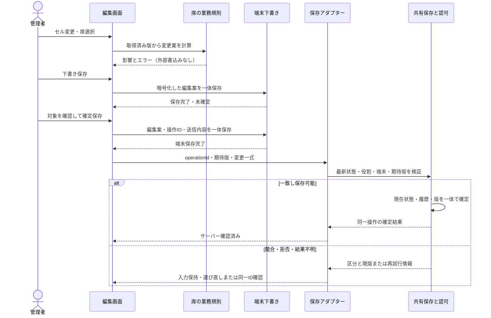

# 会場席作成・席設定の詳細設計

## 要点

状態：**In Review**。論理契約と検証計画はレビュー承認済み。追加の限定結果は個別レビューする。物理保存方式と依存契約の確定は未完了。本番実装・試験は未実施。

- セルID・座席ID・表示番号を分け、採番や席替えでも対象を保持する。
- 編集案は画面内で計算する。下書きは端末保存、共有と確定は別操作（承認済みCONF-074）。交換は両者を一体で確定する。
- 発券後は移動・交換のみ。通常の席替えはQRを維持し、未設定化は不参加処理で旧QRを無効化する（承認済みCONF-070）。

**未決定：** [#101](https://github.com/EU0207/concert-reception-system/issues/101)のGD91-01～14の限定結果はレビュー承認済み。[GD91-15](#gd91-15-初期準備の中断破棄と再作成)で作業世代を分け、削除せずに初期準備を中断・再作成する候補を限定確認した。列設定の初期生成・採番順と全編集との接続は未完了。物理方式の採否を確定するまで保存実装を開始しない。

**業務回答：** [CONF-071](#conf-071-業務回答と変更設計)で2点を承認済み。交換理由は初回本番受付開始前は不要、開始後は停止中も必須。番号・位置の個別編集は理由付きでお客様未割当席だけに許可する。行列拡張と舞台左／上の技術設計は引き続きIn Review。

**区画と印刷：** [CONF-072](../ui-mock/ui-mock-client-response.md#conf-072-自由な区画名と区画単位の印刷)を正式回答として受領。自由な名前の区画ごとに座席表を作り、1区画A4横1枚とする。左上に区画名、フッターに「現在ページ/総ページ」を表示する。技術設計とT31・32はIn Review。

**当日の個別追加：** [CONF-073](../ui-mock/ui-mock-client-response.md#conf-073-横方向の拡張と当日の個別追加席)で非席4種別からの席追加を受領。横方向の拡張も対応する。既存番号を保持する手入力席と緊急表示を設計する。2026-10-06にCONF-073-C・Dの推奨案承認を受領。枝番・文字を許可し、緊急表示は席構成の変更に限定する。タップ時に理由も表示する。技術設計はIn Review。

**全体スライド：** [CONF-075](../ui-mock/ui-mock-client-response.md#conf-075-座席表全体のスライド)の当初の業務条件は承認済み。CONF-075-Cによりスライドの理由入力・保存を不要へ訂正。[操作契約](#座席表全体のスライドconf-075)とT42～45の計画はPR #119でレビュー承認済み。GD91-08の計算結果と理由不要への訂正はPR #120でレビュー承認済み。GD91-09の限定結果と次の比較方針はPR #121で承認済み。GD91-10の移動量保存の限定結果はPR #122で承認済み。GD91-11の初期集計の限定結果はPR #123で承認済み。GD91-12の同一区画内のID重複拒否はPR #124で承認済み。GD91-13の同居方式の課題と採用非推奨はPR #125で承認済み。GD91-14の検査分担による効率化はPR #126で承認済み。GD91-15で初期準備の中断・再作成を限定確認。方式の採否、画面と本番試験は未完了。

| 確認箇所 | 確認する内容 |
|---|---|
| [データ・採番](#dd-91-02-データ契約と不変条件)、[採番例](#架空例) | 席／欠番／空間を区別し、逆順でもIDと列名順を保つか |
| [席設定](#dd-91-04-席設定取消し交換)、[異常時](#dd-91-06-画面状態と異常時) | 発券済みの保護、片側交換の拒否、失敗時の入力保持が具体的か |
| [開始条件](#dd-91-08-実装順と承認ゲート)、[試験ケース](#dd-91-09-試験ケース) | 未確定の保存方式と依存契約を開始条件にし、各操作の期待結果を追跡できるか |
| [隔離検証結果](#gd91-01-隔離検証結果2026-10-06) | 500人案の参照上限超過と、世代切替の検証範囲・残作業を区別できるか |

## この文書について

| 項目 | 内容 |
|---|---|
| 目的 | Issue #91の承認内容を、データ契約、操作と異常時へ展開し、試験ケースを同じ文書で追跡する |
| 読者 | 開発者、設計担当者、テスト担当者 |
| 関連Issue | [#91](https://github.com/EU0207/concert-reception-system/issues/91)、[#93](https://github.com/EU0207/concert-reception-system/issues/93) |
| 設計ID | DD-91-01～DD-91-09 |
| 状態 | In Review |
| 承認情報 | 2026-10-06、開発者がPR #109の内容コミット`83c74a81c0cfec28f08e801add24651d4d60ac71`をレビュー承認。論理契約・操作条件、試験条件とタスク分割（#101の検証計画を含む）が対象。物理保存方式・ADR-007の採否は検証後に確定し、設計全体の完了と区別する |
| PR #113承認 | 2026-10-06、開発者が内容コミット`483692d43433212aff4a479f8d508de8373a6d6e`をレビュー承認。限定検証結果、CONF-074の端末下書き契約・操作と試験条件、段階分割が対象。共有確定の物理方式採用、未実施試験の合格と設計全体の完了は含まない |
| PR #114承認 | 2026-10-06、開発者が内容コミット`0676d4b4323b60f19d4226e7be08b1d59f7532c3`をレビュー承認。GD91-02の限定検証結果と候補Eの優先検証方針が対象。物理方式の採用、残作業の完了と本番試験の合格は含まない |
| PR #115承認 | 2026-10-07、開発者が内容コミット`d49dc816c6707700b1c2cadff6a13f8e1ec9084e`をレビュー承認。GD91-03の個別編集の限定結果と構成文書の容量課題が対象。構成集約文書をそのまま採用せず分割を検証する。物理方式の採用と本番試験の合格は含まない |
| PR #116承認 | 2026-10-07、開発者が内容コミット`24ecbbe2315a1a3d3cffc1b0c353d0b37f0d3b7d`をレビュー承認。GD91-04の構成分割と一体確定の限定検証が対象。物理方式の採用、残作業の完了と本番試験の合格は含まない |
| PR #117承認 | 2026-10-07、開発者が内容コミット`0fbdab3e51fd8a8d8a504e752e6c7d99b8de2692`をレビュー承認。GD91-05の軽量版と構成差分受信の限定検証が対象。物理方式の採用、合同Rulesと端末復帰の完了、本番試験の合格は含まない |
| PR #118承認 | 2026-10-07、開発者が内容コミット`b81b1a7dc3264b75f3aae3d2d29a34834e63bf72`をレビュー承認。GD91-06の席構成と席設定の合同検証が対象。物理方式の採用、初期作成・券QR・正式認証の完了と本番試験の合格は含まない |
| PR #119承認 | 2026-10-07、開発者が内容コミット`995d5470fc54b35b0827c5f9ad934201c7fd2b36`をレビュー承認。GD91-07の初期作成・拡張の計算結果、CONF-075の操作契約・試験計画とタスク追跡が対象。設計文書のMarkdown記法整理も含む。スライド計算候補・物理保存方式の採用と未実施試験の合格は含まない |
| PR #120承認 | 2026-10-07、開発者が内容コミット`5b064ce8084bfcd184642d80fe05607bb9fcdca7`をレビュー承認。GD91-08の全体スライド計算の限定結果と、CONF-075-Cの理由入力・保存を不要とする仕様訂正が対象。既存席の緊急追加理由は保持。物理保存方式の採用と未実施試験の合格は含まない |
| PR #121承認 | 2026-10-07、開発者が内容コミット`66b5da5f6e1835e30532ea7871ee048f1604821e`をレビュー承認。GD91-09の世代保存境界の限定結果と、全件複写の採用非推奨・移動量保持候補の比較方針が対象。保存方式の採用と未実施試験の合格は含まない |
| PR #122承認 | 2026-10-07、開発者が内容コミット`0c04d0eb63542ecf2e097b59216f9d6c59e94bc3`をレビュー承認。GD91-10の移動量保存の限定結果と、1要求・2書込みの候補を優先する方針が対象。初期集計と全編集への接続は未検証。保存方式の採用と未実施試験の合格は含まない |
| PR #123承認 | 2026-10-07、開発者が内容コミット`9f0758aa5075d0a7bfb3938d6b59779d4a316c90`をレビュー承認。GD91-11の初期集計と移動量保存への接続の限定結果、区切りをまたぐID重複の既知制約が対象。初期構成全体の保証と全編集への接続は未完了。保存方式の採用と未実施試験の合格は含まない |
| PR #124承認 | 2026-10-07、開発者が内容コミット`fccabf49c8cf5f030a4e955ba2bb72921e89d158`をレビュー承認。GD91-12の初期集計と同一区画内のセル・座席ID重複拒否の限定結果、正式なSeat参照検査の未実装が対象。初期構成全体の保証と全編集への接続は未完了。保存方式の採用と未実施試験の合格は含まない |
| PR #125承認 | 2026-10-07、開発者が内容コミット`8970e0410f05eebd4df15138ebb9a52b8dff70a6`をレビュー承認。GD91-13の自動Seat対応の限定結果と計算量・初期保存効率の課題、単純な1セル保存の採用非推奨が対象。列設定の初期生成と採番順は未保証。初期構成全体の保証と全編集への接続は未完了。保存方式の採用と未実施試験の合格は含まない |
| PR #126承認 | 2026-10-08、開発者が内容コミット`be2d004110c864f6f465d558156ff7ef2715cd42`をレビュー承認。GD91-14のセル・席属性の検査分担と初期保存の効率化の限定結果、分離候補を優先して合同検証する方針が対象。準備片の破棄・再作成、列設定の初期生成・採番順と全編集への接続は未完了。保存方式の採用と未実施試験の合格は含まない |
| 照合基準 | main `b88afb41c28d75ac900362072353a4dd7c50f351`。PR #88は2026-10-03に統合済み、統合コミット`67312c9ed7f915cb01e48336e30f8a98c27fa3fd` |
| 対象 | 公演ごとの会場席作成、席設定、表示名変更、移動・交換、帳票用データ契約 |
| 対象外 | 本番コード、外部環境構築、公開、画像登録基盤、発券基盤、受付・来場状態訂正の実装 |

設計と試験ケースは本書へ集約し、実装分割と依存順は親Issue #91を正本として管理する。タスクごとに同じ内容の文書を追加せず、関連IDで追跡する。

本書と技術的な試験資料のレビューは開発者・設計担当者・テスト担当者が行い、技術上の承認判断は開発者が行う。依頼者には未決定の業務判断だけを平易に説明して確認し、詳細設計全体の技術レビュー・承認は求めない。承認済みの業務回答は維持し、再確認しない。

業務判断DD-91-B01は2026-10-03の[CONF-070](../ui-mock/ui-mock-client-response.md#conf-070-発券後の席設定解除)で解決した。2026-10-05のCONF-071でDD-91-B02・03も推奨案の承認を受領した。

## CONF-071 業務回答と変更設計

状態：**業務回答はApproved、技術設計はIn Review**。[依頼者の回答](../ui-mock/ui-mock-client-response.md#conf-071-席交換の理由当日の構成編集舞台位置)で理由の時点と編集対象を確定した。交換の旧「発券後は理由必須」は以下の時点判定に置き換える。「当日は個別追加のみ」「舞台左端」は行列拡張と舞台選択の変更前条件として照合し、変更後の実装根拠にしない。

| 変更案 | 保持する条件 | 確認・具体化する箇所 |
|---|---|---|
| 初回本番受付開始前の交換は理由不要、開始後は理由必須（停止中も維持） | 両者確認、版確認、両席の同時確定、QR・受付実績の保持。理由なしでも変更履歴は残す | DD-91-B02は承認済み。空席への移動・表示名変更の理由条件は維持 |
| 当日も行列を増やして席を追加 | 割当済みの番号とID、既存席との対応を保持。オンライン、主担当・代理、影響確認、端末更新を維持 | [拡張案](#行列拡張の変更案conf-071)。縮小や全席の再採番を許可するものではない |
| お客様未割当の席だけ、理由付きで番号・位置を編集 | 他の割当済み席を動かさず、履歴を保持 | DD-91-B03は承認済み。お客様への単独解除や固定解除ボタンを新設せず、CONF-070を維持 |
| 舞台を左／上から選択 | 席ID、番号、採番方向は舞台位置と独立。席番号は名前枠の左隣を維持 | [データ案](#舞台位置の変更案conf-071)、画面とPDF・Excelの共通投影（#108） |

DD91-T26～30は変更の試験案。T29は理由時点、T30は未割当席編集を分けて確認する。本番試験は全件未実施である。

## DD-91-01 正式情報との照合

| 根拠 | 承認済み条件と適用先 | 具体化する設計 | 試験 |
|---|---|---|---|
| [REQ-F-035・038・039](../../client/requirements.md)、[AC-025](../../client/acceptance-criteria.md) | 任意開始番号、欠番の補完禁止、舞台左端、階・区画と画像の連動。主担当・代理による会場照合 | DD-91-02・03・06 | T01～06、T19、T24 |
| [REQ-F-036、AC-026](../../client/acceptance-criteria.md)、[RES-005](../technical-validation/res-005-seat-allocation-desk-review.md) | 一般席、最大10人、人数降順、連続席、手動分割後の固定、発券後の自動配置禁止 | DD-91-04 | T07～10、T25 |
| [REQ-F-007・043、AC-003・035](../../client/acceptance-criteria.md) | 変更履歴、購入者名と表示名の分離、表示名6文字、旧受付の保持 | DD-91-02・04 | T11～13、T20 |
| [REQ-F-004、AC-002・022](../../client/acceptance-criteria.md) | 通常の座席変更ではQRを維持。紛失再発行とは分離 | DD-91-04・07 | T12、T20 |
| [REQ-F-045、AC-037](../../client/acceptance-criteria.md) | 同じ確定構成からPDF・Excel、舞台左端、席番左隣、確保席ラベル、A4横1ページ | DD-91-07 | T23 |
| [BD-02-02～05・09](../basic-design/logical-data-model.md) | ID分離、変更不能イベント、公演分離、不変条件 | DD-91-02・05 | T14～18、T21 |
| [BD-03-01・04・07](../basic-design/offline-sync-conflict-design.md) | 明示保存、基準版比較、オンライン限定座席変更、同一ID再試行、未更新端末の運用 | DD-91-05・07 | T14～18、T21～22 |
| [BD-04-04・07](../basic-design/authentication-authorization-design.md)、[BD-05](../basic-design/security-privacy-design.md) | 公演役割と端末認可、閲覧データ分離、直接API拒否 | DD-91-05・06 | T17～18 |
| [BD-06-01・08・10・15](../basic-design/screen-flow-wireframe-design.md)、[BD-07-08](../basic-design/file-output-report-design.md) | 未保存離脱、写真参照、キャンバス、当日個別追加、帳票共通構成 | DD-91-03・06・07 | T19、T22～24 |
| [引継ぎ台帳](../ui-mock/ui-mock-production-handoff.md) FB-08・09・14／MCT-08・09・14、CONF-061 | 初期「未」、5種別、番号消費、逆順、配置済み保護 | DD-91-02・03 | T01～06、T13 |
| 同台帳 FB-10・19・30／MCT-10・19・30、MCT-34、CONF-062 | 表示名・交換・取消し、未入金を禁止理由にしない、不参加、フォーカス、席設定の名称 | DD-91-04・06・07 | T07、T11～13、T19～21、T24 |
| 同台帳 MHD-03・05 | 座標と帳票共通構成、#93の取消し原子性、旧QR、履歴 | DD-91-02～07 | T14～18、T20～23 |
| CONF-072、REQ-F-035・038・045、AC-025・037 | 自由な区画名と独立した座席表、1区画1枚、左上名称とページ数 | DD-91-02・03・07 | T31・32 |
| CONF-073、REQ-F-035・038、AC-025 | 非席からの個別追加、手入力席と自動採番の分離、緊急表示。C・Dは推奨案承認済み | DD-91-02・03・05～07 | T04、T22、T27、T33～36 |
| CONF-075、REQ-F-035・038、AC-025・026・032 | 未の外周を使う全体スライド。当日も主担当・代理がオンラインで一括確定。CONF-075-Cで理由入力・保存を不要へ訂正 | DD-91-02・03・05～07 | T42～45 |

Txxは[本書の試験ケース](#dd-91-09-試験ケース)の`DD91-Txx`を指す。REQ-F-044・046、REQ-NF-013・014・020とAC-032・036・038を関連条件として維持する。来場状態の訂正はREQ-F-041・AC-029の別操作とし、席替えで受付実績をリセットしない。

### 旧本文との相違

基本設計の「座席・スペース」の2種別へ5種別を追加するが、座席以外をQR・割当の対象へ広げない。BD-07-08の「欠番はセル自体を生成しない」は、編集用欠番セルを永続化しない意味には使わない。編集座標は保持し、帳票では座席枠を描画しない。これはCONF-060の追補の適用である。

モックの1～30セルと74×72pxは確認用の値である。本番の上限・初期値・実機寸法の承認根拠には使わない。新規入力の推奨初期値はモック同様5×8とし、変更可能とする。1～30は暫定技術上限案であり、DD-91-T01の容量確認後に採否を決める。席数上限を来場者500人から逆算しない。

## DD-91-02 データ契約と不変条件

以下は製品に依存しない型の案である。IDは不透明なUUID v4とし、すべての公演所属レコードに`environmentId`と`performanceId`を持つ。購入者名や席番号をキーにしない。

| 型 | 項目・検証 | 意味 |
|---|---|---|
| LayoutSection | `sectionId`, `name`, `floorId?`, `displayOrder`, `rows`, `columns`, `axis: horizontal/vertical`, `seatOrder: forward/reverse`, `lineSettings[]`, `cells[]` | 自由な区画名と区画ごとの構成。座標は0始まり、画面は1始まり。舞台は左端の別表示要素 |
| LineSetting | `lineId`, `index`, `name`, `prefix`, `startNumber`, `nextAutomaticNumber`案 | 横なら行、縦なら列へ対応。開始番号は正の安全整数、接頭部と列名は英字・数字を扱う。接頭部と列名は分離。次番号は手入力席の追加では進めない |
| LayoutCell | `cellId`, `row`, `column`, `kind: unset/seat/gap/space/aisle`, `seatId?`, `consumedNumber?` | 位置と種別。gapは番号を消費し、手入力席へ変更しても消費番号を保持。space・aisle・unsetは番号なし |
| Seat | `seatId`, `sectionId`, `lineId`, `numberingMode`, `prefix?`, `number?`, `manualNumber?`, `displayOrder`, `category`, `usable`, `reservedLabel?`, `emergencyChange?`案 | automaticは接頭部＋整数、manualは別の表示番号。枝番・文字を許可。緊急表示は新設・番号・位置変更だけ。categoryは従来区分を維持 |
| SeatAssignment | `attendeeId`, `seatId`, `groupId?`, `fixed`, `revision` | 一人一席の現在関係。座席表示名はAttendee側に持ち、セルへ氏名を複製しない |
| Attendeeの参照項目 | `attendeeId`, `buyerId`, `rosterOrder`, `groupId?`, `attendancePlan`, `seatDisplayName` | #93・97と共通契約。購入者IDとグループIDは別。同名からIDを統合しない |
| Ticketの参照項目 | `ticketId`, `attendeeId`, `issued`, `sent`, `activeCredentialId`, `revision` | 発行チェックが未済でも有効QRまたは発行履歴があれば発券済み保護を外さない。#93・95で実体定義を整合させる |
| SeatEditCommand | `operationId`, `kind`, `expectedVersions`, `actorId`, `deviceId`, `beforeRefs`, `after`, `reason?` | 編集開始時の版を保持。確認画面の内容と送信内容を一致させる |
| SeatEditEvent | BD-03共通イベント項目、`operationId`, `before`, `after`, `groupEffects`, `result` | 確定した前後差分を追記。取消しは元イベント参照を持つ新イベント。QR生値は含めない |
| SeatMapProjection | `schemaVersion`, `layoutRevision`, `assignmentRevision`, `attendeeRevision`, `ticketRevision`, `sections`, `counts` | 一貫した確定版から画面・帳票を生成する共通入力。購入者名と任意項目を含めない |
| 公演管理の参照項目 | `performanceId`, `controlRevision`, `firstReceptionStartedAt?` | 初回本番受付開始の時刻。未開始はnull。一度設定した値は受付停止で消さない。席保存の期待版に公演管理版を含める技術案 |

本節のセル座標と列indexは、画面・帳票へ渡す論理上の位置を示す。GD91-10では保存済みの基準座標と区画の移動量から論理位置を作る候補を検証する。両者を混同して移動量を二重適用しない。保存構造の採用は未決定。

空欄の階・区画は表示上の「指定なし」へ対応させ、内部のsectionIdは必須とする。表示名の改行は保存値へ追加しない。文字数はUnicodeコードポイント単位とする技術案で、半角・全角空白を除いた1～6文字を検証する。未入力は許容し、空欄のままなら席設定時に略称入力を案内する。空白なしは3文字ごと、空白ありはその位置で2行表示する。空白が多く3行以上になる入力は保存値を保持し、表示では空白を除いて3文字ごとに折り返す案とする。切捨てはしない。

### 自由な区画名と独立した座席表（CONF-072）

区画名は「1階」「前方席」「バルコニー」等の自由入力とし、「○階」という書式や階番号を必須にしない。`name`は表示用、`sectionId`は変更しない識別子とする。名前変更で座席IDと割当を作り直さず、同名から区画を自動統合しない。`floorId`がある既存構成も保持し、名称だけから階や画像の対応を推測しない。

「新しい区画を作る」で新しいsectionIdを発行し、その区画の行列をunsetから作成する。他区画の席設定をコピー・削除せず、区画切替では既存構成を読み込む。切替時の未保存確認と、オンライン・役割・版確認は既存の席編集に従う。旧データの名前未指定は「指定なし」と表示し、新規作成時の未入力・空白だけは修正を案内する。名称の長さと構成容量の上限はGD91-01で具体化し、保存前とサーバー側で同じ検査を行う。

### 舞台位置の変更案（CONF-071）

LayoutSectionへ`stagePosition: left | top`を追加する案とする。既存データはleftとして読み、上への切替でセル座標や採番方向を回転・交換しない。区画ごとの確定値をSeatMapProjectionへ渡し、会場編集・当日閲覧・帳票で共用する。未保存の位置は確定帳票へ反映しない。舞台は座席セルと別の表示要素であり、席数を増減させない。

DD-91-B03の承認を踏まえ、個別編集の許可は最新の未割当状態で判定する。追加の`geometryEditable`フラグや専用の固定解除状態は設けない案とする。実会場で変更可能な対象を管理者が画像と照合し、旧新番号・位置を確認する。

自動席の表示番号は接頭部と整数番号を連結して作る。初期の接頭部は列名と区切り文字`-`から生成し、A列・開始1なら`prefix: A-`と`number: 1`から`A-1`を表示する。実会場に合わせた接頭部を明示変更できる。自動採番時のgapのconsumedNumberと自動seatのnumberは同じ採番結果から取得する。手入力席はmanualNumberを表示し、表示文字列を内部キーにせず、自動採番の整数へ変換しない。

### 不変条件

1. 同一区画の座標とcellIdは重複しない。既存セルの移動でIDを変えない。削除したセル・座席のIDを別の席へ再利用しない。
2. seatセルだけがSeatを参照し、一つのSeatは一つのセルに対応する。seat以外は割当・チケット・QR資格を持たない。
3. 自動席は従来の`公演＋階＋区画＋列＋接頭部＋番号`の一意性を維持する。CONF-073-Cに従い、手入力席との同一表示番号は同一区画・同一列で拒否する。同じ番号でも異なる区画は許容する。選択欄では階・区画を併記する。
4. 来場予定者一人に現在席は最大一つ、一席の現在割当も最大一人。不参加者は割当を持たない。
5. 確保済み・使用不可・特別席は自動配置から除外する。未割当の確保席にQRを作らない。
6. 入金状態を席設定の許可条件にしない。購入者名とQR資格を通常の表示名変更・席替えで変更しない。
7. 現在版と期待版が違えば業務変更を確定しない。理由付き操作の履歴、現在関係、版は論理上同時に確定する。
8. 履歴内の旧席・旧券状態は書き換えない。保持期限と削除はBD-02・BD-08へ従い、個人情報を恒久保持する別台帳は作らない。

## DD-91-03 作成・採番・構成変更

### 作成と採番

1. 既存区画を選ぶか、自由な名前の区画を新規作成し、縦横数を指定する。新規セルはすべてunset。個別選択、複数選択、矩形選択を可能とする。
2. セルを5種別へ変更し、横なら上から下の行順、縦なら左から右の列順へlineSettingsを対応付ける。
3. 各列の開始番号から、横は左→右、縦は上→下に走査する。reverseなら各列内だけ反転する。列名の並びとcellIdは変えない。
4. automaticのseat・gapで番号を1進める。manual席と他種別は進めない。通常の採番と当日の個別追加は分離し、表示番号の重複を検証する。
5. 変更前後の席番号、影響するお客様、件数をプレビューし、会場画像と実会場に照合して確定する。画像の自動解析は行わない。

CONF-073-Bにより、unsetは下書きと確定版の両方で非席として保持できる案とする。非席を受付・割当対象にはしない。自動採番の正数以外、範囲外座標、重複番号、数値オーバーフローは理由を示して拒否する。列名等の文字列上限はDD-91-T01で容量・既存席表との適合を検証し、未決のままアプリへ固定しない。

### 架空例

横方向A列、開始1、左からの入力が`席／欠番／空間／席／通路／席`の場合：

| 座標（行,列） | (0,0) | (0,1) | (0,2) | (0,3) | (0,4) | (0,5) |
|---|---|---|---|---|---|---|
| 通常順 | A-1 | 欠番2 | 番号なし | A-3 | 番号なし | A-4 |
| 逆順 | A-4 | 欠番3 | 番号なし | A-2 | 番号なし | A-1 |

実在席3、欠番1、空間1、通路1。自動配置対象は一般・利用可・未割当の席だけである。開始7なら通常順はA-7・欠番8・番号なし・A-9・番号なし・A-10。縦方向は同じ規則を列内へ適用する。

### 既存席の保護

| 対象 | 構成変更の扱い |
|---|---|
| 未設定の一般席 | 再採番案を表示し、確定までは旧版を維持する |
| 未発券の席設定済み席 | 自動では番号をずらさない。必要なら既存の確認付き席設定解除を先に確定する。最新の未割当状態を取得してから理由付き構成編集を行い、構成操作だけで割当を解除しない |
| 発券済み席 | 番号変更・種別変更・削除を一括操作で拒否する。個別の移動・交換へ案内し、元席構成の変更とは分ける。交換理由は初回本番受付開始の有無で判定 |
| 確保席・特別席 | ラベル・区分・利用可否を含む影響を確認する。割当があれば上記保護を適用する。空席でも区分を一般へ自動変更しない |
| 行列の縮小・方向変更 | 範囲外セル、変わる列対応、旧新番号を列挙する。影響解消なしに確定しない。発券済み対象があれば一括変更を拒否する |
| 当日運用中 | 全体再構成・全列逆順は禁止。主担当・代理による個別追加・変更だけをオンライン、理由付きで行う。既存セルと席番号を自動変更しない |

一部の保護席を避けて残りを黙って確定しない。操作全体を止め、対象を選び直して新しい変更案を確認する。当日の追加席は番号を明示入力し、欠番補完による新設とは扱わない。

### 行列拡張の変更案（CONF-071）

全体の再採番と、外周へ新しい行列を足す操作を分離する。行列の拡張案は既存セルの対応表と追加セルを生成し、確定前に番号の差分を表示する。既存cellId・seatIdと番号は維持する。割当参照と有効QRも変更しない。

| 追加方向 | 座標の扱い | 新しい番号 |
|---|---|---|
| 縦採番・上から | 下側へ行を追加。既存座標は不変 | 各列の末尾消費番号の次から、追加セルのseat・gapだけへ付与 |
| 縦採番・下から | 上側へ行を追加。既存rowを追加行数だけ一律増やす | 下側の既存席は不変。追加行を下から走査し、末尾番号の次から付与 |
| 横採番・左から／右から | 左からなら右側、右からなら左側へ列を追加。左側追加時は既存columnを一律増やす | 同じ規則を行内へ適用。既存番号を再計算しない |
| 採番列そのものの追加 | 新しいlineIdと列名・接頭部を指定。既存lineIdと列名を維持 | 新列の開始番号を指定。既存列と混ぜて採番しない |

新規セルはunsetとし、種別選択後に追加分だけ採番する。欠番は番号を消費し、空間・通路は消費しない。既存の欠番を自動で埋めない。拡張辺と列名は確認画面で明示し、割当済み席の相対配置を変える案を拒否する。

例：縦A列を下から採番し、上から`A-3／A-2／A-1`と並んでいる場合、上側へ1行追加してseatへ変更すると、上から`A-4／A-3／A-2／A-1`となる。旧3席のID・番号とお客様は不変。2行追加なら新しい上端がA-5、その下がA-4となる。これは原点の移動であり、旧3席どうしの距離・並びを変更しない。

当日の確定には理由と最新オンライン版を要求する案とする。構成版と共通投影を同じ確定境界で更新し、未更新端末はDD-91-07の更新確認を経て再開する。容量超過、座標・番号重複、旧版の要求は全体拒否し、旧確定版と入力を保持する。拡張後の上限とRules検証は#101へ追加する。

横採番の例：右から採番し、左から`A-3／A-2／A-1`と並ぶ行へ左側1列を追加してseatへ変更すると、左から`A-4／A-3／A-2／A-1`となる。左から採番する行なら、右側へ追加し`A-1／A-2／A-3／A-4`となる。縦と横の違いは走査軸だけであり、既存番号とIDを保持する条件は共通である。

### 座席表全体のスライド（CONF-075）

当初の業務条件はApproved。操作契約と試験計画はPR #119でレビュー承認済み。理由条件のCONF-075-Cへの改訂はPR #120でレビュー承認済み。計算候補の結果と保存方式の採否は別にレビューする。実会場の席を動かす操作ではなく、同一区画の格子内で余白を調整する。CONF-071-Cの割当済み席の個別位置編集は禁止を維持し、この例外を全体の平行移動だけへ限定する。

例：`A-1｜A-2｜未`を右へ1列ずらすと`未｜A-1｜A-2`。旧席どうしの並びと距離は変えない。追加セルの既定種別は未を維持し、スライドでは採番を行わない。

| 対象 | 操作・保持条件 |
|---|---|
| 範囲 | 選択中の1区画だけ。席・欠番と空間・通路を同じ量だけ動かす。一部の席だけを選んだ移動や区画間移動は対象外 |
| 方向 | 初期案は上下左右のボタンで1行／1列ずつ。採番方向と独立。移動先側の外周全体がunsetの場合だけ許可し、space・aisle・gapを空きと判定しない |
| 保持する席 | cellId・seatIdと番号、Seatの区分・利用可否と確保ラベルを保持。既存の緊急印・理由も保持し、余白調整だけで全席へ新しい印を付けない |
| 保持する関係 | 割当・券とQR参照、受付実績を変更しない。lineId・列名と次番号も対応する席へ追従。舞台left／topは座席セルと別の設定として維持 |
| 画面と保存 | 変更前後を表示して明示保存。未保存時は編集案だけ変更し、受付・発券と確定帳票へ混入させない。端末下書きはCONF-074に従う |
| 当日 | 主担当・代理とオンラインが必須。最新の役割・公演管理版と確定版で一括検査する。スライドの理由欄は設けず、理由を保存しない。操作履歴へ方向・移動量を記録。緊急席追加の用途を伝える理由は別操作として維持 |
| 拒否 | 外周に非未セルが1つでもある場合は全体拒否。無効な方向・斜め指定、旧版と権限失効も拒否。旧確定版・入力を保持し、自動で部分移動しない |

#### データと計算案

`SlideSeatMapCommand`案は`operationId`・`sectionId`、`direction`・`amount: 1`と`expectedVersions`を持つ。理由フィールドは設けず、下書き・確定要求とスライド履歴にもスライドの理由を保存しない。既存席の緊急追加理由は保持する。保存層で本人と端末を結合し、端末申告だけで許可しない。区画の行列数は変えず、全セル・全席のID集合も変えない。

当日の判定には公演日と会場タイムゾーンに基づくサーバー時刻を使う案とする。#111で公演管理版と共に検証する。端末時計や受付の開始／停止だけで当日判定を変えない。

1. 入力を複製し、移動先側の外周がすべてunsetで、座席参照・消費番号を持たないことを確認する。
2. 各セルの移動後座標を一時領域へ作る。非未セルは指定方向へ1だけ平行移動し、外周の未セルは反対側の空いた外周へ移す。重なった移動元を逐次上書きしない。
3. 採番列そのものが移る方向ではLineSettingのindexも同じ量だけ移す。外周の未列の設定は反対側へ移し、lineId・名前と次番号を作り直さない。
4. 座標の一意性とcell↔Seatの対応、旧席間の相対位置を検査する。保持対象の不変性を検査して変更案を返す。全セルが未で表示が変わらない場合は変更なしとし、保存要求を作らない。

これは移動後の論理座標を作る計算候補であり、全セルの保存値を書き換えることは要求しない。GD91-10では移動量から同じ論理結果を得る。未セルを反対側へ移すが、範囲外へ席を回り込ませる機能ではない。採番列が移る方向は、横採番なら上下、縦採番なら左右である。セルを座標へ固定して中身だけをコピーする案は既存cellIdの対応を変えるため採用候補にしない。計算候補の採否はT42・43の検証後にレビューする。

#### 保存と実装の追跡

GD91-06の個別編集Rulesを全体スライドへそのまま適用しない。GD91-09の全件複写は要求・書込み数が多いため、本番採用を推奨しない。#101ではGD91-10の移動量保存を優先候補とし、空き外周の集計を正しく作成・維持する条件を確認する。確定時は構成版と共通投影を同じ境界で更新し、未更新端末は差分更新完了前に本番受付へ戻さない。応答不明時は同一operationIdで結果照会し、再スライドや二重履歴を作らない。

実装は#102の計算と型、#104の保存、#105の画面の順に既存タスクへ組み込む。#108は同じ確定座標を画面・帳票へ渡す。対象技術設計のレビューと#101の保存成立性確認前には、本番コードを追加しない。T42・43の計算部分はGD91-08、保存の一部はGD91-09・10で限定確認。投影・画面結合と公演日判定、本番試験は未実施。

### 当日の非席セルからの個別席追加（CONF-073）

外周の末尾拡張とは別に、既存の空間・通路・未・欠番セルを個別にseatへ変更する。主担当・代理が最新オンライン版を取得し、実際に椅子を追加できる位置を会場と照合する。元の種別、位置と入力した席番を確認し、理由付きで確定する。対象cellIdは保持し、新しいseatIdを発行する。既存席を全体走査して再採番せず、他の席の座標・割当・QRを変更しない。

| 元セル | 個別追加の採番契約 |
|---|---|
| space・aisle・unset | 自動採番へ加えない手入力席として作成する。既存列の自動採番の次番号を進めない |
| gap | 元の消費番号を保持したまま手入力席へ変更する。元の番号は入力候補にできるが、勝手に席番を確定しない。消費番号を返却せず、後続の自動席をずらさない |

`numberingMode: automatic | manual`をSeatに加える技術案とする。手入力席の番号は自動採番用の整数とは分け、CONF-073-Cに従い、枝番・文字（例：`A-2a`、`臨時1`）を許可する。空白だけの番号を拒否し、前後空白を除いた表示番号で重複を比較する技術案とする。内部空白・全半角・英字大小は勝手に同一化せず、入力上限は#101で確定する。LineSettingに`nextAutomaticNumber`を保持する候補とし、初回採番と末尾追加でだけ進める。途中追加はこの値を更新しない。gapからの変更時は元のconsumedNumberを保持する。旧構成の次番号は変換前の自動席と欠番から求め、手入力値から逆算しない。次回の末尾追加で入力番号と衝突した場合も黙って改番せず、追加案を拒否して修正を案内する。

例：`A-1／空間／A-2／A-3`の空間へ手入力席を追加しても、A-1・A-2・A-3は不変で、自動採番の次番号はA-4のまま。`A-1／欠番2／A-3`の欠番をA-2の席へ変更した場合も、次番号はA-4のままになる。新しい席は位置順で表示し、番号の文字列順で周囲の席を並べ替えない。

CONF-073-Bに合わせ、unsetは「まだ席にしていない非席」として確定構成に保持できる案へ変更する。seatId、割当とQRは持たず、帳票・座席数・空席数へ含めない。kind未取得、参照欠落、seatセルの番号未入力をunsetとして扱うことは禁止する。非席から席への確定後にだけ件数と割当候補へ加える。席追加だけでお客様の登録・割当・QR発行は行わず、既存の各操作へ引き渡す。

自動採番と、お客様の自動席配置は別の処理である。numberingModeだけで手入力席への席設定を禁止しない。自動配置の可否は既存の区分・利用可否・固定・発券状態で判定し、連続席は列とセル位置から確認する。自由な番号の文字列順を使って隣接席を推測しない。公演中の発券済みグループの自動再配置禁止も維持する。

保存はセル・Seat・採番契約・履歴と版を一体で確定する。対象が既にseat、参照欠落、表示番号の重複、空白理由、旧版、同時追加は全体拒否し、入力を保持する。直接要求でも手入力席を自動席として偽装させず、他の番号と次番号の改変を拒否する。確定後は端末を差分更新待ちにし、更新確認後に受付を再開する。

### 緊急席の表示（CONF-073-D・E）

Seatへ公演単位の緊急変更情報を持たせ、構成版と一緒にSeatMapProjectionへ渡す。CONF-073-Eに従い、座席表では色等で区別し、「緊急」の文字を常時表示しない。タップした席の既存の選択席情報へ、緊急追加席なら「緊急追加です」と表示する。通常席にはこの説明を表示しない。変更席の説明は記録された変更種別に対応させ、追加された席と誤表示しない。CONF-073-Dの承認済み対象は当日の新設・番号変更・位置変更。選択時に、その変更の理由を種別の説明と一緒に表示する。

PCのクリック・キーボード選択でも同じ情報を確認できる案とし、色の違いが分かりにくい場合も選択時に区分を確認できる。空席／確保席等の区分と受付状態は維持し、タップ・閲覧だけで席・割当・受付記録を更新しない。通常の席交換と名前訂正では緊急印を新設・上書きしない。既に緊急印がある席も、その構成変更の理由を保持する。

技術案では「緊急の席追加・変更」の操作種別を明示し、`emergencyChange: { kind, operationId, markedAt, reason }`を席と一体保存する。本番受付開始後の構成変更は停止中も緊急操作として扱い、開始前の急遽対応も専用操作から記録できる。単に公演日へ到達しただけで全席へ印を付けない。変更種別と操作IDを履歴へ記録し、再読込み・差分更新で印を失わない。別公演への構成コピーでは当日の履歴・緊急印を引き継がない。印を外す操作は新設しない。

色等の区別と選択時の説明は会場編集と当日座席閲覧で共通とし、一般受付を含む座席閲覧では、現在表示する緊急構成変更の種別と理由だけを渡す。操作者や過去の管理履歴は配布しない。理由は会場・座席の変更内容を記載し、来場者の氏名や連絡先を含めない入力案内とする。

理由と履歴の不一致・空白理由を直接要求でも拒否し、Seat・共通投影・履歴を同じ確定境界で更新する。連続した構成変更では最新の対象変更を表示し、過去の理由は管理履歴へ残す。履歴参照権限を広げず、読取り用データの分離と入力上限は#101で検証する。印刷物への強調追加は本要望のUI対象とは分け、従来の帳票形式を維持する。

### 未割当席の番号・位置編集（CONF-071-C）

主担当・代理がオンラインで、最新の割当参照を両方向から確認して編集する。参照欠落は空席とみなさない。番号変更は一意性を検証する。位置変更の移動先は同一区画のunsetまたはspaceセルで、座席参照を持たないことを確認する。他の割当済み席を再採番・移動しない。

seatIdを維持し、番号・座標の前後と理由を確認して履歴へ保存する。移動元はspaceへ変更して番号と座席参照を外し、移動先はseatとして同じseatIdを参照する。両セルのcellIdは保持し、Seatの列参照も同時に更新する。他の席を採番し直さない。過去の発券・割当履歴だけで現在の空席を編集不可にせず、現行の参照を照合する。保存直前に別担当が席を割り当てた場合は全体拒否し、入力を保持する。理由の空白だけの入力、移動先の占有、番号重複も拒否する。

## DD-91-04 席設定・取消し・交換

| 操作 | 入力・検証 | 更新と確認 |
|---|---|---|
| 候補表示 | 来場予定・席未設定を対象。初期は入金済み、切替で未入金を含む全員 | 絞込・件数はメモリー計算。不参加は両タブから除外。切替で編集中の対象を失わない |
| 手動設定 | attendeeIdとseatId。利用可能席、重複なし、来場予定を確認 | 対象者・新席を確認し「席設定を確定」で保存。発券は別操作 |
| 自動配置 | 一般空席、グループIDと名簿順を入力。最大10人。固定済み・発券済みを除外 | RES-005の人数降順と候補順を適用。分割せず配置不能理由を示す。ランダムは生成済み順序を記録し再試行で変更しない |
| 手動分割 | グループ全員、必要席数、理由を入力 | 分割確認後に全員を固定。発券前だけ固定解除・再配置・直前状態への取消しを許可 |
| 表示名変更 | 購入者名と旧表示名を示し、6文字以内を検証 | 購入者名、購入状態、席、QRを維持。前後値を履歴へ。発券後・当日管理では理由必須 |
| 未発券の席設定解除 | 対象者と旧席。グループの場合は全員への固定影響を確認 | 席未設定へ戻す。SeatやAttendee本体は削除しない。通常の解除と直前操作取消しは別ボタン |
| 空席への移動 | 対象者、旧席、新席。相手なし | 旧席解放と新席割当を同時確定。発券後はオンライン版確認と理由必須、QR維持 |
| 二人の交換 | 両者・両席と公演管理の版を確認。初回本番受付開始前は理由任意、開始後は必須 | 両者の前後を確認し一操作で交換。受付停止でも理由必須を維持。片方だけ保存せず、QRと来場履歴を維持 |
| 発券後の席だけ解除 | CONF-070で単独解除を禁止 | 不参加処理を案内する。来場予定を維持する場合は通常の移動・交換を使う |
| 不参加・復帰 | #93へ委譲。入金と来場者記録は維持 | 不参加は席解放・現在券状態解除・QR無効化・履歴を一操作で確定。発券済みは独立2回確認。復帰は未設定・未発券から開始 |

発券済みの判定は固定チェックの表示だけに依存しない。券発行済みを手動で外しただけで発券前へ戻す抜け道を認めない。対象グループに発券済みが一人でもいれば、そのグループの自動再配置・固定解除・直前取消しを拒否する。

不参加者を含むグループは、残る来場予定者だけを黙って別グループに組み替えない。自動配置対象外理由を表示し、#93のグループ状態整理後に再判定する。必要な業務変更があれば#93の確認事項として記録する。

理由の判定は発券・開演時刻・当日の日付ではなく、初回本番受付開始の有無を用いる。`firstReceptionStartedAt`は初回の有効な「受付を開始」と同時に保存し、練習受付や失敗した開始要求では設定しない。停止や再開始では初回値を保持する。共有側でこの値と公演管理版を再確認し、端末が未開始と申告しただけで理由不要にしない。入力中に受付が開始された場合は保存を拒否し、入力を保持して理由の追加入力へ戻す。直接要求による初回値の消去・巻戻しも拒否する。実現方式は#101で検証し、公演開始基盤の具体的な依存Issueへ引き継ぐ。

## DD-91-05 保存・履歴・認可の境界

### 操作の流れ

### 端末下書きの保存と復元（CONF-074）

[依頼者回答CONF-074](../ui-mock/ui-mock-client-response.md#conf-074-座席編集の端末下書き保存)の業務方針は承認済み。以下の契約・操作と試験条件はPR #113でレビュー承認済み。共有確定方式と依存基盤は未完了のため、詳細設計全体はIn Review。本番実装・試験は未実施。入力ごとの自動保存は初期版の対象外とする。

| 操作 | 保存先・成功条件 | 業務への影響 |
|---|---|---|
| 下書き保存 | IndexedDBの保存トランザクション完了後に保存時刻を表示。Firestore読書き0 | 同じ端末・ブラウザーで再開。受付・発券・確定帳票には使わない |
| 下書きを共有 | 端末保存後、オンラインで共有下書きを保存。サーバー受領後に共有済みを表示 | 他の主担当・代理管理者が再開可。現確定版は不変 |
| 確定保存 | 端末保存後、最新の認可・期待版を検証し、一体確定の結果を確認 | 確認済みの新確定版だけを業務へ反映 |

保存先を選ぶチェックボックスは設けない。離脱時の「保存して移動」は端末下書き保存が成功した後だけ移動する。「保存せず移動」は最後の保存以降の画面変更だけを破棄する。保存済み下書きは取り消さない。

**端末データの契約**

| データ | 保持する項目・条件 |
|---|---|
| LocalSeatDraft | 環境・公演・本人・端末の識別子、draftIdとローカル版。編集対象区画と構成・席設定案を保持 |
| 復元条件 | 基準確定版群、保存形式のschemaVersion、保存時刻。時刻は表示用で、認可・競合の判定には使わない |
| PendingSeatOperation | operationId、操作種別、期待版群と送信内容の照合値。再送に必要な内容と結果確認状態も暗号化して保持 |

- 1本人・公演・端末につき編集中の下書き1件を管理し、複数区画をまとめて保存する。同じブラウザーの複数タブもローカル期待版で比較し、古い案の無条件上書きを拒否する。
- 既存の公演・端末専用非抽出CryptoKeyで暗号化する。暗号化を保存トランザクション前に終え、編集案と必要な操作記録を一体保存する。個別put成功だけで保存済みとしない。失敗時は直前の保存内容と画面入力を保持する。中断後は完全な旧版または新版だけを復元し、部分保存を成功扱いしない。
- 初回端末保存時に永続化を要求する。許可されない場合も保存成否と分離し、ブラウザーによる消去の可能性を案内する。保存領域不足・利用不能では成功表示しない。プライベートブラウザーを永続下書きの運用先にしない。
- 復元は同じ本人・端末で、既存の認証・役割・端末利用条件を満たす場合だけ許可する。復号後に形式・参照整合性を検証し、鍵欠損・破損・未知の形式を成功扱いしない。別利用者に渡さず、ログアウト時は復号済み値を消して保存データをロックする。
- オフラインでも既存の利用条件内で端末保存はできる。最新版を確認できない案は「共有状態未確認」とし、オンラインの共有・確定前に必ず再検証する。現在版が変わっていれば案を保持し、差分を確認して再計算する。自動上書き・自動結合をしない。
- 共有下書きの読込み時も既存の端末下書きを無条件に置き換えない。未保存変更の離脱確認を行い、選んだ共有版を端末保存してから再開する。
- 共有・確定の送信前に操作記録を端末保存する。保存失敗では送信しない。応答不明のまま再起動しても同じIDで結果を照会する。notFoundだけで別IDを発行せず、認可と基準版を確認して利用者が再試行する。照合済みの内容だけを受領・確定済みとする。
- 通信障害・無料枠上限・恒久拒否でも端末下書きを保持する。回線復旧では自動送信せず、結果照会と状態確認だけを行う。端末保存の変更と受付イベントの自動同期を混同しない。
- 確定成功後も下書きを確定結果と対応付けて保持する。明示的な破棄、締めまたは端末廃止で削除する際は未確定案の存在を示し、保存・共有または破棄を選ぶ。端末保存を選んだ場合は削除を保留し、共有を選んだ場合は共有受領を確認してから削除する。応答不明の操作記録と未受領受付は結果照合前に削除しない。別公演のデータと鍵には触れない。

端末故障、利用者の保存領域消去や最後の保存以降の変更まで保護する保証とは区別する。[保存完了の仕様](https://developer.mozilla.org/en-US/docs/Web/API/IDBTransaction/complete_event)、[永続化要求](https://developer.mozilla.org/en-US/docs/Web/API/StorageManager/persist)を参照。

以下の契約は端末保存と共有保存を分ける。共有・確定の物理方式は#101で継続検証する。

### アダプター契約

| 操作 | 入力 | 成功・失敗 |
|---|---|---|
| loadSeatContext | 環境、公演、既取得版 | 一貫した確定版と許可済み項目。版不変ならデータ本体0件 |
| saveLocalDraft | 端末利用主体、期待ローカル版、基準確定版と編集案 | ローカル版・保存時刻。完了後のみ成功、Firestore読書き0 |
| loadLocalDraft | 環境・公演・本人・端末、対応形式版 | 許可条件内の検証済み案または欠損・破損・非互換。自動共有しない |
| prepareSeatOperation | 端末下書き、operationId、操作種別と確認済み送信内容 | 下書きと操作記録の一体保存完了。失敗なら送信禁止 |
| shareSeatDraft | operationId、期待共有draft版、基準確定版と構成案 | 新共有draft版。現確定版は不変。一般受付へ配布しない |
| commitSeatEdit | operationId、確認済みcommand、期待版群 | committed版とeventId。競合・権限不足・検証不備は確定なし |
| getOperationResult | 環境、公演、operationId | committed / rejected / preparing / notFound。committedの内容一致時だけ既送信として扱う |
| getSeatMapProjection | 確定版群、出力用途、役割 | 同一版の構成と表示。下書き・途中版が混じれば生成拒否 |

期待版群には公演状態、役割、端末許可、構成、席設定、来場予定、チケットを含める。不参加・発券・役割変更が確認画面の後に起きても、古い確認で保存させない。無関係な別区画の変更で競合が多発する場合は版単位の縮小を後続検証で検討する。

### 物理保存案と未解決の成立性

[ADR-007](../decisions/ADR-007-seat-edit-commit-boundary.md)はProposedである。少人数の変更を単一Firestoreトランザクションで確定する候補と、一括変更を世代切替で公開する候補を検証する。下記は候補パスであり、採用済みスキーマではない。

| 候補パス（公演配下） | 保存内容・公開範囲 |
|---|---|
| seatState/head | 構成版、席設定版、基準版と最終操作ID。購入者名なし |
| layoutSections/{sectionId} | 自由な区画名、座標、5種別、番号、固定ID、区分。来場者名・購入者情報を入れない |
| assignments/{attendeeId} | 一人の現在席と固定状態。逆参照をseats/{seatId}と同時更新 |
| seats/{seatId} | 現在割当参照、番号、区分、版。席ごとの排他確認 |
| seatDrafts/{sectionId} | 主担当・代理だけが読める共有下書きと基準確定版 |
| seatOperations/{operationId} | 期待版、操作種別、処理状態、結果版、内容照合情報。氏名なし |
| events/{eventId} | DD-91-02の前後差分。履歴の権限と保持期限を適用 |

通常の移動は一人と旧新席、交換は二人と二席を同時更新する。不参加は#93の来場予定・券・QR・席・履歴を同じ確定境界へ含める。再送時はoperationIdと業務内容を照合し、同じIDの別内容は拒否する。トランザクション内でUI更新や乱数再生成をしない。

従来案の500人配置は、双方向参照だけで最低1,000参照となり、Rulesの要求単位20参照を超える。文書容量が収まっても同じ方式を適用しない。少人数操作も、本番の全業務条件を含めて再算定する。名前を含む大きな一文書案は閲覧分離のため採用しない。

一括変更の候補は、変更不能な世代データを準備し、完了検証後にheadを切り替える方式である。固定席集合での完全性と割当の一意性は下記の限定検証で確認した。構成変更と番号の一意性は未検証。件数やハッシュの自己申告だけで確定を許可しない。無料条件や外部サービスを変える案は業務承認へ戻す。Cloud Functionsや代替基盤を先行追加しない。

DD-91-T01完了まで、本番保存の物理スキーマとRulesは未確定である。これは一般的な残存リスクではなく、保存実装と設計完了承認のブロッカーである。

### GD91-01 隔離検証結果（2026-10-06）

**結論：候補Aを500人の一括変更へ適用しない。候補Bは固定席集合で成立する可能性を確認したが、本番採用は未決定。#101は未完了である。**

#### 容量・保存手順・試験証拠と残作業

検証コードと再実行方法は[GD91-01](../../../poc/GD91-01/README.md)。Node.js 24.19.0、Firebase CLI 15.28.2、Firestore Emulator 1.22.0とJava 21を使用した。実Firebaseへの接続と依存追加はない。

##### 容量と公式上限

[容量証拠](../../../poc/GD91-01/artifacts/capacity-summary.json)は、UUIDを36文字、文字列を最大4バイトのUnicodeで評価した。評価値は区画名64、列名16、接頭部16、自由席番64、理由200コードポイント。製品の入力上限は未承認である。

| 候補Aの操作 | 文書数 | 文書本体の合計バイト | 最大文書バイト | 異なる逆参照先＋共有参照先 |
|---|---:|---:|---:|---:|
| 1人移動 | 6 | 6,297 | 1,771 | 3＋6＝9 |
| 2人交換 | 7 | 7,408 | 1,787 | 4＋6＝10 |
| 10人配置 | 23 | 30,464 | 4,571 | 20＋6＝26 |
| 500人配置 | 1,003 | 1,442,644 | 175,091 | 1,000＋6＝1,006 |

共有参照先は本人・端末認可3件と、headの前後・履歴の3件。表は異なる参照先の算定で、キャッシュ後の参照回数や少人数操作の本番合格を意味しない。容量モデルは操作結果と履歴を別文書とし、エミュレーターの最小モデルより1文書多い。

30×30セルの構成文書は171,130バイト。31×30は176,530、30×31は176,810バイトだった。拡張例の容量評価であり、31セルの製品上限を承認したものではない。複数区画の総量と索引容量は別途評価する。

公式上限は1文書1MiB、要求10MiB、Rulesは各書込み10参照・一体要求20参照。本体の合計を通信要求のサイズと同一視しない。索引更新と通信形式の追加量は未実測。[公式上限](https://firebase.google.com/docs/firestore/quotas)、[文書容量の計算](https://firebase.google.com/docs/firestore/storage-size)

候補Aの500人配置はエミュレーターで成功したが、最低1,000の異なる逆参照だけで公式上限を超える。エミュレーターは本番上限をすべて再現しないため、この成功を採用根拠にしない。[エミュレーターの制約](https://firebase.google.com/docs/emulator-suite/connect_firestore#how_the_cloud_firestore_emulator_differs_from_production)

##### 候補Bの固定席集合で確認した保存の流れ

検証では、既存の席集合とその件数が正しい初期状態を使用する。構成変更や初期状態作成の本番認可は含めない。

| 段階 | データと拒否条件 |
|---|---|
| 開始 | operationに基準世代・基準版と公演管理版を記録。予定件数は現在headと一致させ、自己申告による短縮を拒否 |
| 準備 | 連続したordinalごとに席entryと来場者memberを作成し、同時にprocessedを1だけ進める。旧ID・番号・緊急情報を保持。同じ来場者memberの二重作成を拒否 |
| 検証 | 全entry完成後に旧席を順に確認し、既存の来場者が新世代から欠落しない場合だけverifiedを1進める。固定席の変更も拒否 |
| 公開 | 全件検証後、現在版と公演管理版を再確認。head切替・operation公開済み・最小履歴を同時保存。競合時は旧公開版を維持 |
| 閲覧 | 一般受付は現在headのentryだけを読む。準備世代、操作者入りoperation、管理履歴は取得不可 |

Rulesの認可は各文書で3参照。以下は関数内で取得を一度にまとめ、キャッシュを差し引かずに数えた最大参照回数である。追加の業務条件を入れたら再算定する。

| 一体要求 | 文書ごとの参照回数 | 合計 |
|---|---|---:|
| 1席準備 | operation 8、entry 5、member 6 | 19 |
| 旧来場者の保持確認 | operation 7 | 7 |
| 公開 | head 7、operation 6、履歴 6 | 19 |

500席では1,004回の保存要求、2,006文書書込みとなる。900席へ500人を割り当てる検証では1,804回・3,206書込みとなる。900件の固定集合の確認であり、30×30の座標・拡張を検証したものではない。通信遅延と無料枠への影響が大きいため、処理時間と読取り費用も採用条件にする。ローカル時間は[実行証拠](../../../poc/GD91-01/artifacts/emulator-summary.json)に残すが、実回線の性能保証には使わない。

##### 実施結果と本番試験との対応

24シナリオの結果を[実行証拠](../../../poc/GD91-01/artifacts/emulator-summary.json)に記録した。GD91-P04～07は候補Aの件数別観測であり、本番成立性の合格件数へ数えない。RESTの一体commitを使用し、SDKのトランザクション再試行は未検証。

| 本番ケースへの対応 | 限定検証で確認した内容 | 証拠ID |
|---|---|---|
| T14・16 | 片側割当を拒否、移動・交換の双方向整合。同時確定は一方だけ成功 | P01～03・P10・11、B06 |
| T16・18 | 欠落・件数偽装・途中公開・準備後改変・検証飛越・履歴欠落を拒否。固定900件の公開も確認 | B01～04・B09・12 |
| T17 | 停止端末・期限切れ・一般受付・未認証を拒否。停止端末による別端末の自己申告も拒否 | P08、B05・11 |
| T15 | 再送で公開版・履歴が増えず、操作結果を取得できる。同内容なら成功結果を返すアダプターは未実装 | B10 |
| T29 | 初回時刻をサーバー時刻で設定し、消去・巻戻しを拒否。停止相当の版更新で維持 | P09・12 |
| T35 | 一般受付へ現在理由だけを配布し、管理文書を拒否。新しい緊急変更の理由と履歴の一致は未検証 | B03・08 |

T27・30・33・34の構成変更は未検証。#93の席・券・QR・来場予定の一体確定も未検証。Bの最小履歴は公開事実だけで、正式な変更前後履歴の完成ではない。いずれも本番ケースを合格扱いしない。

##### #101を完了するための残作業

- 構成変更：行列拡張、個別追加、手入力番号の一意性と次番号保護を採用候補へ組み込み、直接改変を拒否する。
- 業務境界：来場予定・発券済み・QRと正式履歴を含める。本人証跡の作成、役割準備版と再認証の条件も確認する。
- 運用条件：区画数と入力上限、索引と読取り範囲、準備中断・旧世代の保持削除を具体化する。通信量と実回線性能を確認する。
- 技術判断：候補Eの正本と少人数・大量操作の業務条件を揃え、ADR-007の採否をレビューする。前提実装Issueの登録だけでは依存完了にしない。

### GD91-02 割当表集約の限定検証

**結論：固定席の割当は、少数変更も500人配置も一つの割当mapを正本にする候補Eを優先検証する。限定モデルは1要求・2文書書込みで成立した。構成変更・券とQRを含む本番採用は未決定、#101は未完了。**

#### データの流れ、18シナリオの結果と採用前の残作業

[GD91-02の再実行方法](../../../poc/GD91-02/README.md)。localhostのAuth／Firestoreをdemoプロジェクトで実行し、既存依存を使用した。実Firebaseへの接続と配信はない。2026-10-06の[実行証拠](../../../poc/GD91-02/artifacts/emulator-summary.json)は18シナリオ。本番の受入試験とは区別する。GD91-01の証拠は変更しない。

##### 正本と操作

| 対象 | 候補Eの契約 |
|---|---|
| 現在状態 | assignmentState/currentへ公演全体のseatId→attendeeId mapと版を保持。空席は空文字。お客様→席は取得済みmapから導出し、二重保存しない |
| 少数変更 | 変更した席フィールドと版を送信し、対象1～2席の変更前後履歴を同じcommitへ含める。UUIDキーはフィールドパスで引用する |
| 一括変更 | 同じmap全体と前後履歴を同じcommitへ含める。別の正本や公開世代を作らず、片側だけの確定を拒否する |
| 検証用の前提 | 既知の席ID・保護席ID、許可候補IDとその版を別文書へ保持。初期投入は隔離管理経路。本番で信頼できる作成・更新は未検証 |

Rulesはmapのキー集合と席ID集合を照合する。空席を除く値の件数と集合の件数を比べて重複を拒否し、許可候補以外のIDを拒否する。既割当者の欠落と保護席の変更も拒否する。[Mapのvalues・diff](https://firebase.google.com/docs/reference/rules/rules.Map)、[ListのremoveAll・toSet](https://firebase.google.com/docs/reference/rules/rules.List)を利用する。500人分の逆参照getを使わない。

少数変更も公演全体の割当版を比較する。異なる席への同時保存でも一方だけを確定し、他方は入力を保持して最新状態を再確認する。利用者の確認を省略して自動結合しない。

| 一体要求の内訳 | キャッシュに依存しないRules参照数 |
|---|---:|
| 現在状態 | 認可3、席・候補・公演管理3、履歴1＝7 |
| 履歴 | 認可3、変更前後の現在状態2＝5 |
| 合計 | 12。各操作10・一体要求20の上限内となる限定モデル |

[公式上限](https://firebase.google.com/docs/firestore/quotas)と静的な呼出し数を照合した。正式な認可や券更新を追加した後の数値は再算定する。集合処理を含む本番の評価回数・実回線性能までローカル成功で保証しない。

##### 容量と送信量

[容量評価](../../../poc/GD91-02/artifacts/capacity-summary.json)はUUID36文字、理由200コードポイントを最大4バイトで評価した。入力上限の承認ではない。

| 評価例 | 割当文書 | 前後とも500人を含む履歴 |
|---|---:|---:|
| 500席 | 37,358バイト | 75,188バイト |
| 900席・500人 | 52,558バイト | 105,588バイト |

この評価範囲では各文書1MiB未満。900席・UUIDでの実送信JSONは500人初回配置193,587バイト、1人移動1,600バイト（E18）。HTTPヘッダーと内部通信形式、索引容量を含む上限実証ではない。少数変更は変更席だけを送るが、Rulesは更新後のmap全体を検証する。一般端末への差分配布は別の未検証範囲とする。

| ケース対応 | 限定検証で確認した内容 | 証拠ID |
|---|---|---|
| T14・16・18 | 500人配置、1人移動、2人交換と10人配置を同じ正本へ保存。重複・未知ID・欠落、履歴偽装を拒否 | E01～07・13・16～18 |
| T14・17 | 異席への競合は一方だけ成功。席・候補・公演管理版の変更、停止・期限切れ、一般受付・異公演要求を拒否 | E08・09・11・14・15 |
| T15・29 | 受領履歴を照会でき、再送・履歴改変で版を増やさない。初回本番開始後の空白理由を拒否 | E10・12 |

##### 採用前に確認すること

- 業務条件：未発券取消し、グループの固定と発券保護、席・券・QRの一体変更を#93・112と照合する。検証用lockedSeatIdsをそのまま業務の固定チェックへ置換しない。
- 信頼できる前提：席・許可候補一覧の作成と変更を通常の業務更新へ結合する。本人証跡・役割準備版・再認証を含む参照数を再算定する。
- 構成と配布：行列拡張、手入力番号と次番号の保護、緊急理由、端末への差分配布を組み込む。割当mapの成功だけで構成変更を合格にしない。
- 運用条件：入力・区画上限、索引除外と履歴保持、SDK再試行・端末下書き復帰を具体化する。受付イベントの正本は割当mapへ移さない。

候補Eは単純な正本と一定数の文書参照を使えるため優先候補とする。前段の全席コピー型Bは予備候補に残し、通常の小変更へそのまま採用しない。適用する業務条件と差分配布が成立してからADR-007の採否をレビューする。

### GD91-03 個別構成編集と容量境界

**結論：既存セルへの席追加と未割当席の個別編集は限定検証できた。ただし、構成・番号索引・緊急理由を一つに集約した文書は、長い入力の評価条件で1MiBを超えるため、このまま本番採用しない。割当表E自体の採否とは分けて扱う。**

#### 構造、確認結果と残作業

2026-10-06、localhostのAuth／FirestoreでGD91-L01～18を実行し、期待結果を確認した。初期構成と本人証跡は管理経路で投入した。編集要求は端末Authで送信した。実行結果は[JSON証拠](../../../poc/GD91-03/artifacts/emulator-summary.json)、容量算定は[容量証拠](../../../poc/GD91-03/artifacts/capacity-summary.json)に保持する。本番試験の合格ではない。

##### 操作と保存境界

| 保存先・操作 | 限定検証の内容 |
|---|---|
| catalog/current | 既存900セル、600席の正しい初期構成。セルと席の対応、列別番号索引、次番号と現在の緊急情報を集約 |
| assignmentState/current | GD91-02と同じ考え方の割当表。構成追加では新席の空欄だけ追加。番号・位置変更では全割当を保持 |
| operations/{operationId} | 管理者だけが読む変更不能履歴。席と対象セルの前後値を保存。構成と割当表の基準版を検証 |
| 非席からの追加 | unset・gap・space・aisleからmanual席へ変更。番号を明示入力。gapの消費番号と全列の次番号を保持 |
| 未割当席の番号・位置変更 | seatIdを保持。番号変更はmanualへ、位置変更は同じ列の空いた既存セルへ。確保区分と利用可否を勝手に変えない |

番号索引は`lineId＋区切り＋表示番号`から重複を検出する補助データであり、席の識別子ではない。更新された索引だけを席の正本にしない。セル・席と索引を同時に検証する。別列の同じ表示番号は許可し、同一列の自動席と手入力席の衝突を拒否した（L03・18）。

処理は変更案の生成、変更したフィールドと履歴の送信、Rulesの一体検証の順である。未更新版、割当済み席の構成変更、他席への隠れた変更は全体拒否する。構成編集と割当操作を合同で処理する本番Rulesはまだ作成していない。

| 参照箇所 | キャッシュに依存しないget／getAfter回数 |
|---|---|
| 構成更新 | 認可3＋割当前後2＋公演管理1＋履歴後1＝7 |
| 割当表更新 | 認可3＋構成前後2＝5。構成更新が割当表の内容を検証する |
| 履歴作成 | 認可3＋構成前後2＝5。構成更新が履歴の内容を検証する |
| 合計 | 1要求・3文書書込み・17参照。正式認可と券を加える前の数値 |

追加1席の送信JSONは4,216～4,223バイト（L01）。フィールドマスクで変更席だけを送信しても、保存後の文書サイズは縮まらない。一般受付は現在の変更種別・理由だけを構成から取得できる。操作者と過去履歴は取得できない（L13）。差分配布の成立性は別途確認する。

##### 容量による採用制限

UUID36文字、900セルの1区画を評価した。番号64コードポイント、理由200コードポイントは検証用の仮条件であり、製品の承認済み上限ではない。4バイト文字を使用し、全対象席へ現在の緊急理由がある場合も算定した。

| 席数 | 緊急理由なし | 全席に緊急理由あり | 判断 |
|---|---|---|---|
| 600席 | 712,279バイト | 1,250,479バイト | 理由あり条件で1MiB超過 |
| 900席 | 966,679バイト | 1,773,979バイト | 理由あり条件で1MiB超過 |

算定は[公式の保存サイズ式](https://firebase.google.com/docs/firestore/storage-size)に従い、公式147バイト例でも照合した。[文書上限](https://firebase.google.com/docs/firestore/quotas)は1,048,576バイト。索引と通信容量は別である。短い入力でのエミュレーター成功を、この長い入力条件の保存成功と扱わない。

##### 試験ケースへの対応と次の確認

| 詳細設計の一部条件 | 今回の証拠 |
|---|---|
| T14・16～18 | 隠れた変更・片側保存・旧版を拒否。並行編集は一方だけ成功。異公演と失効権限を拒否（L06・09～12・16） |
| T30・33・34 | 未割当の番号・位置変更、4種別の手入力追加、既存番号・次番号の保持と偽装拒否（L01～05・07・14・17・18） |
| T35 | 現在の緊急情報と履歴の一致、空白理由拒否、一般受付の読取り分離（L08・13） |

本番ケース全体を合格にしない。次は以下を#101で検証する。

- 容量：列・セル群への分割、緊急理由の別文書化を比較する。参照数と原子性を再算定し、席数や理由を黙って制限して解決しない。
- 構成：初期作成、行列拡張と縮小、列を跨ぐ移動、舞台変更を追加する。手入力番号の正規化と製品上限も未決定。
- 結合：GD91-02との合同Rules、許可候補の更新と券QRの保護を確認する。本人証跡・再認証の正式認可も未検証。
- 運用：差分配布、SDK再試行と端末下書き復帰を確認する。画面操作と実機試験は未実施。

### GD91-04 構成の分割保存

**結論：構成を同じ列の30セル単位へ分割し、番号索引を共通版へ置く案を限定検証した。900セルを1列へ集中させた長い入力条件でも各文書は1MiB未満。分割後の個別編集は1要求・4文書書込みで成立した。正式認可・券結合と差分配布は未検証のため、本番方式の採用は未決定。**

#### 保存構造、試験結果と残作業

2026-10-07、localhostのAuth／FirestoreでGD91-C01～18の期待結果を確認した。前提データは管理経路で投入し、編集は端末Authで要求した。結果は[実行証拠](../../../poc/GD91-04/artifacts/emulator-summary.json)と[容量証拠](../../../poc/GD91-04/artifacts/capacity-summary.json)へ保持する。GD91-03の失敗条件と証拠は変更しない。

##### 構造と一体検証

| 保存先 | 役割 |
|---|---|
| head/current | 構成全体の版、最終操作IDと対象保存片。列別番号索引を保持し、保存片を跨ぐ重複を検証する |
| chunks/{chunkId} | 同じ列の30セルと対応するSeat。現在の緊急理由を保持する。30は保存単位の検証値であり、画面の列長を30へ制限しない |
| assignmentState/current | 公演全体の割当表を維持。新席は空欄だけ追加し、既存のお客様と席の対応は変更しない |
| operations/{operationId} | 共通版・保存片版と割当版、席とセルの前後値。操作者を含む履歴は管理者だけが読む |

30列×30セルと、1列×900セルを評価した。どちらも30個の保存片へ分け、1列900セルでは30個すべてを同じlineIdへ所属させる。セル・seatIdは保持し、画面と帳票の列を分割しない。初期分割の本番作成手順は未検証。

処理は変更案の生成、変更したフィールドと履歴の送信、head更新時の一体検証の順である。Rules参照を一定量へ保つため、認可と全内容検証をheadへ集める。他3文書は同一要求内のhead更新が必須で、別要求で確定済みのheadを流用できない。

| 検証対象 | キャッシュに依存しない参照数 |
|---|---|
| head更新 | 認可3＋保存片前後2＋割当前後2＋履歴後1＋公演管理1＝9 |
| 保存片更新 | head前後2。headで対象保存片IDと変更内容を検証 |
| 割当表更新 | head前後2。headで既存割当の保持を検証 |
| 履歴作成 | head前後2。headで履歴と実変更の一致を検証 |
| 合計 | 4書込み・15参照。正式な本人証跡・役割準備版等を結合する前の数値 |

単独更新を許すため認可を省略した方式ではない。headの認可・検証を通らない要求は全体拒否した（C03～05・14）。別保存片や余分な履歴を同じ要求へ混ぜる攻撃も拒否した。保存片作成と削除は検証用クライアントへ許可していない。

##### 容量と確認できた範囲

900席、UUID36文字、番号64コードポイントと理由200コードポイントを評価した。4バイト文字を用い、全席に緊急理由がある条件とする。これらは評価条件であり、製品上限の承認ではない。

| 文書 | 30列×30セル | 1列×900セル |
|---|---|---|
| 構成保存片の最大 | 49,938バイト | 49,938バイト |
| head | 288,656バイト | 288,656バイト |
| 500人の割当表 | 52,530バイト | 52,530バイト |

[公式のサイズ式](https://firebase.google.com/docs/firestore/storage-size)で算定し、公式147バイト例でも照合した。GD91-03の構成集約案の容量超過を、この評価範囲で回避できる。総保存量を減らす方式ではなく、文書を分割する方式である。索引・要求全体の上限と本番性能は保証しない。

| 詳細設計の一部条件 | 限定結果 |
|---|---|
| T14・16～18 | 4文書の不完全な組合せ14通りと、混入攻撃を拒否。異なる保存片への並行要求でも一方だけ成功。失効と異公演を拒否（C03～05・09・10・14・15） |
| T30・33・34 | 4種別からの追加、未割当の番号・位置変更、既存割当・次番号と確保区分の保持。別保存片の番号衝突とseatId再利用を拒否（C01・02・06～08・13・16～18） |
| T35 | 現在の理由と履歴の一致。一般受付は現在の種別・理由を読めるが操作者と履歴は取得不可（C11・12） |

追加1席の送信JSONは4,722～4,729バイト（C01）。headを丸ごと配布すると番号索引も送るため、この値を一般端末の受信量とは扱わない。軽い受信版文書と変更保存片の配布を次に検証する。本番ケース全体を合格にしない。

##### 採用前の残作業

- 構成：初期作成、行列拡張と保存片追加、片を跨ぐ席移動を確認する。入力・公演全体上限も未確定。
- 結合：GD91-02と合同のRules、正式認可と許可候補更新、券・QRを結合して参照数を再算定する。headの9参照を本番全操作の予算と見なさない。
- 運用：差分配布と版不変時の読書き、SDK再試行と端末下書き復帰を確認する。画面と実機試験は未実施。

### GD91-05 軽量版と構成差分受信

**結論：番号索引を管理用headへ限定し、各保存片の版を小さな一覧として一体保存する案を検証した。版不変時は一覧1件だけを取得し、本体取得・受信側書込みは0。未受信の複数更新も取りこぼさず、取得途中の版変更や失敗では旧状態を保持する。割当表の差分化と本番結合は未完了のため、方式全体の採用は未決定。**

#### 受信手順、主要試験と残作業

2026-10-07、localhostのAuth／FirestoreでGD91-C01～32を確認した。[実行証拠](../../../poc/GD91-05/artifacts/emulator-summary.json)と[容量証拠](../../../poc/GD91-05/artifacts/capacity-summary.json)を保存する。GD91-04の結果を上書きせず、本番ケース全体の合格とも区別する。

##### データと処理

| 保存先 | 追加・変更する契約 |
|---|---|
| head/current | 番号索引は管理者だけが読む。保存片ID別の版を追加し、変更対象1片だけの増分を検証する |
| versions/current | 保存形式版、公演・区画と配置条件。構成版・割当版・公演管理版と保存片版一覧を保持し、操作者・番号索引・履歴を含めない |
| 構成片・割当表・履歴 | GD91-04の一体検証を維持。軽量版を含む5文書の一部だけでは確定できない |

最後の変更片だけを示す案は、休止中に異なる片が更新されると欠落するため用いない。全片の小さな版一覧を比較し、途中の編集履歴ではなく現在の構成を復元する。受付イベントの履歴同期とは別の処理である。

1. 軽量版を読み、対応形式と公演を検査する。同じ版なら手元の確定データを再利用する。
2. 変わった構成片だけを一時領域へ取得する。割当版が変わった場合は現行の割当表1文書を取得する。
3. 軽量版を再取得する。前後一致と構成・割当の整合が確認できた場合だけ、一式を返す。
4. 途中で版が変われば一時領域を破棄して再取得する。検証では2回を上限とし、失敗や連続更新では旧状態を保持する。遅れて終わった旧要求で新版を置き換えない。

[受信処理](../../../poc/GD91-05/tests/receiver.mjs)は取得アダプターから分離した。旧状態の保持は受付再開の許可を意味しない。停止・更新確認と権限の運用条件はDD-91-07を維持する。

##### 確認結果と制約

| 条件 | クライアントが取得した文書数 |
|---|---|
| 初回・30片 | 軽量版2＋構成30＋割当1＝33 |
| 版不変 | 軽量版1。本体0・受信側書込み0 |
| 1片の更新 | 軽量版2＋変更片1＋割当1＝4。未変更29片は取得しない |
| 異なる2片の更新を見逃した後 | 軽量版2＋変更片2＋割当1＝5 |

これらはREST取得要求の数であり、Rules内の参照課金・再試行を含む本番利用量ではない。受信JSONの参考値は証拠へ記録し、SDKの通信量や当日20MB条件の合格とは扱わない。割当表は全体取得が残り、すべての業務データの差分化が完了したとはしない。

長い入力の900席評価で、軽量版は1,871バイト、管理用headは290,052バイト。構成片の最大49,938バイトと割当表52,530バイトを含め、評価範囲の各文書は1MiB未満。製品上限を確定する値ではない。

| 詳細設計の一部条件 | 限定確認 |
|---|---|
| T14・16～18・35 | 5文書の不完全な組合せ30通り、版一覧偽装と保護項目の改変を拒否。一般受付から番号索引・操作者履歴を取得不可（C03・05・30・31） |
| T22の更新完了判定の前提 | 版不変、見逃した更新と取得中の更新を再現。通信失敗・権限失効・未対応版では旧状態を保持。旧要求の遅延完了も拒否（C19～29・32）。端末永続化と受付再開・実機復帰は未検証 |

初稿では位置変更がRulesの1,000式評価上限で拒否された。既存席の不変項目は差分許可項目で保護し、新規席だけ全項目を検査するよう重複を整理した。修正版では正当操作と保護項目の改変拒否を確認した。参照数だけで成立判断しない。[公式の上限](https://firebase.google.com/docs/firestore/quotas)

キャッシュに依存しない参照数はhead10、他4文書は各2、合計18。headは単体上限に達している。正式認可・券と合同Rulesを追加できる余裕を示す結果ではなく、結合時に構造と評価量を再検討する。

##### 採用前の残作業

- 構成：初期作成、行列拡張・片追加と片を跨ぐ席移動。入力・公演全体上限も未確定。
- 結合：GD91-02の割当更新・正式認可と券QRを結合し、割当差分と共通版契約を確認する。参照数・式評価量と要求容量を再評価する。
- 端末：SDK、暗号化IndexedDBへの一体反映・再起動と下書き保持を確認する。画面・受付再開、対象実機と性能は未検証。

### GD91-06 席構成と席設定の合同検証

**結論：分割した席構成と割当mapを同じRulesへ結合し、500人の一括席設定を確認した。新設席への配置・交換と、その後の未割当席編集も一貫して扱える。構成だけの版と全体確定版を分け、席交換では構成片を再取得しない。単一区画の限定結果であり、券QR・正式認証と初期作成を含む本番方式の採用は未決定。**

#### 共通保存契約、主要試験と残作業

2026-10-07、localhostのAuth／Firestoreで48シナリオを確認した。構成・受信の回帰32件と合同検証16件を[実行証拠](../../../poc/GD91-06/artifacts/emulator-summary.json)へ保存する。前段の証拠と業務回答は変更しない。自動のRules・受信結合試験であり、実機・本番試験の合格ではない。

##### データと処理

| 対象 | 合同モデルの契約 |
|---|---|
| head/current | `revision`は席編集全体の確定番号。`layoutRevision`は構成変更時だけ増やす。操作領域をlayout／assignmentで区別し、席設定による構成・番号索引の改変を拒否する |
| assignmentState/current | 構成版を参照する割当mapが唯一の正本。許可候補版と公演管理版を最新値で確認する。新席は空欄追加、通常席操作では既存のお客様を暗黙に除外しない |
| versions/current | 全体確定版・構成版と保存片版一覧を含む保存形式版2。前後一致を確認して一式を受信する。未対応形式は反映しない |
| operations/{id} | 操作領域と全体確定の前後版を追加。構成の前後値または席設定の前後値を、実更新と一致させる |

構成変更は5文書、席設定は構成片を除く4文書を同じ要求で更新する。どちらも全体確定版で競合を検出し、異なる領域だからといって古い確認を自動結合しない。構成が変わらない席設定は、軽量版2回と割当表1件だけを取得する（J03）。割当表そのものの差分化は未完了。

headで認可と操作内容を検査する。割当表側で許可候補・軽量版の一致を検査し、軽量版と他文書も同じ要求内のhead更新を必須にする。head→割当表→軽量版の一部を省くと成立しない。検証を他文書へ分担しても、単独要求や過去の確定版への便乗は許可しない（C03・14、J04・14）。[合同Rules](../../../poc/GD91-06/firestore.rules)

##### 参照数と主要試験

| 要求 | head | 割当表 | 構成片／履歴／軽量版 | キャッシュ非依存の合計 |
|---|---|---|---|---|
| 構成変更 | 認可3＋割当前後2＋履歴1＋公演管理1＋構成前後2＝9 | head前後2＋軽量版1＋許可候補1＝4 | 各2、計6 | 19参照・5書込み |
| 席設定 | 認可3＋割当前後2＋履歴1＋公演管理1＝7 | 同上4 | 構成片なし。履歴と軽量版は各2、計4 | 15参照・4書込み |

GD91-05のheadへ許可候補参照も集めると単体上限を超えるため、軽量版の一致と許可候補の検査を割当表へ分担した。全体上限20に対し構成変更は19であり、参照数に大きな余裕ができた方式ではない。式評価を含む全操作の本番予算は未確定。

| 詳細設計の一部条件 | 限定確認 |
|---|---|
| T14・16・18 | 600席／900席へ500人を1要求で配置。席設定4文書の不完全な組合せ14通り、構成変更5文書の30通りを拒否。構成編集と席移動の競争は一方だけ成功（J01・04～09、C03） |
| T17 | 端末ごとの役割準備版を検査。不一致・別端末の未準備と一般受付への降格を拒否。本人証跡不一致・期限切れと停止端末も拒否（J10・11・15）。発行・追加準備の実処理は未検証 |
| T29・30・35 | 開始前の理由なし交換、開始後・停止中の理由必須を確認。新設席を配置し、割当済みの番号変更を拒否。交換で緊急印を変えず、お客様を別席へ移した後だけ番号変更可（J02・13）。券QRと初回受付開始処理は未検証 |
| T22の更新完了判定の前提 | 席設定では構成片0件、割当表1件を取得。旧版保持・途中更新・遅延完了拒否の回帰を確認（J03・16、C19～32）。画面と受付再開は未検証 |

500人配置の送信JSONは900席で200,002バイト。長い入力の容量評価は[算定証拠](../../../poc/GD91-06/artifacts/capacity-summary.json)へ保存する。30片・900席の軽量版は1,894バイト、構成片の最大は49,938バイト。headは変更禁止席IDを900件含め323,407バイト、割当表52,558バイト、前後履歴105,730バイト。評価文書は1MiB未満だが、製品上限・索引と通信量の保証ではない。

##### 採用前の残作業

- 構成：初期作成、複数区画と行列拡張。片追加・片を跨ぐ移動、入力・公演全体上限も未確定。
- 業務と認可：許可候補・変更禁止席の業務更新、券QRとグループ処理を結合する。本人証跡・端末準備の発行と再認証を含む#110～112の契約も未完了。
- 端末と予算：割当差分、SDKと暗号化IndexedDBへの反映・復帰を確認する。全操作の参照・式評価量と索引、対象実機の画面・性能は未検証。

### GD91-07 初期作成と行列拡張の計算検証

**結論：追加セルだけを採番する計算で、上下左右の拡張でも旧ID・番号と割当参照を保持できた。900セルを930セルへ拡張する例で500人の対応を保持した。25シナリオの単体試験であり、Firebaseへの確定保存と実際の券QR処理の合格ではない。**

#### 計算の契約、主要試験と保存方式の残作業

2026-10-07、既存Node.jsと標準ライブラリーだけで[計算処理](../../../poc/GD91-07/planner.mjs)を試験した。[実行証拠](../../../poc/GD91-07/artifacts/planner-summary.json)へ25件の結果と実行前後のソースハッシュを保存する。Firebase接続・依存追加はない。GD91-01～06のソースと証拠は変更しない。

##### 処理とデータ

| 処理 | 計算上の契約 |
|---|---|
| 初期作成 | 自由な区画名と新しいsectionIdを持つunsetの格子を生成。種別選択後にseat・gapだけ番号を消費する。逆順でも列名の論理順は維持 |
| 採番方向の末尾拡張 | 順方向は下／右、逆方向は上／左へ追加。旧セルは同じIDのまま必要な座標だけ一律移動し、追加分だけ次番号から採番 |
| 採番列の追加 | 新しいlineId・列名と開始番号を要求。旧列の設定と次番号を保持し、新列は別に採番 |
| 保持する参照 | 旧Seatの番号・区分と緊急情報を保持。割当と架空の券参照を複製して保持し、作り直さない |
| 失敗 | 入力を変更せず複製上で計算。番号衝突・容量予算超過と数値オーバーフローでは変更案を返さない |

検証モデルは論理契約の計算部分だけを抜き出した集約である。`initialNumbered`は初回計算を区別する検証用状態。正式な保存スキーマとして採用しない。`maxCells: 10000`は検証プロセスの確保予算であり、製品上限ではない。

公演と利用者の照合は呼出元の責務として未検証。理由の必要時点も検証用入力で与える。端末が送った状態だけで当日の認可を判断する設計へ変更しない。割当と券参照の保持は、実際の発券・QR結合や履歴更新の試験を代替しない。

##### 主要試験との対応

| 設計試験の一部条件 | 計算上の確認 |
|---|---|
| T01～06・26・27 | 初期unset、任意開始番号と5種別の番号消費。横・縦の順方向／逆方向、2セル追加と繰返し拡張を確認。旧欠番は補完しない（G01～15） |
| T26・27 | 旧番号・セルと席ID、割当・券参照を保持。30×30から31×30へ拡張し、旧900セルのrowを一律+1。500人の対応を保持（G06～09・24） |
| T28・31 | 舞台左／上の切替と自由な区画名変更で席・採番を変えない。同名区画を統合せず、一方の拡張で他方を変更しない（G17・18） |
| T27・34・35 | 手入力席と自動次番号を分離。番号衝突は全体拒否。当日拡張の理由不足を拒否し、新席だけ追加理由を保持（G15・16・19） |
| T01・26・27の異常系 | 不正な寸法・方向とID重複、旧セルへの便乗指定を拒否。初期再採番とオーバーフローを拒否し、入力を保持（G20～25） |

上記は単体試験の限定確認である。Rules・SDK結合、画面と実機、帳票の試験は未実施。構成競合・応答喪失と端末更新も本検証では扱わない。

##### 次の保存方式検証

- GD91-06のRulesは初期文書のcreateを許可せず、セル集合・寸法と保存片一覧も固定する。今回の計算結果をそのまま確定できない。既存Rulesの静的照合であり、新たな保存要求の実行結果ではない。
- 次は[ADR-007の構成世代候補](../decisions/ADR-007-seat-edit-commit-boundary.md#初期作成と拡張の保存候補gd91-07)を優先検証する。準備中の構成を受付へ渡さず、旧版と保護項目の検査完了後だけ有効版を切り替える。採用は未決定。
- 初期作成・複数区画を含む公開境界、途中中断と偽の完了を直接要求で確認する。全セルの正当性を端末の件数やハッシュだけへ委ねない。前段Bの固定席検証を拡張の成立証拠として流用しない。

### GD91-08 全体スライドの計算検証

**結論：全体スライドの計算を27シナリオで確認した。上下左右の移動で全ID・席番号と列設定を保持し、930セル・900席の4例で500人の割当・券QR参照と受付参照を保持した。計算の単体試験であり、実際のQR・受付処理や確定保存の合格ではない。**

#### 計算と確認結果

2026-10-07、既存Node.jsだけで[計算処理](../../../poc/GD91-08/slide.mjs)を試験し、[実行証拠](../../../poc/GD91-08/artifacts/slide-summary.json)へ結果と実行前後のソースハッシュを保存した。GD91-07の型・検査を再利用し、旧ソースと証拠は変更しない。追加依存・Firebase接続はない。

移動先の外周を検査し、複製した全セルへ同じ座標差分を適用する。範囲外へ出るのは未セルだけで、反対側の空いた外周へ移す。採番列が移る方向ではLineSettingのindexも追従させ、lineId・列名と次番号は保持する。途中のセルを順番に上書きする方式は使わない。

| 主要試験の一部条件 | 限定確認 |
|---|---|
| T42：全方向と列設定 | 横／縦採番×順方向／逆方向×上下左右の16通り。各操作を逆向きに戻すと元の全データへ一致。舞台・席区分と既存緊急理由も保持（S01～16） |
| T42：大量構成 | 30×30へ未の外周を追加後、全体をスライド。930セル・900席を4方向の例で確認し、500人の架空参照を保持（S22） |
| T43：空き判定と異常 | 外周のseat・gap・space・aisleを各方向で拒否。入力破損、不正方向と移動量も拒否し入力を保持。全未は変更なし（S18～21） |
| T42・43：IDと採番 | 右へ移す例、繰返し移動と他区画不変を確認。gap由来の手入力席の消費番号を保持。出力の変更が入力へ伝播せず、新IDも発行しない（S17・23～27） |

`initialNumbered`と確保予算はGD91-07の検証用状態であり、正式な確定証跡や製品上限ではない。架空の券QR・受付参照の保持を、実際の業務処理との結合確認に置き換えない。T42の投影結合、T43の直接要求とT44・45は未実施。

#### 次の保存検証と残作業

- 次は構成世代の準備・検査と有効版切替をローカルRulesで検証する。初期作成・複数区画、行列拡張とスライドを対象にする。方式の採用は未決定。
- 全セルのID・座標と列対応をサーバー側で検査し、旧席の保持項目も照合する。端末の「完了」や件数・ハッシュだけで公開せず、不正な対応表・検査省略を直接要求で拒否できることを確認する。
- 準備途中・競合と失効では旧公開版を維持し、公開時に認可・基準版と履歴の一致を再検査する。参照数と保存量を評価する。SDK・端末永続化、画面・帳票と実機は引き続き未検証。

### GD91-09 全体スライドの世代保存検証

**結論：前提投入した1区画の旧版について、全セルと列設定を検査してから公開先・操作状態と履歴を一括更新する境界を24シナリオで確認した。理由なしで確定し、旧席の緊急追加理由を保持した。ただし930セル・900席の例は963要求・1,925書込みとなるため、全件複写方式の本番採用は推奨しない。方式は未決定。**

#### データと処理

2026-10-07、[ローカルRules](../../../poc/GD91-09/firestore.rules)と[自動試験](../../../poc/GD91-09/tests/emulator.mjs)をAuth・Firestore Emulatorで実行した。[証拠](../../../poc/GD91-09/artifacts/emulator-summary.json)に24件の結果と実行前後のソースハッシュを保存した。実際のFirebase、追加依存と本番コードへの変更はない。

- 有効版headは区画情報と世代IDを持つ。旧世代の各セルはID・座標と席情報、採番列はlineId・indexと次番号を持つ。割当・券QRと受付は架空の参照値として保持する。
- operationsは基準世代・版と公演管理版、方向・移動量と検査済み位置を持つ。理由フィールドは設けない。1レコードの作成と進捗更新を同じ要求で確定し、Rulesが旧値との対応を照合する。
- 全件照合後だけreadyへ移す。公開時は最新認可と基準版を再確認し、head・操作状態と履歴を3書込みで確定する。公開前の候補は一般受付へ配布しない。過去の世代と作成済み候補は端末から変更・削除できない。

#### 確認できた範囲

| 対象 | 結果と限界 |
|---|---|
| T42の保存境界 | 縦／横採番×順方向／逆方向×上下左右の16通り。旧セル・席情報と列設定がGD91-08の計算結果へ一致（G01～16） |
| T43の直接要求 | 検査省略、ID・座標と席情報の改変を拒否。外周のseat・gap・space・aisleを空き扱いせず、列名と次番号の改変も拒否（G17・18） |
| T44の保存部分 | 3書込みの部分集合6通りと偽履歴を拒否。同時準備の一方だけ公開。失効・停止端末と公演管理版変更を準備中・公開前に再検査（G19・21～23） |
| T44・45の一部 | 準備中は旧版を維持。中断後に同じ操作を照会して再開し、公開済みの再送を拒否。受付から候補と履歴を読めない。SDK・端末再起動の確認は含まない（G20） |
| 大量構成 | 930セル・900席、30列設定と500人の架空参照を全件比較。追加理由を保持し、操作・履歴にスライド理由なし（G24） |

#### 要求数と採用判断

G24は前提投入と確認読取りを除き、開始1要求、960レコードの保存960要求、検査完了1要求、公開1要求で合計963要求となった。書込みは開始1件、レコードと進捗の1,920件、検査完了1件、公開3件で合計1,925件。最大要求のJSON本文は1,943バイト。大量ケース全体はローカルで約15.8秒であり、本番の応答時間や請求量の証拠ではない。

Rulesのキャッシュを数えない静的参照数は、準備時7＋5＝12、公開時7＋8＋5＝20。各書込みは最大8参照である。[公式の参照上限](https://firebase.google.com/docs/firestore/security/rules-conditions#access_call_limits)に公開時の余裕がなく、正式認可との合同化で再評価が必要になる。[公式無料枠](https://firebase.google.com/docs/firestore/quotas#free_quota)の1日20,000書込みに対し、この例の1回分は約9.6%となる。実際には他操作・再試行と後片付けも加わるため、無料運用の成立とは判定しない。

#### 次の比較と残作業

- 次は全セルの複写を減らす案を比較する。全体の移動量を区画情報へ保持する候補では、旧IDを維持できる一方、外周がすべて未である根拠をサーバー側で維持する必要がある。画面・帳票の座標計算と個別編集への影響も確認する。未検証・未採用であり、クライアント申告の空き件数だけで許可しない。
- 旧世代の完全性と本人・端末証跡は前提投入。初期作成・複数区画と行列拡張、GD91-06との合同Rulesと差分配布は未検証。今回の保存形式を採用済みの契約へ置き換えない。
- 公演日と会場タイムゾーンの判定、正式QRと共同業務、SDK・端末下書きと実機は未実施。T42～45の全体を合格にせず、#101と#110～112の依存を維持する。

### GD91-10 区画の移動量による保存検証

**結論：基準となる1区画と集計を前提投入したモデルで、移動量・版と履歴だけの保存を30シナリオで確認した。930セル・900席でも1要求・2書込みとなり、元セルと席情報を変更せず500人の架空参照を保持した。全件複写より優先する候補とするが、初期集計と全編集の整合性が未検証のため採用は未決定。**

#### 保存とデータの流れ

2026-10-07、[ローカルRules](../../../poc/GD91-10/firestore.rules)をAuth・Firestore Emulatorで検証した。[投影](../../../poc/GD91-10/projection.mjs)の結果をGD91-08の全セル移動と全件比較した。[実行証拠](../../../poc/GD91-10/artifacts/emulator-summary.json)は30シナリオと実行前後のソースハッシュを保持する。本番Firebase・追加依存と本番コードへの変更はない。

| 保存する情報 | 役割・更新条件 |
|---|---|
| 元セル・採番列と席参照 | 基準座標とIDを保持。スライドでは種別・番号と割当、既存の追加理由を更新しない |
| headのrowOffset・columnOffset | 区画全体の移動量。確定版とoperationIdを同じ文書へ保存。操作中の計算は端末内で行う |
| headのrowCounts・columnCounts | 基準座標ごとの未以外のセル数。外周の表示位置を基準位置へ戻し、対象の集計が0の場合だけ許可。端末申告の空き件数で上書きしない |
| headのsourceRevision | 元セルの変更版。スライドでは不変、セル変更では進める。途中の編集を見逃した端末にも元データの再取得が必要と分かる |
| events | 方向・移動量と基準版を追記。理由フィールドは設けず、履歴単独やhead単独の保存を拒否 |

保存時は最新の役割・端末状態と公演管理版を検査し、headと履歴を1回の要求で確定する。保存済み基準座標に移動量を適用してセルと列の論理位置を作る。範囲外へ回り込むのは未だけで、席・欠番と空間・通路を含む外周は拒否する。反対側に現れる旧未セルのIDも維持する。

#### 確認結果と書込み量

| 対象 | 限定結果 |
|---|---|
| T42の論理座標 | 縦／横採番×順方向／逆方向×上下左右の16通りでGD91-08と一致。手入力番号と舞台左／上、既存追加理由を保持（O01～16） |
| T43の空き外周 | 4方向×非未4種の16通りを拒否。逆移動で元へ戻り、繰返し移動は現在の外周で判定。移動量・集計と保存情報の偽装を拒否（O17～19） |
| T44の確定境界 | 片側保存・同時セル改変と再送を拒否し、同じIDで履歴を照会。別担当のスライドとセル変更の競合を両順で確認。失効と役割準備版、公演管理版も再検査（O20・24～26） |
| 集計維持の一部 | 検証専用の未・空間・通路の変換で、元セルと行列集計を同時更新。片側更新・無関係な行列の改変を拒否。表示位置から元cellIdへ戻して編集後の逆移動も検査（O21～23） |
| 大量構成と受信判断 | 930セル・900席と30列設定、500人の架空参照を保持。元データ版が同じならhead1件の取得で再計算。見逃したセル編集はsourceRevisionで検知する（O27・30） |
| 未実装操作の保護 | 全未は保存不要として拒否。未採番のスライド、不正な投影を拒否。検証専用変換から席・欠番は変更できない（O28・29） |

O27のスライド保存は**1要求・2書込み、要求のJSON本文943バイト**。前提投入と確認読取りは含めない。元セル・列と席参照への書込みは0で、GD91-09の963要求・1,925書込みを必要としない。元データ版が同じ受信例はheadの取得1件・元データの再取得0件であり、Rulesの認可読取りを含む請求量ではない。

Rulesのキャッシュを数えない静的参照数は、スライドがhead5＋履歴5＝10。集計維持の検証操作はhead7＋セル6＋履歴5＝18。各書込みは最大7参照である。正式認可・共同業務との合同化で再評価し、本番の無料枠や応答時間の合格根拠にしない。

#### 採用前の残作業

- GD91-11で元セルと初期集計の一致だけを限定確認した。初期構成全体のID・採番保証と、席追加・個別移動と行列拡張での集計維持は引き続き必要。GD91-10のnonSeatProofは未・空間・通路だけの試験操作であり、本番の業務操作へ追加しない。
- 集計と移動量をGD91-06の合同Rules、共通投影と差分受信へ接続する。sourceRevision不一致では手元の元データを使わず、再取得と一貫した版の確認を経て再開する。保存構造と初期作成・複数区画の保証は未確定。
- 公演日判定と正式QR、SDK・端末下書きと画面・帳票、実機は未実施。T42～45の全体を合格にしない。#101と#110～112の依存を維持し、対象設計承認前に本番実装を開始しない。

### GD91-11 行列集計の初期保存検証

**結論：元セルと集計を端末認証で保存し、行・列の件数が一致した状態から1要求・2書込みのスライドへ接続できた。初期構成全体の保証ではなく、保存方式は未採用。**

2026-10-07、[Rules](../../../poc/GD91-11/firestore.rules)と[自動試験](../../../poc/GD91-11/tests/emulator.mjs)をローカルAuth・Firestore Emulatorで検証した。[証拠](../../../poc/GD91-11/artifacts/emulator-summary.json)は28シナリオと実行前後のソースハッシュを保持する。27件は正常・拒否条件の確認、I28は既知制約の再現であり、全要件の合格件数ではない。

#### 処理とデータの流れ

1. headを集計空map・合計0で作る。状態はbuildingで、途中データの一般受付への読取りとスライドを拒否する。mapにない行・列は0として扱う。
2. 同じ行の最大5セルを1片にし、元セル片とheadの集計・受領位置を一括保存する。左上から全位置を順に受領する。セル側のRulesで座標・種別を検査し、head側で種別から増分を求める。端末申告の件数だけで進めない。
3. 全位置を受領した後、headと操作結果を一括でcountReadyへ切り替える。これは集計完了だけを意味する。以後のスライドはGD91-10と同じ移動量方式で、元セル片を書き換えない。

初期案で検査を1書込みへ集中すると、Rulesの評価上限に達した。最終候補は検査をセル片側とhead側へ分担する。5セルと100×100の制限は試験用であり、製品上限やGD91-06の構成分割の採用値にはしない。[公式のRules上限](https://firebase.google.com/docs/firestore/quotas#security_rules)を2026-10-07に再確認した。

#### 確認結果とコスト

| 対象 | 限定結果 |
|---|---|
| T04・05の入力の一部 | 5種別の初期集計を元セルと照合。初期件数の偽装、位置飛ばし・欠落と不正種別を拒否。短い末尾片と行境界を確認（I17～19・25） |
| T42・43の一部 | 縦／横採番×順方向／逆方向×上下左右の16通りでGD91-08と一致。非未4種の外周を4方向すべて拒否。全未は集計できるがスライド保存は拒否（I01～16・24） |
| T44の保存境界の一部 | 途中公開・片側保存と旧版を拒否。中断後は受領位置から再開し、応答不明の結果を照会。同時要求と制御版変更、3段階での権限失効を確認（I20～23） |
| 930セルの例 | 900席・210片を初期集計し、500人の架空参照を保持した投影でスライド。移動後も元セル片と集計は不変（I26） |
| 未対応経路 | 確定後の5種別へのセル更新と集計の初期化を拒否。席編集・拡張へ未接続のまま集計を変更できない（I27） |

I26の**初期集計は212要求・423書込み、最大JSON本文4,127バイト**。head作成1件、210片×2件、最後の切替2件を含む。同じ構成の**スライドは1要求・2書込み、945バイト**。初期作成の値をスライドの毎回費用と混同しない。

本人証跡・公演管理版と採番列、架空の席参照は前提投入した。これらの保存と確認読取りは上記の件数に含めず、元セル片と集計は管理経路で投入していない。正式な初期保存全体のコストや本番請求量ではない。Rulesのキャッシュを数えない静的参照は、初期head作成4、片の保存がhead6＋片5＝11、最後の切替とスライドが各10。各書込みは最大6参照で、合同Rulesへの接続時に再評価する。

#### 採用前の残作業

- **初期構成全体の保証は未完了。** I28では異なる片への同じcellIdを拒否できないことを再現した。seatIdの全件一意性と採番・正式割当も未検証。countReadyを業務の確定済み状態へ流用しない。 このID重複の不足は下記GD91-12で追加検証したが、GD91-11の証拠は変更しない。
- 席追加・個別移動と行列拡張で集計を維持し、GD91-06の合同Rulesへ接続する。初期保存の要求回数も最適化を比較する。今回の片分割を本番保存形式として確定しない。
- 制御版変更後の準備データの再作成・回収と複数区画、正式認可・券QRと共通受信は未完了。SDK・端末下書き、画面・帳票と実機も未実施。T04・05とT42～45の全体を合格にせず、#101を継続する。

### GD91-12 初期保存のID重複拒否検証

**結論：同一区画内のセルID・座席IDを初期保存時に登録し、片をまたぐ重複を拒否できた。スライドは1要求・2書込みを維持。正式な席レコードとの対応と採番は未検証で、保存方式は未採用。**

2026-10-07、[Rules](../../../poc/GD91-12/firestore.rules)と[自動試験](../../../poc/GD91-12/tests/emulator.mjs)をローカルAuth・Firestore Emulatorで実行した。[証拠](../../../poc/GD91-12/artifacts/emulator-summary.json)は35シナリオと実行前後のソースハッシュを保持する。34件は正常・拒否条件、I35は未実装の業務検査の再現であり、設計全体の合格件数ではない。GD91-11以前の証拠は維持する。

#### 方式とデータの流れ

- headと別のidRegistryへ、使用済みIDのmapと受領位置を保存する。初期状態では区画IDだけを予約する。台帳は管理者だけが読める試験構成とし、通常のhead取得にID一覧を含めない。
- 最大5セルの片を保存する際、head・元セル片と台帳を一括更新する。セルIDと座席IDを同じ集合へ登録する。台帳に新しく増えたキーが今回のID集合と完全一致し、過去のキーを変更・削除していない場合だけ許可する。
- 片内の座席ID重複とセルIDとの衝突も検査する。IDは小文字UUIDv4を用いる候補で、表示する自由席番とは別の値。全位置の受領後だけ集計完了へ進み、スライドでは台帳の参照・更新を行わない。

#### 確認結果とコスト

| 対象 | 限定結果 |
|---|---|
| T46のID一意性 | GD91-11で残った異なる片へのcellId再利用を拒否。seatIdの片内・片間の重複、セルIDとの衝突と区画IDの再利用も拒否（I28～30） |
| 一体確定と直接要求 | 初期2書込みの片側保存、3書込みの不完全な組合せ6通りを拒否。台帳の不足・余分なキーとリセットを拒否（I31・32） |
| 公開範囲と送信量 | 一般受付・別公演からの台帳読取りを拒否。台帳は新規IDのフィールドだけを送信し、過去の登録を保持。集計完了後の台帳変更とスライドへの混入を拒否（I33・34） |
| 既存条件との接続 | 縦／横採番×順方向／逆方向×上下左右の16通りでGD91-08と一致。初期集計、空き外周と中断・競合、権限失効を再確認（I01～27） |

930セル・900席と500人の架空参照を使ったI26では、**初期集計とID登録が212要求・634書込み、最大JSON本文5,543バイト**。head・台帳の初期作成2件、210片×3件、最後の切替2件を含む。GD91-11に対し台帳の211書込みが増え、要求数は同じ。

**スライドは1要求・2書込み、947バイト**で、台帳への書込みは0。台帳は1,831キーでJSON表現80,648バイト、headは965バイトだった。これらは通常のJSONの長さであり、Firestoreの保存サイズや請求量ではない。本人証跡・制御版と採番列、架空の席参照は前提投入し、これらの保存と確認読取りは集計から除く。

Rulesのキャッシュを数えない静的参照は、初期作成9、片保存18、最後の切替11、スライド10。各書込みは最大6参照。片保存は上限20に近いため、正式な席レコード・認可との合同化前に再算定する。試験用の5セル片を本番形式へ固定しない。

#### 採用前の残作業

- **初期構成全体の保証は未完了。** I35では正式なSeatレコードがない一意なseatIdを保存でき、投影の整合性検査が拒否することを確認した。採番列IDとの衝突、席レコードとの対応と番号・次番号を同じ初期保存で検証する。対応と消費番号の一意性は下記GD91-13で追加検証した。列設定の生成と採番順の保証は残る。
- 同一区画内だけの限定結果である。複数区画と正式割当、席追加・個別移動と行列拡張の全経路を接続する。台帳の寿命・再作成時の扱いと初期保存の効率化も未確定。GD91-06の合同Rulesへ接続してから採否を判断する。
- 正式認可・公演日判定と券QR、SDK・端末下書きと共通受信、画面・帳票と実機は未実施。T04・05とT42～46の全体を合格にせず、#101を継続する。

### GD91-13 Seat同居と採番列照合の検証

**結論：自動席のデータをセル片へ同居させ、参照欠落・別区画／別列への参照と消費番号の重複を拒否できた。ただし1セル単位だけの限定結果。2・3・5セルではRulesの計算上限に達し、単純な小分けの本番採用は推奨しない。**

2026-10-07、[Rules](../../../poc/GD91-13/firestore.rules)と[自動試験](../../../poc/GD91-13/tests/emulator.mjs)をローカルEmulatorで実行。[証拠](../../../poc/GD91-13/artifacts/emulator-summary.json)は26シナリオと実行前後のハッシュを保持する。24件は正常・拒否条件、S25は未保証の採番順の再現、S26は保存幅の比較であり、設計全体の合格件数ではない。

#### 保存と検査の流れ

- セル片へ位置順のSeat配列を追加する。非席の要素はnull。SeatのIDと区画、座標に対応する列設定を照合する。自動席だけを対象に、接頭部と番号範囲も検査する。
- ID台帳へ前提の列IDも予約する。別の消費番号mapへ「列ID:整数番号」を登録し、自動席と欠番の重複を拒否する。新しいキーだけを送信し、元セル片・集計と一体保存する。
- 保存済みのセルとSeat、前提の列設定と架空参照からモデルを復元する。その後のスライドでは移動量と履歴だけを保存し、旧席情報を維持する。

#### 確認結果とコスト

| 対象 | 限定結果 |
|---|---|
| T46のSeat対応 | GD91-12のI35で残った参照不一致を拒否。縦・横で40種類の偽装を拒否し、正常な元データは保存・復元（S17）。非席へのSeat混入と自動席・欠番の消費番号重複も拒否（S18） |
| 一体保存と競合 | 3書込みの不完全な組合せ6通り、台帳の偽装と列ID再利用を拒否。中断復帰・旧版と権限失効を確認（S19～21）。16通りの方向比較と外周条件を再確認（S01～16・22） |
| 保持する情報 | 区分・利用可否と確保ラベル、既存の緊急追加理由を維持。スライド理由は保存しない（S23） |
| 計算量 | 同じ検査条件で2・3・5セルの保存は1,000式の上限で拒否。元セル片・headと台帳に部分変更なし。1セルの成功だけを本番形式の採用根拠にしない（S26） |

930セル・900席と500人の架空参照では、**初期保存が932要求・2,794書込み、最大JSON本文4,030バイト**。初期2件、930片×3件、最後の切替2件を含む。GD91-12の634書込みから増える。**スライドは1要求・2書込み、955バイト**を維持する（S24）。

台帳はID 1,861件と消費番号900件でJSON表現124,014バイト、headは979バイト。Firestore保存サイズや請求量ではない。列設定・本人証跡と架空の割当等は前提投入し、これらの保存と確認読取りは計測外。キャッシュを数えない静的参照は初期10、片保存19、最後11、スライド10。各書込みは最大7参照で、正式認可との合同化前に再評価する。

#### 採用前の残作業

- **単純に1セルへ縮小する方式は採用非推奨。** 検査条件を省略せず、文書間の検査責務と保存単位を再分割して比較する。参照上限・初期保存コストを同時に評価する。下記GD91-14で検査を分担する候補を追加検証した。
- **列設定の初期生成と採番順は未保証。** 信頼済み列設定を前提投入した結果である。S25は範囲内・重複なしでも番号順を入れ替えた保存を許すことを再現した。countReadyを業務の確定状態へ流用しない。
- 手入力席・複数区画と全編集の合同化、台帳の寿命と準備データの回収は未完了。正式認可・券QRと共通受信も残す。SDK・端末保存、画面・帳票と実機は未実施。T42～46の全体を合格にせず、#101を継続する。

### GD91-14 セル片と席属性片の分離検証

**結論：セルと席属性の検査を分担し、4セルずつの初期保存を限定確認した。930セルの書込みは2,794件から964件へ約65.5%減少し、要求は932回から722回へ減少。スライドは1要求・2書込みを維持。保存方式は未採用。**

2026-10-08、[Rules](../../../poc/GD91-14/firestore.rules)と[自動試験](../../../poc/GD91-14/tests/emulator.mjs)をローカルEmulatorで実行。[証拠](../../../poc/GD91-14/artifacts/emulator-summary.json)は30シナリオと実行前後のハッシュを保持する。28件は正常・拒否条件、V29は未保証の採番順の再現、V30は保存幅の比較。設計全体の合格件数ではない。

#### 保存と復元の流れ

| 段階 | 保存・検査する内容 | 一般受付からの取得 |
|---|---|---|
| セル片の準備 | 最大4セルの位置・IDと種別。自動席と欠番の整数をnumberValueへ保存し、前提の列設定に対する範囲と番号キーを検査 | 拒否 |
| 席属性片の準備 | 同じ位置順の区分・利用可否と任意の表示情報。緊急変更の種別・理由も検査。実際のseatだけが属性を持つ | 拒否 |
| 集計への取込み | 変更不可の両片が揃った位置だけ進め、headとID／消費番号台帳を一体更新。全位置の受領後だけ集計完了へ切り替える | 集計完了後だけ許可。業務全体の確定を意味しない |

[変換処理](../../../poc/GD91-14/codec.mjs)で業務のCell・Seatへ復元する。区画・列と接頭部は正本から導出し、SeatのIDは同じセル位置から取得する。numberValueはseatなら自動席番号、gapなら消費番号へ戻す。席属性は同じ位置へ結合する。共通項目の上書き入力は拒否し、業務の論理契約は変更しない。手入力席はこの変換の対象外として明示的に拒否する。

#### 確認結果とコスト

| 対象 | 限定結果 |
|---|---|
| 内容検査と保持 | セルの偽装27件、席属性の偽装23件を拒否。非席への属性混入も拒否。16通りの方向比較と復元、開始番号・確保情報と既存の緊急理由を照合（V01～18・25～28） |
| 途中状態と一体更新 | 片だけでは一般受付へ公開せず、欠落属性での取込みとhead／台帳の片側更新を拒否。重複ID・消費番号を取込み時に拒否し、中断・応答喪失と競合を確認（V19～23） |
| 認可と計算量 | 準備を含む5段階×4種類の失効を拒否。4セルの全席へ付帯情報を持たせても保存・復元。5セルはセル検査の1,000式上限で拒否し、部分変更なし（V24・30） |

V27の930セル・900席と500人の架空参照では、**初期保存722要求・964書込み、最大JSON本文3,835バイト**。初期2件、240組×4件、最後の切替2件を含む。各組はセル片と属性片の2書込み、headと台帳の2書込み。GD91-13の1セル方式との比較であり、検査範囲の異なるGD91-12の634件と同等条件ではない。

**スライドは1要求・2書込み、949バイト**。ID 1,861件と消費番号900件の台帳はJSON表現124,014バイト、headは979バイト。Firestoreの保存サイズ・請求量とは異なる。列設定・本人証跡と架空の割当等は前提投入し、その保存と確認読取りは計測外。

キャッシュを数えない静的参照は、初期10、セル準備6、属性準備6、取込み13、最後11、スライド10。各書込みは最大7参照。計算量と参照上限を分けて評価し、4セルを製品上限や正式な保存形式へ固定しない。

#### 採用前の残作業

- **分離候補を優先して合同検証する。** 保存後の訂正・中断破棄と再作成、準備データの回収は未実装。V20の不正なIDを含む準備片は公開されないが、そのままでは取込みできない。安全な再開・破棄を正式契約へ接続する。下記GD91-15で初期準備の中断・再作成だけを追加検証した。
- **列設定の初期生成と採番順は未保証。** V29で範囲内・重複なしの番号入替えを許すことを再現。手入力席・複数区画と全編集の合同化も残す。countReadyを業務の確定状態へ流用しない。
- 正式認可・券QRと共通受信、SDK・端末下書きは未完了。画面・帳票と実機は未実施。正式認可を追加した計算量と参照数を再評価し、T42～46全体の合格や#101の完了にしない。

### GD91-15 初期準備の中断破棄と再作成

**結論：初期準備を作業世代で分け、1要求・3書込みで中断破棄できた。準備セルを削除・上書きせず、新しい作業IDで再作成する。遅れた旧要求は拒否し、一般受付へ途中データを渡さない。保存方式は未採用。**

2026-10-08、[Rules](../../../poc/GD91-15/firestore.rules)と[自動試験](../../../poc/GD91-15/tests/emulator.mjs)をローカルEmulatorで実行。[証拠](../../../poc/GD91-15/artifacts/emulator-summary.json)は40シナリオと実行前後のハッシュを保持。GD91-14から引き継いだ正常・拒否28件に再開等の10件を追加した。V29は未保証の採番順の再現、V30は保存幅の比較。設計全体の合格件数ではない。

#### 状態と処理の流れ

| 操作 | 一体更新する内容 | 条件・結果 |
|---|---|---|
| 初期準備を開始 | 新世代のhead・ID台帳とselection | 作業世代IDを新規UUIDで作成。既存の有効結果がない場合だけ許可。selectionの版を1進める |
| 同じ準備を再開 | 保存済み位置からセル片・属性片を作り、集計と台帳へ取込み | GD91-14の検査を維持。選択中の作業IDと最新認可を確認する |
| 中断破棄 | headをabortedへ変更し、selectionの作業IDを解除。履歴を追加 | 3件を一体更新。セルと端末下書きは削除しない。管理者の最新認可・公演管理版を確認する |
| 作り直し | 新しい作業IDで初期準備を開始 | 保持した入力を訂正して再送。旧セル・属性と台帳は変更しない。旧作業IDを再利用しない |
| 全位置の取込みを完了 | headのcountReady・履歴とselectionの読取対象を切替 | 3件を一体更新。完了か破棄の片方だけが成立し、途中世代は一般受付から取得できない |

selectionは選択情報（作業中・読取対象の世代ID）と、版・最終操作IDを持つ。中断と完了の前に最新状態を確認する。応答不明時は同じIDの履歴とselectionを照会してから判断し、回線復旧だけで再送・新規作成しない。端末下書きの保存・送信前記録はCONF-074へ接続するが、この検証では未実装。

countReadyと読取対象の切替は、この隔離モデル内の検証完了だけを表す。業務上の確定と共有下書きへ流用しない。既存の有効結果がある場合の開始・破棄は拒否するため、確定済み座席表の差替えを検証したことにはしない。

#### 確認結果とコスト

| 対象 | 限定結果 |
|---|---|
| 中断と訂正 | 準備片の状態3段階（なし／セルのみ／属性まで）と、取込み途中・全位置受領で破棄。部分更新30通りを拒否。不正IDを含む私有片から訂正・再作成し、席IDと付帯情報を復元（V31・32） |
| 応答と競合 | 中断・再開始の結果照会、遅れた旧要求5種類の拒否を確認。保存と中断の競合は先行保存後の中断を許し、完了と中断の競合は片方だけ成立。開始競合の敗者はhead・台帳も作られない（V33～36・38） |
| 認可と選択先 | 中断時の4種類の失効、権限外・別公演と匿名要求を拒否。公演管理版が変わった場合は最新の版で破棄。完了済みの破棄と再初期化、偽の選択先を拒否（V37・39） |

V40は930セルの途中で240片を準備し、**中断1要求・3書込み、JSON本文1,343バイト**。旧片は削除・上書きせず、新世代へ再作成できた。中断時にセル数分の書込みは発生しない。

V27の930セル・900席と500人の架空参照では、**初期保存722要求・966書込み、最大JSON本文3,933バイト**。GD91-14の964件に、開始・完了のselection各1件を追加。スライドは1要求・2書込み、1047バイトを維持。前提投入・確認読取りは計測外。JSON表現はFirestore保存サイズ・請求量ではない。

キャッシュを数えない静的参照は次のとおり。各書込みは最大8参照。正式認可を含めた再評価は残す。

| 段階 | 静的参照 |
|---|---|
| 開始／完了／中断 | 15／17／16 |
| セル準備／属性準備／取込み | 7／7／14 |
| スライド | 11 |

#### 採用前の残作業

- **作業世代の分離を初期準備の優先候補とする。** 物理削除・保持期限と回収手順は未検証。履歴・応答不明記録と読取対象を保護して回収する条件を詰める。大量の再作成による保存量・料金と濫用対策も評価する。
- **次は列設定の初期生成・採番順を検証する。** V29の番号入替えは引き続き許され、方式採用を妨げる。手入力席と複数区画、全編集の集計維持・確定済み世代の差替えも未完了。
- 正式認可・券QRと共通受信、SDK・端末保存は未完了。画面・帳票と実機は未実施。T42～46全体の合格や#101の完了にしない。

### 前提実装の追跡

今回登録したIssueはすべてTodo。対象詳細設計の承認と依存完了後に実装する。登録済みを実装済みと扱わない。

| 前提Issue | #91への受渡し | 開始条件 |
|---|---|---|
| [#110 本人セッション・端末認可](https://github.com/EU0207/concert-reception-system/issues/110) | 本人・端末の結合、期限、役割準備版と再認証の共通認可 | 対象の認証詳細設計がApproved。隔離検証の管理経路で作った証跡を流用しない |
| [#111 公演保存・初回受付開始](https://github.com/EU0207/concert-reception-system/issues/111) | 保存の初期状態、公演管理版、firstReceptionStartedAt | #101の方式確定と対象設計承認、#110完了 |
| [#112 チケット・QR状態](https://github.com/EU0207/concert-reception-system/issues/112) | 発券済み保護と不参加の読取り・書込み集合 | #93・#101の対象設計承認、#110・111完了 |

#104の保存実装は#110・111と#93の共同契約を前提にする。#107の不参加結合は#112の完了も必要である。画像基盤とPDF・Excel生成基盤は別の責務であり、これら3件で完成したことにしない。

### 権限表

| 操作 | 一般受付 | 臨時管理者 | 主担当・代理 |
|---|---|---|---|
| 確定会場席の閲覧 | 座席表示名と来場状態のみ | 当日業務に必要な項目 | 許可済み管理情報 |
| 構成編集、席設定、自動配置、移動・交換 | 拒否 | 拒否 | オンライン、対象公演・許可端末、最新状態 |
| 当日の座席表示名変更 | 拒否 | 既存BD-04の有効な当日権限で可 | 可 |
| 不参加、旧QR無効化、券操作 | 拒否 | 拒否 | #93・95の確認条件を満たす場合 |
| 席表の管理出力 | 拒否 | 拒否 | BD-07のオンライン再認証、監査 |

#98の権限カスタマイズで変更するまでは、臨時管理者へ新しい操作を広げない。Security Rulesでは本人・端末主体の結合、メール確認、有効役割、停止状態を検証する。一般受付へ購入者名・任意項目・管理履歴・下書きを送らず、画面で隠すだけにしない。

## DD-91-06 画面状態と異常時

| 状態・異常 | 表示と次の操作 | データの扱い |
|---|---|---|
| 取得中・参照欠落 | 編集不可、取得または再取得を案内 | 欠落Seatを空席扱いしない |
| 編集中・未保存 | 選択席・選択客・未保存を追随表示 | 最後の保存以降はメモリーのみ。端末保存して移動／保存せず移動／編集継続 |
| 保存中 | 二重押下と対象変更を停止 | 同一operationIdを維持。成功通知前にdirtyを消さない |
| 端末下書き保存済み | 「この端末に保存済み・未確定」と保存時刻 | 同じ端末・ブラウザーで復元。一般受付・発券・確定帳票には不使用 |
| 下書き共有済み | 共有版と未確定を明示 | 他の管理端末で再開可。端末下書きも保持 |
| 版競合 | 自分の案と共有先の変更対象を提示 | 入力保持。最新取得後に影響を再計算し、再確認する |
| オフライン・App Check等の状態確認失敗 | 共有・確定は不可。利用条件内の端末下書き保存は可 | 自動送信しない。共有状態未確認を表示し再接続を案内 |
| 応答喪失 | 「保存結果を確認中」、同一操作の照会・再試行 | 未保存と断定して別IDを作らない。サーバー確認まで再割当不可 |
| 容量・検証・Rules拒否 | 対象と不足条件を示す。入力を保持 | 部分成功にしない。恒久拒否は自動無限再送しない |
| 役割失効・端末停止 | 操作・閲覧をロックし、管理者連絡を案内 | 私有入力を別利用者へ渡さない。未受領の受付記録は既存BD-04に従い保持 |
| 再読込み・強制終了 | 保存済み端末下書きを復元。最後の保存以降の変更は保証しない | 応答不明操作は同じIDで照会。照合前の再確定・成功断定をしない |

会場写真は階・区画に対応する確定画像版を参照し、登録・削除を#91に追加しない。事前取得失敗時は座席一覧へ切り替える。パン・ズームは画像と座席キャンバスで独立して保持する。

画面名は「お客様の席を設定」、タブは「席未設定／席設定済み」。ボタンは「この席に設定」「席設定を確定」。席設定済みタブでは席替えを中心に表示し、未発券の取消しは対象詳細から独立した確認へ進む。キャンバスは選択cellIdで位置を復元し、席番号変更後も対象を見失わない。「選択席へ戻る」で中央へ、「標準倍率で左上へ」で倍率と位置を戻す。取消されたセルは未選択とし、勝手に別席を選択しない。

## DD-91-07 #93・発券・帳票・未更新端末への受渡し

| 境界 | #91の責務 | 相手の責務・開始条件 |
|---|---|---|
| #93：不参加 | 席解放と割当参照変更をcommandへ含める。中間状態を空席として配布しない | 来場予定、券状態解除、旧QR無効化、旧席と券状態の履歴を一操作にまとめる。MHD-05の共同契約をレビューする |
| #93・97：購入者 | attendeeId・buyerIdを参照し、表示名だけを更新 | 購入者名修正はbuyerId単位。同名統合禁止。個別登録の未設定行を供給する |
| #95：発券・出力 | 確定席と席設定版を渡す。未設定・未確定対象の発券を拒否 | チケットとQRの生成・無効化・再発行を担当。通常の席替えでは同じcredentialIdを維持 |
| #89：当日閲覧 | 同じSeatMapProjectionを提供し、席設定後の選択IDを保持 | 実カメラ離脱、画像閲覧と当日導線を担当。会場編集への往復は未保存確認を通す |
| 帳票 | 番号版・名前版の共通投影を作る | PDFとxlsxの生成ライブラリ、レイアウト・安全性は出力タスク。購入者名や任意項目を投影へ混ぜない |
| 端末差分更新 | 確定版と変更対象を返す | 最新版との不一致を差分更新待ちとし、本番受付を拒否。新しい版の保存・整合性確認後に準備完了へ戻す |

CONF-073の手入力席もseatIdで受け渡し、番号の形式をQR資格や内部キーとして解析しない。画面と帳票へ確定した表示番号を渡す。#95のチケット・出力と#89の当日閲覧の共通契約へ、手入力番号と緊急表示情報の互換性を追加する。旧端末が新しい種別を扱えない場合は差分更新だけで受付可能にせず、対応版への更新または紙対応を案内する。

### 印刷用レイアウトと500席の確認

[CONF-041](../requirements-review/production-seat-map-ui-ux-notes.md#印刷用座席表)で承認済みのExcelサンプル形式を帳票へ引き継ぐ。画面と帳票で共通にするのは確定配置と表示データであり、画面のカード寸法や「上が席番号、下が名前」という表示を画像として印刷する方式にはしない。

| 出力 | 印刷用の表現 |
|---|---|
| 番号版PDF | 実在席に席番号を表示する |
| 名前版PDF・Excel | 席番号を名前枠の左隣、座席表示名または確保席ラベルを枠内へ表示する。名前は承認済みの最大6文字・2行表示 |
| 共通配置 | 階・区画と空間位置を確定版から維持する。舞台はCONF-071の左／上の設計案を適用し、出力のために席を並べ替えない |

処理は、確定構成・席設定・表示名を版付きで取得し、SeatMapProjectionから画面と印刷用レイアウトを別々に生成する。PDFとExcelは同じ印刷用配置を使い、Excelの名前を数式ではなく文字列として出力する。出力後のセル調整は可能だが、変更したファイルを席設定として再取込しない。

CONF-072により、A4横1ページは1区画単位で適用する。左上にその区画名を表示し、名前版と番号版に同じ条件を適用する。出力対象の確定区画をdisplayOrder順にページへ割り当て、フッターに「現在ページ/総ページ」を表示する技術案とする。例えば3区画なら「1/3」「2/3」「3/3」、1区画だけなら「1/1」となる。総ページ数は今回の出力対象区画数であり、公演全体の登録区画数とは区別する。出力対象0件は生成前に案内する。

PDFは1区画1ページ、Excelは1区画1シート・各シートA4横1ページの案とする。Excelのシート名制約は生成時に処理し、左上の区画名は元の名前を省略せず表示する。シート名の調整で区画IDを変えない。Excelのページ番号もシート単位で「1/1」へ戻さず、今回の出力全体に対応する値を設定する。生成後に印刷対象やページ設定を変更した場合はページ番号も確認する旨を案内する。出力対象、名前と版を先に確定し、途中で名称・構成の版が変われば生成をやり直す。

1区画A4横1ページという条件だけで最大500席の可読性を保証しない。IMP91-07の出力基盤との結合で、小規模例に加えて500席の見本を作り、家庭用プリンターで確認する。横長の配置と6文字の名前を含め、席番号の対応、文字の重なり、印刷範囲外への欠けを照合する。区画名とフッターの領域を確保し、席や舞台を重ねない。Excelは保存後のセル幅・行高と印刷設定の調整も確認する。

文字寸法と余白は出力タスクで具体化し、PDF・Excelのページ設定と紙の確認結果を証拠に残す。ファイルを生成できただけでは可読性の確認を完了にしない。読みづらい配置は残課題として記録し、1区画1枚の条件を無断で変更しない。条件変更が必要なら見本を示して、その業務条件だけを変更確認する。今回、受領済み条件の再確認は求めない。

取消しの対象に既存来場実績があっても実績を削除しない。受付の採否と集計は#92・93のイベント導出で扱う。旧QR無効化を座席番号変更から推測しない。

完全オフライン端末へ席変更やQR無効化を即時通知することはできない。BD-03-07の承認済み運用を使い、稼働端末の受付停止を担当者へ確認し、確定後の更新版受信を確認してから再開する。確認不能な間は無効化・再発行を保留し、紙の例外記録で扱う。通常の席替えでも旧席を示す端末があるため、同じ更新確認または紙照合を行う。オンライン画面の「更新済み」を全端末への配信保証として表示しない。

## DD-91-08 実装順と承認ゲート

[親Issue #91](https://github.com/EU0207/concert-reception-system/issues/91)で実装分割、依存順と完了条件を管理する。各PRは一つの責務をレビューできる大きさへ限定する。複数段階を持つIssueは、段階の結果を追跡して全完了後にCloseする。

| ゲート | 必須条件 | 未完了時の扱い |
|---|---|---|
| G91-A 詳細設計レビュー | PR #109の記載内容と#101の検証計画は2026-10-06に開発者がレビュー承認。検証後に確定する物理方式・依存契約は別途技術レビューする | 未確定部分の本番コードへ着手しない。依頼者へ技術レビュー・承認を求めない |
| G91-B 技術成立性 | DD-91-T01で物理スキーマ・Rules・容量・直接API拒否を検証し、ADRを採否決定 | 保存実装へ着手せず、#91を設計完了にしない |
| G91-C 依存契約 | #93のMHD-05、#95のチケット保護、認証・端末基盤の契約と前提を具体的Issueで追跡 | 対象結合タスクを開始しない。画面の隠し方だけで認可完成としない |
| G91-D 業務判断 | DD-91-B01～07は回答記録済み。CONF-073-C・Dの推奨案と理由表示を受領 | 番号形式と緊急表示の対象を未決のまま実装しない。受領済み条件は再確認せず、業務回答を詳細設計全体の承認としない |
| G91-E タスクごとの開始 | 適用する設計がApproved、対象Issueと試験が確定、依存Issueが完了 | Todoのまま維持。依存追加時はTBD-011の実版確認も行う |

### CONF-074の実装段階

既存Issueを次のPR単位の段階へ分ける。Issue全体の完了と段階のレビュー済みを区別し、途中の段階だけでCloseしない。すべて対象設計承認と適用する前提基盤の完了後に着手する。

| 順 | 既存タスク内の段階 | 前提と確認 |
|---|---|---|
| 1 | #104-A 端末下書き保存・復元と操作記録 | #102・103の型、本人・端末利用と暗号鍵基盤。T37・38・41を自動試験 |
| 2 | #105-A 会場席画面の保存状態と離脱確認 | #104-Aの契約・実装と会場席画面の前提。共有・確定は試験用アダプターで操作境界だけ確認 |
| 3 | #104-B 共有・確定の接続、#105-B 実アダプター結合 | #101の採用、#110・111等の既存前提。T15・39・40と実機確認後に#104・105を完了判定 |

#105-Aは#104全体のCloseを待たず、A段階のレビュー済み成果を前提とする。#104-Bは#105全体の完了に依存しない。#106の席設定画面への接続は既存の#104・105完了条件に従う。新しい正式資料を段階ごとに増やさない。

## DD-91-09 試験ケース

T01～36の従来試験条件はPR #109でレビュー承認済み。CONF-074で変更したT15・19と追加T37～41はPR #113、CONF-075のT42～45の計画はPR #119でレビュー承認済み。T44の理由条件のCONF-075-Cへの改訂はPR #120でレビュー承認済み。物理方式・入力上限の確定後に具体的な実行条件を補う。本番試験は全件未実施。机上照合は試験合格ではない。

### 共通前提

環境E1、公演P1とP2、主担当O、代理D、臨時T、一般Rを架空データで用意する。公演役割と承認済み端末を別データとする。P1の構成版7、席設定版3を初期版とし、来場予定者A・B・C、席S1・S2・S3を用意する。購入者IDと来場者IDを分離する。氏名とQR値はすべて架空とし、本番データを取り込まない。

試験の合否証拠には、入力版、操作ID、期待値と実測値を記録する。画像登録の既存試験は本表で置き換えない。ルール試験はボタンの表示確認に加えて、画面を経由しない要求で実施する。

### ケース一覧

| ID | 入力と操作 | 期待結果 | 関連AC／MCT | レベル・担当タスク |
|---|---|---|---|---|
| DD91-T01 | 横A列、開始1、席・欠番・空間・席・通路・席を通常順で採番 | A-1、欠番2、番号なし、A-3、番号なし、A-4。Seat3件、gap1件。非席に割当・QRなし | AC-025・037／MCT-09 | 単体、IMP91-01 |
| DD91-T02 | T01を逆順、開始7へ変更。別B列は開始11 | A-10、欠番9、なし、A-8、なし、A-7。B列名順と開始11を維持。cellId不変 | AC-025／MCT-09・14、CONF-061 | 単体、IMP91-01 |
| DD91-T03 | 縦A・B列、各3セル、上からと下からで採番 | 上からA-1/2/3、下からA-3/2/1。A→Bの列名順と舞台左端は不変 | AC-025／MCT-09、CONF-061 | 単体、IMP91-01 |
| DD91-T04 | unset・seat・gap・space・aisleを往復変更。unsetを含む確定版とseatの参照欠落を比較 | 座席参照はseatだけ。CONF-073の案ではunsetを非席として確定版に保持可、件数・割当・QRの対象外。seatの参照欠落を未として通さず拒否。配置前の自動採番はプレビューに一致 | AC-025／MCT-09・14、CONF-073-B | 単体・画面、IMP91-01・04 |
| DD91-T05 | 開始0、負数、小数、安全整数超過。行列0・上限超過、座標重複、番号重複 | 理由付き拒否、確定版不変。上限はGD91-01で確定した値を使用。異なる区画の同番号は可 | AC-025／MCT-09 | 単体、IMP91-01 |
| DD91-T06 | Aを未発券S1へ設定。S1削除を伴う縮小または欠番化。BのS2は発券済み | Aと旧席の確認なしには解除されない。S2に影響する一括変更全体を拒否、旧番号・割当不変 | AC-025・026／MCT-08・14 | 単体・画面、IMP91-01・04 |
| DD91-T07 | A入金済み、B未入金、C不参加。席未設定・席設定済みタブと候補フィルターを切替 | 初期A、全員表示でAとB。Cは両タブと件数から除外。Bの手動設定可。タブ切替で編集案保持 | AC-026・036／MCT-19 | 単体・画面、IMP91-02・05 |
| DD91-T08 | RES-005-T01～08の入力。10人、11人、連続席不足、特別・確保席、列境界、同人数 | 既存机上期待値と一致。グループを自動分割しない。一般連続席だけを使用 | AC-026／MCT-19 | 単体、IMP91-02 |
| DD91-T09 | RES-005-T09～12。分割、固定、解除、再配置、直前取消し。発券済みが一人いる | 手動分割は理由必須・全員固定。発券前だけ解除・再配置・取消し可。一人でも発券後は3操作拒否 | AC-026／MCT-10 | 単体・画面、IMP91-02・05 |
| DD91-T10 | 個人500人、名簿順と生成済みランダム順。保存の再試行 | 入力順に一般空席へ設定、同じ生成順で再現可能。再試行で乱数を引き直さない。容量計測は別記録 | AC-026／MCT-19 | 単体・容量検証、IMP91-02、GD91-01 |
| DD91-T11 | 表示名を田中 全角空白 太郎、6文字、7文字、絵文字を含む値へ変更 | 空白位置または3文字で2行。6文字可、7文字拒否。原値に表示改行を保存せず、購入者名・入金・QR不変 | AC-035／MCT-10 | 単体・画面、IMP91-01・05 |
| DD91-T12 | AをS1→S3へ移動、AのS1とBのS2を交換。片方が発券済み | 旧新席と対象両者、最新オンライン版を確認。発券後の移動は理由必須。交換理由はT29の時点判定。二人一席・片側交換なし、QRと初回受付維持 | AC-002・026・035／MCT-10 | 単体・結合、IMP91-03・05 |
| DD91-T13 | A未発券の単独解除、発券済みAの単独解除、発券チェックだけを外して再試行 | 未発券は確認後に未設定へ。発券後は不参加への案内、単独解除拒否。チェック解除で保護を迂回できない（CONF-070） | AC-026・035／MCT-08・10・14 | 単体・画面、IMP91-01・05 |
| DD91-T14 | OとDが期待版3でS1へAとBを同時設定 | 一方のみ確定、他方は競合。拒否側の入力保持。履歴・割当・版の部分更新なし | AC-026・032／MCT-10 | 保存結合、IMP91-03 |
| DD91-T15 | 共有・確定の送信直前、サーバー受領直後に中断・応答喪失し再起動。同一ID・同内容と異内容を送る | 端末の操作記録から結果照会。同内容は一回の結果、異内容は拒否。二重履歴・版更新なし。端末保存失敗では送信0、照合前に別IDを発行しない | AC-003・032／MCT-10、CONF-074 | 障害注入・保存結合、IMP91-03 |
| DD91-T16 | 保存処理の各境界で中断、容量超過・通信断・Rules拒否 | 旧確定版または全件新確定版のみ。未完了案を空席一覧・QR・帳票へ反映しない。入力保持と再試行案内 | AC-025・026・032／MCT-08・10 | 障害注入、GD91-01、IMP91-03 |
| DD91-T17 | R・Tによる構成編集、P2のID混入、停止端末、役割失効、認可証跡不正の直接要求 | サーバー拒否、確定状態不変。Rに購入者名・任意項目・下書き・管理履歴を配布しない。Tの既存表示名変更は許可条件内のみ | AC-025・030・031／MCT-08～10 | Rules・契約、GD91-01、IMP91-03 |
| DD91-T18 | 不完全な相互参照、片側交換、偽の完了操作、上限超過を直接送信 | クライアント検証を迂回しても拒否。Rules参照数の実測を記録。成立しなければADR未採用のまま | AC-026・035／MCT-10 | 成立性検証、GD91-01 |
| DD91-T19 | 100回セル変更・席移動、端末下書き保存、画面往復、版不変再接続、共有下書き再開、未保存離脱 | 編集と端末下書き保存によるFirestore読書き0（初回取得・認可更新は別計測）。往復の全件再取得0、版不変の本体差分0。離脱3択、保存失敗で移動せず入力保持 | AC-003・025・032／MCT-08・14、CONF-074 | 呼出し計測・画面、IMP91-03～05 |
| DD91-T20 | #93の発券済み不参加、券送付済み、既存受付あり、復帰 | 独立2回確認。席解放・現在券解除・QR無効化・旧席券履歴が同時確定。入金・来場者・初回受付保持。復帰だけで旧席QR復活なし | AC-002・035・036／MCT-30 | 共同結合、IMP91-06 |
| DD91-T21 | 確認後に不参加・発券・公演状態変更。旧データのオフライン端末で旧QRを提示 | 古い確認の席操作拒否。即時通知を保証しない。全稼働端末の停止・更新確認不能なら無効化を保留し紙対応。復旧後は最新状態と履歴を照合 | AC-002・025・032・036／MCT-30 | 共同結合・運用、IMP91-06 |
| DD91-T22 | 当日に非席4種別から個別席追加。画像・全体再採番、変更前版での受付再開を試行 | 個別追加は主担当・代理、オンライン、理由必須。既存席不変。全体再採番拒否。手入力採番はT33・34、行列拡張はT26・27で別確認。差分更新完了まで本番受付不可、未知席・非対応端末は紙または管理者へ | AC-025・028・039／MCT-09、CONF-073-B | 結合・画面、IMP91-04・06 |
| DD91-T23 | T01の小規模例と、横長配置・6文字名を含む500席で投影とPDF・xlsxを照合。欠番・空間・通路、複数階、確保席を含め、紙印刷とExcelの保存後調整を確認 | 構成・割当・表示版一致。T01はSeat3件、500席例は実在席500件。欠番の席枠なし、空間位置維持。番号左隣・名前枠内のサンプル形式、1区画A4横1ページ。舞台初期左、位置変更はT28。重なり・欠けと可読性を記録し、未確認・不合格を完了扱いしない。生成Firestore書込み0、監査は別計測 | AC-037／MCT-09・10、MHD-03、CONF-041・072 | 投影単体・出力結合・紙印刷、IMP91-07 |
| DD91-T24 | PCとBD-09の対象3実機で写真参照、階区画連動、パン、ズーム、選択席復帰、パネル上下 | 編集中も画像参照可。選択ID一致、中央へ復帰、標準倍率左上へ。原値保持、色だけに頼らず操作・表示名が読める。未実施実機を合格にしない | AC-025・032／MCT-08・34 | 手動実機、IMP91-04・05 |
| DD91-T25 | 不参加・発券済み・固定済みを含むグループ、必要数未選択、異公演コピーIDの流用 | 勝手な部分再編・自動分割なし。必要数まで確定不可。既存固定保護。公演境界拒否、別公演状態不変 | AC-026・038／MCT-19・30 | 単体・結合、IMP91-02・06 |
| DD91-T26 | 縦・下からA-3／2／1、旧席に割当と発券あり。上側へ1行または2行追加して席にする | 変更案：A-4／3／2／1またはA-5／4／3／2／1。旧ID・番号・割当・QR不変。rowは一律移動、旧席の相対配置不変。上限超過・番号衝突は全体拒否 | AC-025・026／CONF-071-B | 単体・Rules・画面案、GD91-01、IMP91-01・03・04 |
| DD91-T27 | 上から縦採番、左右から横採番、列追加、欠番・空間・通路を含む拡張。右から採番するA-3/2/1へ左側1列を追加し、左からの例も比較。保存競合・応答喪失・未更新端末を試行 | 変更案：採番方向の末尾側だけ拡張し、追加automatic席・gapだけ番号を消費。横逆順は左からA-4/3/2/1、通常順はA-1/2/3/4。旧列名・ID・番号不変、欠番補完なし。競合・中断で部分確定なし。更新確認前の受付再開拒否 | AC-025・032／CONF-071-B、CONF-073-A | 単体・障害注入・結合案、GD91-01、IMP91-01・03・04・06 |
| DD91-T28 | 左／上の舞台を切替え、会場編集・当日閲覧・番号PDF・名前PDF／xlsxを比較。未保存で出力、旧データを読込 | 変更案：確定位置が全出力で一致。旧データは左。席のID・番号・採番方向不変、枠の左隣に番号、1区画A4横1ページ。未保存位置は出力へ混入しない | AC-025・037／CONF-071-D、CONF-072 | 投影・画面・出力結合案、IMP91-01・04・07 |
| DD91-T29 | 発券済み二人を理由なし交換。初回本番受付開始前・開始後・停止後、練習と開始失敗を比較。入力中の本番開始、初回値消去の直接要求を試行 | 初回本番開始前は許可、開始後・停止後は理由なし拒否。練習と開始失敗では初回値不変。開始後の空白理由・古い公演管理版・初回値消去は拒否し入力保持。履歴・QR・初回受付維持 | AC-026・032・035・039／CONF-071-A | 単体・Rules・結合、GD91-01、IMP91-01・03・05 |
| DD91-T30 | 未割当席の番号・位置を理由付き変更。空白理由、重複番号、占有セル、割当済み席、参照欠落を試行。確認後に他担当が席設定 | 未割当かつ参照整合ならseatIdを維持し前後差分と理由を一体確定。他の割当済み席は不変。空白理由・重複・占有・割当済み・欠落・版競合は全体拒否。発券後単独解除を新設しない | AC-025・026・032・035／CONF-071-C | 単体・Rules・画面・結合、GD91-01、IMP91-01・03・04 |
| DD91-T31 | 「1階」「前方席」「バルコニー」を新規作成し、それぞれ同じ席番号を配置。区画切替、名前変更、未保存切替、旧名称未指定データを確認 | 区画ごとにsectionIdと座席表が独立。切替で初期化せず、名前変更でID・割当不変。同名から自動統合しない。未保存確認を適用し、旧未指定は「指定なし」。他区画の構成・席設定不変 | AC-025／CONF-072 | 型・保存・画面、IMP91-01・03・04 |
| DD91-T32 | T31の3区画を番号PDF・名前PDF／xlsxへまとめて出力し、1区画だけの出力とも比較。Excelシート名制約に当たる名称、出力対象0件、生成中の名称版変更を試行 | 3区画はA4横3ページ、各区画は1枚。左上の元名称と確定配置が対応し、フッターは1/3・2/3・3/3、単区画は1/1。Excelも出力全体で連番。見出し・舞台・席・フッターに重なり・欠けなし。0件・版不一致を成功扱いせず、名称を数式として実行しない | AC-037／CONF-072、MHD-03 | 投影・PDF／xlsx結合・紙印刷、IMP91-07 |
| DD91-T33 | 公演中、space・aisle・unset・gapをそれぞれmanual席へ変更。A-1/欠番2/A-3のgapにA-2を入力し、その後末尾追加 | 新しいseatId、既存cellId保持。既存席・割当・QR不変。gapの消費番号保持、途中追加で次番号不変、末尾自動番号はA-4。確定後だけ席数増加。お客様・QRを自動作成しない | AC-025・032／CONF-073-B・C | 単体・保存・画面、IMP91-01・03・04 |
| DD91-T34 | 同時に同じセルへ追加、既存seatを追加対象に指定。空白番号・理由、重複番号、旧版、参照欠落、権限外、他席番号と次番号の改変を直接要求 | 全体拒否し入力保持。一方の同時追加だけ成功、セル・Seat・採番契約・履歴・版の部分更新なし。手入力席を自動席と偽装できない。末尾追加の衝突も拒否。同一区画・同一列の実在席と同じ表示番号を拒否（CONF-073-C） | AC-025・030・032／CONF-073-B・C | 単体・Rules・障害注入、GD91-01、IMP91-01・03・04 |
| DD91-T35 | 当日の新設・番号変更・位置変更、交換・名前訂正を比較。席のタップ・クリック・キーボード選択、受付停止後、再読込み、端末差分更新、別公演コピー、一般受付の閲覧を確認 | CONF-073-Eに従い「緊急」の常時文字表示なし。緊急追加席の選択情報へ「緊急追加です」、通常席へは表示しない。変更席を追加席と誤表示せず、閲覧で席・割当・受付記録を更新しない。新設・番号変更・位置変更だけを色等で区別。選択時に変更種別と一致した理由を併記。交換・名前訂正では印と理由を新設・上書きしない。連続構成変更は最新の対象変更を表示し、空白・不一致理由の直接要求を拒否。区分・受付状態と印を再取得で保持し、別公演へ引き継がない。一般受付も現在の緊急変更理由を閲覧でき、操作者・過去履歴は取得不可。本番試験未実施 | AC-025・032／CONF-073-D・E | 共通投影・画面・端末結合、IMP91-03～07、#89境界 |
| DD91-T36 | 自動席と手入力席が混在する同一構成を当日画面、番号PDF、名前PDF／xlsxと#95のチケットへ渡す。自由番号の境界値と式開始文字を試行 | 枝番・文字（A-2a、臨時1）を保持し、空白・同一区画同一列の実在席との重複は拒否。異なる区画・列の同番号は許可。表示番号からIDやQRを作らない。既存席を並べ替えず、文字を数式として実行しない。1区画1枚とページ数を維持。旧形式しか扱えない受取側を結合完了としない。入力上限は#101で確定、本番試験未実施 | AC-002・025・037／CONF-073-C、MHD-03 | 投影・出力・チケット結合、IMP91-07、#95境界 |
| DD91-T37 | 500席・複数区画を端末保存し、PCと対象実機で再読込み・PWA終了から再開 | 編集案・基準版・保存時刻一致。Firestore読書き0、未確定表示。最後の保存以降の変更は保存済みとしない | AC-025・032／CONF-074-A・C | IndexedDB結合・手動実機、#104-A・#105-A |
| DD91-T38 | put後からトランザクション完了前の中断、容量不足、永続化拒否、鍵欠損・破損・未知の形式 | 完了確認前は成功表示なし。失敗は直前の保存を保持、中断復帰は完全な旧版または新版のみ。永続化拒否と保存失敗を区別。破損等は復元を止め、入力と可能な原本を保持 | AC-025・032／CONF-074-A・C | 障害注入・ブラウザー結合、#104-A |
| DD91-T39 | 古い基準版で復元、別担当の確定、同じブラウザーの複数タブ、共有下書き読込み | 案を保持し差分確認。旧ローカル版の上書き拒否、共有読込みの無条件置換なし。共有・確定は最新認可と版を確認 | AC-025・032／CONF-074-B | 保存・画面結合、#104-B・#105-B |
| DD91-T40 | オフラインと無料枠拒否で端末保存後に共有・確定。応答不明で終了し復旧。受付・発券・帳票を照合 | 下書き保持、復旧だけの送信0。結果照会は同一ID。共有・確定拒否で現確定版不変。端末・共有下書きの業務への混入0 | AC-025・032・037／CONF-074-B・C | 障害注入・共同結合、#104-B・#105-B、IMP91-07 |
| DD91-T41 | 別公演・別本人・別端末、ログアウト、停止・役割失効、締め・端末廃止・明示破棄を比較 | 許可条件外の閲覧拒否。ログアウトは復号値を消してロック。削除前に未確定案を確認。応答不明操作と未受領受付を照合前に削除せず、別公演は不変 | AC-030・032／CONF-074 | 認可・端末保存・運用結合、#104-A・B |
| DD91-T42 | 割当・発券済みを含む格子を、未の外周へ上下左右に1行／1列ずつ移す。横・縦採番と順方向／逆方向を組み合わせる | 全体が同量移動し、空いた側は未。全ID・番号・割当・券QR参照と受付実績、旧席の相対位置を保持。列名・lineIdと次番号が追従し、既存緊急印・理由と舞台設定は不変。行列数と席数は不変。GD91-08で計算、GD91-09・10で前提投入した1区画の保存を限定確認。GD91-11・12は初期集計からの接続を限定確認。投影結合・本番試験未実施 | AC-025・026／CONF-075-A | 計算単体・投影結合、#102・108 |
| DD91-T43 | 外周へseat・gap・space・aisleを1つずつ含める。参照付きunset、不正方向・斜め・範囲外、全未、他区画、繰返しスライドを試す | 非未や不正参照を空き扱いせず全体拒否。重複座標・ID再発行と席の回り込みなし。拒否時は入力不変、全未は変更なし。他区画不変。GD91-08で計算、GD91-09～12で保存の直接要求を限定確認。初期構成全体の保証・本番試験未実施 | AC-025・032／CONF-075-A | 計算単体・直接要求、#101・102 |
| DD91-T44 | 公演日前と当日、開始前・開始後と停止中の主担当・代理で実行。会場タイムゾーンの日付境界と端末時計改変を確認。理由未入力、権限外と失効、他担当の確定、応答喪失と再開を試す | 事前・当日とも理由なしで要求でき、理由欄・スライド理由の保存なし。交換・緊急席追加の理由条件は維持。最新認可と版の一致時だけ全体確定。競合・失効では旧確定版と案を保持。方向・量の履歴が実更新と一致し、同一IDの結果照会で二重移動なし。GD91-09～12で保存の一部を限定確認。公演日判定・画面と本番試験未実施 | AC-025・030・032／CONF-075-B・C | Rules・障害注入・保存結合、#101・104・111 |
| DD91-T45 | 未保存・端末下書きと確定後を比較し、当日画面・PDF／Excelへ渡す。受信途中の失敗、未更新端末と再起動を確認 | 未確定案が受付・発券・確定帳票へ混入しない。確定後は同じセル座標を使用。区画名・舞台とページ数を保持。版不一致・途中受信では旧状態を保持し、更新完了前に本番受付を再開しない。試験案、未実施 | AC-025・032・037／CONF-075、CONF-074 | 端末・画面・出力結合、手動実機、#104・105・108 |
| DD91-T46 | 初期構成を小片で保存。集計・ID台帳の偽装、片内・片間重複と途中公開を試す。正式なSeat・列設定との参照も照合 | 集計と元セルの全位置が一致。同一区画内のセルID・座席IDの重複を拒否する。検査済みの元セルを固定し、集計と台帳を一体更新。欠落・偽装は拒否し途中公開なし。正式な席・採番列との対応も確認する。GD91-11～15は集計・一意性と自動席対応、初期準備の中断・再作成を限定確認。回収と列設定の生成・採番順を残し、初期構成全体は未完了 | AC-025・032／MCT-09・14、CONF-075 | Rules・初期保存結合、#101・104 |

### 判定と証拠

各タスクのPRに対象ケースID、実行環境、結果、証拠ファイルを記載する。未実施・依存待ち・不合格を合格へ集約しない。IMP91-07は投影単体の合格と実PDF・Excelの結合合格を分けて記録する。MCT-13のモック専用エラーボタンは移植せず、障害注入は試験側で行う。

## 確認事項の分類

| ID | 区分 | 内容・理由 | 推奨案・影響 |
|---|---|---|---|
| DD-91-B01 | 解決済みの業務判断 | 発券後、不参加にせず席だけ未設定へ戻す場合の受付資格を確認 | CONF-070で推奨案を承認。発券後は移動・交換のみ、未設定化は不参加処理を使用 |
| DD-91-B02 | 解決済みの業務判断 | 交換理由の必須時点 | CONF-071で推奨案承認。初回本番受付開始前は不要、開始後は停止中も必須。交換以外の旧理由条件は維持 |
| DD-91-B03 | 解決済みの業務判断 | 番号・位置の編集対象と発券済み保護 | CONF-071で推奨案承認。未割当席だけ理由付き編集。割当済みは移動・交換を使い、CONF-070を維持 |
| DD-91-B04 | 解決済みの業務判断 | 自由な区画名、区画ごとの新規座席表、印刷単位と見出し | CONF-072を正式回答として受領。1区画A4横1枚、左上に区画名、フッターにページ数。技術方式の承認とは区別 |
| DD-91-B05 | 解決済みの業務判断 | 手入力席番に枝番・文字を許可するか | CONF-073-Cで推奨案承認。枝番・文字を許可し、同一区画・同一列の実在席との表示番号重複を拒否。保持方式・上限は技術判断 |
| DD-91-B06 | 解決済みの業務判断 | 当日の緊急席表示に交換・名前訂正を含めるか | CONF-073-Dで推奨案承認。席の新設・番号・位置変更だけを対象とし、交換・名前訂正は除く。常時文字なし、タップ時に種別と理由を表示 |
| DD-91-B07 | 解決済みの業務判断 | 座席編集の下書き保持と他端末への引継ぎ | CONF-074承認済み。端末下書き、共有と確定を別操作とし、保存先選択なし。技術方式の承認とは区別 |
| DD-91-B08 | 解決済みの業務判断 | 割当済みを含む全体スライドと当日操作 | CONF-075-A・Bで当初案を承認。Cの開発者指示で理由入力・保存を不要へ訂正。未の外周を使い、既存対応を維持。当日も主担当・代理がオンラインで一括確定 |
| DD-91-T01 | 開発側の技術判断・ブロッカー | 大量編集の物理保存とRulesによる整合性検証。無料条件を維持したまま全件確定できるか | 従来の500人単一要求は参照上限超過。割当表集約Eを優先検証し、構成・業務・差分配布の条件を満たしてから採否をレビュー |
| DD-91-T02 | 開発側の技術判断 | ID、版、座標、表示名整形、アルゴリズムの再現性 | 本書の共通契約を採用候補とし、純粋な計算をSDKから分離する |
| DD-91-T03 | 開発側の技術判断 | 臨時管理者の範囲、発券済みの安全判定、#93の共同操作 | 承認済み禁止操作を維持。画面・直接API双方をケースへ割当てる |

**依頼者に確認してください**

- なし。DD-91-B01～08は回答記録済み。CONF-073の承認と理由表示、CONF-074・075の承認履歴と、CONF-075-Cの開発者指示を区別して適用する。

**開発者が確認してください**

- DD-91-T01：最大構成と500人一括配置を、権限・参照制限内で全件確定できることを確認し、物理構造を確定してください。
- DD-91-T02・03：共通型と試験、#93・95の境界、臨時管理者の禁止操作をレビューしてください。
- CONF-071：初回本番受付開始の保持、未割当席編集の直接要求拒否を検証してください。行列拡張と舞台設定の技術設計も引き続きレビュー対象です。
- PR #109の記載内容と実装分割はレビュー承認済みです。#101の検証後に未確定の物理方式と依存契約を確定し、対象設計と依存が整ったタスクから開始してください。
