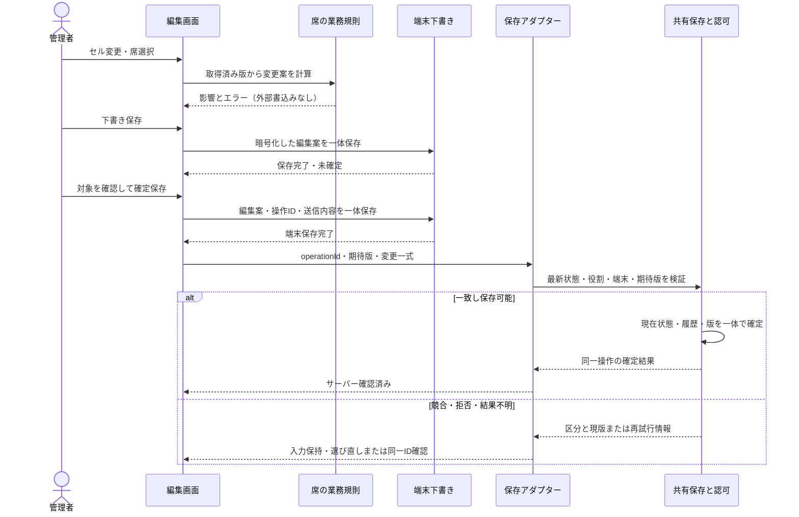

# 会場席作成・席設定の詳細設計

## 要点

状態：**Approved（PR #245・#91全体の最終レビュー承認済み）**。RTDBの物理・復旧契約はPR #228、お客様管理はPR #231・238、受付画面・復帰はPR #241・242、出力はPR #243で承認・統合済み。[全体照合](seat-design-final-review.md)で共同契約・G91-A～EとDD91-T01～103の担当を対応付けた。画像登録基盤は#244へ補完。共通型・計算#102は実装レビュー中。単体61件は[製品試験記録](../technical-validation/seat-domain-unit-test-results.md)を参照し、保存・認証と画面の結合は未実施とする。

本書の採用する現行契約は、[正式RTDB契約](rtdb-storage-contract.md)と上記の承認済み共同設計を優先する。以下の検討経緯・旧候補の未決定表記を、現在の方式未採用や旧PoC互換移行の必須条件と解釈しない。未実施の製品試験を合格へ変更しない。#91の最終レビュー・main統合後も、#96・98の対象設計と各実装タスクの開始条件を維持する。

- セルID・座席ID・表示番号を分け、採番や席替えでも対象を保持する。
- 編集案は画面内で計算する。下書きは端末保存、共有と確定は別操作（承認済みCONF-074）。交換は両者を一体で確定する。
- 発券後は移動・交換のみ。通常の席替えはQRを維持し、未設定化は不参加処理で旧QRを無効化する（承認済みCONF-070）。

**保存方式の現在地：** V1 #165・V2 #166とV3 #167の設計検証は完了。PR #219までレビュー承認・main統合済み。初期上限は1公演16区画・1区画256採番列、総4,096セルとする。[容量・費用と回収の判定](../technical-validation/seat-capacity-validation.md)は設計評価であり、完成アプリの600人無料受入は#220で必須とする（承認済みTECH-DD91-111-A）。物理保存方式は#168の122-AでRTDBを初期採用し、本番実装は未着手。

**V4の現在地：** 2026-10-19、開発者が[TECH-DD91-122-A](../decisions/ADR-007-seat-edit-commit-boundary.md#初期方式の設計採用を単独で判断するtech-dd91-122)でRTDBを初期方式として設計採用した。業務・画像と現在認可を同じDBへ置く。[正式保存・復旧契約](rtdb-storage-contract.md)を現行の設計正本とする。詳細契約もPR #228でレビュー承認・統合済み。本番実装・配備は別判定である。

[121](../decisions/ADR-007-seat-edit-commit-boundary.md#旧poc互換移行の対象除外tech-dd91-121)で旧PoC全形式の互換移行を初期・将来の必須対応から除外した。検証記録と3案の比較は保持する。以下に残る検討時点の記述より、122-Aと正式保存・復旧契約を優先する。過去の未実施項目を合格へ変更しない。

**容量・費用方針（2026-10-12開発者指示）：** 通常無料を必須とし、最低600人・目標1,000人で全業務を評価する。1公演1,000人超の無料枠維持は開発側の保証対象外。人数と席数・セル数を分け、1,000席に通路・余白を加えた構成も確認する。従来の500人・1,000セルへの縮小案は撤回。現PoCの500人検査を単純に引き上げて合格扱いにしない。

**拡張方針（2026-10-12開発者指示）：** 将来3,000人へ増やす際に画面・業務処理の全面改修を避けるため、保存データと目録を追加できる構造を本番採用前に評価する。[分割と拡張の契約](#人数増加に備える分割と拡張)を#167・168の条件に加える。今回は3,000人の検証を行わず、将来増設しやすい設計条件として扱う。正式対応・課金導入の承認ではない。

**無料運用の案内：** 登録・座席準備とQR発行は数日前から進め、前日までに完了する。当日は受付と急な追加・変更に絞る案内を準備画面・公演前チェックへ表示する。RTDBの月間通信は前日分も合算し、翌朝の回復を案内しない。[現在の予算と制約](../../../poc/GD91-121/README.md#比較結果と制約)を参照する。旧Firestoreの日次枠の表示案をRTDBへ転用しない。完成アプリの600人無料受入は#220で未実施であり、合格まで本番利用を認めない。

**業務回答：** [CONF-071](#conf-071-業務回答と変更設計)で2点を承認済み。交換理由は初回本番受付開始前は不要、開始後は停止中も必須。番号・位置の個別編集は理由付きでお客様未割当席だけに許可する。行列拡張と舞台左／上の技術設計は引き続きIn Review。

**区画と印刷：** [CONF-072](../ui-mock/ui-mock-client-response.md#conf-072-自由な区画名と区画単位の印刷)を正式回答として受領。自由な名前の区画ごとに座席表を作り、1区画A4横1枚とする。左上に区画名、フッターに「現在ページ/総ページ」を表示する。技術設計とT31・32はIn Review。

**当日の個別追加：** [CONF-073](../ui-mock/ui-mock-client-response.md#conf-073-横方向の拡張と当日の個別追加席)で非席4種別からの席追加を受領。横方向の拡張も対応する。既存番号を保持する手入力席と緊急表示を設計する。2026-10-06にCONF-073-C・Dの推奨案承認を受領。枝番・文字を許可し、緊急表示は席構成の変更に限定する。タップ時に理由も表示する。技術設計はIn Review。

**全体スライド：** [CONF-075](../ui-mock/ui-mock-client-response.md#conf-075-座席表全体のスライド)と訂正CONF-075-Cを適用する。未セルを使う余白調整として、席番号・IDと割当を保持し、理由入力・保存は不要。当日も主担当・代理がオンラインで一括確定する。[操作契約](#座席表全体のスライドconf-075)とT42～45を正本とし、[検証経緯](../technical-validation/seat-save-validation.md#検証索引)を分離する。物理方式の採否と本番試験は未完了。

| 確認箇所 | 確認する内容 |
|---|---|
| [データ・採番](#dd-91-02-データ契約と不変条件)、[採番例](#架空例) | 席／欠番／空間を区別し、逆順でもIDと列名順を保つか |
| [席設定](#dd-91-04-席設定取消し交換)、[異常時](#dd-91-06-画面状態と異常時) | 発券済みの保護、片側交換の拒否、失敗時の入力保持が具体的か |
| [開始条件](#dd-91-08-実装順と承認ゲート)、[試験ケース](#dd-91-09-試験ケース) | 未確定の保存方式と依存契約を開始条件にし、各操作の期待結果を追跡できるか |
| [検証の現在地](#検証の現在地)、[検証記録](../technical-validation/seat-save-validation.md#現在の結果と残作業) | 最新の限定結果と採用前の残作業を確認する。過去の比較は検証記録から必要なIDだけ読む |

PR #228承認記録：2026-10-19、開発者がPR #228の先頭`1d1fb3837d6ebbe4900598cd432f60529534a77a`を会話でレビュー承認し、mainへ統合した。統合コミットは`d1d2d33fc483ce5a89ed8e4fff37c69ea95c59f6`。初期方式・正式保存復旧契約と証拠対応が対象。本番実装・配備と未実施の製品試験は含まない。MHD-05等の後続共同契約は冒頭の現行記録へ接続し、本書全体はPR #245で最終レビューを承認・統合済み。

## この文書について

| 項目 | 内容 |
|---|---|
| 目的 | Issue #91の承認内容を、データ契約、操作と異常時へ展開し、試験ケースを同じ文書で追跡する |
| 読者 | 開発者、設計担当者、テスト担当者 |
| 関連Issue | [#91](https://github.com/EU0207/concert-reception-system/issues/91)、[#93](https://github.com/EU0207/concert-reception-system/issues/93) |
| 設計ID | DD-91-01～DD-91-09 |
| 状態 | In Review |
| 承認情報 | 2026-10-06、開発者がPR #109の内容コミット`83c74a81c0cfec28f08e801add24651d4d60ac71`をレビュー承認。論理契約・操作条件、試験条件とタスク分割（#101の検証計画を含む）が対象。物理保存方式・ADR-007の採否は検証後に確定し、設計全体の完了と区別する |
| PR #113承認 | 2026-10-06、開発者が内容コミット`483692d43433212aff4a479f8d508de8373a6d6e`をレビュー承認。限定検証結果、CONF-074の端末下書き契約・操作と試験条件、段階分割が対象。共有確定の物理方式採用、未実施試験の合格と設計全体の完了は含まない |
| PR #114承認 | 2026-10-06、開発者が内容コミット`0676d4b4323b60f19d4226e7be08b1d59f7532c3`をレビュー承認。GD91-02の限定検証結果と候補Eの優先検証方針が対象。物理方式の採用、残作業の完了と本番試験の合格は含まない |
| PR #115承認 | 2026-10-07、開発者が内容コミット`d49dc816c6707700b1c2cadff6a13f8e1ec9084e`をレビュー承認。GD91-03の個別編集の限定結果と構成文書の容量課題が対象。構成集約文書をそのまま採用せず分割を検証する。物理方式の採用と本番試験の合格は含まない |
| PR #116承認 | 2026-10-07、開発者が内容コミット`24ecbbe2315a1a3d3cffc1b0c353d0b37f0d3b7d`をレビュー承認。GD91-04の構成分割と一体確定の限定検証が対象。物理方式の採用、残作業の完了と本番試験の合格は含まない |
| PR #117承認 | 2026-10-07、開発者が内容コミット`0fbdab3e51fd8a8d8a504e752e6c7d99b8de2692`をレビュー承認。GD91-05の軽量版と構成差分受信の限定検証が対象。物理方式の採用、合同Rulesと端末復帰の完了、本番試験の合格は含まない |
| PR #118承認 | 2026-10-07、開発者が内容コミット`b81b1a7dc3264b75f3aae3d2d29a34834e63bf72`をレビュー承認。GD91-06の席構成と席設定の合同検証が対象。物理方式の採用、初期作成・券QR・正式認証の完了と本番試験の合格は含まない |
| PR #119承認 | 2026-10-07、開発者が内容コミット`995d5470fc54b35b0827c5f9ad934201c7fd2b36`をレビュー承認。GD91-07の初期作成・拡張の計算結果、CONF-075の操作契約・試験計画とタスク追跡が対象。設計文書のMarkdown記法整理も含む。スライド計算候補・物理保存方式の採用と未実施試験の合格は含まない |
| PR #120承認 | 2026-10-07、開発者が内容コミット`5b064ce8084bfcd184642d80fe05607bb9fcdca7`をレビュー承認。GD91-08の全体スライド計算の限定結果と、CONF-075-Cの理由入力・保存を不要とする仕様訂正が対象。既存席の緊急追加理由は保持。物理保存方式の採用と未実施試験の合格は含まない |
| PR #121承認 | 2026-10-07、開発者が内容コミット`66b5da5f6e1835e30532ea7871ee048f1604821e`をレビュー承認。GD91-09の世代保存境界の限定結果と、全件複写の採用非推奨・移動量保持候補の比較方針が対象。保存方式の採用と未実施試験の合格は含まない |
| PR #122承認 | 2026-10-07、開発者が内容コミット`0c04d0eb63542ecf2e097b59216f9d6c59e94bc3`をレビュー承認。GD91-10の移動量保存の限定結果と、1要求・2書込みの候補を優先する方針が対象。初期集計と全編集への接続は未検証。保存方式の採用と未実施試験の合格は含まない |
| PR #123承認 | 2026-10-07、開発者が内容コミット`9f0758aa5075d0a7bfb3938d6b59779d4a316c90`をレビュー承認。GD91-11の初期集計と移動量保存への接続の限定結果、区切りをまたぐID重複の既知制約が対象。初期構成全体の保証と全編集への接続は未完了。保存方式の採用と未実施試験の合格は含まない |
| PR #124承認 | 2026-10-07、開発者が内容コミット`fccabf49c8cf5f030a4e955ba2bb72921e89d158`をレビュー承認。GD91-12の初期集計と同一区画内のセル・座席ID重複拒否の限定結果、正式なSeat参照検査の未実装が対象。初期構成全体の保証と全編集への接続は未完了。保存方式の採用と未実施試験の合格は含まない |
| PR #125承認 | 2026-10-07、開発者が内容コミット`8970e0410f05eebd4df15138ebb9a52b8dff70a6`をレビュー承認。GD91-13の自動Seat対応の限定結果と計算量・初期保存効率の課題、単純な1セル保存の採用非推奨が対象。列設定の初期生成と採番順は未保証。初期構成全体の保証と全編集への接続は未完了。保存方式の採用と未実施試験の合格は含まない |
| PR #126承認 | 2026-10-08、開発者が内容コミット`be2d004110c864f6f465d558156ff7ef2715cd42`をレビュー承認。GD91-14のセル・席属性の検査分担と初期保存の効率化の限定結果、分離候補を優先して合同検証する方針が対象。準備片の破棄・再作成、列設定の初期生成・採番順と全編集への接続は未完了。保存方式の採用と未実施試験の合格は含まない |
| PR #127承認 | 2026-10-08、開発者が内容コミット`554ac6e626f990557a5f84f5813974742ef58276`をレビュー承認。GD91-15の作業世代を分けた初期準備の中断・再作成の限定結果が対象。中断は3書込み、初期保存は966書込み。物理回収・保持条件、列設定の初期生成・採番順と全編集への接続は未完了。保存方式の採用と未実施試験の合格は含まない |
| PR #128承認 | 2026-10-08、開発者が内容コミット`675a601692c73321e47700b61cfe25fdb1c11cb5`をレビュー承認。GD91-16の列設定の通常作成と初期採番順の限定結果が対象。930セルは初期1,232要求・1,507書込み、スライド2書込み。追加検査のコストを含む。手入力席・全編集と正式認可への接続、物理回収は未完了。保存方式の採用と未実施試験の合格は含まない |
| PR #129承認 | 2026-10-08、開発者が内容コミット`cb21a52f05b24d4dad8c9bc82df9e1a71c9d05a0`をレビュー承認。GD91-17の初回列設定とID台帳作成の一体化が対象。開始の静的参照は19から14、930セルは初期1,232要求・1,506書込み。正式認可・全編集と回収は未完了。保存方式の採用と未実施試験の合格は含まない。 |
| PR #130承認 | 2026-10-08、開発者が内容コミット`7da8cdee78cf53a82fe774c64387ca32f3033b79`をレビュー承認。GD91-18の公開対象を保持する別世代の準備・中断の限定結果が対象。準備7段階で旧データを保持し、中断は3書込み。公開対象の差替え・全編集と正式認可、回収は未完了。保存方式の採用と未実施試験の合格は含まない。 |
| PR #131承認 | 2026-10-08、開発者が内容コミット`0621a3ce92cacea58606d5c88fe8762272cb255e`をレビュー承認。GD91-19の反映前検査と操作別の保存計画の限定結果が対象。計算単体53件で操作外の変更を拒否し、通常スライドは移動量更新を優先する候補。最新状態・正式認可との一体保存、全編集と差替え・回収は未完了。保存方式の採用と未実施試験の合格は含まない。 |
| PR #132承認 | 2026-10-08、開発者が内容コミット`d5a467a2ee8ebf7111170495603fcb1a55755fd5`をレビュー承認。GD91-20の共通版・履歴と移動量の一体保存の限定結果が対象。Emulatorの78シナリオで1要求・3書込みを確認。初期作成と共通版発行、全編集・正式認可全体と差替え・回収は未完了。保存方式の採用と未実施試験の合格は含まない。 |
| PR #133承認 | 2026-10-08、開発者が内容コミット`ce63b9b86934f5b80e6022419a078956fbeef946`をレビュー承認。GD91-21の初期完了・公開先と共通版の一体発行、その後のスライド保存への接続の限定結果が対象。Emulatorの69シナリオ（正常・拒否67件、比較2件）で初回発行4書込みとスライド3書込みを確認。正式認可と全業務の版発行、席ID・割当の照合と全編集、差替え・回収は未完了。保存方式の採用と未実施試験の合格は含まない。 |
| PR #134承認 | 2026-10-08、開発者が内容コミット`2bceeb234fd82415ee94e9d1326c9d88c155d6c4`をレビュー承認。GD91-22の本人セッション発行と保存時の認可の限定結果が対象。Emulatorの81シナリオ（正常・拒否78件、比較3件）で初回発行4書込みとスライド3書込みを確認。認可追加後の3セル片では初期1,652要求・2,017書込みへ増加。正式認可と全業務の版発行、席ID・割当の照合と全編集、差替え・回収は未完了。保存方式の採用と未実施試験の合格は含まない。 |
| PR #135承認 | 2026-10-09、開発者が内容コミット`1d3fe9cd040fa4451209a3445655284b5df8ae64`をレビュー承認。GD91-23の席ID集合と割当正本、業務正本からの版取得の机上設計が対象。初回5文書の接続候補の参照予算は20・各書込み最大8。DD91-T47～50と合同Rulesは未実施。保存方式の採用と本番実装、未実施試験の合格は含まない。 |
| PR #136承認 | 2026-10-09、開発者が内容コミット`06a518ef276f2ce4c1671c10d544b438c1508932`をレビュー承認。GD91-24の席ID集合の通常作成と空の割当表の初回5文書保存の限定結果が対象。Emulatorの25シナリオ（正常・拒否24件、比較1件）で部分送信30通りを拒否。初期1,652要求・2,018書込み、スライド3書込み。業務正本の通常発行と500人実割当、正式認可全体は未接続。保存方式の採用と本番実装、未実施試験の合格は含まない。 |
| PR #137承認 | 2026-10-09、開発者が内容コミット`6cc723125d1909fd71ca67bf783ea2f8c658e9b7`をレビュー承認。GD91-25の業務更新と構成版の分離、正本と小さな索引の接続契約が対象。通常割当の最小参照予算15・各書込み最大9は未実装の机上値。T51～53と業務正本の通常発行、500人実割当は未実施。正式認可全体と物理方式の採用、本番実装の承認と未実施試験の合格は含まない。 |
| PR #138承認 | 2026-10-09、開発者が内容コミット`828012ee55ed278428e88ea31eee241567073247`をレビュー承認。GD91-26の最小来場者の通常登録と500人実割当、移動交換・スライドの限定結果が対象。19シナリオ（比較2件）、通常登録4書込み・割当とスライド各3書込みを確認。名簿先行の初期化と券・QR、不参加の共同結合、正式認可全体は未完了。保存方式の採用と本番実装、未実施試験の合格は含まない。 |
| PR #139承認 | 2026-10-09、開発者が内容コミット`5eb56a6abcfe98de30aa1cf439502e2cae11cd48`をレビュー承認。GD91-27の共通版・空索引の先行初期化契約とT54～57の検証計画が対象。名簿先行と構成先行を許可し、初回公開で既存業務版を保持する案。初期化4・公開5書込みは未実装の候補。Rules成立性と新形式の試験は未実施。方式全体の採用、本番実装と未実施試験の合格は含まない。 |
| PR #140承認 | 2026-10-09、開発者が内容コミット`965c9240831ab31d56e66cf07560e2a32955be73`をレビュー承認。GD91-28の共通初期化・両準備順と各500人の実割当を含む22シナリオの限定結果が対象。初期化4・公開5書込みと既存業務版の保持を確認した。券QRと不参加、正式認可全体の接続は未実施。方式全体の採用、本番実装と未実施試験の合格は含まない。 |
| PR #141承認 | 2026-10-09、開発者が内容コミット`6f513af0e8561a21d24b2408dc49906793acdcd7`をレビュー承認。GD91-29の券QR・不参加の共同保存契約、来場cycleとT58～63の検証計画が対象。チェックとQR資格を分け、席交換のQR維持と不参加の原子性、復帰時の旧資格保護を具体化した。書込み数は未実測の候補で、合同Rules・SDKと実機は未検証。方式全体の採用、本番実装と未実施試験の合格は含まない。 |
| PR #142承認 | 2026-10-09、開発者が内容コミット`4e00ec484f6799f38b2e16312de8928849c2f640`をレビュー承認。GD91-30の初回資格6・券チェック4書込みと、500人の生成・発券後保護の限定14シナリオが対象。初回資格の静的参照予算は20で余裕がない。再発行と不参加・復帰、正式認可全体は未実施。方式全体の採用、本番実装と未実施試験の合格は含まない。 |
| PR #143承認 | 2026-10-09、開発者が内容コミット`0efe7cae78a26b144d06243e83ce07e0b45e6436`をレビュー承認。GD91-31の再発行8書込みと旧資格・旧コードの無効化、参照分担変更の限定21シナリオが対象。初回資格17・再発行20参照。停止確認は申告入力を前提とし、全端末の実運用確認は未実施。不参加・復帰と正式認可全体、SDKと実機は未接続。方式全体の採用、本番実装と未実施試験の合格は含まない。 |
| PR #144承認 | 2026-10-09、開発者が内容コミット`d9b35b4606b06152de3aeb96f837db3c695fe630`をレビュー承認。GD91-32の有効QR・席ありの不参加9書込みと復帰4書込み、新cycleと既存操作IDの拒否修正の限定30シナリオが対象。仕様・主要試験と検証記録の分離も承認。不参加20・復帰19参照。券未作成・QRなしと未配置の分岐、正式認可全体と実機運用は未確認。方式全体の採用、本番実装と未実施試験の合格は含まない。 |
| PR #145承認 | 2026-10-09、開発者が内容コミット`f944c94c5e11a971faa82007a2d3cba66a47fa9d`をレビュー承認。GD91-33の券未作成の不参加を席あり5・席なし4書込みで確定する限定38シナリオとDD91-T64が対象。構成未作成と通常更新への迂回拒否を確認。静的参照は18・16、文書最大10・9。QRなしの既存券と正式認可全体、SDK・画面と実機は未確認。方式全体の採用、本番実装と未実施試験の合格は含まない。 |
| PR #146承認 | 2026-10-09、開発者が内容コミット`04fb102541fc57aed68dd324d7d274361703b5fb`をレビュー承認。GD91-34のQRなし既存券の不参加を席あり7・席なし6書込みで確定する限定48シナリオとDD91-T65が対象。構成未作成、追加確認と復帰、新cycleを確認。静的参照は16・15、文書最大5・6。正式認可全体と受付同期、SDK・画面と実機は未確認。方式全体の採用、本番実装と未実施試験の合格は含まない。 |
| PR #147承認 | 2026-10-09、開発者が内容コミット`6887871c3c2837654941081e207c3b004e5e705a`をレビュー承認。GD91-35の正式認可との差分、合同検証A～Dと試験案DD91-T66～69が対象。本人証跡・役割準備から隔離検証を行う。机上照合と計画の承認であり、新しいRules動作、方式全体の採用、本番実装と実機の合格は含まない。 |
| PR #148承認 | 2026-10-09、開発者が内容コミット`9328e430a29b66db3ef98e443da58c353a3b7ffa`をレビュー承認。GD91-36の本人証跡・役割準備と保存回帰57シナリオ、DD91-T66・67・69の限定結果が対象。固定時計のRules境界を含むが、実Google再認証と端末保存の完全性は未確認。方式全体の採用、本番実装と実機の合格は含まない。 |
| PR #149承認 | 2026-10-10、開発者が内容コミット`16a1f68548137028551d89f26fd1e946473a1930`をレビュー承認。GD91-37の公演状態・役割別取得範囲とDD91-T68の限定結果が対象。Auth・Firestore Emulatorの自動結合試験9シナリオを確認。準備完了・隔離受領と実業務保存への接続は未確認。方式全体の採用、本番実装と実機の合格は含まない。 |
| PR #150承認 | 2026-10-10、開発者が内容コミット`0730d6f48e87975bcd444fd57737a4aae1acd4f8`をレビュー承認。GD91-38の準備版確認・隔離受領とDD91-T66・68の限定結果が対象。自動結合試験18シナリオを確認。端末保存の完全性と実キュー、配布の正本との一体公開と全保存への合同接続は未確認。方式全体の採用、本番実装と実機の合格は含まない。 |
| PR #151承認 | 2026-10-10、開発者が内容コミット`522a50b80589154e97de1a24d5a8623e3a66807c`をレビュー承認。GD91-39の表示名最小正本との一体公開・本人当日履歴とDD91-T68の限定結果が対象。自動結合試験24シナリオを確認（B09は単独公開拒否へ改訂）。既存業務形式8への接続と目録発行、端末保存は未確認。方式全体の採用、本番実装と実機の合格は含まない。 |
| PR #152承認 | 2026-10-10、開発者が内容コミット`732b32d89b5ea9bc0eae22c962e163b237ba5839`をレビュー承認。GD91-40の正本分割・端末内合成と参照共用の接続契約が対象。5書込み・19参照は未実装の目標。机上設計と静的照合を承認し、新Rules・合同回帰の合格、方式全体の採用と本番開始は含まない。 |
| PR #153承認 | 2026-10-10、開発者が内容コミット`0e3602c4c6c61be827ddead0bae98131f7ec5160`をレビュー承認。GD91-41の形式9の通常登録・表示名変更とDD91-T69の限定結果が対象。自動結合試験9シナリオ、当日5書込み・静的19参照を確認。既存48保存の同一Rules回帰、目録・端末保存と方式採用、本番実装・実機の合格は含まない。 |
| PR #154承認 | 2026-10-10、開発者が内容コミット`841aa0cc66639ae0b5d318c232e3d10a43c0b87f`をレビュー承認。GD91-42の形式10の業務保存回帰とDD91-T69の限定結果が対象。既存48保存・認可9件と追加6件、計63シナリオを確認。登録・当日表示名変更は静的20参照。全編集・複数区画と端末保存、方式採用と本番実装・実機の合格は含まない。 |
| PR #155承認 | 2026-10-10、開発者が内容コミット`9144f30565e49e46af1a6892a30b8779ff4cb371`をレビュー承認。GD91-43の区画追加・差替えの公開契約と計算24件、静的照合が対象。新しいRulesの成立性、複数区画のサーバー結合と回収、方式採用と本番実装・実機の合格は含まない。 |
| PR #156承認 | 2026-10-10、開発者が内容コミット`5452356890abc9d74864f16b0f0b41e02f1cbef9`をレビュー承認。GD91-44の完成候補を前提とする一体公開20件と静的19参照が対象。構成準備からの完成証明、全編集・複数区画の業務回帰と回収、方式採用と本番実装・実機の合格は含まない。 |
| PR #157承認 | 2026-10-11、開発者が内容コミット`b1231e3aabb99d6e75e0f026ae97fac5cb741c1f`をレビュー承認。GD91-45の初回1区画の構成準備・候補発行・一体公開18件と静的照合が対象。別区画追加・差替えの変更対象証明、全編集の業務回帰と回収、方式採用と本番実装・実機の合格は含まない。 |
| PR #158承認 | 2026-10-11、開発者が内容コミット`c3918e05ffa431826383613f739ea3a48d1072ad`をレビュー承認。GD91-46の区画別構成準備・新規追加28件（初回18件回帰・追加10件）と静的照合が対象。差替えの変更対象証明、全編集の業務回帰と回収、方式採用と本番実装・実機の合格は含まない。 |
| PR #159承認 | 2026-10-11、開発者が内容コミット`88753cc28a22351971fba92fccd6ff5a20ab02df`をレビュー承認。GD91-47の同じ形・列設定の区画差替え44件（既存28件回帰・差替え16件）と静的照合が対象。形・列設定が変わる差替えと手動席番、全業務回帰と回収、方式採用と本番実装・実機の合格は含まない。 |
| PR #160承認 | 2026-10-11、開発者が内容コミット`e766208609f3b5805fbeaec3f88f956fd56656ab`をレビュー承認。GD91-48の論理比較契約・計算単体36件と静的照合が対象。保存済み構成の完成証明、物理形式・保存費用、方式採用と本番実装・実機の合格は含まない。 |
| PR #161承認 | 2026-10-11、開発者が内容コミット`0fd964ce2615e919a7d3d5351cfe50eeb3a6f722`をレビュー承認。GD91-49の保存・復元20件、3形状の容量・文書数比較と静的照合が対象。サーバー完成証明・新方式の総費用、方式採用と本番実装・実機の合格は含まない。 |
| PR #162承認 | 2026-10-11、開発者が内容コミット`74858ed444a6259c44d00e0f14c46cae7fce5002`をレビュー承認。GD91-50の3候補×6正常入力の診断と段階化方針、静的照合が対象。一括検査は未成立で、業務試験の合格や方式採用を承認したものではない。完成証明・総費用と本番実装・実機の合格は含まない。 |
| PR #163承認 | 2026-10-11、開発者が内容コミット`c68e6a613c93fb944f1c258509fead0212c1b68c`をレビュー承認。GD91-51の小片内の局所検査25件と費用、静的照合が対象。全体一意性・採番と完成証明、公開までの総費用・全業務回帰は含まない。方式採用・本番実装と実機の合格は未承認。 |
| PR #164承認 | 2026-10-11、開発者が内容コミット`8da242f3635d55aec8402fcbe5550d7489dde450`をレビュー承認。GD91-52の4段階の局所検査28件、3段階候補の上限診断と費用比較、静的照合が対象。全体一意性・採番と完成証明、公開までの総費用・全業務回帰は含まない。方式採用・本番実装と実機の合格は未承認。 |
| PR #169承認 | 2026-10-11、開発者が内容コミット`00716365338698661f29586b9fedac19f1719beb`をレビュー承認。GD91-53の残作業4単位・依存順と既存完了条件の対応が対象。新たな動作試験の合格、方式採用・本番開始の承認は含まない。 |
| PR #170承認 | 2026-10-11、開発者が内容コミット`1f389b542d984b22d12fc7bef88b7cf4c688c5ab`をレビュー承認。GD91-54の区画内ID・採番検査28件と局所回帰28件、500席の限定費用が対象。完成候補・形変更と旧席全件比較、方式採用・本番開始は含まない。 |
| PR #171承認 | 2026-10-11、開発者が内容コミット`135258648837b8098c21ce0e4990665d003b2de8`をレビュー承認。GD91-55の列目録・席情報発行と旧席比較18件、全体28件・局所28件と500席の限定費用が対象。旧目録の正規発行・非席履歴と公開接続、方式採用・本番開始は含まない。 |
| PR #172承認 | 2026-10-11、開発者が内容コミット`732b25a41600556dc28c1ba97033d5cc48b6b3e8`をレビュー承認。GD91-56の旧全セル目録・非席履歴18件、比較18件・全体28件・局所28件と500席の限定費用が対象。専用編集・完成候補と公開接続、方式採用・本番開始は含まない。 |
| PR #173承認 | 2026-10-11、開発者が内容コミット`1d53f99ac366353fc989980390f9f1482c292777`をレビュー承認。GD91-57の完成候補18件と既存回帰92件、500席の限定費用と主題別記録への整理が対象。専用編集・一体公開と方式採用、本番開始は含まない。 |
| PR #174承認 | 2026-10-11、開発者が内容コミット`93c77445785ab0db296d8c176fa233405bb15620`をレビュー承認。GD91-58の一体公開19件と既存回帰110件、500席・2区画と限定費用が対象。専用編集の業務許可・合同回帰、方式採用・本番開始は含まない。 |
| PR #175承認 | 2026-10-11、開発者が内容コミット`828437974eea16d32efa43b4815cfb5cf0d1e361`をレビュー承認。GD91-59の追加14件と既存証拠によるV1 #165の4条件の完了判定が対象。業務合同回帰・費用回収と方式採用は#166～168に残す。本番開始を含まない。 |
| PR #176承認 | 2026-10-11、開発者が内容コミット`6156093292885b204eedaee6ee1619a53888d286`をレビュー承認。GD91-60の本人認可・公演状態接続と47件の結果が対象。競合10回中7回の双方未確定と明示再操作の制約を維持。#166の第2～4条件、SDKと実機、方式採用と本番開始は含まない。 |
| PR #177承認 | 2026-10-11、開発者が内容コミット`6681547e4665e66eefbb9ec69254ca042860b05b`をレビュー承認。GD91-61の構成公開・公演開始に限るSDK14件と設計判断が対象。全業務保存・実ブラウザーと端末永続化、実機は未完了。方式全体の採用と本番開始は含まない。 |
| PR #178承認 | 2026-10-11、開発者が内容コミット`1f5c1afde10963846d458d220f0617641d89a40b`をレビュー承認。GD91-62の通常登録・入金と未発券の手動席設定20件、同じ正本への接続判断が対象。500人は登録だけ・4席の試験。発券済み・専用編集と全配置、共有下書き・実機は未完了。方式全体の採用と本番開始は含まない。 |
| PR #179承認 | 2026-10-11、開発者が内容コミット`5b31702de50079f8241ec819ee3569c92d2f95a5`をレビュー承認。GD91-63の席あり券・QRと不参加32件、部分集合980通りと同じ正本への接続判断が対象。4席・単一区画。券未作成・席なしと全500人更新、SDK・実機は未完了。方式全体の採用と本番開始は含まない。 |
| PR #180承認 | 2026-10-12、開発者が内容コミット`1442aacf6b10ce6408e44b973dc7740843a56735`をレビュー承認。GD91-64の券未作成・席なし24件と既存32件の回帰、部分集合1,190通りが対象。4席・単一区画。初回公開と全500人更新、SDK・実機は未完了。方式全体の採用と本番開始は含まない。 |
| PR #181承認 | 2026-10-12、開発者が内容コミット`6e7e6b7d6143996c1a5d1459a28d1b6175ad722b`をレビュー承認。GD91-65の通常初期化・初回公開20件と既存56件の回帰、部分集合1,210通りが対象。4席・単一区画。自動配置・専用編集と全500人更新、SDK・実機は未完了。方式全体の採用と本番開始は含まない。 |
| PR #184承認 | 2026-10-12、開発者が内容コミット`d4ef2d878635280d6e1c8b36f21ca55e015b5767`をレビュー承認。GD91-66の自動配置・グループ固定の純粋計算27件と保存への引継ぎ契約が対象。500人・2区画も計算のみ。保存接続・認可と実機、方式全体の採用と本番開始は含まない。 |
| PR #185承認 | 2026-10-12、開発者が内容コミット`c9fd9b9853b53597a97b7cc1b4bd56d9aa70e96a`をレビュー承認。GD91-67の通常名簿の所属・順序と配置参照12件、既存76件の回帰が対象。500人は名簿登録のみ。グループ配置保存・実機と方式全体の採用、本番開始は含まない。 |
| PR #186承認 | 2026-10-12、開発者が内容コミット`05525e6ac1fca3d67de2f14d895525fbb0754a12`をレビュー承認。GD91-68・69の配置保存・全体スライドと500人・2区画、同じ候補の119件が対象。#166全体の完了・本番方式採用と実機の合格は含まない。 |
| PR #187承認 | 2026-10-12、開発者が内容コミット`948f1b89bf9e8d0eb76355a940849232ec2fe7b0`をレビュー承認。GD91-73の225件でV2 #166の4条件を完了。容量・回収は#167、採否は#168へ維持。本番方式採用と実機の合格は含まない。 |
| PR #188承認 | 2026-10-12、開発者が内容コミット`7cd08a71e1549f30630e21b1d71652feb9f588d2`をレビュー承認。GD91-74の9件と無料600人必須・1,000人目標の方針、前日準備案内と拡張設計条件を対象とする。同日の最新指示により3,000人の検証は今回行わない。#167の成立・回収と#168の方式採用は未完了。 |
| PR #193承認 | 2026-10-13、開発者が内容コミット`8d105b203283caedae4873afd8c69a7d271ccaaf`をレビュー承認。GD91-84の合同接続・診断用ノードの期限対策と、承認範囲内の外部比較が対象。全業務の無料成立と本番方式は未採用。 |
| PR #194承認 | 2026-10-14、開発者が内容コミット`250caa8f7077257c27837657468f81121e82a487`をレビュー承認しmainへ統合。席操作・暗号化端末再開と、承認範囲内の実Google認証の外部最小確認が対象。#167全体と本番方式の採用は未完了。 |
| PR #195承認 | 2026-10-14、開発者が内容コミット`db5a1431e83a4fbc062354a4b0ce0acba59521cb`をレビュー承認しmainへ統合。受付差分とTECH-DD91-086-Aの外部2期限条件が対象。#167全体と本番方式の採用は未完了。 |
| PR #196承認 | 2026-10-14、開発者が内容コミット`51e29487202e7f6e65438255b5b72d5f10219dc0`をレビュー承認しmainへ統合。通常登録・券と旧QR識別、TECH-DD91-087-Aの外部7群を対象とする。#167全体と本番方式の採用は未完了。 |
| PR #197承認 | 2026-10-14、開発者が内容コミット`9065f7c2e9a8c644c32b369910a83343d4dfa00b`をレビュー承認しmainへ統合。通常発券から6SDK受付と参照保護、TECH-DD91-088-Aの外部600人対照を対象とする。#167全体の完了・本番採用ではない。 |
| PR #198承認 | 2026-10-14、開発者が内容コミット`9a63890bdca36e0ae63cc27d7d963783052ff279`をレビュー承認しmainへ統合。共有中の候補・基準の保持を対象とする。#167全体の完了・本番採用ではない。 |
| PR #199承認 | 2026-10-14、開発者が内容コミット`ea3cf3297d1ec6dda0a46a7fd2c978d035454a90`をレビュー承認しmainへ統合。共有送信中の予約・結果照会を対象とする。#167全体の完了・本番採用ではない。 |
| PR #200承認 | 2026-10-14、開発者が内容コミット`bf8e5978e7657fd2ba492f562f87b127f5e1a1e2`をレビュー承認しmainへ統合。GD91-95～97の暗号化再開・受付キューと人数別合同取得、承認済み外部最小確認が対象。#167全体の完了・本番採用は含まない。 |
| PR #201承認 | 2026-10-14、開発者が内容コミット`a8161af87d8b13639dbf08afcad6a50f5d96bc2a`をレビュー承認しmainへ統合。GD91-98の停止後隔離受領・照合待ち保持と承認済み外部最小確認が対象。採否・例外締めと保持解除、#167全体の完了・本番採用は含まない。 |
| PR #202承認 | 2026-10-14、開発者が内容コミット`2921b0c64874b6521f5ca4fd485d09b56554763d`をレビュー承認しmainへ統合。GD91-99の共通連番・管理者照合と監査付き参照解除、承認済み外部6群が対象。#167の残条件と本番採用は含まない。 |
| PR #203承認 | 2026-10-15、開発者が内容コミット`642838101e8b9558f034a38d3ab9901cd67e64fc`をレビュー承認しmainへ統合。GD91-100の締め後明示回収・実績訂正と参照保全、承認済み外部12群が対象。締め・初回実績生成と#167全体の完了、本番採用は含まない。 |
| PR #204承認 | 2026-10-15、開発者が内容コミット`b4c1270c2ae462c3fab0d64b1b2b4ff4c56fe4a1`をレビュー承認しmainへ統合。GD91-101の人数別の限定結果、GD91-102の構成保存・割当席保護と候補保持、承認済み外部8群が対象。新形式の全業務無料成立と#167全体の完了、本番採用は含まない。 |
| PR #205承認 | 2026-10-15、開発者が内容コミット`a025994dc5b2ca137b8b25bf4bbf06d6dee22a7b`をレビュー承認しmainへ統合。GD91-103の所属・固定と席操作理由、承認済み外部8群が対象。自動配置全体と構造編集、新形式の全業務無料成立と#167完了、本番採用は含まない。 |
| PR #206承認 | 2026-10-15、開発者が内容コミット`0ab5b028be3416fba7cb4304d197d13a134b014d`をレビュー承認しmainへ統合。GD91-104の未セル拡張・未割当席編集、余白スライドと回収、承認済み外部4群が対象。追加自動採番・区画操作、新形式の全業務無料成立と#167完了、本番採用は含まない。 |
| PR #207承認 | 2026-10-15、開発者が内容コミット`d903c6ebd2ae135f652a8e2c3f5cb86184171fab`をレビュー承認しmainへ統合。GD91-105の区画新設・改名と舞台変更、外部097-Aの失敗終了と後処理記録が対象。外部4群全体の合格・#167完了と本番採用は含まない。 |
| PR #208承認 | 2026-10-15、開発者が内容コミット`13a49dc1c79485bf9cd0d0705ea43483cba643e2`をレビュー承認しmainへ統合。GD91-106の区画取得再利用・予算停止再現と外部098-Aの4群合格が対象。#167全体・本番採用と全業務無料成立は含まない。 |
| 照合基準 | main `b88afb41c28d75ac900362072353a4dd7c50f351`。PR #88は2026-10-03に統合済み、統合コミット`67312c9ed7f915cb01e48336e30f8a98c27fa3fd` |
| 対象 | 公演ごとの会場席作成、席設定、表示名変更、移動・交換、帳票用データ契約 |
| 対象外 | 本番コード、外部環境構築、公開、画像登録基盤、発券基盤、受付・来場状態訂正の実装 |

現在の仕様と主要試験ケースは本書へ集約する。検証の結果・費用と比較履歴は[座席保存の技術検証記録](../technical-validation/seat-save-validation.md)へ分離し、実行手順と測定データは既存のpoc/GD91-xx/に保持する。実装分割と依存順は親Issue #91を正本とし、タスクごとに同じ内容の文書を追加しない。

本書と技術的な試験資料のレビューは開発者・設計担当者・テスト担当者が行い、技術上の承認判断は開発者が行う。依頼者には未決定の業務判断だけを平易に説明して確認し、詳細設計全体の技術レビュー・承認は求めない。承認済みの業務回答は維持し、再確認しない。

業務判断DD-91-B01は2026-10-03の[CONF-070](../ui-mock/ui-mock-client-response.md#conf-070-発券後の席設定解除)で解決した。2026-10-05のCONF-071でDD-91-B02・03も推奨案の承認を受領した。

## CONF-071 業務回答と変更設計

状態：**業務回答はApproved、技術設計はIn Review**。[依頼者の回答](../ui-mock/ui-mock-client-response.md#conf-071-席交換の理由当日の構成編集舞台位置)で理由の時点と編集対象を確定した。交換の旧「発券後は理由必須」は以下の時点判定に置き換える。「当日は個別追加のみ」「舞台左端」は行列拡張と舞台選択の変更前条件として照合し、変更後の実装根拠にしない。

| 変更案 | 保持する条件 | 確認・具体化する箇所 |
|---|---|---|
| 初回本番受付開始前の交換は理由不要、開始後は理由必須（停止中も維持） | 両者確認、版確認、両席の同時確定、QR・受付実績の保持。理由なしでも変更履歴は残す | DD-91-B02は承認済み。空席への移動・表示名変更の理由条件は維持 |
| 当日も行列を増やして席を追加 | 割当済みの番号とID、既存席との対応を保持。オンライン、主担当・代理、影響確認、端末更新を維持 | [拡張案](#行列拡張の変更案conf-071)。縮小や全席の再採番を許可するものではない |
| お客様未割当の席だけ、理由付きで番号・位置を編集 | 他の割当済み席を動かさず、履歴を保持 | DD-91-B03は承認済み。お客様への単独解除や固定解除ボタンを新設せず、CONF-070を維持 |
| 舞台を左／上から選択 | 席ID、番号、採番方向は舞台位置と独立。席番号は名前枠の左隣を維持 | [データ案](#舞台位置の変更案conf-071)、画面とPDF・Excelの共通投影（#108） |

DD91-T26～30は変更の試験案。T29は理由時点、T30は未割当席編集を分けて確認する。本番試験は全件未実施である。

## DD-91-01 正式情報との照合

| 根拠 | 承認済み条件と適用先 | 具体化する設計 | 試験 |
|---|---|---|---|
| [REQ-F-035・038・039](../../client/requirements.md)、[AC-025](../../client/acceptance-criteria.md) | 任意開始番号、欠番の補完禁止、舞台左端、階・区画と画像の連動。主担当・代理による会場照合 | DD-91-02・03・06 | T01～06、T19、T24 |
| [REQ-F-036、AC-026](../../client/acceptance-criteria.md)、[RES-005](../technical-validation/res-005-seat-allocation-desk-review.md) | 一般席、最大10人、人数降順、連続席、手動分割後の固定、発券後の自動配置禁止 | DD-91-04 | T07～10、T25 |
| [REQ-F-007・043、AC-003・035](../../client/acceptance-criteria.md) | 変更履歴、購入者名と表示名の分離、表示名6文字、旧受付の保持 | DD-91-02・04 | T11～13、T20 |
| [REQ-F-004、AC-002・022](../../client/acceptance-criteria.md) | 通常の座席変更ではQRを維持。紛失再発行とは分離 | DD-91-04・07 | T12、T20 |
| [REQ-F-045、AC-037](../../client/acceptance-criteria.md) | 同じ確定構成からPDF・Excel、舞台左端、席番左隣、確保席ラベル、A4横1ページ | DD-91-07 | T23 |
| [BD-02-02～05・09](../basic-design/logical-data-model.md) | ID分離、変更不能イベント、公演分離、不変条件 | DD-91-02・05 | T14～18、T21 |
| [BD-03-01・04・07](../basic-design/offline-sync-conflict-design.md) | 明示保存、基準版比較、オンライン限定座席変更、同一ID再試行、未更新端末の運用 | DD-91-05・07 | T14～18、T21～22 |
| [BD-04-04・07](../basic-design/authentication-authorization-design.md)、[BD-05](../basic-design/security-privacy-design.md) | 公演役割と端末認可、閲覧データ分離、直接API拒否 | DD-91-05・06 | T17～18 |
| [BD-06-01・08・10・15](../basic-design/screen-flow-wireframe-design.md)、[BD-07-08](../basic-design/file-output-report-design.md) | 未保存離脱、写真参照、キャンバス、当日個別追加、帳票共通構成 | DD-91-03・06・07 | T19、T22～24 |
| [引継ぎ台帳](../ui-mock/ui-mock-production-handoff.md) FB-08・09・14／MCT-08・09・14、CONF-061 | 初期「未」、5種別、番号消費、逆順、配置済み保護 | DD-91-02・03 | T01～06、T13 |
| 同台帳 FB-10・19・30／MCT-10・19・30、MCT-34、CONF-062 | 表示名・交換・取消し、未入金を禁止理由にしない、不参加、フォーカス、席設定の名称 | DD-91-04・06・07 | T07、T11～13、T19～21、T24 |
| 同台帳 MHD-03・05 | 座標と帳票共通構成、#93の取消し原子性、旧QR、履歴 | DD-91-02～07 | T14～18、T20～23 |
| CONF-072、REQ-F-035・038・045、AC-025・037 | 自由な区画名と独立した座席表、1区画1枚、左上名称とページ数 | DD-91-02・03・07 | T31・32 |
| CONF-073、REQ-F-035・038、AC-025 | 非席からの個別追加、手入力席と自動採番の分離、緊急表示。C・Dは推奨案承認済み | DD-91-02・03・05～07 | T04、T22、T27、T33～36 |
| CONF-075、REQ-F-035・038、AC-025・026・032 | 未の外周を使う全体スライド。当日も主担当・代理がオンラインで一括確定。CONF-075-Cで理由入力・保存を不要へ訂正 | DD-91-02・03・05～07 | T42～45 |

Txxは[本書の試験ケース](#dd-91-09-試験ケース)の`DD91-Txx`を指す。REQ-F-044・046、REQ-NF-013・014・020とAC-032・036・038を関連条件として維持する。来場状態の訂正はREQ-F-041・AC-029の別操作とし、席替えで受付実績をリセットしない。

### 旧本文との相違

基本設計の「座席・スペース」の2種別へ5種別を追加するが、座席以外をQR・割当の対象へ広げない。BD-07-08の「欠番はセル自体を生成しない」は、編集用欠番セルを永続化しない意味には使わない。編集座標は保持し、帳票では座席枠を描画しない。これはCONF-060の追補の適用である。

モックの1～30セルと74×72pxは確認用の値である。本番の上限・初期値・実機寸法の承認根拠には使わない。新規入力の推奨初期値はモック同様5×8とし、変更可能とする。1～30は暫定技術上限案であり、DD-91-T01の容量確認後に採否を決める。席数上限を来場者500人から逆算しない。

## DD-91-02 データ契約と不変条件

以下は製品に依存しない型の案である。IDは不透明なUUID v4とし、すべての公演所属レコードに`environmentId`と`performanceId`を持つ。購入者名や席番号をキーにしない。

| 型 | 項目・検証 | 意味 |
|---|---|---|
| LayoutSection | `sectionId`, `name`, `floorId?`, `displayOrder`, `rows`, `columns`, `axis: horizontal/vertical`, `seatOrder: forward/reverse`, `lineSettings[]`, `cells[]` | 自由な区画名と区画ごとの構成。座標は0始まり、画面は1始まり。舞台は左端の別表示要素 |
| LineSetting | `lineId`, `index`, `name`, `prefix`, `startNumber`, `nextAutomaticNumber`案 | 横なら行、縦なら列へ対応。開始番号は正の安全整数、接頭部と列名は英字・数字を扱う。接頭部と列名は分離。次番号は手入力席の追加では進めない |
| LayoutCell | `cellId`, `row`, `column`, `kind: unset/seat/gap/space/aisle`, `seatId?`, `consumedNumber?` | 位置と種別。gapは番号を消費し、手入力席へ変更しても消費番号を保持。space・aisle・unsetは番号なし |
| Seat | `seatId`, `sectionId`, `lineId`, `numberingMode`, `prefix?`, `number?`, `manualNumber?`, `displayOrder`, `category`, `usable`, `reservedLabel?`, `emergencyChange?`案 | automaticは接頭部＋整数、manualは別の表示番号。枝番・文字を許可。緊急表示は新設・番号・位置変更だけ。categoryは従来区分を維持 |
| SeatAssignment | `attendeeId`, `seatId`, `groupId?`, `fixed`, `revision` | 一人一席の現在関係。座席表示名はAttendee側に持ち、セルへ氏名を複製しない |
| Attendeeの参照項目 | `attendeeId`, `buyerId`, `rosterOrder`, `groupId?`, `attendancePlan`, `seatDisplayName` | #93・97と共通契約。購入者IDとグループIDは別。同名からIDを統合しない |
| Ticketの参照項目 | `ticketId`, `attendeeId`, `issued`, `sent`, `activeCredentialId`, `revision` | 発行チェックが未済でも有効QRまたは発行履歴があれば発券済み保護を外さない。#93・112で実体定義を整合させる |
| SeatEditCommand | `operationId`, `kind`, `expectedVersions`, `actorId`, `deviceId`, `beforeRefs`, `after`, `reason?` | 編集開始時の版を保持。確認画面の内容と送信内容を一致させる |
| SeatEditEvent | BD-03共通イベント項目、`operationId`, `before`, `after`, `groupEffects`, `result` | 確定した前後差分を追記。取消しは元イベント参照を持つ新イベント。QR生値は含めない |
| SeatMapProjection | `schemaVersion`, `layoutRevision`, `assignmentRevision`, `attendeeRevision`, `ticketRevision`, `sections`, `counts` | 一貫した確定版から画面・帳票を生成する共通入力。購入者名と任意項目を含めない |
| 公演管理の参照項目 | `performanceId`, `controlRevision`, `firstReceptionStartedAt?` | 初回本番受付開始の時刻。未開始はnull。一度設定した値は受付停止で消さない。席保存の期待版に公演管理版を含める技術案 |

本節のセル座標と列indexは、画面・帳票へ渡す論理上の位置を示す。GD91-10では保存済みの基準座標と区画の移動量から論理位置を作る候補を検証する。両者を混同して移動量を二重適用しない。保存構造の採用は未決定。

空欄の階・区画は表示上の「指定なし」へ対応させ、内部のsectionIdは必須とする。表示名の改行は保存値へ追加しない。文字数はUnicodeコードポイント単位とする技術案で、半角・全角空白を除いた1～6文字を検証する。未入力は許容し、空欄のままなら席設定時に略称入力を案内する。空白なしは3文字ごと、空白ありはその位置で2行表示する。空白が多く3行以上になる入力は保存値を保持し、表示では空白を除いて3文字ごとに折り返す案とする。切捨てはしない。

### 自由な区画名と独立した座席表（CONF-072）

区画名は「1階」「前方席」「バルコニー」等の自由入力とし、「○階」という書式や階番号を必須にしない。`name`は表示用、`sectionId`は変更しない識別子とする。名前変更で座席IDと割当を作り直さず、同名から区画を自動統合しない。`floorId`がある既存構成も保持し、名称だけから階や画像の対応を推測しない。

「新しい区画を作る」で新しいsectionIdを発行し、その区画の行列をunsetから作成する。他区画の席設定をコピー・削除せず、区画切替では既存構成を読み込む。切替時の未保存確認と、オンライン・役割・版確認は既存の席編集に従う。旧データの名前未指定は「指定なし」と表示し、新規作成時の未入力・空白だけは修正を案内する。名称の長さと構成容量の上限はGD91-01で具体化し、保存前とサーバー側で同じ検査を行う。

### 舞台位置の変更案（CONF-071）

LayoutSectionへ`stagePosition: left | top`を追加する案とする。既存データはleftとして読み、上への切替でセル座標や採番方向を回転・交換しない。区画ごとの確定値をSeatMapProjectionへ渡し、会場編集・当日閲覧・帳票で共用する。未保存の位置は確定帳票へ反映しない。舞台は座席セルと別の表示要素であり、席数を増減させない。

DD-91-B03の承認を踏まえ、個別編集の許可は最新の未割当状態で判定する。追加の`geometryEditable`フラグや専用の固定解除状態は設けない案とする。実会場で変更可能な対象を管理者が画像と照合し、旧新番号・位置を確認する。

自動席の表示番号は接頭部と整数番号を連結して作る。初期の接頭部は列名と区切り文字`-`から生成し、A列・開始1なら`prefix: A-`と`number: 1`から`A-1`を表示する。実会場に合わせた接頭部を明示変更できる。自動採番時のgapのconsumedNumberと自動seatのnumberは同じ採番結果から取得する。手入力席はmanualNumberを表示し、表示文字列を内部キーにせず、自動採番の整数へ変換しない。

### 不変条件

1. 同一区画の座標とcellIdは重複しない。既存セルの移動でIDを変えない。削除したセル・座席のIDを別の席へ再利用しない。
2. seatセルだけがSeatを参照し、一つのSeatは一つのセルに対応する。seat以外は割当・チケット・QR資格を持たない。
3. 自動席は従来の`公演＋階＋区画＋列＋接頭部＋番号`の一意性を維持する。CONF-073-Cに従い、手入力席との同一表示番号は同一区画・同一列で拒否する。同じ番号でも異なる区画は許容する。選択欄では階・区画を併記する。
4. 来場予定者一人に現在席は最大一つ、一席の現在割当も最大一人。不参加者は割当を持たない。
5. 確保済み・使用不可・特別席は自動配置から除外する。未割当の確保席にQRを作らない。
6. 入金状態を席設定の許可条件にしない。購入者名とQR資格を通常の表示名変更・席替えで変更しない。
7. 現在版と期待版が違えば業務変更を確定しない。理由付き操作の履歴、現在関係、版は論理上同時に確定する。
8. 履歴内の旧席・旧券状態は書き換えない。保持期限と削除はBD-02・BD-08へ従い、個人情報を恒久保持する別台帳は作らない。

## DD-91-03 作成・採番・構成変更

### 作成と採番

1. 既存区画を選ぶか、自由な名前の区画を新規作成し、縦横数を指定する。新規セルはすべてunset。個別選択、複数選択、矩形選択を可能とする。
2. セルを5種別へ変更し、横なら上から下の行順、縦なら左から右の列順へlineSettingsを対応付ける。
3. 各列の開始番号から、横は左→右、縦は上→下に走査する。reverseなら各列内だけ反転する。列名の並びとcellIdは変えない。
4. automaticのseat・gapで番号を1進める。manual席と他種別は進めない。通常の採番と当日の個別追加は分離し、表示番号の重複を検証する。
5. 変更前後の席番号、影響するお客様、件数をプレビューし、会場画像と実会場に照合して確定する。画像の自動解析は行わない。

CONF-073-Bにより、unsetは下書きと確定版の両方で非席として保持できる案とする。非席を受付・割当対象にはしない。自動採番の正数以外、範囲外座標、重複番号、数値オーバーフローは理由を示して拒否する。列名等の文字列上限はDD-91-T01で容量・既存席表との適合を検証し、未決のままアプリへ固定しない。

### 架空例

横方向A列、開始1、左からの入力が`席／欠番／空間／席／通路／席`の場合：

| 座標（行,列） | (0,0) | (0,1) | (0,2) | (0,3) | (0,4) | (0,5) |
|---|---|---|---|---|---|---|
| 通常順 | A-1 | 欠番2 | 番号なし | A-3 | 番号なし | A-4 |
| 逆順 | A-4 | 欠番3 | 番号なし | A-2 | 番号なし | A-1 |

実在席3、欠番1、空間1、通路1。自動配置対象は一般・利用可・未割当の席だけである。開始7なら通常順はA-7・欠番8・番号なし・A-9・番号なし・A-10。縦方向は同じ規則を列内へ適用する。

### 既存席の保護

| 対象 | 構成変更の扱い |
|---|---|
| 未設定の一般席 | 再採番案を表示し、確定までは旧版を維持する |
| 未発券の席設定済み席 | 自動では番号をずらさない。必要なら既存の確認付き席設定解除を先に確定する。最新の未割当状態を取得してから理由付き構成編集を行い、構成操作だけで割当を解除しない |
| 発券済み席 | 番号変更・種別変更・削除を一括操作で拒否する。個別の移動・交換へ案内し、元席構成の変更とは分ける。交換理由は初回本番受付開始の有無で判定 |
| 確保席・特別席 | ラベル・区分・利用可否を含む影響を確認する。割当があれば上記保護を適用する。空席でも区分を一般へ自動変更しない |
| 行列の縮小・方向変更 | 範囲外セル、変わる列対応、旧新番号を列挙する。影響解消なしに確定しない。発券済み対象があれば一括変更を拒否する |
| 当日運用中 | 全体再構成・全列逆順は禁止。主担当・代理による個別追加・変更だけをオンライン、理由付きで行う。既存セルと席番号を自動変更しない |

一部の保護席を避けて残りを黙って確定しない。操作全体を止め、対象を選び直して新しい変更案を確認する。当日の追加席は番号を明示入力し、欠番補完による新設とは扱わない。

### 行列拡張の変更案（CONF-071）

全体の再採番と、外周へ新しい行列を足す操作を分離する。行列の拡張案は既存セルの対応表と追加セルを生成し、確定前に番号の差分を表示する。既存cellId・seatIdと番号は維持する。割当参照と有効QRも変更しない。

| 追加方向 | 座標の扱い | 新しい番号 |
|---|---|---|
| 縦採番・上から | 下側へ行を追加。既存座標は不変 | 各列の末尾消費番号の次から、追加セルのseat・gapだけへ付与 |
| 縦採番・下から | 上側へ行を追加。既存rowを追加行数だけ一律増やす | 下側の既存席は不変。追加行を下から走査し、末尾番号の次から付与 |
| 横採番・左から／右から | 左からなら右側、右からなら左側へ列を追加。左側追加時は既存columnを一律増やす | 同じ規則を行内へ適用。既存番号を再計算しない |
| 採番列そのものの追加 | 新しいlineIdと列名・接頭部を指定。既存lineIdと列名を維持 | 新列の開始番号を指定。既存列と混ぜて採番しない |

新規セルはunsetとし、種別選択後に追加分だけ採番する。欠番は番号を消費し、空間・通路は消費しない。既存の欠番を自動で埋めない。拡張辺と列名は確認画面で明示し、割当済み席の相対配置を変える案を拒否する。

例：縦A列を下から採番し、上から`A-3／A-2／A-1`と並んでいる場合、上側へ1行追加してseatへ変更すると、上から`A-4／A-3／A-2／A-1`となる。旧3席のID・番号とお客様は不変。2行追加なら新しい上端がA-5、その下がA-4となる。これは原点の移動であり、旧3席どうしの距離・並びを変更しない。

当日の確定には理由と最新オンライン版を要求する案とする。構成版と共通投影を同じ確定境界で更新し、未更新端末はDD-91-07の更新確認を経て再開する。容量超過、座標・番号重複、旧版の要求は全体拒否し、旧確定版と入力を保持する。拡張後の上限とRules検証は#101へ追加する。

横採番の例：右から採番し、左から`A-3／A-2／A-1`と並ぶ行へ左側1列を追加してseatへ変更すると、左から`A-4／A-3／A-2／A-1`となる。左から採番する行なら、右側へ追加し`A-1／A-2／A-3／A-4`となる。縦と横の違いは走査軸だけであり、既存番号とIDを保持する条件は共通である。

### 座席表全体のスライド（CONF-075）

当初の業務条件はApproved。操作契約と試験計画はPR #119でレビュー承認済み。理由条件のCONF-075-Cへの改訂はPR #120でレビュー承認済み。計算候補の結果と保存方式の採否は別にレビューする。実会場の席を動かす操作ではなく、同一区画の格子内で余白を調整する。CONF-071-Cの割当済み席の個別位置編集は禁止を維持し、この例外を全体の平行移動だけへ限定する。

例：`A-1｜A-2｜未`を右へ1列ずらすと`未｜A-1｜A-2`。旧席どうしの並びと距離は変えない。追加セルの既定種別は未を維持し、スライドでは採番を行わない。

| 対象 | 操作・保持条件 |
|---|---|
| 範囲 | 選択中の1区画だけ。席・欠番と空間・通路を同じ量だけ動かす。一部の席だけを選んだ移動や区画間移動は対象外 |
| 方向 | 初期案は上下左右のボタンで1行／1列ずつ。採番方向と独立。移動先側の外周全体がunsetの場合だけ許可し、space・aisle・gapを空きと判定しない |
| 保持する席 | cellId・seatIdと番号、Seatの区分・利用可否と確保ラベルを保持。既存の緊急印・理由も保持し、余白調整だけで全席へ新しい印を付けない |
| 保持する関係 | 割当・券とQR参照、受付実績を変更しない。lineId・列名と次番号も対応する席へ追従。舞台left／topは座席セルと別の設定として維持 |
| 画面と保存 | 変更前後を表示して明示保存。未保存時は編集案だけ変更し、受付・発券と確定帳票へ混入させない。端末下書きはCONF-074に従う |
| 当日 | 主担当・代理とオンラインが必須。最新の役割・公演管理版と確定版で一括検査する。スライドの理由欄は設けず、理由を保存しない。操作履歴へ方向・移動量を記録。緊急席追加の用途を伝える理由は別操作として維持 |
| 拒否 | 外周に非未セルが1つでもある場合は全体拒否。無効な方向・斜め指定、旧版と権限失効も拒否。旧確定版・入力を保持し、自動で部分移動しない |

#### データと計算案

`SlideSeatMapCommand`案は`operationId`・`sectionId`、`direction`・`amount: 1`と`expectedVersions`を持つ。理由フィールドは設けず、下書き・確定要求とスライド履歴にもスライドの理由を保存しない。既存席の緊急追加理由は保持する。保存層で本人と端末を結合し、端末申告だけで許可しない。区画の行列数は変えず、全セル・全席のID集合も変えない。

当日の判定には公演日と会場タイムゾーンに基づくサーバー時刻を使う案とする。#111で公演管理版と共に検証する。端末時計や受付の開始／停止だけで当日判定を変えない。

1. 入力を複製し、移動先側の外周がすべてunsetで、座席参照・消費番号を持たないことを確認する。
2. 各セルの移動後座標を一時領域へ作る。非未セルは指定方向へ1だけ平行移動し、外周の未セルは反対側の空いた外周へ移す。重なった移動元を逐次上書きしない。
3. 採番列そのものが移る方向ではLineSettingのindexも同じ量だけ移す。外周の未列の設定は反対側へ移し、lineId・名前と次番号を作り直さない。
4. 座標の一意性とcell↔Seatの対応、旧席間の相対位置を検査する。保持対象の不変性を検査して変更案を返す。全セルが未で表示が変わらない場合は変更なしとし、保存要求を作らない。

これは移動後の論理座標を作る計算候補であり、全セルの保存値を書き換えることは要求しない。GD91-10では移動量から同じ論理結果を得る。未セルを反対側へ移すが、範囲外へ席を回り込ませる機能ではない。採番列が移る方向は、横採番なら上下、縦採番なら左右である。セルを座標へ固定して中身だけをコピーする案は既存cellIdの対応を変えるため採用候補にしない。計算候補の採否はT42・43の検証後にレビューする。

#### 保存と実装の追跡

GD91-06の個別編集Rulesを全体スライドへそのまま適用しない。GD91-09の全件複写は要求・書込み数が多いため、本番採用を推奨しない。#101ではGD91-10の移動量保存を優先候補とし、空き外周の集計を正しく作成・維持する条件を確認する。確定時は構成版と共通投影を同じ境界で更新し、未更新端末は差分更新完了前に本番受付へ戻さない。応答不明時は同一operationIdで結果照会し、再スライドや二重履歴を作らない。

実装は#102の計算と型、#104の保存、#105の画面の順に既存タスクへ組み込む。#108は同じ確定座標を画面・帳票へ渡す。対象技術設計のレビューと#101の保存成立性確認前には、本番コードを追加しない。T42・43の計算部分はGD91-08、保存の一部はGD91-09・10で限定確認。投影・画面結合と公演日判定、本番試験は未実施。

### 当日の非席セルからの個別席追加（CONF-073）

外周の末尾拡張とは別に、既存の空間・通路・未・欠番セルを個別にseatへ変更する。主担当・代理が最新オンライン版を取得し、実際に椅子を追加できる位置を会場と照合する。元の種別、位置と入力した席番を確認し、理由付きで確定する。対象cellIdは保持し、新しいseatIdを発行する。既存席を全体走査して再採番せず、他の席の座標・割当・QRを変更しない。

| 元セル | 個別追加の採番契約 |
|---|---|
| space・aisle・unset | 自動採番へ加えない手入力席として作成する。既存列の自動採番の次番号を進めない |
| gap | 元の消費番号を保持したまま手入力席へ変更する。元の番号は入力候補にできるが、勝手に席番を確定しない。消費番号を返却せず、後続の自動席をずらさない |

`numberingMode: automatic | manual`をSeatに加える技術案とする。手入力席の番号は自動採番用の整数とは分け、CONF-073-Cに従い、枝番・文字（例：`A-2a`、`臨時1`）を許可する。空白だけの番号を拒否し、前後空白を除いた表示番号で重複を比較する技術案とする。内部空白・全半角・英字大小は勝手に同一化せず、入力上限は#101で確定する。LineSettingに`nextAutomaticNumber`を保持する候補とし、初回採番と末尾追加でだけ進める。途中追加はこの値を更新しない。gapからの変更時は元のconsumedNumberを保持する。旧構成の次番号は変換前の自動席と欠番から求め、手入力値から逆算しない。次回の末尾追加で入力番号と衝突した場合も黙って改番せず、追加案を拒否して修正を案内する。

例：`A-1／空間／A-2／A-3`の空間へ手入力席を追加しても、A-1・A-2・A-3は不変で、自動採番の次番号はA-4のまま。`A-1／欠番2／A-3`の欠番をA-2の席へ変更した場合も、次番号はA-4のままになる。新しい席は位置順で表示し、番号の文字列順で周囲の席を並べ替えない。

CONF-073-Bに合わせ、unsetは「まだ席にしていない非席」として確定構成に保持できる案へ変更する。seatId、割当とQRは持たず、帳票・座席数・空席数へ含めない。kind未取得、参照欠落、seatセルの番号未入力をunsetとして扱うことは禁止する。非席から席への確定後にだけ件数と割当候補へ加える。席追加だけでお客様の登録・割当・QR発行は行わず、既存の各操作へ引き渡す。

自動採番と、お客様の自動席配置は別の処理である。numberingModeだけで手入力席への席設定を禁止しない。自動配置の可否は既存の区分・利用可否・固定・発券状態で判定し、連続席は列とセル位置から確認する。自由な番号の文字列順を使って隣接席を推測しない。公演中の発券済みグループの自動再配置禁止も維持する。

保存はセル・Seat・採番契約・履歴と版を一体で確定する。対象が既にseat、参照欠落、表示番号の重複、空白理由、旧版、同時追加は全体拒否し、入力を保持する。直接要求でも手入力席を自動席として偽装させず、他の番号と次番号の改変を拒否する。確定後は端末を差分更新待ちにし、更新確認後に受付を再開する。

### 緊急席の表示（CONF-073-D・E）

Seatへ公演単位の緊急変更情報を持たせ、構成版と一緒にSeatMapProjectionへ渡す。CONF-073-Eに従い、座席表では色等で区別し、「緊急」の文字を常時表示しない。タップした席の既存の選択席情報へ、緊急追加席なら「緊急追加です」と表示する。通常席にはこの説明を表示しない。変更席の説明は記録された変更種別に対応させ、追加された席と誤表示しない。CONF-073-Dの承認済み対象は当日の新設・番号変更・位置変更。選択時に、その変更の理由を種別の説明と一緒に表示する。

PCのクリック・キーボード選択でも同じ情報を確認できる案とし、色の違いが分かりにくい場合も選択時に区分を確認できる。空席／確保席等の区分と受付状態は維持し、タップ・閲覧だけで席・割当・受付記録を更新しない。通常の席交換と名前訂正では緊急印を新設・上書きしない。既に緊急印がある席も、その構成変更の理由を保持する。

技術案では「緊急の席追加・変更」の操作種別を明示し、`emergencyChange: { kind, operationId, markedAt, reason }`を席と一体保存する。本番受付開始後の構成変更は停止中も緊急操作として扱い、開始前の急遽対応も専用操作から記録できる。単に公演日へ到達しただけで全席へ印を付けない。変更種別と操作IDを履歴へ記録し、再読込み・差分更新で印を失わない。別公演への構成コピーでは当日の履歴・緊急印を引き継がない。印を外す操作は新設しない。

色等の区別と選択時の説明は会場編集と当日座席閲覧で共通とし、一般受付を含む座席閲覧では、現在表示する緊急構成変更の種別と理由だけを渡す。操作者や過去の管理履歴は配布しない。理由は会場・座席の変更内容を記載し、来場者の氏名や連絡先を含めない入力案内とする。

理由と履歴の不一致・空白理由を直接要求でも拒否し、Seat・共通投影・履歴を同じ確定境界で更新する。連続した構成変更では最新の対象変更を表示し、過去の理由は管理履歴へ残す。履歴参照権限を広げず、読取り用データの分離と入力上限は#101で検証する。印刷物への強調追加は本要望のUI対象とは分け、従来の帳票形式を維持する。

### 未割当席の番号・位置編集（CONF-071-C）

主担当・代理がオンラインで、最新の割当参照を両方向から確認して編集する。参照欠落は空席とみなさない。番号変更は一意性を検証する。位置変更の移動先は同一区画のunsetまたはspaceセルで、座席参照を持たないことを確認する。他の割当済み席を再採番・移動しない。

seatIdを維持し、番号・座標の前後と理由を確認して履歴へ保存する。移動元はspaceへ変更して番号と座席参照を外し、移動先はseatとして同じseatIdを参照する。両セルのcellIdは保持し、Seatの列参照も同時に更新する。他の席を採番し直さない。過去の発券・割当履歴だけで現在の空席を編集不可にせず、現行の参照を照合する。保存直前に別担当が席を割り当てた場合は全体拒否し、入力を保持する。理由の空白だけの入力、移動先の占有、番号重複も拒否する。

## DD-91-04 席設定・取消し・交換

| 操作 | 入力・検証 | 更新と確認 |
|---|---|---|
| 候補表示 | 来場予定・席未設定を対象。初期は入金済み、切替で未入金を含む全員 | 絞込・件数はメモリー計算。不参加は両タブから除外。切替で編集中の対象を失わない |
| 手動設定 | attendeeIdとseatId。利用可能席、重複なし、来場予定を確認 | 対象者・新席を確認し「席設定を確定」で保存。発券は別操作 |
| 自動配置 | 一般空席、グループIDと名簿順を入力。最大10人。固定済み・発券済みを除外 | RES-005の人数降順と候補順を適用。分割せず配置不能理由を示す。ランダムは生成済み順序を記録し再試行で変更しない |
| 手動分割 | グループ全員、必要席数、理由を入力 | 分割確認後に全員を固定。発券前だけ固定解除・再配置・直前状態への取消しを許可 |
| 表示名変更 | 購入者名と旧表示名を示し、6文字以内を検証 | 購入者名、購入状態、席、QRを維持。前後値を履歴へ。発券後・当日管理では理由必須 |
| 未発券の席設定解除 | 対象者と旧席。グループの場合は全員への固定影響を確認 | 席未設定へ戻す。SeatやAttendee本体は削除しない。通常の解除と直前操作取消しは別ボタン |
| 空席への移動 | 対象者、旧席、新席。相手なし | 旧席解放と新席割当を同時確定。発券後はオンライン版確認と理由必須、QR維持 |
| 二人の交換 | 両者・両席と公演管理の版を確認。初回本番受付開始前は理由任意、開始後は必須 | 両者の前後を確認し一操作で交換。受付停止でも理由必須を維持。片方だけ保存せず、QRと来場履歴を維持 |
| 発券後の席だけ解除 | CONF-070で単独解除を禁止 | 不参加処理を案内する。来場予定を維持する場合は通常の移動・交換を使う |
| 不参加・復帰 | #93へ委譲。入金と来場者記録は維持 | 不参加は席解放・現在券状態解除・QR無効化・履歴を一操作で確定。発券済みは独立2回確認。復帰は未設定・未発券から開始 |

発券済みの判定は固定チェックの表示だけに依存しない。券発行済みを手動で外しただけで発券前へ戻す抜け道を認めない。対象グループに発券済みが一人でもいれば、そのグループの自動再配置・固定解除・直前取消しを拒否する。

不参加者を含むグループは、残る来場予定者だけを黙って別グループに組み替えない。自動配置対象外理由を表示し、#93のグループ状態整理後に再判定する。必要な業務変更があれば#93の確認事項として記録する。

理由の判定は発券・開演時刻・当日の日付ではなく、初回本番受付開始の有無を用いる。`firstReceptionStartedAt`は初回の有効な「受付を開始」と同時に保存し、練習受付や失敗した開始要求では設定しない。停止や再開始では初回値を保持する。共有側でこの値と公演管理版を再確認し、端末が未開始と申告しただけで理由不要にしない。入力中に受付が開始された場合は保存を拒否し、入力を保持して理由の追加入力へ戻す。直接要求による初回値の消去・巻戻しも拒否する。実現方式は#101で検証し、公演開始基盤の具体的な依存Issueへ引き継ぐ。

### 自動配置・固定の計算と保存への引継ぎ（GD91-66）

状態：In Review。承認済みRES-005を[隔離計算PoC](../../../poc/GD91-66/README.md)で具体化した技術案。業務回答は変更しない。計算だけの合格を、共有保存・認可の合格へ読み替えない。

| 契約 | 入力・操作と異常時 |
|---|---|
| 完全な計算入力 | 同じ公演の全名簿、確定構成投影と現在割当を取得。全名簿のgroupIdとrosterOrderから所属・人数・順序を作る。画面の入金絞込みや一部ページだけから人数を判断しない |
| 固定状態 | グループごとのfixed・manualReasonからSeatAssignment.fixedを投影する候補。固定操作で全員分の名簿を書き換えない。所属一覧を別の可変正本へ重複保存しない |
| 配置計算 | 一般・利用可・空席だけを探索。候補順は区画・列の表示順と採番方向のセル順から作り、連続性は同一区画・同一列の隣接座標で確認。席番号文字列で並べない |
| 対象外・未配置 | 11人以上、不参加者ありと発券保護、固定と一部既配置はグループ全体を除外して理由を返す。連続席不足で分割せず、他の配置可能な単位の案は保持する |
| 解除・再配置・取消し | 解除は席・手動理由を保持。直前解除後の再配置は全員分を計算し、不能なら旧席を解放しない。直前再配置の取消しは元の席と解除前の固定・理由へ戻し、版は進める |
| 履歴・再試行 | 操作IDと全期待版、変更した割当・固定状態の前後差分を保持。ランダムの生成済み個人順を記録し、再試行で引き直さない。解除元・取消対象は確定履歴から参照する |
| 保存側の責務 | #93共通の名簿順・所属を通常生成し、最新の名簿・券保護と共通版で照合する。クライアントの完全性マーカーや送信履歴を信用しない。役割・端末と公演状態も確定時に再確認する |

共有保存の物理配置・証明方式は未決定。GD91-65の名簿と割当形式は所属・固定をまだ持たないため、そのまま配置案だけを送る接続はしない。名簿契約→グループ状態・履歴→配置一体保存の順で接続し、旧版・部分送信と直接改変の拒否を確認する。[ADR-007](../decisions/ADR-007-seat-edit-commit-boundary.md#自動配置計算とグループ固定の分離gd91-66)に候補と理由、[合同検証記録](../technical-validation/seat-business-integration-validation.md#gd91-66-自動配置とグループ固定の計算)に結果を集約する。

DD91-T08・09はRES-005の12例、T10は500人の名簿順と生成済み順、T25は対象外グループと不正入力を確認する。GD91-66は純粋計算27件の限定結果。画面・共有保存と実機は未実施。

### 通常名簿の配置参照（GD91-67）

状態：In Review。[通常生成の限定結果](../technical-validation/seat-business-integration-validation.md#gd91-67-通常名簿の配置参照)に基づく保存候補。承認済みGD91-66の所属正本を重複させない方針を維持する。

| データ・操作 | 契約 |
|---|---|
| 管理正本 | attendeeIdごとにgroupId・rosterOrderを保存。未所属はnull、内部IDはUUID。購入者IDとは独立し、表示名から統合しない |
| Excelからの所属 | #251の[DD-97の是正案](customer-ticket-detail-design.md#excelのグループ所属から配置への契約251)はIn Review。個別登録・空欄はnull、Excel指定ありは公演内の対応済みUUID。複数ファイルでも同じ所属を保持し、全名簿の所属を配置へ渡す |
| 配置参照roster | 参加索引内にattendeeId→所属・名簿順だけを保持。登録で正本・表示名と同じ操作へ照合する派生索引とし、直接の編集入口を設けない |
| 順序と不参加 | 追加順を0始まりで採番し、取込時は元名簿順に追加する。不参加は参加予定IDだけを除き、所属・名簿順を残す。復帰は元の順序、新規登録は未使用の次順序 |
| 配置への入力 | 共通版・参加索引と券保護を同じ公演・版で照合。非参加者も含む全参照から入力を作り、名前と購入者情報は複製しない。現在の券保護を計算用の保護フラグへ変換 |
| 異常時 | 旧版・部分送信、正本と参照の不一致を拒否。既存参照の除去・他人の所属変更を登録へ混ぜない。旧形式・参照欠落を空の全名簿とみなさない |

通常初期化4文書・登録5文書は据置き。入金・不参加と復帰でも所属・順序を保持する。今回のPoCは新規登録と読込みが対象で、所属変更・並替えと名簿取込の一体性は#93との整合を残す。GD91-67時点では既存形式の移行、グループ固定・配置の一体保存は未接続。後続の保存候補は次節を参照する。DD91-T25・54～57へ限定追跡し、保存の採否は#168で判断する。

### グループ配置と全体スライドの保存候補（GD91-68・69）

状態：In Review。通常名簿・構成と同じ認可候補へ接続する。[結果と残条件](../technical-validation/seat-business-integration-validation.md#gd91-6869-配置保存と全体スライドの合同検証)を参照する。業務仕様の追加承認ではなく、#166の技術検証である。

| データ・操作 | 保存契約 |
|---|---|
| グループ所属・固定 | eligible/currentのgroupsは全所属を導出する索引。通常登録で既存所属へ1人分だけ追加する。assignmentState/currentのgroupsへ固定状態と分割理由を保存する |
| 配置の検査 | immutableなbulkPlansへ基準版・変更差分と全員の配置案を保存する。1席ずつ、現行世代の席属性と全所属を照合する。進捗だけでは受付正本を変更しない |
| 配置の確定 | 全員の検査後、最新権限と共通版を再確認し、版・割当・履歴の3文書を同時確定する。自動配置、手動分割と固定解除、再配置と直前取消しを同じ境界で扱う |
| 取消しと保護 | 全所属の一部欠落や一人でも発券済みの場合は再編を拒否する。直前取消しは確定済み履歴から解除前の固定状態と理由を復元する。通常席設定から固定状態を改変させない |
| 構成の範囲 | 既存のセル検査へ、未以外のセルが占める行列範囲の集計を加える。候補のgeometryへ検査結果を結合し、クライアント申告の範囲を無条件に信用しない |
| スライド | sectionViewsへ行列の移動量を保持。版・移動量・履歴の3文書で一体保存する。1回は上下左右の1セル分とし、未以外のセルが区画外へ出る移動を拒否する。理由項目は持たない |
| スライドの保持対象 | 同じ構成世代の席ID・番号と割当、券・QRを維持する。版はcommit・layout・receptionだけ進める。準備中と運用中に最新の主担当・代理へ許可する。構成差替え後の旧移動量は流用しない |
| 新規区画 | 公演全体の空判定と、新しい区画だけの未登録判定を分ける。既存区画の席ID・番号と割当、券を保持して公開する |

異常時は部分送信・旧版と偽の完了を拒否する。応答不明時は同じ操作IDを照会し、回線復旧だけで再確定しない。端末の下書き保存と共有下書きは、この確定処理から分離する。

DD91-T08～10・25、T42～45とT69の保存部分へ追跡する。500人の配置検査には準備を含め503要求・505書込みが必要となる候補で、最終確定3文書とは区別する。GD91-68・69時点の未接続範囲は、後続のGD91-70～72で更新する。本番方式は未採用。

### 行列拡張と移動量の引継ぎ（GD91-70）

状態：In Review。CONF-071の未セル拡張を同じ確定境界へ接続する隔離候補。[検証記録](../technical-validation/seat-business-integration-validation.md#gd91-70-行列拡張と移動量の引継ぎ)へ追跡し、業務回答と本番採否のゲートは維持する。

| 対象 | 契約 |
|---|---|
| 旧構成の比較 | 旧世代の移動量を論理座標へ適用し、逆方向追加の原点移動を加える。この一律変換以外の旧セル・席情報の変更を拒否する |
| 追加セルと列 | 新規セルは未だけ。旧列設定と次番号は保持し、採番列の追加だけ新しいlineIdを発行する |
| 検査と確定 | editSealへ旧候補・移動量と期待版を結合する。候補発行後も最新認可・公演状態と8版を再確認し、版・割当・履歴の3文書で確定する |
| 理由と保護 | 当日または初回受付開始後は理由必須。既存割当・券とQRは不変。一般差替えの種別へ変えて理由条件を回避させない |
| 世代切替 | 新世代の実座標へ旧移動量を反映済みとし、有効な移動量をゼロへ戻す。旧世代のsectionViewsは新世代へ流用しない。後のスライドは新世代で検査する |

DD91-T26・27とT42～45の保存部分へ限定追跡する。末尾追加セルの採番と個別席追加、未割当席編集はこの未セル拡張とは別に検証する。画面・受付投影と全業務SDK、実機は未確認。

### 未割当席の専用編集（GD91-71）

状態：In Review。CONF-071-C・073の専用操作をGD91-70へ接続する隔離候補。[結果](../technical-validation/seat-business-integration-validation.md#gd91-71-未割当席編集と個別追加)に限定し、一般差替えを当日操作の許可へ流用しない。

| 対象 | 契約 |
|---|---|
| 番号変更・位置変更 | seatIdを維持し、対象以外の旧席情報・列設定と次番号を保持する。位置変更の移動元はspace、移動先は同一区画の未・空間。跨列でも表示番号を保持する |
| 個別追加 | 未・空間・通路・欠番から手入力席を作る。cellIdと元の消費番号、既存の自動採番結果を保持する。新席は未割当とし、お客様の登録・発券を同時に行わない |
| 検査 | editDetailsへ対象前後・理由と種別を結合し、editSealから完成候補へ追跡する。対象以外の便乗変更を拒否する |
| 確定 | 最新8版と現行割当・券保護を照合し、版・割当・履歴の3文書で保存する。対象が既に割当済みなら全体拒否する |
| 採番との分離 | 初回の連続採番検査は初期作成へ維持する。専用編集後は全セル・席の新旧比較と対象制限で保持を検査し、初回の並びを再要求しない |

DD91-T30～35・42～45のRules・保存部分へ追跡する。緊急印の候補はkind・reason、操作IDと時刻は確定履歴へ保存する。論理emergencyChange全項目の物理形式と出力の結合は未完了。表示番号64文字は隔離評価値であり、製品上限へ確定しない。

### 受付配布・共有と端末復旧の検証境界（GD91-72）

状態：In Review。[合同結果と判断点](../technical-validation/seat-business-integration-validation.md#gd91-72-受付配布と端末復旧)に限定する。確定と共通投影の同時更新という既存契約を変更しない。

| 対象 | 検証した候補・残条件 |
|---|---|
| 受付用読取データ | 確定8版から不変の席geometryを作り、現割当の表示名と受付状態だけを結合する。完成確認後にheadを公開。一般取得は現在版・公開世代に限定し、管理履歴・下書きを渡さない |
| 配布の制約 | 500席で追加1,503書込み。正本確定後の配布期間は一般の最新取得を拒否する。この候補は同時更新を満たさず、採用判断へ進めない。差分配布との比較が必要 |
| 共有下書き | 最新主担当・代理だけが暗号文・基準版を保存し、正本と受付は不変。操作IDによる不変記録の隔離を確認。期待共有版による選択版管理は未接続 |
| 端末保存・復旧 | 公演・本人別に保存形式版と基準版、固定した送信案を暗号化してIndexedDBへ一体保存する。保存完了後だけ成功を返し、再起動後は同一ID照会。回線復旧だけで送らない |
| SDK | 初期化から席・券と専用編集まで固定案を送信する。入れ子のサーバー時刻と精度を保持し、再照会で同じ操作を照合する。旧版・失効と異内容の同一IDは再送しない |

DD91-T18・37～41・67～69の保存・読取部分へ限定追跡する。区画名・舞台を含む共通投影全体、出力と画面は未完了。実ブラウザー自動試験は実機の手動確認を代替しない。配布・共有の残契約を#166で解決し、容量・回収と本番採否は#167・168へ維持する。

### 差分公開と共有選択版の比較契約（GD91-73）

状態：In Review。[比較判断](../decisions/ADR-007-seat-edit-commit-boundary.md#不変構成と確定索引を分ける候補gd91-73)と[再現手順](../../../poc/GD91-73/README.md)に限定する。本番物理方式は未採用。

| 対象 | 候補の契約 |
|---|---|
| 確定と公開 | 正本が必須とする同一IDの履歴から、公開索引の8版一致を検査する。索引は確定後の正本・割当と一致する場合だけ更新。索引欠落・旧版では全体を拒否 |
| 共通投影の取得 | 現在の構成世代へ区画名・舞台を結合し、非席配置も取得する。割当済み表示名と受付状態を追加する。前後の索引が違えば表示せず再取得 |
| スライド | 不変構成へ現在の移動量を結合する。席ID・表示番号を保持し、確定後の全席複製を行わない。確定要求は既存3件と索引1件 |
| 共有選択版 | `expectedSharedDraftVersion`の比較契約を、隔離形式の`expectedSharedVersion`と選択headへ接続する。不変下書きと選択版を一体更新。過去記録の再選択を無条件に許可しない |
| 端末の送信案 | 索引を含む案を組み立て、IndexedDBへ固定してから明示送信。同一ID照会を先に行い、失効・競合を案の再計算で自動回避しない |

DD91-T18・37～41・67～69の保存・読取部分へ追跡する。参照上限の静的保証と総費用は未達で#167の必須確認とし、採否は#168で判断する。画面・帳票、実機と鍵配布の本番試験を合格扱いにしない。

## DD-91-05 保存・履歴・認可の境界

### 操作の流れ

### 端末下書きの保存と復元（CONF-074）

[依頼者回答CONF-074](../ui-mock/ui-mock-client-response.md#conf-074-座席編集の端末下書き保存)の業務方針は承認済み。以下の契約・操作と試験条件はPR #113でレビュー承認済み。共有確定方式と依存基盤は未完了のため、詳細設計全体はIn Review。本番実装・試験は未実施。入力ごとの自動保存は初期版の対象外とする。

| 操作 | 保存先・成功条件 | 業務への影響 |
|---|---|---|
| 下書き保存 | IndexedDBの保存トランザクション完了後に保存時刻を表示。Firestore読書き0 | 同じ端末・ブラウザーで再開。受付・発券・確定帳票には使わない |
| 下書きを共有 | 端末保存後、オンラインで共有下書きを保存。サーバー受領後に共有済みを表示 | 他の主担当・代理管理者が再開可。現確定版は不変 |
| 確定保存 | 端末保存後、最新の認可・期待版を検証し、一体確定の結果を確認 | 確認済みの新確定版だけを業務へ反映 |

保存先を選ぶチェックボックスは設けない。離脱時の「保存して移動」は端末下書き保存が成功した後だけ移動する。「保存せず移動」は最後の保存以降の画面変更だけを破棄する。保存済み下書きは取り消さない。

**端末データの契約**

| データ | 保持する項目・条件 |
|---|---|
| LocalSeatDraft | 環境・公演・本人・端末の識別子、draftIdとローカル版。編集対象区画と構成・席設定案を保持 |
| 復元条件 | 基準確定版群、保存形式のschemaVersion、保存時刻。時刻は表示用で、認可・競合の判定には使わない |
| PendingSeatOperation | operationId、操作種別、期待版群と送信内容の照合値。再送に必要な内容と結果確認状態も暗号化して保持 |

- 1本人・公演・端末につき編集中の下書き1件を管理し、複数区画をまとめて保存する。同じブラウザーの複数タブもローカル期待版で比較し、古い案の無条件上書きを拒否する。
- 既存の公演・端末専用非抽出CryptoKeyで暗号化する。暗号化を保存トランザクション前に終え、編集案と必要な操作記録を一体保存する。個別put成功だけで保存済みとしない。失敗時は直前の保存内容と画面入力を保持する。中断後は完全な旧版または新版だけを復元し、部分保存を成功扱いしない。
- 初回端末保存時に永続化を要求する。許可されない場合も保存成否と分離し、ブラウザーによる消去の可能性を案内する。保存領域不足・利用不能では成功表示しない。プライベートブラウザーを永続下書きの運用先にしない。
- 復元は同じ本人・端末で、既存の認証・役割・端末利用条件を満たす場合だけ許可する。復号後に形式・参照整合性を検証し、鍵欠損・破損・未知の形式を成功扱いしない。別利用者に渡さず、ログアウト時は復号済み値を消して保存データをロックする。
- オフラインでも既存の利用条件内で端末保存はできる。最新版を確認できない案は「共有状態未確認」とし、オンラインの共有・確定前に必ず再検証する。現在版が変わっていれば案を保持し、差分を確認して再計算する。自動上書き・自動結合をしない。
- 共有下書きの読込み時も既存の端末下書きを無条件に置き換えない。未保存変更の離脱確認を行い、選んだ共有版を端末保存してから再開する。
- 共有・確定の送信前に操作記録を端末保存する。保存失敗では送信しない。応答不明のまま再起動しても同じIDで結果を照会する。notFoundだけで別IDを発行せず、認可と基準版を確認して利用者が再試行する。照合済みの内容だけを受領・確定済みとする。
- 通信障害・無料枠上限・恒久拒否でも端末下書きを保持する。回線復旧では自動送信せず、結果照会と状態確認だけを行う。端末保存の変更と受付イベントの自動同期を混同しない。
- 確定成功後も下書きを確定結果と対応付けて保持する。明示的な破棄、締めまたは端末廃止で削除する際は未確定案の存在を示し、保存・共有または破棄を選ぶ。端末保存を選んだ場合は削除を保留し、共有を選んだ場合は共有受領を確認してから削除する。応答不明の操作記録と未受領受付は結果照合前に削除しない。別公演のデータと鍵には触れない。

端末故障、利用者の保存領域消去や最後の保存以降の変更まで保護する保証とは区別する。[保存完了の仕様](https://developer.mozilla.org/en-US/docs/Web/API/IDBTransaction/complete_event)、[永続化要求](https://developer.mozilla.org/en-US/docs/Web/API/StorageManager/persist)を参照。

以下の契約は端末保存と共有保存を分ける。共有・確定の物理方式は#101で継続検証する。

### アダプター契約

| 操作 | 入力 | 成功・失敗 |
|---|---|---|
| loadSeatContext | 環境、公演、既取得版 | 一貫した確定版と許可済み項目。版不変ならデータ本体0件 |
| saveLocalDraft | 端末利用主体、期待ローカル版、基準確定版と編集案 | ローカル版・保存時刻。完了後のみ成功、Firebaseの読書き・送信0 |
| loadLocalDraft | 環境・公演・本人・端末、対応形式版 | 許可条件内の検証済み案または欠損・破損・非互換。自動共有しない |
| prepareSeatOperation | 端末下書き、operationId、操作種別と確認済み送信内容 | 下書きと操作記録の一体保存完了。失敗なら送信禁止 |
| shareSeatDraft | operationId、期待共有draft版、基準確定版と構成案 | 新共有draft版。現確定版は不変。一般受付へ配布しない |
| commitSeatEdit | operationId、確認済みcommand、期待版群 | committed版とeventId。競合・権限不足・検証不備は確定なし |
| getOperationResult | 環境、公演、operationId | committed / rejected / preparing / notFound。committedの内容一致時だけ既送信として扱う |
| getSeatMapProjection | 確定版群、出力用途、役割 | 同一版の構成と表示。下書き・途中版が混じれば生成拒否 |

期待版群には公演状態、役割、端末許可、構成、席設定、来場予定、チケットを含める。不参加・発券・役割変更が確認画面の後に起きても、古い確認で保存させない。無関係な別区画の変更で競合が多発する場合は版単位の縮小を後続検証で検討する。

### 3方式に共通する処理と保持

初期方式は122-AでRTDBに決定した。端末下書きと固定した送信案を暗号化IndexedDBへ一体保存し、現在認可と版の確認後に正本・投影と結果をRTDB内で一体確定する。Hostingは画面とプログラムを配信する。

業務履歴は利用者の明示操作まで保持する。状態別のDB移動は行わず、過去分も同じ保存・通信予算へ含める。訂正は理由付きイベントを追記し、元の締め結果を保持する。手動削除と復旧は[正式契約](rtdb-storage-contract.md#初期化保持削除)に従う。

Firestore中心・状態分担を含む[比較と採否理由](../decisions/ADR-007-seat-edit-commit-boundary.md#初期方式の設計採用を単独で判断するtech-dd91-122)はADRへ、認可反例と未測定条件は[検証記録](../technical-validation/seat-capacity-validation.md#3案の同じ基準による比較)へ分離する。118-A・120-Aの旧PoC取込用Rules・管理用台帳を自動採用しない。

#### 製品の正式形式によるバックアップ・復旧

状態：In Review。対象は採用する製品の正式形式である。旧PoCの形式を受け付ける変換器と、全旧形式からの移行手順は実装しない。未知形式と対応しない版は、通常データへ保存する前に拒否する。

| 段階 | 契約 | 担当 |
|---|---|---|
| 生成 | 主担当がオンライン・15分以内の再認証後に生成する。同一版の公演・業務事実と削除証跡を暗号化し、認証秘密・端末鍵とQR生データを含めない | #168で保存・認可の境界を確定、#221で実装・試験 |
| 検査 | 正式な形式版と対象公演、ハッシュと業務参照を検査する。混在・改変と欠落を有効化しない。現在実績と元の締め結果を区別する | #221。共通型と業務規則は#102・111の正式契約を使う |
| 隔離復旧 | 現行正本を上書きせず、現在の本人・端末認可で隔離先を検査する。現在の削除証跡を照合し、最新性不明なら削除なしとせず復旧を止める | #168で安全条件、#221で通常経路の復旧実証 |
| 有効化・再開 | 全件検証後だけ有効にする。途中失敗で原本と現行正本を保持し、同じ操作を重複確定しない。新しい事実を古いバックアップで消さない | #221、認可・操作IDは#104・110と接続 |
| 保持・削除 | CONF-049・050の保管と世代切替を維持する。旧世代と外部複製の破棄結果を確認し、利用者の明示前に自動削除しない | #221の目録と手動運用へ接続 |

物理形式・形式版の識別と復旧目録は[正式契約](rtdb-storage-contract.md#正式バックアップ形式と復旧)へ定める。旧PoC用の「imports」「restoreAuthorities」をそのまま製品へ配備する契約ではない。認可は復旧先で再承認する。最新削除証跡は稼働正本と主担当の独立目録から照合し、不明なら有効化を禁止する。個人単位削除と全複製の確認範囲も#168の正式契約と#221の試験に対応付ける。

旧移行の経過と限界は[検証記録](../technical-validation/seat-capacity-validation.md#全形式移行の残条件121で旧poc互換移行は対象外)と[118～120のADR](../decisions/ADR-007-seat-edit-commit-boundary.md#移行用の取込権限tech-dd91-118)へ保持する。通常復旧の実証は#221、無料600人の完成アプリ受入は#220で必須とする。検証データの保存成功を正式機能の合格にしない。

#### 締め後の保持・削除と復旧

通常締めの実績照合は、元台帳の順序と締め確認の最終連番から初回実績を再計算する。締め後の未照合記録を自動加算せず、採用訂正は元イベントと訂正前の版を照合して別に適用する。実績・集計と締め時点の座席数を照合し、元の締め結果を保持する。例外締めは未受領の可能性と紙照合結果を保持する。履歴削除後は最小実績と訂正履歴から現在値を照合し、削除済み本文を再生成しない。製品での再計算試験は#111・221へ渡す。

照合結果は既存Rulesの採用・重複・誤読と疑わしい区分を使う。採用以外は照合済みとして保持し、受付実績へ加算しない。存在しない区分を不採用の総称として保存しない。

削除前確認の候補は、業務更新を凍結して元台帳と受領連番を順番に走査する。未照合があれば確認位置を進めず、本文を保持する。確認を取り消して通常照合を終えてから、新しい確認を始める。登録台帳内の確認完了だけで削除を許可せず、台帳外の履歴と複製の対象確認を別に必要とする。個人削除と全複製の確認は[正式契約](rtdb-storage-contract.md#初期化保持削除)に従い、DB内の回収と外部保管先の確認待ちを区別する。

受付詳細の削除候補は、範囲と理由を固定して削除確認を受けた後、本文・進捗と本文を含めない削除記録を一体更新する。受領索引は本文を消し終えてから回収する。台帳外の履歴があれば後処理を止め、実績・集計と締め結果は保持する。サーバー上の対象がなくなってから結果を確定し、原本・外部複製の確認待ちと区別する。

削除後の実績正本による復旧と訂正は正式契約として確定する。PoCの凍結を完成仕様の禁止操作として採用しない。旧バックアップから削除済み本文を復活させない検査と、外部複製の回収を含む全体完了の契約も必要とする。

#### 履歴削除後の実績訂正の候補

状態：In Review。REQ-F-015とAC-009・035、BD-03の締め後訂正に対応する隔離候補である。元の受付履歴を消した後は、保持した最小実績の版を訂正の基準とする。元の締め結果と現在の実績を区別し、削除済み履歴を推測で再生成しない。

| 段階 | 保存する仕様 | 確認条件 |
|---|---|---|
| 候補受付 | `actualAmendmentHeads/{person}`で1つの受付を示す。`actualAmendmentWindows/{id}`に対象人・実績版と候補を保持する | 現在の主担当・代理と直近の本人再認証を検査。候補の原版が古くても捨てず、現在版との違いを示す |
| 候補追記 | 候補本文・順番と件数を一体保存する。同じ候補IDを再利用して照会する | 件数が競合したら保存済み結果を確認して再試行。別候補を上書きせず、実績も変更しない |
| 締切 | 取得済みの候補件数を固定する | 同時追記で件数が増えた場合は拒否して再取得。締切後の未受領候補は端末で保持する |
| 確定 | 選択候補の判断を`actualAmendments/{id}`へ追記する。実績・集計と受付状態を同じ更新で確定する | 全候補・現在実績と理由を確認。対象人の元版と集計の直前版を照合し、欠落した部分要求を拒否する |

訂正では来場済みと未受付の双方向を扱う。対象人の氏名等の保持情報を変更せず、現在の来場状態と同版の集計を一体更新する。操作担当者とサーバー時刻を記録し、元の締め結果を上書きしない。候補と訂正記録は変更不能とする。

訂正前の実績版・集計版と直前の訂正IDを残す。現在の最小実績から訂正を逆順にたどり、削除境界の照合値と一致することを確認する。最小実績そのものを保持し、ハッシュだけを実績の代わりにしない。

実装では候補ID・原版と本文を暗号化IndexedDBへ保存してから要求する。締切後の拒否や応答不明でも候補を削除しない。新しい受付へ持ち込む場合は、古い候補と現在の実績を明示して再確認する。この端末永続化・画面接続と、複数集計片の並行確定は未確認である。

訂正記録も手動削除の対象目録へ含める。復旧では現在実績と訂正履歴を保持し、元の締め結果を上書きしない。削除済み本文の復活防止は正式契約に従い、実装・復旧試験は#221へ引き渡す。旧PoC形式の再移行は要求しない。

### V4の物理契約案

状態：Approved（PR #228の物理保存設計範囲）。以下は126のRulesと127・131・135に対応する採用物理契約である。[正式保存・復旧契約](rtdb-storage-contract.md)もレビュー承認・統合済み。#229の新しい業務領域の設計と、本番実装・試験は別判定。

本番の公演ルートは`/environments/{environmentId}/performances/{performanceId}`とし、以下の枝をその配下へ置く。開発用と依頼者用は別Firebaseプロジェクトとし、パスだけで環境分離を代替しない。本文の公演IDはパスと一致させる。PoCの`checks/{run}`を本番へコピーしない。この名前空間へ適用したRulesと別公演の直接要求拒否は#104・110で確認し、PoCの合格へ含めない。

| 公演ルート配下の枝 | 契約・取得範囲 |
|---|---|
| `roles`・`devices`・`sessions`・`control` | 本人役割・端末結合と公演状態。現在の版・期限をサーバーで検査する。本文の本人UIDだけを信用せず、共通親の読取り許可を与えない |
| `head`・`sectionViews`・`sectionPresentation` | 現行構成と表示版。公開根へ全席IDや氏名を集約しない。構成・業務と表示版を取得前後に照合し、混在を表示しない |
| `generations/{generation}` | `schemaVersion=2`の不変構成。16セル単位・1片64KiB以内を保存計画で検査する。目録とセル／座標／消費番号の索引を分離。全体検査後だけ公開する |
| `publicationChecks`・`numberProofs` | 新旧構成と追加採番の検査進捗。対象版と世代を固定し、飛越し・古い証跡と不完全な公開を拒否する |
| `event/people`・`seats`・`profiles`・`groupInfo`・`groupStates` | IDごとの正本とグループ。正逆の割当と許可された変更を同時検査。購入者情報や任意項目は管理範囲だけへ返す |
| `event/tickets`・`credentials`・`codes` | 券と資格・コード予約。席替えではQRを保持。不参加時はcycleと旧資格の不可逆な無効化を同じ確定へ含める |
| `event/commit`・`event/operations`・`event/reception` | 共通確定版・操作結果と受付向け行。結果は不変。名簿と券の変更時は必要な投影も同時確定する。受付行はキー順で最大32件ずつ取得し、管理情報を混ぜない |
| `sharedHead`・`sharedOperations`・`references` | 共有選択版と候補・基準の保持。共有は確定版を変更しない。未解決操作と端末参照は失効や時間経過だけで解除しない |
| `receipts`・`quarantine`・`receiptEventIds`等 | 端末別の不変イベントと共通連番。停止後の隔離受領を通常来場へ自動採用せず、管理判断と監査を保持する |
| `deviceRoster`・`closingRuns`・`actuals`等 | 全登録端末の締め検査と最小実績。途中集計を公開せず、同じ締めIDと操作IDで再開する |
| `images/{slot}/head`・`banks/{a,b}`・`operations/{id}` | 122-Aで初期採用。5枠・各2バンク、元画像1,000,000 B以内。公開先と結果を一体更新し、現行バンクの上書き・削除を拒否する。画像の旧バンクは一般・管理とも取得を拒否して通常権限で回収する |

セル構成の総上限は4,096、区画数は16、各区画の採番列は256とする。横・縦採番を区別し、超過する編集も端末下書きへ保持して共有・確定を止める。16セル片はGD91-102以降の形式であり、GD91-83の旧32スロット評価値を使わない。64KiBはアプリの保存計画の検査値であり、RulesがJSON全体のUTF-8バイト数を直接計測した保証とは区別する。

ID索引から対象レコードを直接参照する。受付行とイベントのキー順取得は、[自動のキー索引](https://firebase.google.com/docs/database/security/indexing-data)を使う。現候補のRulesに追加の`.indexOn`はない。子項目で検索する経路を追加する場合は、索引とRulesのクエリー条件を同じ変更で定義する。一般受付にDB全体・管理用名簿と操作履歴を取得させない。

画像候補は、管理端末でPNG／JPEGの復号・容量とSHA-256を確認→非公開バンクへBase64保存→同じ画像版の公開先と操作結果を一体確定→許可済み端末が公開先から本体を取得・復号・ハッシュ照合、の順とする。RulesはBase64の形式・実長と末尾から元容量を検査する。実体の画像復号とSHA-256の計算はアプリが行う。一般受付へ準備バンクと操作結果を配布しない。画像の認可も同じ役割・端末・セッションの現在値を参照する。[検証結果と未確認](../technical-validation/seat-capacity-validation.md#gd91-123-rtdb画像候補と共通認可の隔離検証)。122-Aにより、ADR-006のFirestore保存方式はADR-007へ置換する。

QR資格はBD-07-04に従い、128ビット以上の暗号学的乱数をBase64urlで表す。初期生成の候補は16バイト・正規表現22文字とし、確認コードは独立した紛らわしい文字を除いた英数字8文字とする。資格をUUID形、コードを数字だけに限定しない。資格の旧新対応を保ち、席替えと保存形式の変更で振り直さない。[GD91-126](../technical-validation/seat-capacity-validation.md#gd91-126-qr資格確認コードの形式整合)の形式を初期採用し、製品の生成・保存試験は#112へ渡す。操作ID・席IDのUUIDとは区別する。

処理は、暗号化IndexedDBへ下書き・固定操作を一体保存→最新認可と版を取得→必要なら不変候補を準備・検査→正本と投影・結果を複数パスで一体確定→同じ版の表示、の順とする。保存失敗は通信0件。応答不明では同じ操作IDを照会し、内容一致を確認するまで成功表示しない。`notFound`だけで再送せず、古い案を自動確定しない。

回収は現行・共有先と全参照を検査し、`deleting`から削除を進め、最後に`deleted`とする。中断時は同じ世代から再開する。操作結果は世代と一緒に削除しない。保存形式が非互換の場合は原下書きと操作記録を保持して停止し、変換・再確認なしに再送しない。

製品バックアップは採用する正式形式を対象に、上記の認可・隔離復旧と削除証跡の条件を適用する。旧PoCの保存形式・旧共有案と試験用認可は引き継がない。正式形式を将来変更する場合は、実際の対象データを特定してBD-10の計画・検証・承認を行う。

### V4の実装・試験受渡し

状態：In Review。全タスクは対象設計の承認と既存依存の完了後に開始する。今回の対応表はその承認や依存完了を代替しない。既存のG91-A～Eと#104-A→#105-A→#104-B・105-Bの段階を維持する。

| 実装先 | 開始に必要なもの | 担当する未実施試験・受渡し |
|---|---|---|
| #102 共通型・計算 | DD-91-02・03の対象設計承認 | 安定IDと採番・4方向拡張、16区画・256採番列と総4,096セルを共通型で検査。T01～04・27・30～34・42～43・102 |
| #103 配置計算 | #102、DD-91-04の対象設計承認 | 最大10人の連続席と手動分割・固定、発券済み保護。T05～10。保存時の一体検査は#104へ接続 |
| #104 保存アダプター | #168の採用、#110・111と#112の対象契約。A段階も鍵・認可基盤が必要 | 端末保存・操作ID照会、共有と確定、保持回収。T14～18・37～41・69・81～85・97～103。同じSDK環境の復帰後に自動再送・二重確定がないことを確認 |
| #105 会場席画面 | #102・104の対象段階 | 下書き・共有・確定の明確な表示、容量不足と失効時の入力保持。前日準備案内・月間残量不足時の新規共有／確定停止。T26～35・37～45・70～71 |
| #106 席設定画面 | #102・103・104と#93の対象契約 | 自動配置から確認・保存と発券保護、不参加への導線。T05～18・25・29。600／1,000人の結合は#220 |
| #107 受付・来場表示 | #104・110～112と#92の復帰境界 | 許可済み投影・差分と暗号化キュー、停止・期限と時計ロック。同じSDK接続環境のオンライン復帰、完全オフライン起動と実機。T37～41・66～70・81・85～89 |
| #108 共通投影・PDF／Excel | #102・104と実ファイル出力基盤 | 確定した構成・表示版だけを出力。舞台と自由番号、1区画A4横1枚を実PDF／xlsx・紙で確認。T19～24・31～32・35～36・45。バックアップとは分離 |
| #110 本人・端末認可 | ADR-005とTECH-DD91-116の境界確定、対象設計承認 | 本人と端末の別Auth、セッションと鍵・役割版。デバッグApp Checkの限定確認を本番プロバイダー・対象実機へ接続し、画像の停止・失効も確認。業務・画像の現在認可を同じRTDBで検査する。T66～69。PoCの前提Auth投入を流用しない |
| #111 公演基盤 | #168の採用、#110と対象設計承認 | 通常権限での初期化・初回開始、停止再開と締め・終了。初回時刻を保持し、全登録端末を照合。T29・54～57・68～69・99。ownerによるcontrol・初期台帳投入を置き換える |
| #112 券・QR | #168の採用、#110・111と#93の対象契約 | 正本・cycleと資格、初回発行・再発行と不参加復帰。片側送信・旧資格拒否と席替え時のQR維持。T25・29・58～65・80・92 |
| #221 暗号化バックアップ・復元 | 採用物理形式のバックアップ設計承認、#110・111と対象保存機能 | 正式形式1を対象に、公演前と締め後の2回を通常機能へ接続。旧PoC形式は取込対象にしない。生成・再取込は主担当だけがオンライン・15分以内の再認証後に行い、サーバーでも拒否を確認。代理は一覧と検証結果だけ。変更不能イベントからの再計算、削除済み情報の復活拒否と原本保全を試験。BD-08-12・AC-031。PoCは機能実装の合格ではない |
| #220 完成アプリの無料受入 | 上記対象実装の結合と設計承認 | 初期化→登録・発券→6SDK受付→締め・終了→バックアップを通常権限で測定。8登録端末、600人必須・1,000人目標。実測・予約量とサービス側メーターを区別 |

無料予算は通常の実測に、追加構成保存10回・追加業務50回と全件再取得2組を含める。バックアップ2回と保護中世代も追跡する。これらはGD91-121の評価入力であり、製品の操作禁止上限へ無断で変更しない。#220が合格するまで本番利用を認めず、1,000人超を無料保証へ含めない。

### 保存方式検証の完了と実装への受渡し

#101の既存完了条件を[4つの検証単位](../technical-validation/seat-save-validation.md#gd91-53-保存方式検証の完了計画)へ対応付ける。#101は全条件を満たして方式の採否を記録するまでOPENを維持する。分割は既存の承認・試験条件を変更しない。

検証Issueは隔離候補の成立性を確認する。#102～108・110～112は本番実装と担当範囲の試験を行う。SDK・IndexedDBと画面、実機の試験は後続タスクへ追跡し、本番試験の合格条件を維持する。#101を閉じるために本番実装Issueの完了を先に要求する循環は作らない。G91-A～Eの対象設計・依存の条件を満たしたタスクから実装する。

### 前提実装の追跡

今回登録したIssueはすべてTodo。対象詳細設計の承認と依存完了後に実装する。登録済みを実装済みと扱わない。

| 前提Issue | #91への受渡し | 開始条件 |
|---|---|---|
| [#110 本人セッション・端末認可](https://github.com/EU0207/concert-reception-system/issues/110) | 本人・端末の結合、期限、役割準備版と再認証の共通認可 | 対象の認証詳細設計がApproved。隔離検証の管理経路で作った証跡を流用しない |
| [#111 公演保存・初回受付開始](https://github.com/EU0207/concert-reception-system/issues/111) | GD91-27の構成未作成の初期状態、公演管理版、firstReceptionStartedAt | #101の方式確定と対象設計承認、#110完了。初期化契約の提案を実装承認と扱わない |
| [#112 チケット・QR状態](https://github.com/EU0207/concert-reception-system/issues/112) | 発券済み保護と不参加の読取り・書込み集合 | #93・#101の対象設計承認、#110・111完了 |

#104の保存実装は#110・111と#93の共同契約を前提にする。#107の不参加結合は#112の完了も必要である。画像基盤とPDF・Excel生成基盤は別の責務であり、これら3件で完成したことにしない。

### 権限表

| 操作 | 一般受付 | 臨時管理者 | 主担当・代理 |
|---|---|---|---|
| 確定会場席の閲覧 | 座席表示名と来場状態のみ | 当日業務に必要な項目 | 許可済み管理情報 |
| 構成編集、席設定、自動配置、移動・交換 | 拒否 | 拒否 | オンライン、対象公演・許可端末、最新状態 |
| 当日の座席表示名変更 | 拒否 | 既存BD-04の有効な当日権限で可 | 可 |
| 不参加、旧QR無効化、券操作 | 拒否 | 拒否 | #93・112の確認条件を満たす場合 |
| 席表の管理出力 | 拒否 | 拒否 | BD-07のオンライン再認証、監査 |

#98の権限カスタマイズで変更するまでは、臨時管理者へ新しい操作を広げない。Security Rulesでは本人・端末主体の結合、メール確認、有効役割、停止状態を検証する。一般受付へ購入者名・任意項目・管理履歴・下書きを送らず、画面で隠すだけにしない。

### 旧物理候補の参照

旧Firestore案とRTDB初期候補の検証経過は[座席保存記録](../technical-validation/seat-save-validation.md)と[容量記録](../technical-validation/seat-capacity-validation.md)を参照する。以下は過去の参照先を保つための索引であり、現在の製品仕様ではない。採用仕様は上の物理契約と[正式保存・復旧契約](rtdb-storage-contract.md)に従う。

検討時点の契約への参照

- [旧Firestore候補の物理保存案](https://github.com/EU0207/concert-reception-system/blob/39cf2efef2016ecf39c2a5151608508e822e2adb/docs/development/detailed-design/seat-management-detail-design.md?plain=1#L701)

- [検証の現在地](https://github.com/EU0207/concert-reception-system/blob/39cf2efef2016ecf39c2a5151608508e822e2adb/docs/development/detailed-design/seat-management-detail-design.md?plain=1#L725)

- [GD91-19 反映前検査と操作別の保存経路](https://github.com/EU0207/concert-reception-system/blob/39cf2efef2016ecf39c2a5151608508e822e2adb/docs/development/detailed-design/seat-management-detail-design.md?plain=1#L747)

- [入出力と処理](https://github.com/EU0207/concert-reception-system/blob/39cf2efef2016ecf39c2a5151608508e822e2adb/docs/development/detailed-design/seat-management-detail-design.md?plain=1#L753)

- [操作ごとの接続方針](https://github.com/EU0207/concert-reception-system/blob/39cf2efef2016ecf39c2a5151608508e822e2adb/docs/development/detailed-design/seat-management-detail-design.md?plain=1#L767)

- [確認結果](https://github.com/EU0207/concert-reception-system/blob/39cf2efef2016ecf39c2a5151608508e822e2adb/docs/development/detailed-design/seat-management-detail-design.md?plain=1#L777)

- [採用前の残作業](https://github.com/EU0207/concert-reception-system/blob/39cf2efef2016ecf39c2a5151608508e822e2adb/docs/development/detailed-design/seat-management-detail-design.md?plain=1#L785)

- [GD91-23 業務参照の正本と初期接続契約](https://github.com/EU0207/concert-reception-system/blob/39cf2efef2016ecf39c2a5151608508e822e2adb/docs/development/detailed-design/seat-management-detail-design.md?plain=1#L791)

- [正本と更新責務](https://github.com/EU0207/concert-reception-system/blob/39cf2efef2016ecf39c2a5151608508e822e2adb/docs/development/detailed-design/seat-management-detail-design.md?plain=1#L797)

- [初回発行と以後の流れ](https://github.com/EU0207/concert-reception-system/blob/39cf2efef2016ecf39c2a5151608508e822e2adb/docs/development/detailed-design/seat-management-detail-design.md?plain=1#L813)

- [参照予算と残作業](https://github.com/EU0207/concert-reception-system/blob/39cf2efef2016ecf39c2a5151608508e822e2adb/docs/development/detailed-design/seat-management-detail-design.md?plain=1#L822)

- [GD91-25 業務更新と座席表の版を分ける接続契約](https://github.com/EU0207/concert-reception-system/blob/39cf2efef2016ecf39c2a5151608508e822e2adb/docs/development/detailed-design/seat-management-detail-design.md?plain=1#L851)

- [正本と小さな索引](https://github.com/EU0207/concert-reception-system/blob/39cf2efef2016ecf39c2a5151608508e822e2adb/docs/development/detailed-design/seat-management-detail-design.md?plain=1#L857)

- [版と一体保存](https://github.com/EU0207/concert-reception-system/blob/39cf2efef2016ecf39c2a5151608508e822e2adb/docs/development/detailed-design/seat-management-detail-design.md?plain=1#L873)

- [費用・確認範囲と次の検証](https://github.com/EU0207/concert-reception-system/blob/39cf2efef2016ecf39c2a5151608508e822e2adb/docs/development/detailed-design/seat-management-detail-design.md?plain=1#L897)

- [GD91-27 名簿と座席表の準備順に依存しない初期化契約](https://github.com/EU0207/concert-reception-system/blob/39cf2efef2016ecf39c2a5151608508e822e2adb/docs/development/detailed-design/seat-management-detail-design.md?plain=1#L918)

- [データと操作の流れ](https://github.com/EU0207/concert-reception-system/blob/39cf2efef2016ecf39c2a5151608508e822e2adb/docs/development/detailed-design/seat-management-detail-design.md?plain=1#L924)

- [拒否・再開と表示](https://github.com/EU0207/concert-reception-system/blob/39cf2efef2016ecf39c2a5151608508e822e2adb/docs/development/detailed-design/seat-management-detail-design.md?plain=1#L943)

- [費用・検証順と未実施](https://github.com/EU0207/concert-reception-system/blob/39cf2efef2016ecf39c2a5151608508e822e2adb/docs/development/detailed-design/seat-management-detail-design.md?plain=1#L950)

- [券未作成の不参加候補（GD91-33）](https://github.com/EU0207/concert-reception-system/blob/39cf2efef2016ecf39c2a5151608508e822e2adb/docs/development/detailed-design/seat-management-detail-design.md?plain=1#L964)

- [QRなしの既存券の不参加候補（GD91-34）](https://github.com/EU0207/concert-reception-system/blob/39cf2efef2016ecf39c2a5151608508e822e2adb/docs/development/detailed-design/seat-management-detail-design.md?plain=1#L979)

- [正式認可への接続条件（GD91-35）](https://github.com/EU0207/concert-reception-system/blob/39cf2efef2016ecf39c2a5151608508e822e2adb/docs/development/detailed-design/seat-management-detail-design.md?plain=1#L994)

- [本人証跡・役割準備の候補（GD91-36）](https://github.com/EU0207/concert-reception-system/blob/39cf2efef2016ecf39c2a5151608508e822e2adb/docs/development/detailed-design/seat-management-detail-design.md?plain=1#L1016)

- [公演状態・取得範囲の候補（GD91-37）](https://github.com/EU0207/concert-reception-system/blob/39cf2efef2016ecf39c2a5151608508e822e2adb/docs/development/detailed-design/seat-management-detail-design.md?plain=1#L1032)

- [準備確認・隔離受領の候補（GD91-38）](https://github.com/EU0207/concert-reception-system/blob/39cf2efef2016ecf39c2a5151608508e822e2adb/docs/development/detailed-design/seat-management-detail-design.md?plain=1#L1047)

- [配布正本・本人履歴の候補（GD91-39）](https://github.com/EU0207/concert-reception-system/blob/39cf2efef2016ecf39c2a5151608508e822e2adb/docs/development/detailed-design/seat-management-detail-design.md?plain=1#L1061)

- [GD91-40 業務正本との配布接続契約](https://github.com/EU0207/concert-reception-system/blob/39cf2efef2016ecf39c2a5151608508e822e2adb/docs/development/detailed-design/seat-management-detail-design.md?plain=1#L1077)

- [データと取得範囲](https://github.com/EU0207/concert-reception-system/blob/39cf2efef2016ecf39c2a5151608508e822e2adb/docs/development/detailed-design/seat-management-detail-design.md?plain=1#L1083)

- [保存・配布の流れ](https://github.com/EU0207/concert-reception-system/blob/39cf2efef2016ecf39c2a5151608508e822e2adb/docs/development/detailed-design/seat-management-detail-design.md?plain=1#L1097)

- [参照分担と検証順](https://github.com/EU0207/concert-reception-system/blob/39cf2efef2016ecf39c2a5151608508e822e2adb/docs/development/detailed-design/seat-management-detail-design.md?plain=1#L1115)

- [GD91-43 区画追加・差替えの公開接続契約](https://github.com/EU0207/concert-reception-system/blob/39cf2efef2016ecf39c2a5151608508e822e2adb/docs/development/detailed-design/seat-management-detail-design.md?plain=1#L1130)

- [データと不変条件](https://github.com/EU0207/concert-reception-system/blob/39cf2efef2016ecf39c2a5151608508e822e2adb/docs/development/detailed-design/seat-management-detail-design.md?plain=1#L1136)

- [操作と処理の流れ](https://github.com/EU0207/concert-reception-system/blob/39cf2efef2016ecf39c2a5151608508e822e2adb/docs/development/detailed-design/seat-management-detail-design.md?plain=1#L1148)

- [異常時と回収](https://github.com/EU0207/concert-reception-system/blob/39cf2efef2016ecf39c2a5151608508e822e2adb/docs/development/detailed-design/seat-management-detail-design.md?plain=1#L1165)

- [試験と受渡し](https://github.com/EU0207/concert-reception-system/blob/39cf2efef2016ecf39c2a5151608508e822e2adb/docs/development/detailed-design/seat-management-detail-design.md?plain=1#L1176)

- [GD91-44 公開境界の限定候補](https://github.com/EU0207/concert-reception-system/blob/39cf2efef2016ecf39c2a5151608508e822e2adb/docs/development/detailed-design/seat-management-detail-design.md?plain=1#L1182)

- [GD91-45 初回の完成候補発行](https://github.com/EU0207/concert-reception-system/blob/39cf2efef2016ecf39c2a5151608508e822e2adb/docs/development/detailed-design/seat-management-detail-design.md?plain=1#L1204)

- [GD91-46 区画ごとの準備と新規追加](https://github.com/EU0207/concert-reception-system/blob/39cf2efef2016ecf39c2a5151608508e822e2adb/docs/development/detailed-design/seat-management-detail-design.md?plain=1#L1220)

- [GD91-47 同じ形の区画差替え](https://github.com/EU0207/concert-reception-system/blob/39cf2efef2016ecf39c2a5151608508e822e2adb/docs/development/detailed-design/seat-management-detail-design.md?plain=1#L1236)

- [GD91-48 席IDによる差替え比較契約](https://github.com/EU0207/concert-reception-system/blob/39cf2efef2016ecf39c2a5151608508e822e2adb/docs/development/detailed-design/seat-management-detail-design.md?plain=1#L1252)

- [GD91-49 手入力席を保持する保存形式候補](https://github.com/EU0207/concert-reception-system/blob/39cf2efef2016ecf39c2a5151608508e822e2adb/docs/development/detailed-design/seat-management-detail-design.md?plain=1#L1266)

- [GD91-50 一括検査の限界と次の条件](https://github.com/EU0207/concert-reception-system/blob/39cf2efef2016ecf39c2a5151608508e822e2adb/docs/development/detailed-design/seat-management-detail-design.md?plain=1#L1274)

- [GD91-51 小片の段階的な検査証跡](https://github.com/EU0207/concert-reception-system/blob/39cf2efef2016ecf39c2a5151608508e822e2adb/docs/development/detailed-design/seat-management-detail-design.md?plain=1#L1280)

- [GD91-52 小片検査の段階集約候補](https://github.com/EU0207/concert-reception-system/blob/39cf2efef2016ecf39c2a5151608508e822e2adb/docs/development/detailed-design/seat-management-detail-design.md?plain=1#L1288)

- [GD91-29 券・QRと不参加の共同保存契約](https://github.com/EU0207/concert-reception-system/blob/39cf2efef2016ecf39c2a5151608508e822e2adb/docs/development/detailed-design/seat-management-detail-design.md?plain=1#L1333)

- [データと保護の判定](https://github.com/EU0207/concert-reception-system/blob/39cf2efef2016ecf39c2a5151608508e822e2adb/docs/development/detailed-design/seat-management-detail-design.md?plain=1#L1346)

- [操作別の一体保存](https://github.com/EU0207/concert-reception-system/blob/39cf2efef2016ecf39c2a5151608508e822e2adb/docs/development/detailed-design/seat-management-detail-design.md?plain=1#L1366)

- [処理順と異常時](https://github.com/EU0207/concert-reception-system/blob/39cf2efef2016ecf39c2a5151608508e822e2adb/docs/development/detailed-design/seat-management-detail-design.md?plain=1#L1382)

- [費用・検証と実装順](https://github.com/EU0207/concert-reception-system/blob/39cf2efef2016ecf39c2a5151608508e822e2adb/docs/development/detailed-design/seat-management-detail-design.md?plain=1#L1392)

- [公開座席表の取得再利用候補](https://github.com/EU0207/concert-reception-system/blob/39cf2efef2016ecf39c2a5151608508e822e2adb/docs/development/detailed-design/seat-management-detail-design.md?plain=1#L1412)

- [Realtime Database候補の保存契約と再評価計画（GD91-83）](https://github.com/EU0207/concert-reception-system/blob/39cf2efef2016ecf39c2a5151608508e822e2adb/docs/development/detailed-design/seat-management-detail-design.md?plain=1#L1430)

- [維持する契約と物理形式の候補](https://github.com/EU0207/concert-reception-system/blob/39cf2efef2016ecf39c2a5151608508e822e2adb/docs/development/detailed-design/seat-management-detail-design.md?plain=1#L1434)

- [保存・受信・再開の流れ](https://github.com/EU0207/concert-reception-system/blob/39cf2efef2016ecf39c2a5151608508e822e2adb/docs/development/detailed-design/seat-management-detail-design.md?plain=1#L1463)

- [#167の合同検証と完了条件](https://github.com/EU0207/concert-reception-system/blob/39cf2efef2016ecf39c2a5151608508e822e2adb/docs/development/detailed-design/seat-management-detail-design.md?plain=1#L1477)

- [GD91-84の接続結果と期限後受信の追加条件](https://github.com/EU0207/concert-reception-system/blob/39cf2efef2016ecf39c2a5151608508e822e2adb/docs/development/detailed-design/seat-management-detail-design.md?plain=1#L1503)

- [GD91-85・86の接続と外部管理者認証の残条件](https://github.com/EU0207/concert-reception-system/blob/39cf2efef2016ecf39c2a5151608508e822e2adb/docs/development/detailed-design/seat-management-detail-design.md?plain=1#L1511)

- [受付差分の接続とクエリー認可（GD91-87）](https://github.com/EU0207/concert-reception-system/blob/39cf2efef2016ecf39c2a5151608508e822e2adb/docs/development/detailed-design/seat-management-detail-design.md?plain=1#L1519)

- [登録・券と現在資格の照合（GD91-88）](https://github.com/EU0207/concert-reception-system/blob/39cf2efef2016ecf39c2a5151608508e822e2adb/docs/development/detailed-design/seat-management-detail-design.md?plain=1#L1525)

- [受付用投影と一括割当（GD91-89・90）](https://github.com/EU0207/concert-reception-system/blob/39cf2efef2016ecf39c2a5151608508e822e2adb/docs/development/detailed-design/seat-management-detail-design.md?plain=1#L1535)

- [固定案・結果と基準世代の保護（GD91-91・92）](https://github.com/EU0207/concert-reception-system/blob/39cf2efef2016ecf39c2a5151608508e822e2adb/docs/development/detailed-design/seat-management-detail-design.md?plain=1#L1539)

### 人数増加に備える分割と拡張

状態：In Review。2026-10-12の最新の開発者指示により、実行する検証は600人・1,000人とし、今回は3,000人の構造・容量と負荷試験を行わない。将来増設できる保存単位とアダプター境界を設計に残し、3,000人の正式対応は未確定とする。現PoCの集約正本は検証証拠として保持し、以下の拡張条件を満たした形式へ置き換える場合も隔離候補で評価する。

| 契約 | 設計条件 |
|---|---|
| 分割単位 | 現Firestore候補では文書、RTDB候補ではJSONの枝を保存片として評価する。セル構成だけでなく割当・名簿の索引も分割対象とする。各片に件数とバイト数の上限を持たせ、超える前に片を追加する。具体値は#167で容量・Rules・無料枠を評価して決める |
| 識別子 | 分割IDは管理用で、席番号とは別。世代内で一意に割り当て、再送で重複発行しない。既存のseatId・attendeeIdとQR参照を振り直さない。分割番号を座席の表示採番へ流用しない |
| 目録と公開根 | データ片の参照一覧も容量に応じて分割する。公開根は世代・版などの少数の管理項目とし、全席・全来場者のIDを保持しない。公開世代から必要な目録・保存片をたどれる契約にする |
| 通常変更 | 対象IDから必要な保存片を特定し、変更に関係する範囲を更新する。1人の受付のために全員分を再保存しない。区画・片をまたぐ交換は両席と関係する割当を同時に確定する |
| 大量変更 | 未公開の候補世代を段階準備し、全体の完全性と一意性を検証した後だけ公開先を切り替える。検証証跡をサーバー側で確認できることを条件とし、クライアントの完了申告だけを信頼しない |
| 画面と業務処理 | 既存アダプター境界で保存片を読み書きする。画面・帳票へ分割パスを渡さず、同じ席モデルを返す。取得はページ・必要差分を扱い、人数別の画面実装を作らない |
| 保存形式と復元 | 保存形式版と基準公開世代を下書き・送信案に保持する。片の追加で旧ID・既存割当を再採番しない。将来の形式変更は変換・復元確認を経て行い、未対応形式を黙って読まない |

処理は、端末で編集→対象片を特定→候補・操作IDを端末保存→最新認可・版の検査→変更一式の確定→必要差分を取得、の順とする。全体変更では候補世代の準備と検証を確定前に挟む。最新認可と同一操作ID照会は維持する。

欠けた片・容量超過と異なる世代の混在は確定・表示を止め、旧確定版と下書きを保持する。片をまたぐ二重割当、席ID再使用と一部だけの送信を拒否する。準備途中の終了は同じ操作の照会から再開し、現行・参照中の片を回収しない。

分割だけで費用・参照制限が解決したと判断しない。名簿・保護集合と公開索引にも一文書へ増加集中する箇所があるため、全経路を[容量評価](../technical-validation/seat-capacity-validation.md#将来3000人へ拡張するための採用条件)へ追跡する。分割間の一意性を毎回全件取得で確認する方式や、検査を省いた分割は採用しない。

本番採用の構造条件はDD91-T72で確認する。検証の人数は600人・1,000人に限り、将来拡張は設計照合で扱う。無料条件はT70のまま維持し、今回の完了に3,000人の試験を要求しない。

## DD-91-06 画面状態と異常時

| 状態・異常 | 表示と次の操作 | データの扱い |
|---|---|---|
| 取得中・参照欠落 | 編集不可、取得または再取得を案内 | 欠落Seatを空席扱いしない |
| 編集中・未保存 | 選択席・選択客・未保存を追随表示 | 最後の保存以降はメモリーのみ。端末保存して移動／保存せず移動／編集継続 |
| 保存中 | 二重押下と対象変更を停止 | 同一operationIdを維持。成功通知前にdirtyを消さない |
| 端末下書き保存済み | 「この端末に保存済み・未確定」と保存時刻 | 同じ端末・ブラウザーで復元。一般受付・発券・確定帳票には不使用 |
| 下書き共有済み | 共有版と未確定を明示 | 他の管理端末で再開可。端末下書きも保持 |
| 版競合 | 自分の案と共有先の変更対象を提示 | 入力保持。最新取得後に影響を再計算し、再確認する |
| オフライン・App Check等の状態確認失敗 | 共有・確定は不可。利用条件内の端末下書き保存は可 | 自動送信しない。共有状態未確認を表示し再接続を案内 |
| 応答喪失 | 「保存結果を確認中」、同一操作の照会・再試行 | 未保存と断定して別IDを作らない。サーバー確認まで再割当不可 |
| 容量・検証・Rules拒否 | 対象と不足条件を示す。入力を保持 | 部分成功にしない。恒久拒否は自動無限再送しない |
| 役割失効・端末停止 | 操作・閲覧をロックし、管理者連絡を案内 | 私有入力を別利用者へ渡さない。未受領の受付記録は既存BD-04に従い保持 |
| 再読込み・強制終了 | 保存済み端末下書きを復元。最後の保存以降の変更は保証しない | 応答不明操作は同じIDで照会。照合前の再確定・成功断定をしない |

会場写真は階・区画に対応する確定画像版を参照し、登録・削除を#91に追加しない。事前取得失敗時は座席一覧へ切り替える。パン・ズームは画像と座席キャンバスで独立して保持する。

画面名は「お客様の席を設定」、タブは「席未設定／席設定済み」。ボタンは「この席に設定」「席設定を確定」。席設定済みタブでは席替えを中心に表示し、未発券の取消しは対象詳細から独立した確認へ進む。キャンバスは選択cellIdで位置を復元し、席番号変更後も対象を見失わない。「選択席へ戻る」で中央へ、「標準倍率で左上へ」で倍率と位置を戻す。取消されたセルは未選択とし、勝手に別席を選択しない。

## DD-91-07 #93・発券・帳票・未更新端末への受渡し

#93のMHD-05は[お客様管理の共同契約](customer-ticket-detail-design.md)へ具体化し、設計#229・97はPR #231・238で承認・統合済み。購入者名の現在値と座席表示名を分離し、固定チェックだけの担当者非記録を維持する。不参加の一体更新と復帰、旧QRの未更新端末による後着はDD93-T10～15と本書T58～65を共同試験する。製品試験は未実施。

| 境界 | #91の責務 | 相手の責務・開始条件 |
|---|---|---|
| #93：不参加 | 席解放と割当参照変更をcommandへ含める。中間状態を空席として配布しない | 来場予定、券状態解除、旧QR無効化、旧席と券状態の履歴を一操作にまとめる。MHD-05の共同契約をレビューする |
| #93・97：購入者 | attendeeId・buyerIdを参照し、表示名だけを更新 | 購入者名修正はbuyerId単位。同名統合禁止。個別登録の未設定行を供給する |
| #112：券・QR基盤 | 確定席と席設定版を渡す。未設定・未確定対象の発券を拒否 | 券とQRの生成・無効化・再発行を担当。実ファイル生成は別の出力基盤で扱い、#108の座席表投影を発券基盤完成としない。通常の席替えでは同じcredentialIdを維持 |
| #89：当日閲覧 | 同じSeatMapProjectionを提供し、席設定後の選択IDを保持 | 実カメラ離脱、画像閲覧と当日導線を担当。会場編集への往復は未保存確認を通す |
| 帳票 | 番号版・名前版の共通投影を作る | PR #243で承認済みの[DD-235](file-output-detail-design.md)へ同一版の投影を渡す。#236が生成、#112が現在資格を担当。購入者名や任意項目を投影へ混ぜない |
| 画像登録・参照 | slotId・imageRevisionと公開参照を#105で表示する | 正式RTDB契約の5枠・2バンク、原画像1,000,000 Bを維持し、登録・差替え#244から受け取る。停止・旧バンクと回収は[全体照合の画像ケース](seat-design-final-review.md#画像の受渡しと追加ケース)を結合 |
| 端末差分更新 | 確定版と変更対象を返す | 最新版との不一致を差分更新待ちとし、本番受付を拒否。新しい版の保存・整合性確認後に準備完了へ戻す |

CONF-073の手入力席もseatIdで受け渡し、番号の形式をQR資格や内部キーとして解析しない。画面と帳票へ確定した表示番号を渡す。#112の券・QR、#108の座席表投影と#89の当日閲覧の共通契約へ、手入力番号と緊急表示情報の互換性を追加する。旧端末が新しい種別を扱えない場合は差分更新だけで受付可能にせず、対応版への更新または紙対応を案内する。

### 印刷用レイアウトと500席の確認

[CONF-041](../requirements-review/production-seat-map-ui-ux-notes.md#印刷用座席表)で承認済みのExcelサンプル形式を帳票へ引き継ぐ。画面と帳票で共通にするのは確定配置と表示データであり、画面のカード寸法や「上が席番号、下が名前」という表示を画像として印刷する方式にはしない。

| 出力 | 印刷用の表現 |
|---|---|
| 番号版PDF | 実在席に席番号を表示する |
| 名前版PDF・Excel | 席番号を名前枠の左隣、座席表示名または確保席ラベルを枠内へ表示する。名前は承認済みの最大6文字・2行表示 |
| 共通配置 | 階・区画と空間位置を確定版から維持する。舞台はCONF-071の左／上の設計案を適用し、出力のために席を並べ替えない |

処理は、確定構成・席設定・表示名を版付きで取得し、SeatMapProjectionから画面と印刷用レイアウトを別々に生成する。PDFとExcelは同じ印刷用配置を使い、Excelの名前を数式ではなく文字列として出力する。出力後のセル調整は可能だが、変更したファイルを席設定として再取込しない。

CONF-072により、A4横1ページは1区画単位で適用する。左上にその区画名を表示し、名前版と番号版に同じ条件を適用する。出力対象の確定区画をdisplayOrder順にページへ割り当て、フッターに「現在ページ/総ページ」を表示する技術案とする。例えば3区画なら「1/3」「2/3」「3/3」、1区画だけなら「1/1」となる。総ページ数は今回の出力対象区画数であり、公演全体の登録区画数とは区別する。出力対象0件は生成前に案内する。

PDFは1区画1ページ、Excelは1区画1シート・各シートA4横1ページの案とする。Excelのシート名制約は生成時に処理し、左上の区画名は元の名前を省略せず表示する。シート名の調整で区画IDを変えない。Excelのページ番号もシート単位で「1/1」へ戻さず、今回の出力全体に対応する値を設定する。生成後に印刷対象やページ設定を変更した場合はページ番号も確認する旨を案内する。出力対象、名前と版を先に確定し、途中で名称・構成の版が変われば生成をやり直す。

1区画A4横1ページという条件だけで最大500席の可読性を保証しない。IMP91-07の出力基盤との結合で、小規模例に加えて500席の見本を作り、家庭用プリンターで確認する。横長の配置と6文字の名前を含め、席番号の対応、文字の重なり、印刷範囲外への欠けを照合する。区画名とフッターの領域を確保し、席や舞台を重ねない。Excelは保存後のセル幅・行高と印刷設定の調整も確認する。

文字寸法と余白は出力タスクで具体化し、PDF・Excelのページ設定と紙の確認結果を証拠に残す。ファイルを生成できただけでは可読性の確認を完了にしない。読みづらい配置は残課題として記録し、1区画1枚の条件を無断で変更しない。条件変更が必要なら見本を示して、その業務条件だけを変更確認する。今回、受領済み条件の再確認は求めない。

取消しの対象に既存来場実績があっても実績を削除しない。受付の採否と集計は#92・93のイベント導出で扱う。旧QR無効化を座席番号変更から推測しない。

完全オフライン端末へ席変更やQR無効化を即時通知することはできない。BD-03-07の承認済み運用を使い、稼働端末の受付停止を担当者へ確認し、確定後の更新版受信を確認してから再開する。確認不能な間は無効化・再発行を保留し、紙の例外記録で扱う。通常の席替えでも旧席を示す端末があるため、同じ更新確認または紙照合を行う。オンライン画面の「更新済み」を全端末への配信保証として表示しない。

## DD-91-08 実装順と承認ゲート

[親Issue #91](https://github.com/EU0207/concert-reception-system/issues/91)で実装分割、依存順と完了条件を管理する。各PRは一つの責務をレビューできる大きさへ限定する。複数段階を持つIssueは、段階の結果を追跡して全完了後にCloseする。

| ゲート | 必須条件 | 未完了時の扱い |
|---|---|---|
| G91-A 詳細設計レビュー | PR #109以降の承認範囲を維持。[全体照合](seat-design-final-review.md)で共同契約・ケースと担当を最終レビューする | PR #245で#91全体の設計レビューは承認済み。対象実装の開始条件を満たす前に本番コードへ着手しない。依頼者へ技術レビューを求めない |
| G91-B 技術成立性 | #101・165～168の設計検証とPR #228で物理・復旧契約、ADR-007のRTDB初期採用を承認済み | 通常権限の製品実装・対象実機と#220の全体無料受入を、PoCの証跡で合格としない |
| G91-C 依存契約 | 承認済みDD-93・97、DD-89・92とDD-235、通常初期化・現在認可を具体的Issueへ対応付ける。画像登録は#244、表示は#105 | 各実装依存と#96・98の対象設計が未完了の操作は開始しない。画面の隠し方だけで認可完成としない |
| G91-D 業務判断 | DD-91-B01～07は回答記録済み。CONF-073-C・Dの推奨案と理由表示を受領 | 番号形式と緊急表示の対象を未決のまま実装しない。受領済み条件は再確認せず、業務回答を詳細設計全体の承認としない |
| G91-E タスクごとの開始 | 適用する設計がApproved、対象Issueと試験が確定、依存Issueが完了 | Todoのまま維持。依存追加時はTBD-011の実版確認も行う |

### CONF-074の実装段階

既存Issueを次のPR単位の段階へ分ける。Issue全体の完了と段階のレビュー済みを区別し、途中の段階だけでCloseしない。すべて対象設計承認と適用する前提基盤の完了後に着手する。

| 順 | 既存タスク内の段階 | 前提と確認 |
|---|---|---|
| 1 | #104-A 端末下書き保存・復元と操作記録 | #102・103の型、本人・端末利用と暗号鍵基盤。T37・38・41を自動試験 |
| 2 | #105-A 会場席画面の保存状態と離脱確認 | #104-Aの契約・実装と会場席画面の前提。共有・確定は試験用アダプターで操作境界だけ確認 |
| 3 | #104-B 共有・確定の接続、#105-B 実アダプター結合 | #101の採用、#110・111等の既存前提。T15・39・40と実機確認後に#104・105を完了判定 |

#105-Aは#104全体のCloseを待たず、A段階のレビュー済み成果を前提とする。#104-Bは#105全体の完了に依存しない。#106の席設定画面への接続は既存の#104・105完了条件に従う。新しい正式資料を段階ごとに増やさない。

## DD-91-09 試験ケース

T01～36の従来試験条件はPR #109でレビュー承認済み。CONF-074で変更したT15・19と追加T37～41はPR #113、CONF-075のT42～45の計画はPR #119でレビュー承認済み。T44の理由条件のCONF-075-Cへの改訂はPR #120でレビュー承認済み。物理方式・入力上限の確定後に具体的な実行条件を補う。本番試験は全件未実施。机上照合は試験合格ではない。

### 共通前提

環境E1、公演P1とP2、主担当O、代理D、臨時T、一般Rを架空データで用意する。公演役割と承認済み端末を別データとする。P1の構成版7、席設定版3を初期版とし、来場予定者A・B・C、席S1・S2・S3を用意する。購入者IDと来場者IDを分離する。氏名とQR値はすべて架空とし、本番データを取り込まない。

試験の合否証拠には、入力版、操作ID、期待値と実測値を記録する。画像登録の既存試験は本表で置き換えない。ルール試験はボタンの表示確認に加えて、画面を経由しない要求で実施する。

### ケース一覧

| ID | 入力と操作 | 期待結果 | 関連AC／MCT | レベル・担当タスク |
|---|---|---|---|---|
| DD91-T01 | 横A列、開始1、席・欠番・空間・席・通路・席を通常順で採番 | A-1、欠番2、番号なし、A-3、番号なし、A-4。Seat3件、gap1件。非席に割当・QRなし | AC-025・037／MCT-09 | 単体、IMP91-01 |
| DD91-T02 | T01を逆順、開始7へ変更。別B列は開始11 | A-10、欠番9、なし、A-8、なし、A-7。B列名順と開始11を維持。cellId不変 | AC-025／MCT-09・14、CONF-061 | 単体、IMP91-01 |
| DD91-T03 | 縦A・B列、各3セル、上からと下からで採番 | 上からA-1/2/3、下からA-3/2/1。A→Bの列名順と舞台左端は不変 | AC-025／MCT-09、CONF-061 | 単体、IMP91-01 |
| DD91-T04 | unset・seat・gap・space・aisleを往復変更。unsetを含む確定版とseatの参照欠落を比較 | 座席参照はseatだけ。CONF-073の案ではunsetを非席として確定版に保持可、件数・割当・QRの対象外。seatの参照欠落を未として通さず拒否。配置前の自動採番はプレビューに一致 | AC-025／MCT-09・14、CONF-073-B | 単体・画面、IMP91-01・04 |
| DD91-T05 | 開始0、負数、小数、安全整数超過。行列0・上限超過、座標重複、番号重複 | 理由付き拒否、確定版不変。上限はGD91-01で確定した値を使用。異なる区画の同番号は可 | AC-025／MCT-09 | 単体、IMP91-01 |
| DD91-T06 | Aを未発券S1へ設定。S1削除を伴う縮小または欠番化。BのS2は発券済み | Aと旧席の確認なしには解除されない。S2に影響する一括変更全体を拒否、旧番号・割当不変 | AC-025・026／MCT-08・14 | 単体・画面、IMP91-01・04 |
| DD91-T07 | A入金済み、B未入金、C不参加。席未設定・席設定済みタブと候補フィルターを切替 | 初期A、全員表示でAとB。Cは両タブと件数から除外。Bの手動設定可。タブ切替で編集案保持 | AC-026・036／MCT-19 | 単体・画面、IMP91-02・05 |
| DD91-T08 | RES-005-T01～08の入力。10人、11人、連続席不足、特別・確保席、列境界、同人数 | 既存机上期待値と一致。グループを自動分割しない。一般連続席だけを使用 GD91-66で計算、GD91-68・69で配置保存の限定範囲を確認。画面は未実施。 | AC-026／MCT-19 | 単体、IMP91-02 |
| DD91-T09 | RES-005-T09～12。分割、固定、解除、再配置、直前取消し。発券済みが一人いる | 手動分割は理由必須・全員固定。発券前だけ解除・再配置・取消し可。一人でも発券後は3操作拒否 GD91-66で計算を確認。保存・画面は未実施。 | AC-026／MCT-10 | 単体・画面、IMP91-02・05 |
| DD91-T10 | 個人500人、名簿順と生成済みランダム順。保存の再試行 | 入力順に一般空席へ設定、同じ生成順で再現可能。再試行で乱数を引き直さない。容量計測は別記録 GD91-66で順序計算、GD91-69で500人・2区画の保存を確認。ランダム順の保存再試行と実機は未確認。 | AC-026／MCT-19 | 単体・容量検証、IMP91-02、GD91-01 |
| DD91-T11 | 表示名を田中 全角空白 太郎、6文字、7文字、絵文字を含む値へ変更 | 空白位置または3文字で2行。6文字可、7文字拒否。原値に表示改行を保存せず、購入者名・入金・QR不変 | AC-035／MCT-10 | 単体・画面、IMP91-01・05 |
| DD91-T12 | AをS1→S3へ移動、AのS1とBのS2を交換。片方が発券済み | 旧新席と対象両者、最新オンライン版を確認。発券後の移動は理由必須。交換理由はT29の時点判定。二人一席・片側交換なし、QRと初回受付維持 | AC-002・026・035／MCT-10 | 単体・結合、IMP91-03・05 |
| DD91-T13 | A未発券の単独解除、発券済みAの単独解除、発券チェックだけを外して再試行 | 未発券は確認後に未設定へ。発券後は不参加への案内、単独解除拒否。チェック解除で保護を迂回できない（CONF-070） GD91-30のQ02～04で固定チェック解除後の保護を限定確認。画面と本番試験は未実施。 | AC-026・035／MCT-08・10・14 | 単体・画面、IMP91-01・05 |
| DD91-T14 | OとDが期待版3でS1へAとBを同時設定 | 一方のみ確定、他方は競合。拒否側の入力保持。履歴・割当・版の部分更新なし | AC-026・032／MCT-10 | 保存結合、IMP91-03 |
| DD91-T15 | 共有・確定の送信直前、サーバー受領直後に中断・応答喪失し再起動。同一ID・同内容と異内容を送る | 端末の操作記録から結果照会。同内容は一回の結果、異内容は拒否。二重履歴・版更新なし。端末保存失敗では送信0、照合前に別IDを発行しない | AC-003・032／MCT-10、CONF-074 | 障害注入・保存結合、IMP91-03 |
| DD91-T16 | 保存処理の各境界で中断、容量超過・通信断・Rules拒否 | 旧確定版または全件新確定版のみ。未完了案を空席一覧・QR・帳票へ反映しない。入力保持と再試行案内 | AC-025・026・032／MCT-08・10 | 障害注入、GD91-01、IMP91-03 |
| DD91-T17 | R・Tによる構成編集、P2のID混入、停止端末、役割失効、認可証跡不正の直接要求 | サーバー拒否、確定状態不変。Rに購入者名・任意項目・下書き・管理履歴を配布しない。Tの既存表示名変更は許可条件内のみ | AC-025・030・031／MCT-08～10 | Rules・契約、GD91-01、IMP91-03 |
| DD91-T18 | 不完全な相互参照、片側交換、偽の完了操作、上限超過を直接送信 | クライアント検証を迂回しても拒否。Rules参照数の実測を記録。成立しなければADR未採用のまま | AC-026・035／MCT-10 | 成立性検証、GD91-01 |
| DD91-T19 | 100回セル変更・席移動、端末下書き保存、画面往復、版不変再接続、共有下書き再開、未保存離脱 | 編集と端末下書き保存によるFirestore読書き0（初回取得・認可更新は別計測）。往復の全件再取得0、版不変の本体差分0。離脱3択、保存失敗で移動せず入力保持 | AC-003・025・032／MCT-08・14、CONF-074 | 呼出し計測・画面、IMP91-03～05 |
| DD91-T20 | #93の発券済み不参加、券送付済み、既存受付あり、復帰 | 独立2回確認。席解放・現在券解除・QR無効化・旧席券履歴が同時確定。入金・来場者・初回受付保持。復帰だけで旧席QR復活なし GD91-32のQ23・24で有効QR・席ありの不参加と復帰を限定確認。受付事実は前提投入。独立確認画面と通常受付同期は未実施。 | AC-002・035・036／MCT-30 | 共同結合、IMP91-06 |
| DD91-T21 | 確認後に不参加・発券・公演状態変更。旧データのオフライン端末で旧QRを提示 | 古い確認の席操作拒否。即時通知を保証しない。全稼働端末の停止・更新確認不能なら無効化を保留し紙対応。復旧後は最新状態と履歴を照合 GD91-32のQ25・27で古い版・認可と停止申告不足を拒否。全端末の停止・更新確認は未実施。 | AC-002・025・032・036／MCT-30 | 共同結合・運用、IMP91-06 |
| DD91-T22 | 当日に非席4種別から個別席追加。画像・全体再採番、変更前版での受付再開を試行 | 個別追加は主担当・代理、オンライン、理由必須。既存席不変。全体再採番拒否。手入力採番はT33・34、行列拡張はT26・27で別確認。差分更新完了まで本番受付不可、未知席・非対応端末は紙または管理者へ | AC-025・028・039／MCT-09、CONF-073-B | 結合・画面、IMP91-04・06 |
| DD91-T23 | T01の小規模例と、横長配置・6文字名を含む500席で投影とPDF・xlsxを照合。欠番・空間・通路、複数階、確保席を含め、紙印刷とExcelの保存後調整を確認 | 構成・割当・表示版一致。T01はSeat3件、500席例は実在席500件。欠番の席枠なし、空間位置維持。番号左隣・名前枠内のサンプル形式、1区画A4横1ページ。舞台初期左、位置変更はT28。重なり・欠けと可読性を記録し、未確認・不合格を完了扱いしない。生成Firestore書込み0、監査は別計測 | AC-037／MCT-09・10、MHD-03、CONF-041・072 | 投影単体・出力結合・紙印刷、IMP91-07 |
| DD91-T24 | PCとBD-09の対象3実機で写真参照、階区画連動、パン、ズーム、選択席復帰、パネル上下 | 編集中も画像参照可。選択ID一致、中央へ復帰、標準倍率左上へ。原値保持、色だけに頼らず操作・表示名が読める。未実施実機を合格にしない | AC-025・032／MCT-08・34 | 手動実機、IMP91-04・05 |
| DD91-T25 | 不参加・発券済み・固定済みを含むグループ、必要数未選択、異公演コピーIDの流用 | 勝手な部分再編・自動分割なし。必要数まで確定不可。既存固定保護。公演境界拒否、別公演状態不変 GD91-66で計算入力を確認。GD91-67で通常名簿の所属・順序と改変拒否を限定確認。GD91-68・69で全所属と固定の保存を限定確認。 | AC-026・038／MCT-19・30 | 単体・結合、IMP91-02・06 |
| DD91-T26 | 縦・下からA-3／2／1、旧席に割当と発券あり。上側へ1行または2行追加して席にする | 変更案：A-4／3／2／1またはA-5／4／3／2／1。旧ID・番号・割当・QR不変。rowは一律移動、旧席の相対配置不変。上限超過・番号衝突は全体拒否 | AC-025・026／CONF-071-B | 単体・Rules・画面案、GD91-01、IMP91-01・03・04 |
| DD91-T27 | 上から縦採番、左右から横採番、列追加、欠番・空間・通路を含む拡張。右から採番するA-3/2/1へ左側1列を追加し、左からの例も比較。保存競合・応答喪失・未更新端末を試行 | 変更案：採番方向の末尾側だけ拡張し、追加automatic席・gapだけ番号を消費。横逆順は左からA-4/3/2/1、通常順はA-1/2/3/4。旧列名・ID・番号不変、欠番補完なし。競合・中断で部分確定なし。更新確認前の受付再開拒否 | AC-025・032／CONF-071-B、CONF-073-A | 単体・障害注入・結合案、GD91-01、IMP91-01・03・04・06 |
| DD91-T28 | 左／上の舞台を切替え、会場編集・当日閲覧・番号PDF・名前PDF／xlsxを比較。未保存で出力、旧データを読込 | 変更案：確定位置が全出力で一致。旧データは左。席のID・番号・採番方向不変、枠の左隣に番号、1区画A4横1ページ。未保存位置は出力へ混入しない | AC-025・037／CONF-071-D、CONF-072 | 投影・画面・出力結合案、IMP91-01・04・07 |
| DD91-T29 | 発券済み二人を理由なし交換。初回本番受付開始前・開始後・停止後、練習と開始失敗を比較。入力中の本番開始、初回値消去の直接要求を試行 | 初回本番開始前は許可、開始後・停止後は理由なし拒否。練習と開始失敗では初回値不変。開始後の空白理由・古い公演管理版・初回値消去は拒否し入力保持。履歴・QR・初回受付維持 | AC-026・032・035・039／CONF-071-A | 単体・Rules・結合、GD91-01、IMP91-01・03・05 |
| DD91-T30 | 未割当席の番号・位置を理由付き変更。空白理由、重複番号、占有セル、割当済み席、参照欠落を試行。確認後に他担当が席設定 | 未割当かつ参照整合ならseatIdを維持し前後差分と理由を一体確定。他の割当済み席は不変。空白理由・重複・占有・割当済み・欠落・版競合は全体拒否。発券後単独解除を新設しない | AC-025・026・032・035／CONF-071-C | 単体・Rules・画面・結合、GD91-01、IMP91-01・03・04 |
| DD91-T31 | 「1階」「前方席」「バルコニー」を新規作成し、それぞれ同じ席番号を配置。区画切替、名前変更、未保存切替、旧名称未指定データを確認 | 区画ごとにsectionIdと座席表が独立。切替で初期化せず、名前変更でID・割当不変。同名から自動統合しない。未保存確認を適用し、旧未指定は「指定なし」。他区画の構成・席設定不変 | AC-025／CONF-072 | 型・保存・画面、IMP91-01・03・04 |
| DD91-T32 | T31の3区画を番号PDF・名前PDF／xlsxへまとめて出力し、1区画だけの出力とも比較。Excelシート名制約に当たる名称、出力対象0件、生成中の名称版変更を試行 | 3区画はA4横3ページ、各区画は1枚。左上の元名称と確定配置が対応し、フッターは1/3・2/3・3/3、単区画は1/1。Excelも出力全体で連番。見出し・舞台・席・フッターに重なり・欠けなし。0件・版不一致を成功扱いせず、名称を数式として実行しない | AC-037／CONF-072、MHD-03 | 投影・PDF／xlsx結合・紙印刷、IMP91-07 |
| DD91-T33 | 公演中、space・aisle・unset・gapをそれぞれmanual席へ変更。A-1/欠番2/A-3のgapにA-2を入力し、その後末尾追加 | 新しいseatId、既存cellId保持。既存席・割当・QR不変。gapの消費番号保持、途中追加で次番号不変、末尾自動番号はA-4。確定後だけ席数増加。お客様・QRを自動作成しない | AC-025・032／CONF-073-B・C | 単体・保存・画面、IMP91-01・03・04 |
| DD91-T34 | 同時に同じセルへ追加、既存seatを追加対象に指定。空白番号・理由、重複番号、旧版、参照欠落、権限外、他席番号と次番号の改変を直接要求 | 全体拒否し入力保持。一方の同時追加だけ成功、セル・Seat・採番契約・履歴・版の部分更新なし。手入力席を自動席と偽装できない。末尾追加の衝突も拒否。同一区画・同一列の実在席と同じ表示番号を拒否（CONF-073-C） | AC-025・030・032／CONF-073-B・C | 単体・Rules・障害注入、GD91-01、IMP91-01・03・04 |
| DD91-T35 | 当日の新設・番号変更・位置変更、交換・名前訂正を比較。席のタップ・クリック・キーボード選択、受付停止後、再読込み、端末差分更新、別公演コピー、一般受付の閲覧を確認 | CONF-073-Eに従い「緊急」の常時文字表示なし。緊急追加席の選択情報へ「緊急追加です」、通常席へは表示しない。変更席を追加席と誤表示せず、閲覧で席・割当・受付記録を更新しない。新設・番号変更・位置変更だけを色等で区別。選択時に変更種別と一致した理由を併記。交換・名前訂正では印と理由を新設・上書きしない。連続構成変更は最新の対象変更を表示し、空白・不一致理由の直接要求を拒否。区分・受付状態と印を再取得で保持し、別公演へ引き継がない。一般受付も現在の緊急変更理由を閲覧でき、操作者・過去履歴は取得不可。本番試験未実施 | AC-025・032／CONF-073-D・E | 共通投影・画面・端末結合、IMP91-03～07、#89境界 |
| DD91-T36 | 自動席と手入力席が混在する同一構成を当日画面、番号PDF、名前PDF／xlsxと#112のチケットへ渡す。自由番号の境界値と式開始文字を試行 | 枝番・文字（A-2a、臨時1）を保持し、空白・同一区画同一列の実在席との重複は拒否。異なる区画・列の同番号は許可。表示番号からIDやQRを作らない。既存席を並べ替えず、文字を数式として実行しない。1区画1枚とページ数を維持。旧形式しか扱えない受取側を結合完了としない。入力上限は#101で確定、本番試験未実施 | AC-002・025・037／CONF-073-C、MHD-03 | 投影・出力・チケット結合、IMP91-07、#112境界 |
| DD91-T37 | 500席・複数区画を端末保存し、PCと対象実機で再読込み・PWA終了から再開 | 編集案・基準版・保存時刻一致。Firebase読書き0、未確定表示。最後の保存以降の変更は保存済みとしない。GD91-86で暗号化1,000席と送信案のEdge再起動復元を自動確認。PWAオフライン起動と実機手動確認は未実施 | AC-025・032／CONF-074-A・C | IndexedDB結合・手動実機、#104-A・#105-A |
| DD91-T38 | put後からトランザクション完了前の中断、容量不足、永続化拒否、鍵欠損・破損・未知の形式 | 完了確認前は成功表示なし。失敗は直前の保存を保持、中断復帰は完全な旧版または新版のみ。永続化拒否と保存失敗を区別。破損等は復元を止め、入力と可能な原本を保持 | AC-025・032／CONF-074-A・C | 障害注入・ブラウザー結合、#104-A |
| DD91-T39 | 古い基準版で復元、別担当の確定、同じブラウザーの複数タブ、共有下書き読込み | 案を保持し差分確認。旧ローカル版の上書き拒否、共有読込みの無条件置換なし。共有・確定は最新認可と版を確認 | AC-025・032／CONF-074-B | 保存・画面結合、#104-B・#105-B |
| DD91-T40 | オフラインと無料枠拒否で端末保存後に共有・確定。応答不明で終了し復旧。受付・発券・帳票を照合 | 下書き保持、復旧だけの送信0。結果照会は同一ID。共有・確定拒否で現確定版不変。端末・共有下書きの業務への混入0 | AC-025・032・037／CONF-074-B・C | 障害注入・共同結合、#104-B・#105-B、IMP91-07 |
| DD91-T41 | 別公演・別本人・別端末、ログアウト、停止・役割失効、締め・端末廃止・明示破棄を比較 | 許可条件外の閲覧拒否。ログアウトは復号値を消してロック。削除前に未確定案を確認。応答不明操作と未受領受付を照合前に削除せず、別公演は不変 | AC-030・032／CONF-074 | 認可・端末保存・運用結合、#104-A・B |
| DD91-T42 | 割当・発券済みを含む格子を、未の外周へ上下左右に1行／1列ずつ移す。横・縦採番と順方向／逆方向を組み合わせる | 全体が同量移動し、空いた側は未。全ID・番号・割当・券QR参照と受付実績、旧席の相対位置を保持。列名・lineIdと次番号が追従し、既存緊急印・理由と舞台設定は不変。行列数と席数は不変。GD91-08で計算、GD91-09・10で前提投入した1区画の保存を限定確認。GD91-11・12は初期集計からの接続を限定確認。投影結合・本番試験未実施 | AC-025・026／CONF-075-A | 計算単体・投影結合、#102・108 |
| DD91-T43 | 外周へseat・gap・space・aisleを1つずつ含める。参照付きunset、不正方向・斜め・範囲外、全未、他区画、繰返しスライドを試す | 非未や不正参照を空き扱いせず全体拒否。重複座標・ID再発行と席の回り込みなし。拒否時は入力不変、全未は変更なし。他区画不変。GD91-08で計算、GD91-09～12で保存の直接要求を限定確認。初期構成全体の保証・本番試験未実施 | AC-025・032／CONF-075-A | 計算単体・直接要求、#101・102 |
| DD91-T44 | 公演日前と当日、開始前・開始後と停止中の主担当・代理で実行。会場タイムゾーンの日付境界と端末時計改変を確認。理由未入力、権限外と失効、他担当の確定、応答喪失と再開を試す | 事前・当日とも理由なしで要求でき、理由欄・スライド理由の保存なし。交換・緊急席追加の理由条件は維持。最新認可と版の一致時だけ全体確定。競合・失効では旧確定版と案を保持。方向・量の履歴が実更新と一致し、同一IDの結果照会で二重移動なし。GD91-09～12で保存の一部、GD91-19で計算検査、GD91-20で共通版・簡略認可と一体保存、GD91-21で初期完了から接続、GD91-22で本人証跡の発行と保存時の期限・対象照合を限定確認。正式認可全体との合同化、公演日判定・画面と本番試験未実施 | AC-025・030・032／CONF-075-B・C | Rules・障害注入・保存結合、#101・104・111 |
| DD91-T45 | 未保存・端末下書きと確定後を比較し、当日画面・PDF／Excelへ渡す。受信途中の失敗、未更新端末と再起動を確認 | 未確定案が受付・発券・確定帳票へ混入しない。確定後は同じセル座標を使用。区画名・舞台とページ数を保持。版不一致・途中受信では旧状態を保持し、更新完了前に本番受付を再開しない。試験案、未実施 | AC-025・032・037／CONF-075、CONF-074 | 端末・画面・出力結合、手動実機、#104・105・108 |
| DD91-T46 | 初期構成を小片で保存。集計・ID台帳の偽装、片内・片間重複と途中公開を試す。正式なSeat・列設定との参照も照合 | 集計と元セルの全位置が一致。同一区画内のセルID・座席IDの重複を拒否する。検査済みの元セルを固定し、集計と台帳を一体更新。欠落・偽装は拒否し途中公開なし。正式な席・採番列との対応も確認する。GD91-11～18で集計・一意性と自動席対応、準備の中断・再作成を限定確認。GD91-21で初期完了・公開先と共通版を一体発行。GD91-22では認可追加後の3セル片で再確認。差替え・回収と全編集、正式認可への接続は未完了 | AC-025・032／MCT-09・14、CONF-075 | Rules・初期保存結合、#101・104 |
| DD91-T47 | 初期取込みで席IDの欠落・水増し、セル・列・区画IDの混入、片をまたぐ重複を直接送信 | 元セルのseatだけがseatIdsに入り、cursorと一体更新。既存集合の削除・変更を拒否。非席と未取込みのIDを割当に使えない。GD91-24のC04～08・25で隔離Rulesを限定確認。本番結合は未実施 | AC-025・032／MCT-09・14 | Rules・初期保存結合、#101・104 |
| DD91-T48 | 初回5文書の部分送信30通り、他操作ID・他公演の混在、空欄以外の初回割当と既存割当の上書きを試す | 5文書が全成功または全失敗。割当キーと実在席IDが完全一致。既存割当を空に戻す初回操作を拒否。元の確定状態と端末案を保持。GD91-24のC02～04・17・19で直接要求を限定確認。画面入力保持は未実施 | AC-025・026・032／MCT-08・14 | Rules・障害注入、#101・104 |
| DD91-T49 | 初期発行とお客様・券・controlの更新、停止・降格、中断を競合させる。応答喪失後に同じIDで照会 | 最新の正本版と認可を照合して一体確定。競合では最新状態を再取得し、無条件上書きなし。結果照会で二重発行しない。最大構成で参照数と式評価量を別に確認。GD91-24で一部確認。GD91-26のC09～13で通常登録・割当とスライドの競合、結果照会を限定確認。GD91-28のB10で初回公開と通常登録／管理版だけの更新の競合を限定確認。正式な公演管理との結合、SDK再試行と本番試験は未実施 | AC-025・030・032／CONF-074 | Rules・競合・SDK結合、#101・104・110 |
| DD91-T50 | 実在席への500人一括割当後に移動・交換・スライド。存在しないお客様、重複割当、古い許可候補と業務版を送信 | 同じ割当正本を使用し、不正要求を全体拒否。発券済みの保護と不参加のQR無効化を維持。スライドは全割当と券・来場参照を変更しない。GD91-26のC07・08・14～16で最小来場者の500人実割当と移動交換・スライドを限定確認。一般席・未発券が対象。グループ固定と正式認可全体、券・不参加の合同確認は未実施 | AC-025・026・030・032／CONF-070・075 | 合同Rules・業務結合、#101・104、#93・112境界 |

| DD91-T51 | 業務だけ更新してからスライド。割当→交換→スライドと公演管理更新を続け、旧形式も送信 | commitは各確定で増加し、対象業務版だけ更新。構成headは構成変更時だけ増加。形式1・旧期待版・版だけの単独更新を拒否。GD91-26のC06～15・18で業務と構成の版分離を限定確認。公演管理の通常更新と本番試験は未実施 | AC-025・026・032／CONF-074・075 | 合同Rules・計算契約、#101・111 |
| DD91-T52 | 未入金の来場予定者を通常登録し索引へ追加。索引のみ追加、非実在者・不参加者混入、別公演と対象外ID便乗を直接送信 | 業務正本と索引・共通版が一体更新。未入金は許可、不正集合と部分送信は拒否。通常経路で500人を作成した費用も記録。GD91-26のC04～06・16で最小正本と索引の通常作成・更新、500人登録費用を限定確認。購入者実体と名簿取込み、本番試験は未実施 | AC-026・030・032・036／MHD-05 | 業務正本・Rules結合、#101・93 |
| DD91-T53 | 発券済みチェックを外して単独解除・自動再配置を要求。不参加と復帰を行い、旧QR・移動交換後の資格を比較 | チェック解除だけで発券後保護を外せない。不参加だけが席解放と現在券解除・旧QR無効化を一体確定。復帰で旧資格は復活せず、移動交換では資格維持。T13・20・50と合同確認。 GD91-32のQ23・24・29で旧資格無効化と新cycleを限定確認。券未作成・QRなしの分岐は未接続。 | AC-002・026・035・036／CONF-070 | 合同Rules・業務結合、#101・112・107 |
| DD91-T54 | 構成未作成の初期化4文書を通常要求で送信。部分送信14通り、別公演・権限失効・旧形式と二重初期化を要求 | 全4文書が同時作成され、構成3版は0。最新control実版を保持。偽装・欠落・初期化やり直しを拒否。GD91-28のB01・02・09・22で初期化4文書と一部認可を限定確認。公演・認可の通常生成と本番試験は未実施 | AC-025・030・032／CONF-074 | Rules・初期化結合、#101・110・111 |
| DD91-T55 | 名簿500人を通常登録して初回構成を公開し割当。構成先行でも同じ手順を比較 | 両順序で同じ来場者と割当を保持。初回公開は最新業務版を残し構成3版だけ0→1。名簿の複製・再初期化なし。要求量と参照・式を別計測。GD91-28のB12・13で各500人の両準備順と実割当を限定確認。購入者実体・名簿取込みと本番試験は未実施 | AC-025・026・032・036／MHD-05 | 合同Rules・容量、#101・93・104・111 |
| DD91-T56 | 現在候補の初回公開3文書の部分送信6通り、通常登録・control更新との競合、公開直後の再初期化と応答喪失を注入 | 全件新状態か旧状態だけ。競合は双方未確定も検出し、同じIDで結果照会・再確認して二重確定しない。GD91-65のN07・12・13・16・18で現在候補を限定確認。GD91-28の旧5文書結果と区別する。SDK・実際の通信遮断と本番試験は未実施 | AC-025・030・032／CONF-074 | 障害注入・Rules・SDK結合、#101・104・111 |
| DD91-T57 | 構成なしで席操作、構成ありで割当表欠落、通常更新で版0へ巻戻し。両状態を管理・一般受付で表示 | 不正操作を拒否。欠落を空席扱いせず、管理画面で未作成と未設定を区別。管理用名簿・履歴を一般受付へ配布しない。自動試験と実機結果を区別。GD91-28のB03・08・22で不正要求と管理情報の配布拒否を限定確認。画面・実機は未実施 | AC-025・030・031・032／MCT-08 | Rules・画面・実機、#101・104・105・111 |
| DD91-T58 | 通常割当後のQR生成、PDF再生成、発行チェックと解除。未入金・未配置・不参加も試行 | 席と来場予定を確認した新資格だけを作成。未入金を理由に拒否せず、未配置・不参加の生成は拒否。生成だけで発行・送付チェックを変更しない。チェック解除と席替えで資格と保護を保持。本番試験未実施 GD91-30のQ01～04・06・14で資格生成と固定チェックを限定確認。PDF再生成・画面と本番試験は未実施。 | AC-002・026・036／CONF-070、BD-07-04・05 | Rules・業務・出力結合、#101・112・93、出力基盤は別途具体化 |
| DD91-T59 | 初回生成6、再発行8、不参加最大9文書の部分送信と索引だけの更新。別人の資格を便乗更新 | 最小固定集合で全件か旧状態だけ。非空の部分集合は各62・254・510通りを拒否。QR・コード予約・保護と履歴の不一致、便乗更新を拒否。書込み集合変更時は組合せを再計算。参照・式・容量も測定。本番試験未実施 GD91-32のQ22・23・26で不参加9文書の510通りと既存操作IDの券単独更新、便乗更新を拒否。 | AC-002・026・030・036／MHD-05 | 障害注入・Rules、#101・112・107 |
| DD91-T60 | コード重複、同時発行・同時再発行、旧QRと旧コードの再利用。対象公演・人・cycleの偽装 | コード競合は未確定を確認して作り直す。版競合は一方だけ確定。有効資格は対象cycleに1つ、失効資格と旧予約を再有効化・付け替えできない。別公演・別人は拒否。本番試験未実施 GD91-32のQ28・29で不参加対再発行の競合とcycleの巻戻し・飛越し拒否を限定確認。 | AC-002・030・035／BD-07-04 | Rules・競合・SDK結合、#101・112 |
| DD91-T61 | 受付済み・発行送付済みの人を不参加にして、空いた席を他者へ割当。元の人を復帰・再割当・新規発行 | 独立2回確認後に一体確定。入金と初回受付を保持。旧席・券事実は履歴で確認可能。復帰だけで旧席QRは復活せず、新cycleの新資格だけ有効。T20・53と合同確認。本番試験未実施 GD91-32のQ23・24・29・30で有効QR・席ありの不参加、復帰・再割当・新cycleを限定確認。初回受付事実は前提投入。画面は未実施。 | AC-002・026・035・036／MCT-30、CONF-070 | 共同Rules・業務・画面、#101・107・112・93・104 |
| DD91-T62 | 確認後の席交換・権限失効・control更新と不参加を競合。端末保存失敗と確定応答喪失を注入 | 古い確認は拒否。端末保存失敗では送信なし。応答不明は同じIDで照会し二重確定・別資格生成なし。回線復旧だけで自動送信せず、案と旧確定状態を保持。T21と合同確認。本番試験未実施 GD91-32のQ25・28で古い版・認可と応答喪失後の結果照会を限定確認。SDKと端末保存の障害は未実施。 | AC-002・025・030・032／CONF-074、MHD-05 | SDK・IndexedDB・障害注入、#101・107・112・110・111 |
| DD91-T63 | 一般受付・管理端末への取得範囲、停止確認不能のオフライン端末、更新前の旧QRを試行 | 管理履歴・コード検索を一般受付へ配布しない。停止確認不能なら無効化・再発行の全体を保留して紙対応。成功後も各端末の更新受信前に再開しない。未更新端末からのイベントは保持して照合。T21と合同確認。自動・実機とも未実施 GD91-31のQ12・20は取得境界と停止確認申告の不足拒否のみ。全端末の停止・更新確認と実機運用は未実施。 | AC-002・025・030・031・032／BD-03-07、MHD-05 | 配布Rules・実機・運用、#101・107・112・110・111 |
| DD91-T64 | 券未作成の不参加。席あり・席なし・構成未作成、確認後の発券と通常のお客様更新による迂回、復帰と500人中一人の取消 | 席あり5・席なし4文書を一体確定し、部分送信30・14通りを拒否。入金・初回受付を保持。空の券・QR・割当表を作らず、変更しない版を増やさない。券が作成された案・古い版・認可失効と迂回を拒否。復帰で旧席・券を復元しない。GD91-33のQ31～38で限定確認。受付事実は前提投入。SDK・端末保存と画面、実機は未実施。 | AC-002・025・026・035・036／CONF-074、GD91-29 | 共同Rules・業務・障害注入、#101・93・107 |
| DD91-T65 | QRなしの既存券の不参加。発行・送付とチェック解除履歴、席あり・席なし・構成未作成、確認後のQR作成と認可失効、復帰と500人中一人の取消 | 席あり7・席なし6文書を一体確定し、部分送信126・62通りを拒否。追加確認を維持し、QR無効化の停止確認は不要。入金・初回受付と他499人の席・券を保持。空の資格を作らず、割当のない版を増やさない。復帰で旧席・券を復元せず、再割当後だけ次cycleを開始。GD91-34のQ39～48で限定確認。受付事実は前提投入。SDK・端末保存と画面、実機は未実施。 | AC-002・025・026・035・036／MCT-30、CONF-070・074、GD91-29 | 共同Rules・業務・障害注入、#101・93・107・112 |
| DD91-T66 | 一般受付から臨時管理者へ任命し、同一本人の端末Aだけ追加準備。降格・期限到達・停止も行い、別端末Bと別公演を比較 | 追加準備前は従来の一般受付操作だけ継続し、臨時管理者用操作は拒否。A準備でBを準備済みにせず、降格後は旧権限を直ちに拒否。一般受付継続もオンライン再確認。完全オフラインの解除遅延と未送信保全を別判定。GD91-36のA02・03・06～09で通常書込みと端末別認可を限定確認。GD91-38のC01～04で準備版確認の一体更新と端末別の範囲を限定確認。端末保存の完全性と実際の臨時業務、オフライン保全・実機は未確認。 | AC-014・030・031／CONF-065・068、BD-04-03・07 | 認可Rules・準備結合と実機、#101・110・96・98 |
| DD91-T67 | 本人再認証から15分の直前・境界・経過後、未来時刻・別本人・別端末の証跡、通常セッションだけの更新を高影響操作へ送信 | 本人Authの認証時刻と対象の結合を検証。15分以内は他条件を満たす場合だけ許可し、15分超と偽装を拒否。セッション更新で再認証期限を延ばさない。確認内容を保持して再認証へ戻す。通常の座席編集へ一律の再認証を追加しない。GD91-36のA01・04～06で限定確認。15分ちょうどは同じRules関数へ固定時計を渡して確認。サーバー実時刻は境界前後。Google実再認証とサーバー実時刻での境界操作、画面・実機は未確認。 | AC-014・030／BD-04-06・10、ADR-005 | 本人証跡・Rules・画面と実機、#101・110 |
| DD91-T68 | 4役割で単一取得・一覧要求を比較。公演開始停止と終了、期限後の通常受付・公演後管理・隔離受領を試す | 管理履歴・下書き・任意項目の一般受付への配布を拒否。操作別の公演状態と準備条件を満たす場合だけ許可。control版一致だけで受付可能にせず、停止・降格を通常経路から迂回できない。未同期は削除しない。GD91-37のB01～09でget・一覧、状態遷移と許可表を限定確認。GD91-38のC01～09で準備版確認と作成専用の隔離受領を限定確認。GD91-39のD01～06で最小の表示名正本との一体公開・本人当日履歴を限定確認。既存業務形式への接続と目録発行、端末保存・実キューと締め後の照合許可、SDK・実機は未確認。 | AC-028・030・031・032／BD-04-05・11、CONF-074 | 配布Rules・公演管理・同期と実機、#101・110・111・107 |
| DD91-T69 | 正式認可候補を初期公開・スライド・券不参加へ接続。500人と最大構成で参照予算、部分送信・過去operationId・競合と応答喪失を再試験 | 最新認可を省かず、文書単位・要求全体の参照上限を満たす。全旧状態または全新状態だけを公開し、部分送信と認可便乗を拒否。同じ操作IDで結果を照会し、二重確定しない。静的参照・式評価と容量・費用を区別し、SDK・実機結果を別記録。限定結果と当時の予算は[検証索引](../technical-validation/seat-save-validation.md#検証索引)、現在の残条件は[現在地](../technical-validation/seat-save-validation.md#現在の結果と残作業)へ追跡。GD91-48・49は計算単体。GD91-50は上限診断、GD91-51・52は小片内の局所検査で、異なる形・手入力席の保存接続と正式認可全体、全業務回帰と安全な回収は未確認。 | AC-002・025・030・032／CONF-074・075、DD91-T01 | 合同Rules・障害注入・SDK結合と実機、#101・104・110・111・112 |
| DD91-T70 | 600人必須・1,000人目標で準備から受付・回収まで計測。6受付環境の取得・再取得、追加席と再送、通路・余白を含む構成を試す | 準備日別・当日別に無料枠、文書容量とRules上限を評価。600人未達なら採用不可。1,000人の目標未達は明記。1,000人超を無料枠保証へ含めない。概算と実測、自動と実機の結果を区別する。GD91-108で正式形式600／1,000人・6SDK受付が合格。1,000人はEmulator試験補助あり・8GiBで完了。全業務無料成立と実機は未判定 | AC-015・020、REQ-NF-002・010／DD-91-T01 | 容量・業務結合の自動試験、実機確認を別記録。#167・168 |
| DD91-T71 | 準備画面・公演前チェックで前日までの準備案内を確認。前夜と翌朝が同じ無料枠の日の場合、当日未準備と1,000人超も試す | 登録・準備・QR発行は数日前から前日までに完了、当日は受付と急な追加・変更と案内。回復予定は日本時間で表示し、同じ枠を二重計上しない。検証済み条件へのリンクと1,000人超の保証対象外を表示。未検証の無料成立を確約せず自動課金しない。未実施 | AC-015・020、REQ-NF-010 | 時計境界の自動試験、画面結合と実機。#167・168、後続画面タスク |
| DD91-T72 | 600人・1,000人で容量と片追加を評価し、将来の増設経路を設計照合する。3,000人の検証は今回対象外。目録自身の分割、最大文字長・非席セル、片をまたぐ交換・二重割当と応答喪失を試す | データ片と目録が上限内で増設でき、既存の席ID・表示番号とQR参照を保持する。画面・業務層の人数別実装を作らず、一部公開・世代混在と不正な検証証跡を拒否する。人数依存の集約正本を残さない。今回は3,000人の構造・容量と負荷試験を行わず、将来の正式対応・有料対応を保証しない。GD91-108で正式形式600／1,000人を保存・取得。1,000人はEmulator試験補助あり。最大入力と片追加の全境界は未判定 | REQ-NF-002・010、AC-015・020／DD-91-T01、T69・70 | 容量計算・分割境界とRules結合。#167・168、#93との保存契約照合 |
| DD91-T73 | 本人役割・端末・セッションと公演制御を失効し、現在／過去時点の直接取得と既存購読を比較。別の有効端末は継続する。get・list・batchGetとrunQuery、読取りトランザクションの経路を分ける | 失効した資格の通常取得を拒否し、未受信データを取り込まない。画面停止とサーバー拒否を区別する。GD91-80の外部5条件は現在取得4経路と新規購読を拒否し、認可変更だけで既存購読も停止した。一方、過去時点の4取得経路と読取りトランザクションは取得できたため未合格。別の有効端末の継続と実業務接続は未実施 | ADR-005、AC-030、REQ-NF-015・016／DD91-T69・70 | 認可の自動結合試験。TECH-DD91-079・#110・168へ追跡。架空Authの外部確認を、実機・issueSession発行の合格へ流用しない |
| DD91-T74 | RTDB候補で分割間の正本・逆引き・受付投影と操作結果を一体保存。部分送信、削除、過去ID再利用、競合と失効、再開を試す | GD91-83の固定2席診断を保持。GD91-86では正常発行セッションで席操作13群・再開7群を接続し、254部分集合を拒否。REST応答接続の実切断後も同じIDで復旧。発券ライフサイクル・一括確定と無料成立は未確認。[再評価計画](#realtime-database候補の保存契約と再評価計画gd91-83)と#167の4条件を維持 | AC-002・025・030、CONF-074／DD91-T01・69～73 | Rules・SDKと実Edgeの自動試験。SDK内部の通信切断と実機手動試験は別段階。#167・168・110 |
| DD91-T75 | 正常に発行したセッションで、明示停止と時刻だけの期限切れを比較。既存SDK・REST受信、新規要求と別の有効利用者を確認。配信版の検査を加え、部分項目購読と版更新省略も試す | GD91-84基準の期限未達と対策の外部限定成立を保持。GD91-86は親・子30経路と版省略をローカル確認。実Google本人・2端末でも2期限条件・各12経路の新規データを受信前に拒否。役割・両セッションの同時期限はowner変更注入。TECH-DD91-085は235呼出しで後処理まで完了。時刻だけの切断と役割単独期限は未検証。期限猶予を業務へ追加しない | ADR-005、AC-030、REQ-NF-015・016／T69・73・74 | Rules・SDK・直接RESTの自動比較。ローカルと外部を分離。#167・168・110 |
| DD91-T76 | 端末別受付追記と座席交換を並行実行。部分更新・重複IDと旧資格、差分再接続・保存失敗と期限後購読を比較 | GD91-87で受付13群と既存席操作13群・認可等32群を同じ候補で確認。600人・1,000人を6 SDK環境へ配布し、再接続の過去イベント0件。クエリーのSDK失効通知は未観測、独立RESTは拒否。外部はTECH-DD91-086-Aで承認し、2期限条件も合格。RAM保存を暗号化保存・実機合格へ流用しない | BD-03-05、AC-030／T70・74・75 | REST・SDKの自動試験。外部少量2条件と全業務・実機は別結果。#167・107・110 |
| DD91-T77 | 通常登録・入金とQR生成・再発行、発行チェックの解除、不参加・復帰を同じ候補で比較。旧・新QRの版を同じ1にし、資格ID・cycleの混在と旧形式を直接送る | GD91-88で登録・券26群、部分送信534通りを拒否。600人・1,000人の通常登録から受付まで接続。旧QR識別の不足を再現・修正し、旧資格・旧cycleを拒否。生成済みのQR保護とチェックの独立性を維持。全業務・外部は別結果 | AC-002・026・030・035・036／CONF-070、T53・58～65 | Rules・SDK自動試験。実機と全端末停止は未確認。#167・107・110・112 |
| DD91-T78 | 未割当記録のない実在席へ初回割当。登録・券の同じ操作IDで別内容・便乗を照会し、確定後のREST応答接続を切断 | GD91-88で必要な正逆参照だけを作成。SDK6群で確定スナップショットと送信内容を照合し、別内容を成功扱いしない。応答喪失後の再書込み0件。新形式のIndexedDB・実機と氏名訂正の合同化は未確認 | AC-025・030・032／CONF-074、T69・74 | REST・SDK自動試験。#167・104・105・110 |
| DD91-T79 | 通常登録・初期一括割当からQR生成・発行チェック、受付用ページ取得と6SDK環境での受付を同じ候補へ接続。部分送信・ページ間の更新、期限と構成版変更を比較 | GD91-90で600人・1,000人の通常発券から配布・受付まで確認。再接続の過去イベント0件。一括8群・投影12群と期限2条件、既存28群が合格。要求数・本文とローカル待ち時間を分離。全業務無料成立は未判定 | AC-025・026・030・032／T50・69・70・74～78 | REST・SDK自動試験。構成との一体取得・暗号化保存と実機、全端末停止は未確認。#167・104・105・107・110 |
| DD91-T80 | 席操作・券操作と一括割当の結果を、後続のQR生成・再発行、不参加・復帰後に同じIDで照会。受付用行だけの改変も比較 | GD91-91のSDK8群とEdge5群が合格。現在資格の最小結果から固定案を照合し、別内容を成功扱いしない。実REST応答接続切断後も再書込み0件。表示名訂正の過去値照合は未接続 | AC-025・030・032／T69・74・78 | SDK・RESTと隔離Edge自動試験。実機・ブラウザー内の認証持続は別確認。#167・104・105・110 |
| DD91-T81 | 基準世代・送信案を参照へ結び、未解決解除、別端末と古い版、公演停止だけの更新、端末喪失と回収再開を比較 | GD91-92で参照12群・確認済み版4群とEdge再開5群が合格。結果一致か旧案の拒否確定後に予約を解く。世代解除は別操作で、時刻経過・失効だけでは消さない。操作結果を残し上限付き回収を再開。受付キュー・共有候補との合同化は未接続 | AC-030・032／T14～18・37～41・69・74 | Rules・SDKと隔離Edgeの自動試験。外部600人対照4群はTECH-DD91-088-Aで承認・完了。全業務の無料成立は別確認。#167・104・105・107・110 |
| DD91-T82 | 共有下書きの基準世代を保持したまま確定版・共有先を変更し、回収・他端末の参照解除と競合させる | GD91-93で共有保持9群・既存参照12群が合格。候補と基準ID・版を一体記録し、選択中と他端末参照中の回収を拒否。置換後の結果照会は再送・巻戻しなし。共有アップロード中の予約と受付キューは未接続 | AC-030・032／T14～18・37～41・81 | ローカルRules自動試験。外部・実機未検証。#167・104・105・110 |
| DD91-T83 | 共有アップロード前に候補・基準を予約し、応答無視後の照会、版進行と失効、予約・回収の競合を比較 | GD91-94で共有予約14群・既存参照12群が合格。端末保存接続口の失敗は通信0件。両参照を一体予約し、結果一致か旧要求の拒否確定後だけ解除。置換後も未解決候補を保持し、解除の再照会は二重更新なし。実保存・物理切断と受付キューは未接続 | AC-030・032／T14～18・37～41・81・82 | ローカルRules・接続口の自動試験。外部・実機未検証。#167・104・105・110 |
| DD91-T84 | 共有の固定案を非抽出鍵のIndexedDBへ保存し、保存中断・Edge再起動と共有成功後の応答切断を比較 | GD91-95の7群が合格。候補1,000席・操作IDと予約IDを復元。別端末による共有先置換後も結果照会の書込み0件。権限失効時は暗号文と参照を保持。ブラウザー内認証持続・実機は未検証 | AC-030・032／T81～83 | 隔離Edge・REST自動試験。#167・104・105・110 |
| DD91-T85 | 一般受付の基準世代を保護し、固定キューの保存中断、応答切断と受領記録の保存失敗、版進行・失効を比較 | GD91-96の12群が合格。非抽出鍵でキュー・構成を再起動復元し、二重書込み0件。空キューでも期間中は参照を保持し、解除は空キュー確認と管理版進行後のみ。未送信記録の自動廃棄・版書換えなし。手動解決は未接続 | AC-030・032／T66・68・70・81 | 隔離Edge・Rules・REST自動試験。#167・107・110 |
| DD91-T86 | 参照付き通常発券から構成と受付用行の合同取得、6SDK環境の受付・再接続へ600人・1,000人を接続。版混在・欠落と取得拒否を比較 | GD91-96で両人数が合格。配置本体は初回だけ、各3回取得・各人数分の受信、再接続の過去イベント0件。取得異常6群は模擬通信の別結果。[TECH-DD91-089-A](../../../poc/GD91-97/README.md#外部結果と後処理)は2026-10-14に開発者が実行承認し、架空2人の外部共通4群も合格。後処理込み111呼出しで全拒否・空DBとAuth残数0を確認。料金参考値と実課金量を分け、緊急編集・全業務無料成立は未判定 | AC-025・030・032／T69・70・72・79 | 人数別Rules・SDK、計算単体と外部最小確認。実機・完全オフラインと一般役割単独期限は未検証。#167・104・107・110 |
| DD91-T87 | 停止後の既受領照会と隔離受領、応答切断・端末保存中断・再起動を比較。端末復旧後の照合前解除、回収不能端末と別端末を確認 | GD91-98で暗号化再開13群と既存42群、共通ローカル6群が合格。通常受付へ自動採用せず、原記録・受領票と参照を保持。旧候補の早期解除を再現し、保持印追加後は復旧端末の解除を拒否。[TECH-DD91-090-A](../../../poc/GD91-98/README.md#外部結果と後処理)は2026-10-14に開発者が実行承認し、外部6群も合格。68呼出しで後処理を完了。採否・例外締めと保持解除は未接続 | AC-030・032／T14～18・69・81・85、BD-08 | Rules・実IndexedDBと隔離Edge、外部最小確認。実機・全業務無料成立は未検証。#167・104・107・110 |
| DD91-T88 | 通常・隔離をまたぐ連番、管理者の採否・最終連番と監査解除を確認。部分要求・競合・準備後の失効、応答切断と再起動を含む | GD91-99で共通連番7群・採否解除16群、最終Rulesの既存55群と共通ローカル6群が合格。番号再利用・二重採用と早期解除を拒否し原記録を保持。[TECH-DD91-091-Aの外部6群](../../../poc/GD91-99/README.md#外部結果と後処理)も2026-10-14に承認・合格。Google本人を含む5Auth・127呼出しで後処理完了。回収不能端末は保持し、例外締め・締め後訂正は残る | AC-028・030・032／T14～18・69・81・85・87、BD-08 | Rules・実IndexedDBと隔離Edge自動確認、外部最小確認。実機・全画面の権限持続と全業務無料成立は未検証。#167・104・107・110 |
| DD91-T89 | 締め後の自動受領拒否と明示回収、実績・集計の一体訂正を確認。紛失記録の保全・応答切断と競合を含む | GD91-100で20群・既存84群と共通12群が合格。範囲外受領・不完全な訂正を拒否し再加算0件。[TECH-DD91-092-Aの外部12群](../../../poc/GD91-100/README.md#外部結果と後処理)も2026-10-15に合格。Google本人を含む5Auth・198呼出しで後処理完了。締めと実績生成は前提投入で、全登録端末の締め判定・実績正本全体は未確認 | AC-028・030・032／T14～18・69・87・88、ADR-004・BD-08 | Rules・実IndexedDBと隔離Edge自動確認、外部最小確認。実機・全画面の権限持続と全業務無料成立は未検証。#167・104・107・110 |
| DD91-T90 | 最新の凍結Rules・共通連番で600／1,000人・6SDK環境を再実行し、DD-91-02の正式データ契約と公開保護を照合 | GD91-101で人数別と再接続が合格。不一致6群は不足の再現で、要件合格ではない。座標・採番とグループ固定、受付後の理由検査が未接続。割当済み席の欠落公開と65片の保存・64片の取得ガード不一致を再現。補完後の全業務無料成立は未判定 | AC-015・020・025・030・032／T01・69・70・72・86、DD-91-02 | Rules・RESTと6SDK環境のローカル自動確認。旧Firestoreの225件・実機と外部の結果は流用しない。#167・168・93・101 |
| DD91-T91 | 新形式の構成保存と取得、公開前の割当席照合と版競合、候補保持・回収を確認 | GD91-102のローカル21群・SDK共通8群と既存116群が合格。TECH-DD91-094-Aの外部共通8群も合格。欠落席・属性変更と検査偽装、業務同時更新の混入を拒否。QRを保持し、66片を取得。新形式のグループ・理由判定とIndexedDB再開、人数別・全業務無料成立は未判定 | AC-015・020・025・030・032／T01・14～18・69・70・72・90、DD-91-02 | Rules・RESTと実SDKの自動確認。外部は架空10セル・3人の1試行で、設定復元・検証データ削除済み。旧形式の実ブラウザー再開は別結果。業務の実機未実施。#167・168・101 |
| DD91-T92 | 通常登録の所属・順序、グループ全員の固定・解除と履歴、移動・交換理由を確認 | GD91-103の19群・実SDK共通8群と既存145群が合格。TECH-DD91-095-Aの外部共通8群も合格。最大10人の完全性、11人の自動配置拒否と他グループの席保護を確認。空白13形式と部分送信を拒否 | AC-020・021・025・026・030・032／T07～10・14～18・25・29・90・91、DD-91-04 | Rules・RESTと実SDKの自動確認。外部は架空10セル・4人の1試行で、検証データ削除・設定復元済み。端末はRAM、公演管理・端末設定は前提投入。自動配置全体と所属変更、実機と全業務無料成立は未判定。#167・168・93・101 |
| DD91-T93 | 非未セルの範囲証明、移動量だけのスライドと未セル拡張、未割当席編集・回収を確認 | GD91-104のローカル18群・実SDK共通4群と既存172群が合格。16方向プロファイルと8拡張を確認。部分保存・対象外変更と旧表示版を拒否し、割当・QRを維持 | AC-025・026・030・032／T04・30～36・69・90～92、CONF-071・073・075 | Rules・RESTと実SDKの自動確認。端末状態はRAM、公演管理と端末設定は前提投入。TECH-DD91-096-Aの外部共通4群も合格。4Auth・110呼出しで後処理完了。実機と全業務無料成立は未判定。追加自動採番・区画新設と舞台変更の保存は未接続。#167・168・101 |
| DD91-T94 | 区画新設・改名と舞台変更の保存、競合・失効と再取得、構造編集・回収への接続を確認 | GD91-105の18群・実SDK共通4群と既存194群が合格。改名・舞台は5論理パスでセル書換え0件。混在取得・対象外変更と旧検査結果を拒否 | AC-025・026・030・032・037／T28・31・32・45・69・93、CONF-071・072・075 | Rules・RESTと実SDKの自動確認。端末はRAM、初期値は前提投入。旧端末の形式確認と一括下書き確定、外部097-AはS04途中で予算停止し全体未完了。後処理255呼出しで設定復元・削除完了。帳票と実機、全業務無料成立は未判定。#167・168・101・110 |
| DD91-T95 | 区画取得の再利用、予算停止の再現と途中結果保持を確認 | GD91-106で改善前4群241呼出し、240停止で3群保持を再現。改善後4群217呼出し、同候補18群も合格 | T94・AC-025・030・032、TECH-DD91-097・098 | 実SDK・Emulatorによる比較。外部の開始18・後処理60はモデル値で、ローカル全要求量や人数別無料成立を示さない。旧194群は過去の同一Rules証拠を維持。外部098-Aの4群も合格。試験217・後処理込み232呼出しで削除・設定復元を確認。1試行は終了済みで本番採用・全業務無料成立を含まない。#167・168・110 |
| DD91-T96 | 追加部分の連続採番を保存・保持回収へ接続し、既存席を保護する | GD91-107で14群・16方向、スライド後の追加1群と共通4群が合格。旧216群も最終Rulesで合格。席・欠番だけ番号を消費。改ざん・途中変更と競合を拒否。共通の呼出しモデル128／試験枠240 | AC-025・026・030・032・037／T04・30～36・69・93～95、CONF-071・073 | Rules・実SDKの自動確認。衝突・整数超過は計算側の拒否。端末RAM、初期値は前提投入。外部099-Aの4群も合格。試験128・後処理込み143呼出しで削除・設定復元を確認。拡張だけ先に確定したセル由来・再開と全業務無料成立は未判定。#167・168・104・110 |

| DD91-T97 | 最大入力と保存・再開、保存と取得の上限を照合する | GD91-109で600／1,000席・4,096セルの長い入力を保存・取得。共有と確定の実応答切断後に、実IndexedDBとEdge再起動から照会。再送0回、参照中の回収拒否、停止・期限切れ時の復号拒否を確認。4,097セルの保存成功・既定取得拒否を再現。TECH-DD91-101-AとPR #211は承認済み | AC-015・025・030・032／T01・14～18・69・70・72・81～83 | 自動PoC。通常登録はGD91-108の別証拠。SDK内部の切断・アプリ全体と実機は未確認。締め・全登録端末の回収と総無料予算は未完了。#167・168・104・105・110 |
| DD91-T98 | 公演全体の保存・取得予算を揃える | [GD91-110](../../../poc/GD91-110/README.md)の共通設定から保存計画・Rules・取得予算を生成。複数区画の総4,096セルを許可し、超過は通信前とサーバー側で拒否。下書きと現行公開を保持し、旧過大候補の安全な回収を妨げない | AC-015・025・030・032／T01・14～18・69・70・72・97 | 自動PoC。境界・回帰・復元を同じRulesで確認。TECH-DD91-102-Aの外部代表6経路・後処理も合格。製品上限全体・無料成立・本番実装は未完了。#167・168・104・105・110 |

| DD91-T99 | 全登録端末を照合し、通常・例外締めと初回実績を確定する | [GD91-111](../../../poc/GD91-111/README.md)で追記専用の端末台帳を登録と一体保存。全端末の受領連番と名簿を順番に検査し、氏名・会場情報と集計を同じ締めIDで保持。途中結果を確定済みへ公開しない | AC-013・025・030・031・032／T37～41・69・70・72・81・97・98、ADR-004、M-01 | 自動PoC。省略・代理申告と未判断の隔離記録を拒否。中断・取消し・失効と応答喪失後の再開、締め後訂正への接続を確認する。認証・初期台帳と終了・停止は前提投入。本番アプリ・実機と全業務無料成立は後続。#167・168・110・111 |
| DD91-T100 | 端末時刻差と送信待ちを分けて受付受領の信頼境界を確認する | [GD91-112](../../../poc/GD91-112/README.md)で通常準備・最小前提の各4条件を比較。観測時刻を保持し、サーバー時刻と区別する。TECH-DD91-106-Aを承認済み。113の28条件と関連回帰で元観測時刻の保持とサーバー認可を照合 | BD-02-04・BD-03、T37～41・81・99、ADR-007／#167 | ローカル8条件と共通10経路。拒否時の不変、待機後の保存と元時刻維持を確認。113の結果を現在契約へ引き継ぐ。製品の時刻・停止と締め後回収は#104・110・111で結合試験。過去の外部停止原因は未確定 |
| DD91-T101 | 観測時刻と受付認可を分離し、停止後・締め後回収の境界を維持する | TECH-DD91-106-Aを[GD91-113](../../../poc/GD91-113/README.md)へ適用。通常・隔離受領で元の観測時刻を保持。型・範囲を検査し、認可と受領時刻はサーバー条件を維持する | BD-02-04・BD-03、T37～41・81・99・100、ADR-007／#167 | 28条件と共通10・締め後12経路が合格。失効・終了後の通常受領と無許可・期限切れ回収を拒否。関連回帰102群・完了済み他回帰31群を確認。外部107-Aの代表8群も合格・後処理完了。本番・実機と無料成立は後続 |
| DD91-T102 | 初期上限の保存・取得と旧候補の境界を揃える | TECH-DD91-108-Aを[GD91-116](../../../poc/GD91-116/README.md)へ適用。16区画・採番列256本、総4,096セル。超過下書きを保持し、共有・確定を拒否 | AC-015・025・030・032、T01・14～18・69～72・97・98、ADR-007／#167 | 方針10条件とEmulator10群が合格。横・縦採番を比較。旧過大候補の公開・共有を拒否し、未解決参照は保持。参照なし候補は回収可能。最大組合せの結合・実サービスと総無料成立は未確認 |
| DD91-T103 | 最大組合せと追加片の境界、発券後の交換を最新Rulesで照合する | [GD91-117](../../../poc/GD91-117/README.md)で600／1,000席・16区画×256採番列・総4,096セルを保存・取得。38→39片と63→64片の追加で既存席を保持。[GD91-118](../../../poc/GD91-118/README.md)で片をまたぐ交換を比較 | AC-015・025・030・032、T14～18・69～72・97・98・102、ADR-007／#167 | 最大構成2群・追加境界2群と交換6群が合格。部分公開・二重割当を拒否し、同じIDの照会と競合時のQR維持を確認。構成試験の来場者は0件、交換の登録・券は前提投入。実通信と全無料成立は未判定 |

### 判定と証拠

各タスクのPRに対象ケースID、実行環境、結果、証拠ファイルを記載する。未実施・依存待ち・不合格を合格へ集約しない。IMP91-07は投影単体の合格と実PDF・Excelの結合合格を分けて記録する。MCT-13のモック専用エラーボタンは移植せず、障害注入は試験側で行う。

## 確認事項の分類

| ID | 区分 | 内容・理由 | 推奨案・影響 |
|---|---|---|---|
| DD-91-B01 | 解決済みの業務判断 | 発券後、不参加にせず席だけ未設定へ戻す場合の受付資格を確認 | CONF-070で推奨案を承認。発券後は移動・交換のみ、未設定化は不参加処理を使用 |
| DD-91-B02 | 解決済みの業務判断 | 交換理由の必須時点 | CONF-071で推奨案承認。初回本番受付開始前は不要、開始後は停止中も必須。交換以外の旧理由条件は維持 |
| DD-91-B03 | 解決済みの業務判断 | 番号・位置の編集対象と発券済み保護 | CONF-071で推奨案承認。未割当席だけ理由付き編集。割当済みは移動・交換を使い、CONF-070を維持 |
| DD-91-B04 | 解決済みの業務判断 | 自由な区画名、区画ごとの新規座席表、印刷単位と見出し | CONF-072を正式回答として受領。1区画A4横1枚、左上に区画名、フッターにページ数。技術方式の承認とは区別 |
| DD-91-B05 | 解決済みの業務判断 | 手入力席番に枝番・文字を許可するか | CONF-073-Cで推奨案承認。枝番・文字を許可し、同一区画・同一列の実在席との表示番号重複を拒否。保持方式・上限は技術判断 |
| DD-91-B06 | 解決済みの業務判断 | 当日の緊急席表示に交換・名前訂正を含めるか | CONF-073-Dで推奨案承認。席の新設・番号・位置変更だけを対象とし、交換・名前訂正は除く。常時文字なし、タップ時に種別と理由を表示 |
| DD-91-B07 | 解決済みの業務判断 | 座席編集の下書き保持と他端末への引継ぎ | CONF-074承認済み。端末下書き、共有と確定を別操作とし、保存先選択なし。技術方式の承認とは区別 |
| DD-91-B08 | 解決済みの業務判断 | 割当済みを含む全体スライドと当日操作 | CONF-075-A・Bで当初案を承認。Cの開発者指示で理由入力・保存を不要へ訂正。未の外周を使い、既存対応を維持。当日も主担当・代理がオンラインで一括確定 |
| DD-91-T01 | 初期方式は122-Aで判断済み・詳細レビュー待ち | RTDBの業務3・構成2を採用し、現在認可と一体確定を同じDBで検査する | 正式保存・復旧契約と全条件の証拠対応をPR #228でレビューする。完成アプリの無料受入は#220 |
| DD-91-T02 | 開発側の技術判断 | ID、版、座標、表示名整形、アルゴリズムの再現性 | 本書の共通契約を採用候補とし、純粋な計算をSDKから分離する |
| DD-91-T03 | 開発側の技術判断 | 臨時管理者の範囲、発券済みの安全判定、#93の共同操作 | 承認済み禁止操作を維持。画面・直接API双方をケースへ割当てる |

**依頼者に確認してください**

- なし。DD-91-B01～08は回答記録済み。CONF-073の承認と理由表示、CONF-074・075の承認履歴と、CONF-075-Cの開発者指示を区別して適用する。

**開発者が確認してください**

- DD-91-T01：122-Aで採用した正式保存・復旧契約と、#101・168の最終証拠対応をレビューしてください。
- DD-91-T02・03：共通型と試験、#93・112の境界、臨時管理者の禁止操作をレビューしてください。
- CONF-071：初回本番受付開始の保持、未割当席編集の直接要求拒否を検証してください。行列拡張と舞台設定の技術設計も引き続きレビュー対象です。
- PR #109の記載内容と実装分割はレビュー承認済みです。物理方式は122-Aで選択済みです。詳細契約のレビューと依存完了を確認してから、対象タスクを開始してください。
