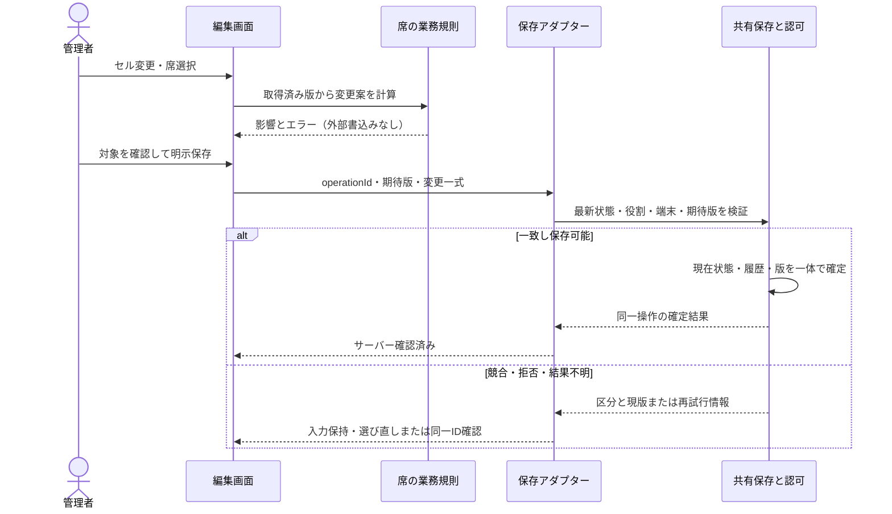

# 会場席作成・席設定の詳細設計

## この文書について

| 項目 | 内容 |
|---|---|
| 目的 | Issue #91の承認内容を、データ契約、操作、異常時、試験と実装単位へ展開する |
| 読者 | 開発者、設計担当者、テスト担当者、依頼者 |
| 関連Issue | [#91](https://github.com/EU0207/concert-reception-system/issues/91)、[#93](https://github.com/EU0207/concert-reception-system/issues/93) |
| 設計ID | DD-91-01～DD-91-08 |
| 状態 | In Review |
| 承認情報 | 本詳細設計は未承認。業務前提はCONF-060～062を含む承認済み追補。本番実装・試験は未実施 |
| 照合基準 | main `b88afb41c28d75ac900362072353a4dd7c50f351`。PR #88は2026-10-03に統合済み、統合コミット`67312c9ed7f915cb01e48336e30f8a98c27fa3fd` |
| 対象 | 公演ごとの会場席作成、席設定、表示名変更、移動・交換、帳票用データ契約 |
| 対象外 | 本番コード、外部環境構築、公開、画像登録基盤、発券基盤、受付・来場状態訂正の実装 |

## 結論

固定セルID、座席ID、表示番号を分離する。編集中は画面メモリーだけで計算し、明示保存で版を確認する。発券済み席を一括採番へ巻き込まず、交換は両者を一つの操作として確定する。通常の席替えではQRを維持し、不参加では#93の取消し操作を通して旧QRを無効化する。

業務判断DD-91-B01は2026-10-03の[CONF-070](../ui-mock/ui-mock-client-response.md#conf-070-発券後の席設定解除)で解決した。現時点の依頼者確認待ちはない。保存の物理構造とSecurity Rulesの成立性はDD-91-T01の技術ブロッカーとして分離する。本書の業務契約がレビュー可能であることと、本番実装を開始できることを区別する。開始条件は[DD-91-08](#dd-91-08-実装順と承認ゲート)で定める。

## DD-91-01 正式情報との照合

| 根拠 | 承認済み条件と適用先 | 具体化する設計 | 試験 |
|---|---|---|---|
| [REQ-F-035・038・039](../../client/requirements.md)、[AC-025](../../client/acceptance-criteria.md) | 任意開始番号、欠番の補完禁止、舞台左端、階・区画と画像の連動。主担当・代理による会場照合 | DD-91-02・03・06 | T01～06、T19、T24 |
| [REQ-F-036、AC-026](../../client/acceptance-criteria.md)、[RES-005](../technical-validation/res-005-seat-allocation-desk-review.md) | 一般席、最大10人、人数降順、連続席、手動分割後の固定、発券後の自動配置禁止 | DD-91-04 | T07～10、T25 |
| [REQ-F-007・043、AC-003・035](../../client/acceptance-criteria.md) | 変更履歴、購入者名と表示名の分離、表示名6文字、旧受付の保持 | DD-91-02・04 | T11～13、T20 |
| [REQ-F-004、AC-002・022](../../client/acceptance-criteria.md) | 通常の座席変更ではQRを維持。紛失再発行とは分離 | DD-91-04・07 | T12、T20 |
| [REQ-F-045、AC-037](../../client/acceptance-criteria.md) | 同じ確定構成からPDF・Excel、舞台左端、席番左隣、確保席ラベル、A4横1ページ | DD-91-07 | T23 |
| [BD-02-02～05・09](../basic-design/logical-data-model.md) | ID分離、変更不能イベント、公演分離、不変条件 | DD-91-02・05 | T14～18、T21 |
| [BD-03-01・04・07](../basic-design/offline-sync-conflict-design.md) | 明示保存、基準版比較、オンライン限定座席変更、同一ID再試行、未更新端末の運用 | DD-91-05・07 | T14～18、T21～22 |
| [BD-04-04・07](../basic-design/authentication-authorization-design.md)、[BD-05](../basic-design/security-privacy-design.md) | 公演役割と端末認可、閲覧データ分離、直接API拒否 | DD-91-05・06 | T17～18 |
| [BD-06-01・08・10・15](../basic-design/screen-flow-wireframe-design.md)、[BD-07-08](../basic-design/file-output-report-design.md) | 未保存離脱、写真参照、キャンバス、当日個別追加、帳票共通構成 | DD-91-03・06・07 | T19、T22～24 |
| [引継ぎ台帳](../ui-mock/ui-mock-production-handoff.md) FB-08・09・14／MCT-08・09・14、CONF-061 | 初期「未」、5種別、番号消費、逆順、配置済み保護 | DD-91-02・03 | T01～06、T13 |
| 同台帳 FB-10・19・30／MCT-10・19・30、MCT-34、CONF-062 | 表示名・交換・取消し、未入金を禁止理由にしない、不参加、フォーカス、席設定の名称 | DD-91-04・06・07 | T07、T11～13、T19～21、T24 |
| 同台帳 MHD-03・05 | 座標と帳票共通構成、#93の取消し原子性、旧QR、履歴 | DD-91-02～07 | T14～18、T20～23 |

Txxは[本設計のケース表](seat-management-test-cases.md)の`DD91-Txx`を指す。REQ-F-044・046、REQ-NF-013・014・020とAC-032・036・038を関連条件として維持する。来場状態の訂正はREQ-F-041・AC-029の別操作とし、席替えで受付実績をリセットしない。

### 旧本文との相違

基本設計の「座席・スペース」の2種別へ5種別を追加するが、座席以外をQR・割当の対象へ広げない。BD-07-08の「欠番はセル自体を生成しない」は、編集用欠番セルを永続化しない意味には使わない。編集座標は保持し、帳票では座席枠を描画しない。これはCONF-060の追補の適用である。

モックの1～30セルと74×72pxは確認用の値である。本番の上限・初期値・実機寸法の承認根拠には使わない。新規入力の推奨初期値はモック同様5×8とし、変更可能とする。1～30は暫定技術上限案であり、DD-91-T01の容量確認後に採否を決める。席数上限を来場者500人から逆算しない。

## DD-91-02 データ契約と不変条件

以下は製品に依存しない型の案である。IDは不透明なUUID v4とし、すべての公演所属レコードに`environmentId`と`performanceId`を持つ。購入者名や席番号をキーにしない。

| 型 | 項目・検証 | 意味 |
|---|---|---|
| LayoutSection | `sectionId`, `floorId?`, `displayOrder`, `rows`, `columns`, `axis: horizontal/vertical`, `seatOrder: forward/reverse`, `lineSettings[]`, `cells[]` | 区画ごとの構成。座標は0始まり、画面は1始まり。舞台は左端の別表示要素 |
| LineSetting | `lineId`, `index`, `name`, `prefix`, `startNumber` | 横なら行、縦なら列へ対応。開始番号は正の安全整数、接頭部と列名は英字・数字を扱う。接頭部と列名は分離 |
| LayoutCell | `cellId`, `row`, `column`, `kind: unset/seat/gap/space/aisle`, `seatId?`, `consumedNumber?` | 位置と種別。gapは番号を消費するが座席IDを持たない。space・aisle・unsetは番号なし |
| Seat | `seatId`, `sectionId`, `lineId`, `prefix`, `number`, `displayOrder`, `category`, `usable`, `reservedLabel?` | categoryは一般・車椅子・同伴者・使用不可・確保済み。欠番にSeatを作らない |
| SeatAssignment | `attendeeId`, `seatId`, `groupId?`, `fixed`, `revision` | 一人一席の現在関係。座席表示名はAttendee側に持ち、セルへ氏名を複製しない |
| Attendeeの参照項目 | `attendeeId`, `buyerId`, `rosterOrder`, `groupId?`, `attendancePlan`, `seatDisplayName` | #93・97と共通契約。購入者IDとグループIDは別。同名からIDを統合しない |
| Ticketの参照項目 | `ticketId`, `attendeeId`, `issued`, `sent`, `activeCredentialId`, `revision` | 発行チェックが未済でも有効QRまたは発行履歴があれば発券済み保護を外さない。#93・95で実体定義を整合させる |
| SeatEditCommand | `operationId`, `kind`, `expectedVersions`, `actorId`, `deviceId`, `beforeRefs`, `after`, `reason?` | 編集開始時の版を保持。確認画面の内容と送信内容を一致させる |
| SeatEditEvent | BD-03共通イベント項目、`operationId`, `before`, `after`, `groupEffects`, `result` | 確定した前後差分を追記。取消しは元イベント参照を持つ新イベント。QR生値は含めない |
| SeatMapProjection | `schemaVersion`, `layoutRevision`, `assignmentRevision`, `attendeeRevision`, `ticketRevision`, `sections`, `counts` | 一貫した確定版から画面・帳票を生成する共通入力。購入者名と任意項目を含めない |

空欄の階・区画は表示上の「指定なし」へ対応させ、内部のsectionIdは必須とする。表示名の改行は保存値へ追加しない。文字数はUnicodeコードポイント単位とする技術案で、半角・全角空白を除いた1～6文字を検証する。未入力は許容し、空欄のままなら席設定時に略称入力を案内する。空白なしは3文字ごと、空白ありはその位置で2行表示する。空白が多く3行以上になる入力は保存値を保持し、表示では空白を除いて3文字ごとに折り返す案とする。切捨てはしない。

表示番号は接頭部と整数番号を連結して作り、表示用文字列を内部キーにしない。初期の接頭部は列名と区切り文字`-`から生成し、A列・開始1なら`prefix: A-`と`number: 1`から`A-1`を表示する。実会場に合わせた接頭部を明示変更できる。gapのconsumedNumberとseatのnumberは同じ採番結果から取得し、セル側で別計算しない。

### 不変条件

1. 同一区画の座標とcellIdは重複しない。既存セルの移動でIDを変えない。削除したセル・座席のIDを別の席へ再利用しない。
2. seatセルだけがSeatを参照し、一つのSeatは一つのセルに対応する。seat以外は割当・チケット・QR資格を持たない。
3. 席番号の一意範囲は`公演＋階＋区画＋列＋接頭部＋番号`。同じ番号でも異なる区画は許容する。選択欄では階・区画を併記する。
4. 来場予定者一人に現在席は最大一つ、一席の現在割当も最大一人。不参加者は割当を持たない。
5. 確保済み・使用不可・特別席は自動配置から除外する。未割当の確保席にQRを作らない。
6. 入金状態を席設定の許可条件にしない。購入者名とQR資格を通常の表示名変更・席替えで変更しない。
7. 現在版と期待版が違えば業務変更を確定しない。理由付き操作の履歴、現在関係、版は論理上同時に確定する。
8. 履歴内の旧席・旧券状態は書き換えない。保持期限と削除はBD-02・BD-08へ従い、個人情報を恒久保持する別台帳は作らない。

## DD-91-03 作成・採番・構成変更

### 作成と採番

1. 階・区画を選び縦横数を指定する。新規セルはすべてunset。個別選択、複数選択、矩形選択を可能とする。
2. セルを5種別へ変更し、横なら上から下の行順、縦なら左から右の列順へlineSettingsを対応付ける。
3. 各列の開始番号から、横は左→右、縦は上→下に走査する。reverseなら各列内だけ反転する。列名の並びとcellIdは変えない。
4. seat・gapで番号を1進める。他種別は進めない。接頭部、番号、階・区画を用いて重複を検証する。
5. 変更前後の席番号、影響するお客様、件数をプレビューし、会場画像と実会場に照合して確定する。画像の自動解析は行わない。

unsetが残る下書きは保存可能とする。確定時はunsetを残せず、意図した空間へ明示変換する。正数以外、範囲外座標、重複番号、数値オーバーフローは理由を示して拒否する。列名等の文字列上限はDD-91-T01で容量・既存席表との適合を検証し、未決のままアプリへ固定しない。

### 架空例

横方向A列、開始1、左からの入力が`席／欠番／空間／席／通路／席`の場合：

| 座標（行,列） | (0,0) | (0,1) | (0,2) | (0,3) | (0,4) | (0,5) |
|---|---|---|---|---|---|---|
| 通常順 | A-1 | 欠番2 | 番号なし | A-3 | 番号なし | A-4 |
| 逆順 | A-4 | 欠番3 | 番号なし | A-2 | 番号なし | A-1 |

実在席3、欠番1、空間1、通路1。自動配置対象は一般・利用可・未割当の席だけである。開始7なら通常順はA-7・欠番8・番号なし・A-9・番号なし・A-10。縦方向は同じ規則を列内へ適用する。

### 既存席の保護

| 対象 | 構成変更の扱い |
|---|---|
| 未設定の一般席 | 再採番案を表示し、確定までは旧版を維持する |
| 未発券の席設定済み席 | 自動では番号をずらさない。影響するお客様と旧席を確認し、明示的に席設定解除した後で構成案を再計算する。解除と構成確定は一操作に含める |
| 発券済み席 | 番号変更・種別変更・削除を一括操作で拒否する。個別の理由付き席替えへ案内し、元席構成の変更とは分ける |
| 確保席・特別席 | ラベル・区分・利用可否を含む影響を確認する。割当があれば上記保護を適用する。空席でも区分を一般へ自動変更しない |
| 行列の縮小・方向変更 | 範囲外セル、変わる列対応、旧新番号を列挙する。影響解消なしに確定しない。発券済み対象があれば一括変更を拒否する |
| 当日運用中 | 全体再構成・全列逆順は禁止。主担当・代理による個別追加・変更だけをオンライン、理由付きで行う。既存セルと席番号を自動変更しない |

一部の保護席を避けて残りを黙って確定しない。操作全体を止め、対象を選び直して新しい変更案を確認する。当日の追加席は番号を明示入力し、欠番補完による新設とは扱わない。

## DD-91-04 席設定・取消し・交換

| 操作 | 入力・検証 | 更新と確認 |
|---|---|---|
| 候補表示 | 来場予定・席未設定を対象。初期は入金済み、切替で未入金を含む全員 | 絞込・件数はメモリー計算。不参加は両タブから除外。切替で編集中の対象を失わない |
| 手動設定 | attendeeIdとseatId。利用可能席、重複なし、来場予定を確認 | 対象者・新席を確認し「席設定を確定」で保存。発券は別操作 |
| 自動配置 | 一般空席、グループIDと名簿順を入力。最大10人。固定済み・発券済みを除外 | RES-005の人数降順と候補順を適用。分割せず配置不能理由を示す。ランダムは生成済み順序を記録し再試行で変更しない |
| 手動分割 | グループ全員、必要席数、理由を入力 | 分割確認後に全員を固定。発券前だけ固定解除・再配置・直前状態への取消しを許可 |
| 表示名変更 | 購入者名と旧表示名を示し、6文字以内を検証 | 購入者名、購入状態、席、QRを維持。前後値を履歴へ。発券後・当日管理では理由必須 |
| 未発券の席設定解除 | 対象者と旧席。グループの場合は全員への固定影響を確認 | 席未設定へ戻す。SeatやAttendee本体は削除しない。通常の解除と直前操作取消しは別ボタン |
| 空席への移動 | 対象者、旧席、新席。相手なし | 旧席解放と新席割当を同時確定。発券後はオンライン版確認と理由必須、QR維持 |
| 二人の交換 | 両者と両席の版を確認。どちらか発券済みなら発券後変更 | 両者の前後を確認し一操作で交換。片方だけ保存しない。両者のQRと来場履歴を維持 |
| 発券後の席だけ解除 | CONF-070で単独解除を禁止 | 不参加処理を案内する。来場予定を維持する場合は通常の移動・交換を使う |
| 不参加・復帰 | #93へ委譲。入金と来場者記録は維持 | 不参加は席解放・現在券状態解除・QR無効化・履歴を一操作で確定。発券済みは独立2回確認。復帰は未設定・未発券から開始 |

発券済みの判定は固定チェックの表示だけに依存しない。券発行済みを手動で外しただけで発券前へ戻す抜け道を認めない。対象グループに発券済みが一人でもいれば、そのグループの自動再配置・固定解除・直前取消しを拒否する。

不参加者を含むグループは、残る来場予定者だけを黙って別グループに組み替えない。自動配置対象外理由を表示し、#93のグループ状態整理後に再判定する。必要な業務変更があれば#93の確認事項として記録する。

## DD-91-05 保存・履歴・認可の境界

### 操作の流れ

公演前編集をIndexedDBへ自動保存しない。明示保存要求の操作IDも応答不明中は画面メモリーで保持する。画面を閉じた後は共有履歴から確定結果を再取得してから次の操作へ進む。受付イベントの端末先行保存と混同しない。

### アダプター契約

| 操作 | 入力 | 成功・失敗 |
|---|---|---|
| loadSeatContext | 環境、公演、既取得版 | 一貫した確定版と許可済み項目。版不変ならデータ本体0件 |
| saveDraft | operationId、期待draft版、基準確定版、構成案 | 新draft版。現確定版は変更しない。一般受付へ下書きを配布しない |
| commitSeatEdit | operationId、確認済みcommand、期待版群 | committed版とeventId。競合・権限不足・検証不備は確定なし |
| getOperationResult | 環境、公演、operationId | committed / rejected / preparing / notFound。committedの内容一致時だけ既送信として扱う |
| getSeatMapProjection | 確定版群、出力用途、役割 | 同一版の構成と表示。下書き・途中版が混じれば生成拒否 |

期待版群には公演状態、役割、端末許可、構成、席設定、来場予定、チケットを含める。不参加・発券・役割変更が確認画面の後に起きても、古い確認で保存させない。無関係な別区画の変更で競合が多発する場合は版単位の縮小を後続検証で検討する。

### 物理保存案と未解決の成立性

[ADR-007](../decisions/ADR-007-seat-edit-commit-boundary.md)はProposedである。第一候補は、上限内の変更一式を単一Firestoreトランザクションで確定する方式。下記は候補パスであり、採用済みスキーマではない。

| 候補パス（公演配下） | 保存内容・公開範囲 |
|---|---|
| seatState/head | 構成版、席設定版、基準版と最終操作ID。購入者名なし |
| layoutSections/{sectionId} | 座標、5種別、番号、固定ID、区分。名前・購入者情報を入れない |
| assignments/{attendeeId} | 一人の現在席と固定状態。逆参照をseats/{seatId}と同時更新 |
| seats/{seatId} | 現在割当参照、番号、区分、版。席ごとの排他確認 |
| seatDrafts/{sectionId} | 主担当・代理だけが読める共有下書きと基準確定版 |
| seatOperations/{operationId} | 期待版、操作種別、処理状態、結果版、内容照合情報。氏名なし |
| events/{eventId} | DD-91-02の前後差分。履歴の権限と保持期限を適用 |

通常の移動は一人と旧新席、交換は二人と二席を同時更新する。不参加は#93の来場予定・券・QR・席・履歴を同じ確定境界へ含める。再送時はoperationIdと業務内容を照合し、同じIDの別内容は拒否する。トランザクション内でUI更新や乱数再生成をしない。

最大500人の自動配置や最大30×30の構成保存を、上限確認なしに同じ方式へ適用しない。DD-91-T01で文書サイズ、要求サイズ、Rules参照数を算定する。名前を含む大きな一文書案は閲覧分離のため採用しない。

上限内に収まらない場合の候補は、`seatOperations`にimmutableな変更片を準備し、完了検証後にheadを切り替える方式である。ただし、Rulesで全変更片の完全性、番号の一意性、双方向割当を検証できる証拠はまだない。件数やハッシュをクライアントが申告しただけで確定を許可しない。検証不能なら方式を採用せず、ADRを再検討する。無料条件や外部サービスを変える案は業務承認へ戻す。Cloud Functionsや代替基盤を先行追加しない。

DD-91-T01完了まで、本番保存の物理スキーマとRulesは未確定である。これは一般的な残存リスクではなく、保存実装と設計完了承認のブロッカーである。

### 権限表

| 操作 | 一般受付 | 臨時管理者 | 主担当・代理 |
|---|---|---|---|
| 確定会場席の閲覧 | 座席表示名と来場状態のみ | 当日業務に必要な項目 | 許可済み管理情報 |
| 構成編集、席設定、自動配置、移動・交換 | 拒否 | 拒否 | オンライン、対象公演・許可端末、最新状態 |
| 当日の座席表示名変更 | 拒否 | 既存BD-04の有効な当日権限で可 | 可 |
| 不参加、旧QR無効化、券操作 | 拒否 | 拒否 | #93・95の確認条件を満たす場合 |
| 席表の管理出力 | 拒否 | 拒否 | BD-07のオンライン再認証、監査 |

#98の権限カスタマイズで変更するまでは、臨時管理者へ新しい操作を広げない。Security Rulesでは本人・端末主体の結合、メール確認、有効役割、停止状態を検証する。一般受付へ購入者名・任意項目・管理履歴・下書きを送らず、画面で隠すだけにしない。

## DD-91-06 画面状態と異常時

| 状態・異常 | 表示と次の操作 | データの扱い |
|---|---|---|
| 取得中・参照欠落 | 編集不可、取得または再取得を案内 | 欠落Seatを空席扱いしない |
| 編集中・未保存 | 選択席・選択客・未保存を追随表示 | メモリーのみ。保存して移動／保存せず移動／編集継続 |
| 保存中 | 二重押下と対象変更を停止 | 同一operationIdを維持。成功通知前にdirtyを消さない |
| 下書き保存済み | 下書き版と未確定を明示 | 他端末で再開可。受付・発券・帳票の確定入力には使わない |
| 版競合 | 自分の案と共有先の変更対象を提示 | 入力保持。最新取得後に影響を再計算し、再確認する |
| オフライン・App Check等の状態確認失敗 | 明示保存・確定不可、紙対応と再接続を案内 | 席変更をオフラインキューへ自動登録しない |
| 応答喪失 | 「保存結果を確認中」、同一操作の照会・再試行 | 未保存と断定して別IDを作らない。サーバー確認まで再割当不可 |
| 容量・検証・Rules拒否 | 対象と不足条件を示す。入力を保持 | 部分成功にしない。恒久拒否は自動無限再送しない |
| 役割失効・端末停止 | 操作・閲覧をロックし、管理者連絡を案内 | 私有入力を別利用者へ渡さない。未受領の受付記録は既存BD-04に従い保持 |
| 再読込み・強制終了 | 未保存案は復元されない旨を案内 | 共有確定版と操作結果を再取得。保存成功前の案を成功扱いしない |

会場写真は階・区画に対応する確定画像版を参照し、登録・削除を#91に追加しない。事前取得失敗時は座席一覧へ切り替える。パン・ズームは画像と座席キャンバスで独立して保持する。

画面名は「お客様の席を設定」、タブは「席未設定／席設定済み」。ボタンは「この席に設定」「席設定を確定」。席設定済みタブでは席替えを中心に表示し、未発券の取消しは対象詳細から独立した確認へ進む。キャンバスは選択cellIdで位置を復元し、席番号変更後も対象を見失わない。「選択席へ戻る」で中央へ、「標準倍率で左上へ」で倍率と位置を戻す。取消されたセルは未選択とし、勝手に別席を選択しない。

## DD-91-07 #93・発券・帳票・未更新端末への受渡し

| 境界 | #91の責務 | 相手の責務・開始条件 |
|---|---|---|
| #93：不参加 | 席解放と割当参照変更をcommandへ含める。中間状態を空席として配布しない | 来場予定、券状態解除、旧QR無効化、旧席と券状態の履歴を一操作にまとめる。MHD-05の共同契約をレビューする |
| #93・97：購入者 | attendeeId・buyerIdを参照し、表示名だけを更新 | 購入者名修正はbuyerId単位。同名統合禁止。個別登録の未設定行を供給する |
| #95：発券・出力 | 確定席と席設定版を渡す。未設定・未確定対象の発券を拒否 | チケットとQRの生成・無効化・再発行を担当。通常の席替えでは同じcredentialIdを維持 |
| #89：当日閲覧 | 同じSeatMapProjectionを提供し、席設定後の選択IDを保持 | 実カメラ離脱、画像閲覧と当日導線を担当。会場編集への往復は未保存確認を通す |
| 帳票 | 番号版・名前版の共通投影を作る | PDFとxlsxの生成ライブラリ、レイアウト・安全性は出力タスク。購入者名や任意項目を投影へ混ぜない |
| 端末差分更新 | 確定版と変更対象を返す | 最新版との不一致を差分更新待ちとし、本番受付を拒否。新しい版の保存・整合性確認後に準備完了へ戻す |

取消しの対象に既存来場実績があっても実績を削除しない。受付の採否と集計は#92・93のイベント導出で扱う。旧QR無効化を座席番号変更から推測しない。

完全オフライン端末へ席変更やQR無効化を即時通知することはできない。BD-03-07の承認済み運用を使い、稼働端末の受付停止を担当者へ確認し、確定後の更新版受信を確認してから再開する。確認不能な間は無効化・再発行を保留し、紙の例外記録で扱う。通常の席替えでも旧席を示す端末があるため、同じ更新確認または紙照合を行う。オンライン画面の「更新済み」を全端末への配信保証として表示しない。

## DD-91-08 実装順と承認ゲート

[実装分割表](seat-management-implementation-plan.md)の順でIssueを作る。各Issueは一つのPRでレビューできる責務へ限定する。

| ゲート | 必須条件 | 未完了時の扱い |
|---|---|---|
| G91-A 詳細設計レビュー | 本書、ケース表、ADR-007の対象と未決事項を開発者が確認 | 本番コードへ着手しない |
| G91-B 技術成立性 | DD-91-T01で物理スキーマ・Rules・容量・直接API拒否を検証し、ADRを採否決定 | 保存実装へ着手せず、#91を設計完了にしない |
| G91-C 依存契約 | #93のMHD-05、#95のチケット保護、認証・端末基盤の契約と前提を具体的Issueで追跡 | 対象結合タスクを開始しない。画面の隠し方だけで認可完成としない |
| G91-D 業務判断 | DD-91-B01はCONF-070で回答記録済み | 発券後の単独解除を禁止し、不参加処理を用いる |
| G91-E タスクごとの開始 | 適用する設計がApproved、対象Issueと試験が確定、依存Issueが完了 | Todoのまま維持。依存追加時はTBD-011の実版確認も行う |

### 確認事項の分類

| ID | 区分 | 内容・理由 | 推奨案・影響 |
|---|---|---|---|
| DD-91-B01 | 解決済みの業務判断 | 発券後、不参加にせず席だけ未設定へ戻す場合の受付資格を確認 | CONF-070で推奨案を承認。発券後は移動・交換のみ、未設定化は不参加処理を使用 |
| DD-91-T01 | 開発側の技術判断・ブロッカー | 大量編集の物理保存とRulesによる整合性検証。無料条件を維持したまま全件確定できるか | 単一トランザクション優先。最大件数の計算・検証後に採用。未成立ならADRと影響を再提示 |
| DD-91-T02 | 開発側の技術判断 | ID、版、座標、表示名整形、アルゴリズムの再現性 | 本書の共通契約を採用候補とし、純粋な計算をSDKから分離する |
| DD-91-T03 | 開発側の技術判断 | 臨時管理者の範囲、発券済みの安全判定、#93の共同操作 | 承認済み禁止操作を維持。画面・直接API双方をケースへ割当てる |

**依頼者に確認してください**

- なし。DD-91-B01はCONF-070で依頼者の回答を受領し、推奨案の承認を記録した。

**開発者が確認してください**

- DD-91-T01：最大構成と500人一括配置を、権限・参照制限内で全件確定できることを確認し、物理構造を確定してください。
- DD-91-T02・03：共通型と試験、#93・95の境界、臨時管理者の禁止操作をレビューしてください。
- 本書と実装分割は未承認です。業務承認済みの範囲を再確認対象に戻さず、対象設計と依存が整ったタスクから開始してください。
