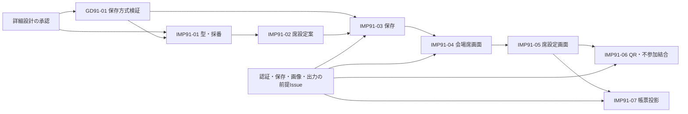

# 会場席作成・席設定の実装分割

## この文書について

| 項目 | 内容 |
|---|---|
| 目的 | #91の詳細設計を、依存順とレビュー範囲が明確な小さなタスクへ分割する |
| 読者 | 開発者、レビュー担当者、テスト担当者 |
| 関連文書 | [詳細設計](seat-management-detail-design.md)、[ケース表](seat-management-test-cases.md)、[ADR-007](../decisions/ADR-007-seat-edit-commit-boundary.md) |
| 関連Issue | [#91](https://github.com/EU0207/concert-reception-system/issues/91) |
| 状態 | In Review |
| 承認情報 | 分割案は未承認。全実装未着手。Issue作成やTodo登録は実装許可ではない |

## 分割と完了条件

2026-10-03に#101～108をGitHubへ登録し、Project「コンサート受付システム開発」のTodoとOPENを再取得して確認した。記号は同じIDをIssue本文へ転記する。実装ファイルの候補は責務の境界を示し、構成採用前の確定パスではない。

| タスク／Issue | 何を作るか・対象 | 依存と開始条件 | 完了条件・ケース |
|---|---|---|---|
| GD91-01／[#101](https://github.com/EU0207/concert-reception-system/issues/101) | 保存スキーマとRulesの成立性を具体化する設計・隔離検証タスク。DD-91-T01とADR-007の採否 | 本書の検証対象レビュー後。外部環境を変更しない | 最大構成・500人の容量、認可参照数、直接API拒否を記録。成立した物理構造と採否を本書へ反映。保存基盤・認証基盤の実装Issueを特定して依存登録。T10・16～18 |
| IMP91-01／[#102](https://github.com/EU0207/concert-reception-system/issues/102) | 共通型、セル種別、採番、影響計算、表示名整形。`src/domain/seats/`候補 | 適用するDD-91-02・03の承認とGD91-01で入力上限確定後。本番SDKを追加しない | 通常・逆順、ID保護、重複、発券保護の純粋計算。T01～06・11・13。MCT-08・09・14、CONF-061 |
| IMP91-02／[#103](https://github.com/EU0207/concert-reception-system/issues/103) | 手動・自動の席設定案、グループ固定と取消し。`src/domain/assignments/`候補 | IMP91-01と対象設計承認。#93の参加・入金契約が明確 | RES-005の全例、10人上限、未入金可、500人と再現可能な順序。T07～10・25。MCT-10・19 |
| IMP91-03／[#104](https://github.com/EU0207/concert-reception-system/issues/104) | 版確認・明示保存・履歴・冪等性の保存アダプター。`src/adapters/seat-store/`候補 | GD91-01、IMP91-01・02完了。認証・端末認可と永続化基盤の具体的実装Issue完了。ADR採用・物理設計承認 | 片側更新拒否、同時更新、再送、公開範囲、計測。T12・14～19。MCT-08～10・14。基盤全体の構築は含めない |
| IMP91-04／[#105](https://github.com/EU0207/concert-reception-system/issues/105) | 会場席作成・編集画面、確定画像参照、キャンバスと下書き操作。`src/features/venue-editor/`候補 | IMP91-01・03完了。#89の画像表示契約、画像登録基盤、共通UIの具体的前提を確認 | 5種別、影響確認、未保存離脱、当日一括再構成禁止。T04・06・19・22・24。MCT-08・09・14・34 |
| IMP91-05／[#106](https://github.com/EU0207/concert-reception-system/issues/106) | 「お客様の席を設定」画面、候補・タブ、表示名、取消し、移動・交換。`src/features/seat-assignment/`候補 | IMP91-02～04完了。#93の候補状態と発券保護契約確定 | 名称統一、対象保持、交換確認、発券後の単独解除拒否。T07・09・11～13・19・24。MCT-10・19・34、CONF-062・070 |
| IMP91-06／[#107](https://github.com/EU0207/concert-reception-system/issues/107) | #93と共同の席解放・QR無効化の結合、準備済み端末の版更新。`src/integration/seat-ticket/`候補 | IMP91-03・05、#93のMHD-05とチケット・QR・差分同期基盤の具体的実装Issue完了 | 旧席券履歴、初回受付保持、復帰非復活、未更新端末・紙運用。T20～22・25。MCT-30、MHD-05。名前修正と確認用項目のUIは#93へ残す |
| IMP91-07／[#108](https://github.com/EU0207/concert-reception-system/issues/108) | 確定座席表の共通投影と既存出力への受渡し。`src/domain/seat-map-projection/`候補 | IMP91-01・03・05完了。ファイル出力基盤の具体的実装Issue完了後に結合 | 投影単体とPDF・xlsxの位置・件数・版の一致、番号版と名前版、生成書込み0。T23。MCT-09・10、MHD-03。ライブラリ採用・発券基盤は別対象 |

## 依存順

GD91-01は実装前の技術検証であり、本番コードを追加するタスクではない。前提Issueが未登録なら、対象責務と完了条件を定めて登録するまで依存待ちとする。モックの承認や閉じたモックIssueを、本番基盤完成の根拠にしない。#94・95はモックの変更履歴であり、本番基盤の依存先として完了済み扱いしない。

## 各PRの共通完了条件

- 適用する詳細設計と対象FB・MCT・ケースIDを本文へ記載する。
- 自分の責務の正常系と異常系を確認する。関係する直接API拒否と公演分離を省略しない。
- 仕様や契約を変更した場合は関連文書とケースを同じ作業で更新する。
- 未実施の結合・実機試験は残作業として明記する。依存待ちを試験合格にしない。
- 依存追加は実版の権利・安全性・配信物を確認する。公開・デプロイ・本番データ移行は含めない。
- IssueとProjectを更新・再取得する。実装タスクの完了で親#91を自動Closeしない。

## #91の設計完了と本番完了の分離

本PRの文書レビューだけでは、GD91-01の技術ブロッカーを解消しない。#91の設計完了は、保存物理構造の成立、共同契約、実装Issueとケースの割当を確認してから判断する。本番変更全体の完了はIMP91-01～07の結果とMCTを突合してから判断する。いずれも親Issueの完了範囲と残作業を明示してCloseする。

**依頼者に確認してください**

- なし。DD-91-B01はCONF-070で解決済み。技術検証で業務条件を変える必要が生じた場合は新しい確認を行う。

**開発者が確認してください**

- 詳細設計の適用範囲と分割をレビューし、保存方式の成立性確認を先に進めてください。後続Issueは未着手Todoとして管理してください。
