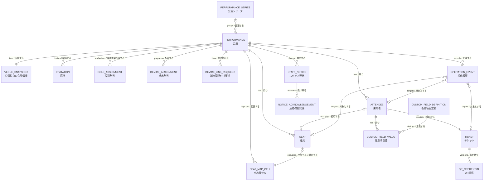
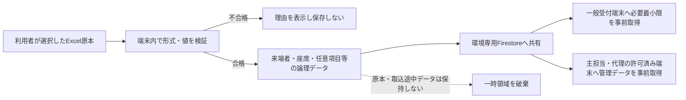
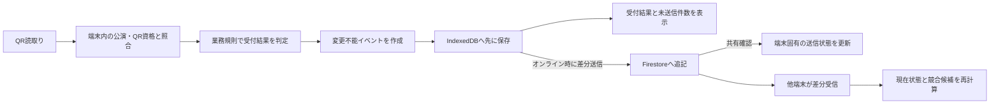
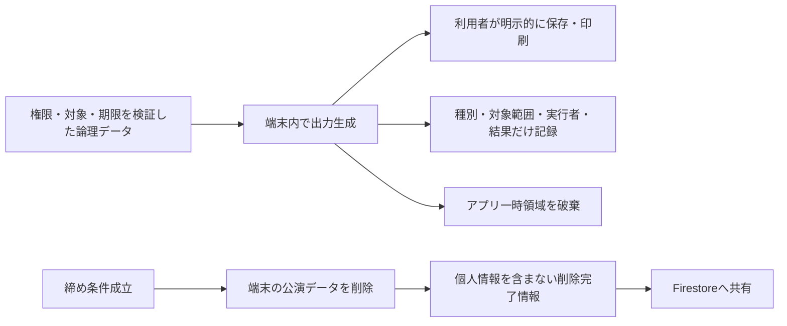

# 論理データモデル・データフロー・ライフサイクル設計

## この文書について

| 項目 | 内容 |
|---|---|
| 目的 | 承認済み要件とBD-01の責務境界を、データの意味、関係、生成・更新・保持・削除経路へ展開する |
| 主な読者 | 依頼者、設計担当者、開発担当者、テスト担当者、運用担当者 |
| 前提 | 要件定義書と受入条件書は`CONF-038`を含めApproved、ADR-001とADR-002はAccepted、BD-01はIn Reviewである |
| 関連文書 | [システム構成・環境分離設計](system-architecture.md)、[基本設計計画書](basic-design-plan.md)、[要件定義書](../client/requirements.md)、[受入条件書](../client/acceptance-criteria.md)、[本番座席表・会場画像UI/UX設計引継ぎ事項](production-seat-map-ui-ux-notes.md)、[本番セキュリティ・UI/UX設計引継ぎ事項](production-security-ui-ux-notes.md)、[トレーサビリティ表](traceability-matrix.md) |
| 関連Issue | [#33](https://github.com/EU0207/concert-reception-system/issues/33) |
| 設計ID | BD-02、BD-02-01～BD-02-10 |
| 関連ID | REQ-F-002～REQ-F-007、REQ-F-010、REQ-F-012～REQ-F-025、REQ-F-028、REQ-F-033～REQ-F-046、REQ-NF-005、REQ-NF-006、REQ-NF-008、REQ-NF-012、REQ-NF-015、REQ-NF-018～REQ-NF-020、AC-002、AC-003、AC-005、AC-007～AC-013、AC-023～AC-031、AC-034～AC-038、TBD-004、TBD-008、CONF-024、CONF-025、CONF-034～CONF-038 |
| 状態 | In Review |
| 承認情報 | 未承認。基本設計一式はBD-10で確認する |

## 結論

業務データを、設定・基準となる「基準データ」、操作の事実を追記する「変更不能イベント」、イベントから再計算できる「現在状態」、利用者が明示的に扱う「一時入出力」の4区分に分ける。受付、再読取り、手動受付、訂正、座席変更、QR再発行、例外、連絡、権限、出力、削除、締めの事実は上書きせずイベントとして残し、来場状態、現在席、QR有効状態、例外状態等はイベントから導出する。

共有すべき正本は環境専用Firestore、当日受付を継続するための端末内作業正本は各端末のIndexedDBとする。端末で発生したイベントはIndexedDBへ先に保存し、送信確認後も締め処理まで保持する。Excel原本とPDF・ZIP・Excel・CSV等の生成物はサーバーへ保存せず、利用者が明示的に選択した端末内処理だけで扱う。

標準の来場者情報は氏名、座席、受付・例外に必要な状態へ限定する。任意項目値は主担当・代理管理者の許可済み端末だけへ配布し、一般受付端末と一時管理者端末へ配布しない。表示権限、暗号化方式、同期順序、物理コレクション、索引、コード上の型は、それぞれBD-03～BD-05で具体化する。

複数日公演は開催日ごとの公演へ分け、任意の公演シリーズは整理とコピー元の参照だけに使用する。公演シリーズをデータ境界にせず、コピーした情報は新しい公演に属する独立データとして保存する。同じ端末に複数公演を準備しても、公演ごとの端末割当、未送信、CryptoKey、削除状態を混在させない。

## 事実、設計判断、後続設計の境界

| 区分 | 内容 |
|---|---|
| 承認済みの事実 | 最大500人、登録利用者10人程度、6環境以上の受付を扱う。変更不能イベント、復旧後統合、個人情報の最小化が承認済みである。`CONF-038`により、複数日公演は日ごとの独立公演とし、公演シリーズは整理・コピー用途に限定する |
| 本書の設計判断 | 論理エンティティ、関係、イベントと現在状態の境界、データフロー、保存区分、配布範囲、削除条件、不変条件を定める |
| 本書で決めない事項 | Firestoreのコレクション・文書構造と索引、IndexedDBのストア名、同期順序と競合解決、暗号方式と鍵、Security Rules、画面項目配置、帳票レイアウト、運用手順を決めない |

## BD-02-01 データ区分と正本

| データ区分 | 内容 | 正本 | 更新方法 |
|---|---|---|---|
| 基準データ | 公演シリーズ、公演、会場スナップショット、座席、座席表セル、来場者、任意項目定義、QR資格、役割割当、端末割当 | オンライン共有時はFirestore | 管理操作をイベントとして記録し、検証済みの現在版を更新する |
| 変更不能イベント | 受付、再読取り、訂正、座席、QR、例外、連絡、権限、出力、削除、締め等の操作事実 | 発生端末ではIndexedDB、共有後はFirestore | 新規追記だけを許可し、既存イベントを上書き・削除して訂正しない |
| 現在状態 | 来場、現在席、QR有効性、例外、連絡、役割、締め、端末削除等の現在値 | イベントから再計算可能な派生情報 | イベント集合から決定的に導出し、キャッシュを正本にしない |
| 一時入出力 | Excel原本、取込途中データ、PDF、ZIP、Excel、CSV、当日運営表 | 利用者が管理する選択元・保存先 | 端末内で検証・生成し、完了・取消し・画面離脱後にアプリの一時領域から破棄する |

すべての共有レコードは論理上の環境識別子によって所属を一意にし、公演に属する業務レコードは公演識別子も持つ。異なる環境のデータを同じ保存領域へ混在させず、異なる公演の識別子を参照した要求は画面制御だけでなくサーバー側でも拒否する。具体的な識別子形式と検証方法はBD-03～BD-05で定める。

端末で新しい業務操作が成立した時点は、Firestore送信時ではなく、検証済みイベントをIndexedDBへ保存できた時点とする。保存失敗を受付成功として表示しない。共有完了は別の送信状態として扱う。

## BD-02-02 論理エンティティと関係

### 中核エンティティ

| 論理エンティティ | 主な意味・論理項目 | 関係 |
|---|---|---|
| 公演シリーズ | 識別子、名称、表示順、作成・更新情報 | 0件以上の公演を整理する任意のまとまり。受付、認可、同期、締め、削除の境界には使用しない |
| 公演 | 識別子、任意の公演シリーズ参照、名称、公演日、開始・終了日時、状態、締め方針、コピー元公演参照、作成・更新情報 | 会場スナップショット、座席、座席表セル、来場者、役割、端末、イベントの所属単位。公演日は会場タイムゾーン基準で解釈する |
| 会場スナップショット | 公演時点の会場名、住所、IANAタイムゾーンID、階・区画、画像メタデータ | 公演に属し、元の会場情報が後日変わっても変更しない。オフライン許可期限等の時刻境界に使用する |
| 座席 | 公演内の区画、列、表示用座席番号、接頭部、番号、表示順、座席区分、利用可否 | 接頭部は英字または数字を扱い、番号は任意の値から開始できる。存在する座席だけを記録し、欠番を自動補完しない。0または1人の来場者へ現在割当し、変更履歴はイベントで保持する |
| 座席表セル | 公演、表示位置、表示順、セル種別（座席・スペース）、座席参照（座席セルだけ） | 座席の識別情報と画面上の配置を分離する。座席セルは必ず1座席を参照し、スペースセルは座席を参照せず、割当・QR・空席数・座席数の対象外とする |
| 来場者 | 識別子、購入者名、座席表示名、名簿順、任意グループID、無効状態 | 公演と1席分の受付資格に属する。同じ購入者名を複数件に許可し、座席表示名の変更後も購入者名を保持する |
| 任意項目定義 | 公演内の項目名、表示順、有効状態 | 最大10件。値が削除された後も定義を残せる |
| 任意項目値 | 来場者、項目定義、200文字以内の任意値、期限状態 | 主担当・代理管理者の許可済み端末だけへ配布する |
| チケット | 来場者、公演、表示用チケット番号、交付方法、準備状態、各状態の到達日時 | 1席に対する受付資格のまとまり。QR資格と再発行履歴を持つ。交付方法は未選択・電子・紙を扱う |
| QR資格 | チケットに属する不透明な照合識別子、版、有効・無効状態 | 座席変更では維持し、紛失再発行では旧資格を無効化して新資格を追加する |
| 利用者参照 | Firebase Authenticationの利用者ID、表示用識別、利用可否 | パスワード、認証トークン、支払情報を業務データへ保存しない |
| 招待 | 公演、招待先メールアドレス、予定役割、有効期限、未使用・使用済み・失効状態、不透明トークンの検証用表現 | URLに氏名、メールアドレス、公演名を含めず、メール一致・メール確認・1回限り利用を認証・権限設計で検証する。平文トークンは保存・一覧表示しない |
| 役割割当 | 利用者UID、公演、主担当・代理管理者・一般受付・一時管理者、開始・終了状態 | 端末ではなくUIDと公演へ割り当てる。同じUIDの複数承認端末は同じ役割を参照する。各公演の主担当は1人とし、公演限定スタッフは会場タイムゾーンの公演翌日23:59:59に失効する |
| 端末割当 | 環境、公演、端末識別子、利用者UID、承認状態、準備項目別結果、準備状態、アプリ版、データ版、整合性、最終接続・同期時刻、未同期件数、オフライン期限、停止・廃止・削除状態 | 公演・ブラウザー保存領域・端末IDごとに独立し、同じ端末へ複数公演の割当を許可する。1公演の状態変更は別公演の端末割当や役割割当へ波及させない |
| 端末関連付け要求 | 主担当UID、公演、発行元端末ID、登録対象端末ID、有効期限、未使用・使用済み・失効状態、トークン検証用表現 | 既存の承認済み主担当端末が発行する1回限りQR・リンクを表す。別UID・別公演・別端末で使用できず、平文トークンを保存しない |
| 例外案件 | 公演、来場者または入力氏名、分類、未承認・保留・承認・対応済み等の状態 | 仮登録、承認、訂正、対応をイベントから導出する |
| スタッフ連絡 | 公演、優先度、タイトル、本文、原文、現在状態 | 来場者固有情報と分離し、訂正・取消し・利用者別確認をイベントで保持する |
| 出力記録 | 出力種別、対象公演、対象範囲、実行者、端末、時刻、結果 | 出力ファイル本体を保持せず、実行事実だけを監査対象にする |
| 削除記録 | 削除区分、対象種別、理由、実行者、端末、時刻、結果、件数 | 削除済み内容を復元できる値や氏名等を保持しない |

### 関係図

#### 図の見方

関係線の端にある2つの記号は、線の中央に近い記号が関係するデータの最小件数、データ名に近い記号が最大件数を表す。丸印の`o`は0件、縦線の`|`は1件、波括弧の`{`は複数件を意味する。次の一覧は、データ名が記号の右側にある場合の表記を示す。

- `||`：最小1件、最大1件。必ず1件だけ関係する。
- `o|`：最小0件、最大1件。関係しない場合があるが、最大1件まで関係する。
- `o{`：最小0件、最大複数件。関係しない場合も、複数件関係する場合もある。
- `|{`：最小1件、最大複数件。必ず1件以上関係する。

例えば、`PERFORMANCE ||--o{ SEAT`は、公演と座席の関係を示す。座席側の`o{`から「1つの公演には0件以上の座席がある」、公演側の`||`から「1つの座席は必ず1つの公演に所属する」と読む。

関係図は論理上の関係を示し、Firestoreの入れ子、文書分割、索引、トランザクション範囲を指定しない。1つの座席は必ず1つの座席表セルへ対応し、1つの座席表セルが参照する座席は0件または1件である。参照がないセルをスペースセルとして扱う。来場者と座席の現在関係は割当イベントから導出し、過去の座席を上書きして失わない。

## BD-02-03 識別子、参照、履歴スナップショット

- 環境、公演、来場者、座席、座席表セル、チケット、QR資格、イベント、利用者、招待、端末、例外、連絡、出力、削除操作に、表示名と分離した不透明な識別子を持たせる。
- 座席の内部識別子と、来場者が見る表示用座席番号を分離する。表示用座席番号は接頭部と番号を保持できるが、欠番を埋める連番や座席表セルの位置を内部識別子として兼用しない。
- 表示用チケット番号と確認コードは利用者が照合する値であり、内部識別子、認証情報、QR生データとして兼用しない。
- QR資格は推測困難な照合値を前提とするが、生成方式、格納方式、署名・暗号方式はBD-05で決める。
- イベントは発生端末が一意に採番できるイベント識別子を持ち、再送で同じイベントを重複作成しない。具体方式はBD-03で決める。
- すべてのイベントは、対象公演、操作種別、発生者、発生端末、端末観測時刻、共有確認時刻、理由、結果、関連対象IDを必要な範囲で持つ。
- 過去の意味を守る必要がある値はスナップショットとしてイベントまたは公演へ保持する。少なくとも公演時点の会場名・住所、受付時点の現在席、役割、QR版、操作理由を後日の基準データ変更で書き換えない。
- 氏名や任意項目等を削除した後の監査には、削除した内容そのものを複製せず、対象種別、件数、理由、実行者、時刻、結果だけを残す。

## BD-02-04 変更不能イベント

### 共通イベント情報

| 情報 | 目的 | 注意 |
|---|---|---|
| イベントID | 再送時の重複防止と追跡 | 発生端末で一意にする。方式はBD-03 |
| 環境ID・公演ID | 所属境界の検証 | 別環境・別公演の混在を拒否する |
| 操作種別 | 業務上の事実の分類 | 許容値以外を拒否する |
| 対象ID | 来場者、座席、チケット、例外、連絡等との関係 | 不要な個人情報をイベントへ複製しない |
| 発生者・端末 | 誰がどの端末で操作したかの監査 | 認証情報そのものは保存しない |
| 端末観測時刻 | オフラインを含む操作順の判断材料 | 信頼済みサーバー時刻とは区別する |
| 共有確認時刻 | Firestoreで共有された時点 | 未送信中は存在しない |
| 理由・メモ | 手動受付、訂正、再読取り、削除等の根拠 | 長さ、必須条件、表示範囲を操作別に検証する |
| 送信状態 | 未送信、送信中、確認済み、再試行、拒否 | 端末固有情報であり、共有イベント本体と分離する |

チケット準備状態のチェック・解除イベントは、対象、変更前後の状態、時刻を保持する。`CONF-037`により、このイベントだけを目的とする操作担当者は記録しない。QR再発行、座席変更、来場状態訂正、削除等の既存監査対象はこの例外に含めず、担当者と端末を引き続き記録する。

### イベント分類

| 分類 | 主なイベント | 現在状態への反映 |
|---|---|---|
| 受付 | 初回受付、再読取り分類、手動受付、来場状態訂正 | 来場状態、初回時刻、再読取り履歴、競合候補 |
| 座席 | 自動割当案確定、手動割当、座席変更、座席表示名変更、取消し、固定・固定解除 | 現在席、座席表示名、空席、固定状態。購入者名と過去値は残す |
| チケット準備・QR | 購入済み、発行済み、送付済み、チェック解除、座席変更による再生成、紛失再発行、旧QR無効化 | 交付方法、準備状態、各到達日時、現在有効なQR版 |
| 例外 | 仮登録、承認、保留、対応済み、訂正、取消し | 例外案件の現在状態と未対応一覧 |
| 連絡 | 投稿、訂正、取消し、重要連絡確認 | 現在表示、未読、利用者別確認状態 |
| 権限・端末 | 招待作成・受諾・失効、役割付与・停止・失効、端末承認、準備開始・項目確認・完了・無効化、取得完了、削除完了・失敗 | 招待状態、現在役割、端末準備・停止状態、締め可否 |
| 出力 | PDF・ZIP・Excel・CSV・当日運営表の生成結果 | 出力実績。生成物本体は保持しない |
| 削除 | 無効化、復活、完全削除、詳細履歴削除、任意項目値削除 | 有効状態、削除対象残件、削除証跡 |
| 締め・復旧 | 締め要求、締め確定、端末再送、紙記録照合、統合確認 | 公演状態、未送信・競合・削除確認状態 |

同じ事実を訂正する場合も元イベントを変更せず、訂正イベントが元イベントIDを参照する。表示上の現在値は、有効なイベントと訂正関係を読み取って導出する。

## BD-02-05 現在状態と競合候補

| 現在状態 | 導出規則の境界 |
|---|---|
| 来場状態 | 初期値は未受付。初回受付または管理者の手動受付で来場済みとなる。管理者の理由付き訂正で未受付へ戻せる。締め時に未受付を未来場として表示・出力する |
| 初回受付 | 最初の有効な初回受付イベントを保持し、再読取りや訂正で時刻を上書きしない。異なる端末の複数初回受付は競合候補とする |
| 再読取り | 正当な再入場、連続・誤読取り、管理者確認、その他の理由を必須とし、任意メモと訂正履歴を追記する |
| 現在席 | 有効な座席割当・変更イベントの結果を表示し、過去席と変更理由を保持する |
| 座席表示名 | 初期値は購入者名とし、席ごとの変更イベントから現在値を導出する。変更しても購入者名を上書きしない |
| チケット準備状態 | 初期値は未。購入済み、発行済み、送付済みの順序とチェック解除イベントから導出し、後続状態だけが残る矛盾を許可しない。各状態の最新到達日時を表示する |
| QR有効状態 | チケットごとに現在有効な資格を判定する。座席変更では維持し、紛失再発行では旧資格を無効とする |
| 例外状態 | 仮登録、未承認、保留、承認、対応済み、取消しを履歴から導出する |
| 連絡状態 | 原文、訂正、取消しを残し、利用者ごとの未読・重要確認を導出する |
| 無効状態 | 無効化イベントで通常一覧から除外し、復活イベントで戻す。完全削除とは区別する |
| 公演状態 | 準備中、当日運用中、終了確認中、締め済みを扱い、締め済みへの遷移は1回だけとする |

現在状態の計算順序、同時イベントの並べ方、端末時刻ずれ、冪等性、競合確定・解消規則はBD-03で定める。本書では、競合を自動的に消さず、元イベントを残したまま管理者確認イベントを追加することを不変条件とする。

## BD-02-06 データフロー

### 名簿取込と開催前準備

- 住所、電話番号、メールアドレス等を標準項目として取り込まない。
- 任意項目値は管理者用の論理データへ分離し、一般受付端末と一時管理者端末へ配布しない。
- 公演、座席表、会場画像、役割、端末準備状況を検証し、事前取得完了を端末単位で記録する。座席表の確定前に、表示用座席番号、欠番、座席セル、スペースセル、会場画像および実際の会場座席表との一致を管理者がプレビューで確認する。
- 公演コピーでは、選択したスタッフ割当、会場情報、座席表を新しい公演IDのデータとして複製する。コピー元IDを監査用に保持しても、コピー後の変更を相互に伝播させない。

### QR受付、オフライン継続、共有

- 通常受付結果に氏名を表示せず、例外対応時だけ許可範囲の氏名・対応内容を表示する。
- Firebase上限または共有停止時もイベントを端末へ保持し、QR生データと氏名を含まない未送信一覧で紙転記を補助する。
- 紙運用後は端末イベント、Firestore共有済みイベント、紙記録を件数と識別子で照合し、重複・欠落確認後に統合完了を記録する。

### 出力と削除

出力項目とレイアウトはBD-07、紙・課金分岐と復旧手順はBD-08、出力・削除権限はBD-04、暗号化と安全な一時領域はBD-05で定める。

## BD-02-07 保存先、配布範囲、出力可否

| データ | Firestore | 一般受付端末 | 一時管理者端末 | 主担当・代理の許可済み端末 | 通常出力 | 選択・管理出力 |
|---|---|---|---|---|---|---|
| 公演・会場スナップショット | 保存 | 必要分 | 必要分 | 保存 | 必要項目 | 可 |
| 購入者名・座席表示名・座席・受付状態 | 保存 | 暗号化して当日必要分 | 暗号化して必要分 | 暗号化して保存 | CSV・座席表・当日運営表等の定義範囲 | 可 |
| 交付方法・チケット準備状態・到達日時 | 保存 | 配布しない | 権限内の必要分 | 保存 | 印刷業者向けExcel等の定義範囲 | 可 |
| 任意項目定義 | 保存 | 定義・値とも配布しない | 定義・値とも配布しない | 保存 | 含めない | 明示選択時だけ可 |
| 任意項目値 | 暗号化して保存 | 配布しない | 配布しない | 暗号化して保存 | 含めない | 主担当・代理が項目を選択した時だけ可 |
| QR資格・確認コード | 保護して保存 | 受付照合に必要な表現だけ | 権限内の必要分 | 発行・再発行に必要な範囲 | チケット・印刷データ | 権限内で可 |
| 受付・再読取り・訂正イベント | 保存 | 当該端末発生分と当日必要分 | 必要分 | 保存 | 通常CSVの定義範囲 | 管理履歴で可 |
| 例外案件 | 保存 | 例外対応に必要な氏名・内容 | 権限内の必要分 | 保存 | 通常CSVの定義範囲 | 管理出力で可 |
| スタッフ連絡 | 保存 | 保存 | 保存 | 保存 | 出力対象外 | 必要性をBD-07で判断 |
| 会場画像 | メタデータを保存。画像本体の共有保存方式は未決定 | 全スタッフへ事前取得 | 事前取得 | 事前取得 | 出力対象外 | 原本管理は利用者側 |
| 認証情報・支払情報 | 業務データへ保存しない | 業務データへ保存しない | 業務データへ保存しない | 業務データへ保存しない | 不可 | 不可 |
| 公演・端末専用の非抽出CryptoKey | 保存しない | 対象端末のIndexedDBだけへ保存 | 対象端末のIndexedDBだけへ保存 | 対象端末のIndexedDBだけへ保存 | 不可 | 不可 |
| 出力ファイル本体 | 保存しない | 一時生成だけ | 一時生成だけ | 一時生成だけ | 利用者が明示保存 | 利用者が明示保存 |
| 出力・削除記録 | 保存 | 自端末の必要分 | 権限内の必要分 | 保存 | 個人情報を含めない範囲 | 監査確認用 |

「保存」は論理上の必要性を示す。`CONF-036`により非抽出CryptoKeyのIndexedDB保存だけは本番方式として確定し、鍵素材をFirestore、Cache Storage、ログ、出力へ複製しない。他の暗号詳細、Firebase Storage採用、物理文書分割は本表だけでは決定しない。会場画像の本番保存方式はBD-05とBD-07で、費用・アクセス制御・事前取得を満たす方式を決める。BD-01でFirebase Storageは未採用のため、必要なら影響をADRへ戻す。

## BD-02-08 保存期間、無効化、完全削除

| 対象 | 保持期間・期限 | 無効化・閲覧停止 | 完全削除と確認 |
|---|---|---|---|
| 氏名、開催回、来場有無、公演時点の会場名・住所 | 自動削除しない | 削除希望処理中は通常利用を止める | 主担当受付後、主担当・代理が対象確認、理由、担当者、時刻を記録して手動削除する |
| 詳細履歴 | 初期設定は自動削除無効。有効時は公演終了後1か月 | 削除対象を分離画面で示す | 期限到達と締め・送信状態を確認し、対象履歴を削除して件数と結果を残す |
| 任意項目値 | 公演終了後1か月まで | 期限後は復号・閲覧を拒否し、期限切れ件数を表示する | 主担当・代理が理由を確認して値だけを削除し、項目定義を残す |
| 無効化可能な基準データ | 業務上必要な期間 | 無効化イベントで通常利用から除外し、グレー表示・表示切替・復活を可能にする | 履歴のない未使用誤登録だけ、確認後に完全削除できる |
| 変更不能イベント | 対応する詳細履歴方針に従う | 訂正・取消しイベントで表示上の有効性を変える | 保存期限または承認済み削除要求による削除以外で個別上書き・削除しない |
| スタッフ連絡 | 詳細履歴と同じ | 取消し後も原文と理由を権限内で保持する | 詳細履歴削除時に対象とし、来場者情報とは別単位で削除する |
| 会場画像・座席構成 | 公演準備から運用・問い合わせに必要な期間 | 当日は構成変更不可 | 公演データ削除時に対象を確認し、過去会場スナップショットの必要項目と分離する |
| 端末内の公演データ | 対象公演の締め処理と送信完了確認まで | 締め済み受信後は対象公演の通常利用を止める。別公演は継続できる | 対象公演の送信完了再確認後にデータとCryptoKeyを削除し、個人情報を含まない完了情報だけを共有する |
| 出力一時データ | 生成処理中だけ | 完了・取消し・失敗後は再利用しない | アプリ管理の一時領域から破棄する。利用者が保存した外部ファイルは運用手順の対象 |
| 削除記録 | 監査に必要な期間 | 権限外表示を拒否する | 削除対象の内容を含めず、保持期間はBD-08で定める |

完全削除の前に、対象、参照、履歴、保存期限、未送信、権限、確認画面を検証する。部分失敗時に削除済みと表示せず、再試行可能な失敗状態と残件を記録する。物理的な一括削除手順と参照整合性の保ち方はBD-03、BD-05、BD-08で定める。

## BD-02-09 不変条件と検証規則

1. 異なる環境または公演のデータを同じ業務操作で参照・更新しない。
2. 受付成功はイベントの端末保存完了後だけ表示し、Firestore送信状態と分離する。
3. 初回受付イベント、過去の座席、旧QR、訂正前記録、連絡原文を上書きしない。
4. 同じイベントIDの再送は新しい業務事実を作らない。
5. 複数初回受付や矛盾する訂正を自動的に隠さず、競合候補として残す。
6. 一般受付端末と一時管理者端末へ任意項目定義・値を配布しない。
7. 通常受付結果、未送信一覧、削除完了情報に氏名、QR生データ、CryptoKey、支払情報を含めない。
8. 公演時点の会場名・住所を後日の会場変更で書き換えない。
9. 履歴があるデータを「未使用誤登録」として完全削除しない。
10. 締め処理は、公演終了、全端末未送信0件、管理者確認が揃うまで成立させず、1回だけ記録する。
11. 端末削除は当該端末の送信完了再確認後に行い、未接続端末を削除済み扱いにしない。
12. 削除後の監査記録から、削除した個人情報や任意項目値を復元できない。
13. 表示用座席番号は英字または数字の接頭部と任意の開始番号を保持でき、存在しない番号を座席として自動補完しない。
14. 座席セルは必ず1つの座席を参照し、スペースセルは座席を参照しない。1つの座席は1つの座席セルだけに対応する。
15. スペースセルへ来場者を割り当てず、QRを発行せず、空席数・座席数へ含めない。
16. 欠番は座席が存在しないこと、スペースセルは画面上の空間が存在することとして区別し、相互に自動変換しない。
17. 購入者名の一致だけを重複エラーにせず、同じ座席への重複割当を拒否する。
18. 各席は別のチケットとQR資格を持ち、1人の購入者が複数席を購入しても統合しない。
19. 座席表示名の変更で購入者名、購入状態、現在のQR資格を変更しない。
20. チケット準備状態のチェックと解除は、未、購入済み、発行済み、送付済みの順序が矛盾しないイベントとして記録する。
21. 公演シリーズを受付、認可、同期、締め、削除の所属判定に使用しない。
22. コピーしたスタッフ割当、会場情報、座席表は新しい公演IDに属し、コピー元の変更を自動反映しない。
23. 端末準備状態、オフライン許可、CryptoKey、送信キューは公演・端末単位で識別する。
24. 1公演の停止、締め、削除で別公演のデータと状態を変更しない。
25. QR、イベント、CryptoKey、同期先の公演ID不一致を拒否する。

入力文字数、必須・任意、列数、画像数・容量、許容ファイル形式等の承認済み上限は取込前と保存前に検証する。サーバー側再検証、文字列の無害化、直接API拒否はBD-04・BD-05で具体化する。

## BD-02-10 後続基本設計への引渡し

| 後続設計 | 本書から引き渡す内容 | 後続設計で決める事項 |
|---|---|---|
| BD-03 同期・競合 | イベント共通情報、現在状態、端末先行保存、競合を隠さない不変条件 | 公演・端末別キュー、採番、順序、冪等性、再送、状態再計算、紙記録統合 |
| BD-04 認証・権限 | 利用者参照、役割割当、配布範囲、操作主体、対象公演境界 | 公演別の役割・端末許可、セッション、停止、Security Rules |
| BD-05 セキュリティ | 個人情報区分、任意項目分離、QR資格、暗号化対象、非保存情報、削除後非復元 | 複数公演の鍵分離、秘密情報、入力保護、ログ保護、脅威対策 |
| BD-06 画面 | 現在状態、未送信、期限切れ、削除残件、座席と座席表セル、公演シリーズの分離 | 公演シリーズ・コピー、公演切替、座席編集、チケット準備、会場席管理 |
| BD-07 帳票 | 入出力境界、出力記録、通常出力と選択出力、ファイル本体非保存、表示用座席番号とスペースセルの区別 | Excel・PDF・ZIP・CSV・当日運営表の詳細、座席番号版と座席表示名版のレイアウト、寸法、一時生成物処理 |
| BD-08 運用 | 保存期間、締め条件、端末削除、削除希望、上限時未送信・紙照合 | 監視、担当、時期、手順、復旧、削除記録保持期間、外部保存物管理 |
| BD-09 テスト | 25件の不変条件、配布範囲、各ライフサイクルと失敗状態 | 複数公演の同時準備・切替・分離、コピー後独立、直接API、複数端末、期限、削除、復旧の証跡 |

### 主なリスク

| リスク | 本書の対策 | 後続確認 |
|---|---|---|
| イベントと現在状態が不一致になる | 現在状態を再計算可能にし、イベントを正本とする | BD-03、BD-09 |
| 氏名・任意項目が不要な端末へ配布される | 標準情報と任意項目を分離し、端末種別ごとの配布範囲を定める | BD-04、BD-05、BD-09 |
| 完全削除で履歴・参照が壊れる | 未使用・履歴なしの事前条件、対象確認、残件・結果記録を必須とする | BD-03、BD-08、BD-09 |
| オフライン端末だけに受付記録が残る | 端末先行保存、未送信一覧、紙照合、未接続端末の未確認表示を定める | BD-03、BD-08、BD-09 |
| 物理構造を早期固定して後続設計を拘束する | 本書は論理名・意味・関係に限定し、コレクション、索引、型を対象外にする | BD-03～BD-05 |
| 座席番号と画面配置が混同され、欠番や通路が実在席になる | 座席と座席表セルを分離し、スペースセルを割当・QR・件数の対象外にする | BD-06、BD-07、BD-09 |
| 購入者名、座席表示名、来場状態が混同される | 3項目を分離し、変更時に購入・受付の事実を上書きしない | BD-06、BD-07、BD-09 |
| 複数公演のQR・未送信・鍵を取り違える | 全業務データと端末状態を公演IDで分離し、切替確認と不一致拒否を必須にする | BD-03～BD-06、BD-09 |

## 要件・受入条件の対応

| 設計範囲 | 主な要件 | 主な受入条件 | 設計ID |
|---|---|---|---|
| 公演・座席・来場者・QR・任意項目 | REQ-F-002～REQ-F-007、REQ-F-033、REQ-F-035、REQ-F-036、REQ-F-038、REQ-F-039、REQ-F-043、REQ-F-044、REQ-NF-005、REQ-NF-012 | AC-002、AC-003、AC-023、AC-025、AC-026、AC-035、AC-036 | BD-02-02～BD-02-05、BD-02-07、BD-02-09、BD-02-10 |
| 受付・再読取り・手動受付・訂正・競合 | REQ-F-010、REQ-F-013～REQ-F-017、REQ-F-034、REQ-F-041、REQ-F-043 | AC-005、AC-007、AC-008、AC-010、AC-011、AC-024、AC-029、AC-035 | BD-02-04、BD-02-05、BD-02-06 |
| 例外・連絡・役割・端末 | REQ-F-012、REQ-F-028、REQ-F-037、REQ-F-040 | AC-007、AC-027、AC-028、AC-029 | BD-02-02、BD-02-04、BD-02-08 |
| 出力・監査・無効化・削除 | REQ-F-018～REQ-F-025、REQ-F-045、REQ-NF-008、REQ-NF-015、REQ-NF-018 | AC-009、AC-012、AC-013、AC-028、AC-031、AC-037 | BD-02-06～BD-02-10 |
| Firebase上限時の継続・復旧 | REQ-F-020、REQ-F-042、REQ-NF-019、REQ-NF-020 | AC-034 | BD-02-04、BD-02-06～BD-02-08 |
| 公演シリーズ、コピー、複数公演分離 | REQ-F-040、REQ-F-046、REQ-NF-015、REQ-NF-020 | AC-028、AC-038 | BD-02-01～BD-02-03、BD-02-06～BD-02-10 |

## 確認事項

**依頼者に確認してください**

- なし。`CONF-035`～`CONF-038`を含め、依頼者の正式要望・回答として確認済みである。基本設計一式はBD-10で確認を依頼する。

**開発者が確認してください**

- 基準データ、変更不能イベント、現在状態、一時入出力の責務が混在していないことを確認してください。
- 来場者、座席、QR、イベント、例外、連絡、監査、端末の関係と保存期間が承認済み要件に一致することを確認してください。
- 座席番号と座席表セルが分離され、欠番とスペースセルを混同せず、スペースセルが割当・QR・件数の対象外になっていることを確認してください。
- 物理コレクション、索引、同期順序、暗号方式、画面・帳票詳細を先取りせず、BD-03～BD-09へ追跡可能に引き渡していることを確認してください。
