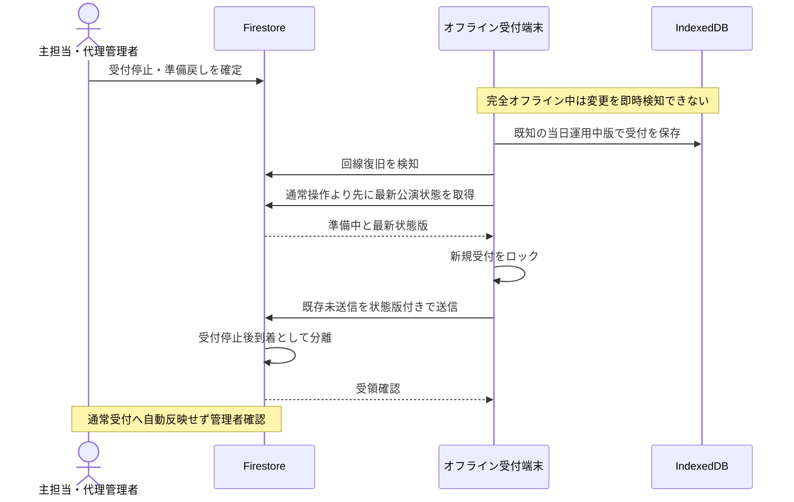
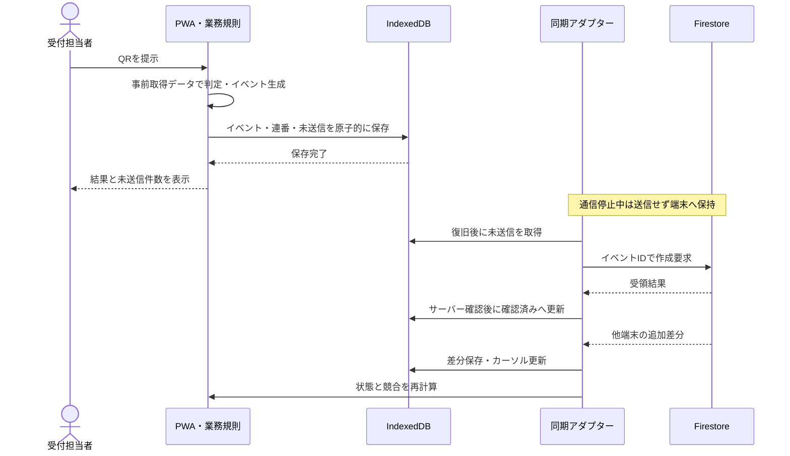
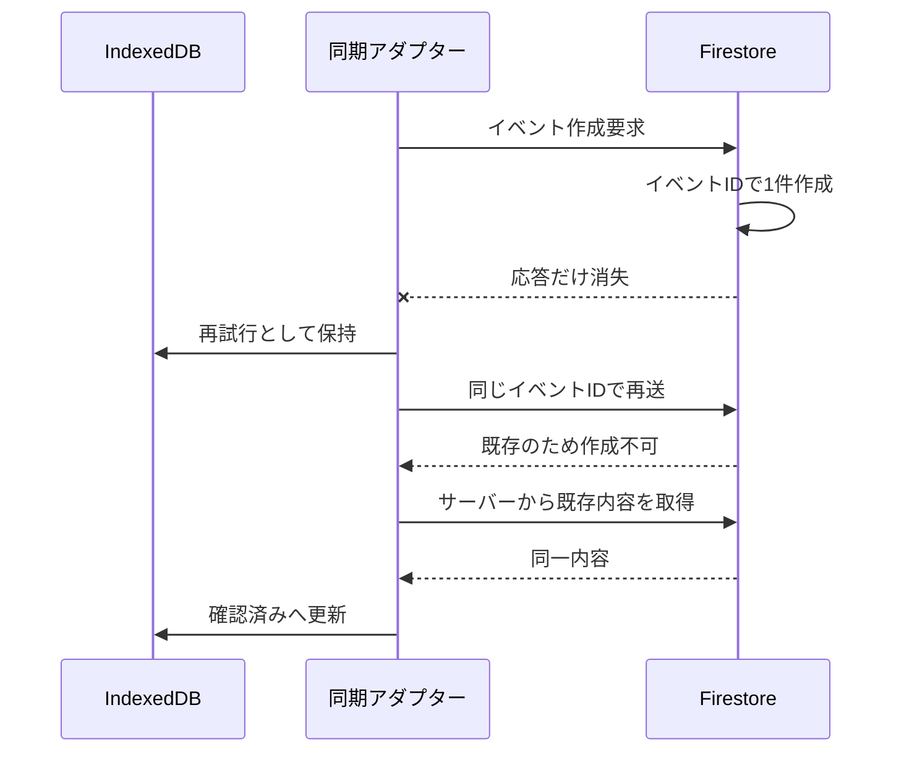
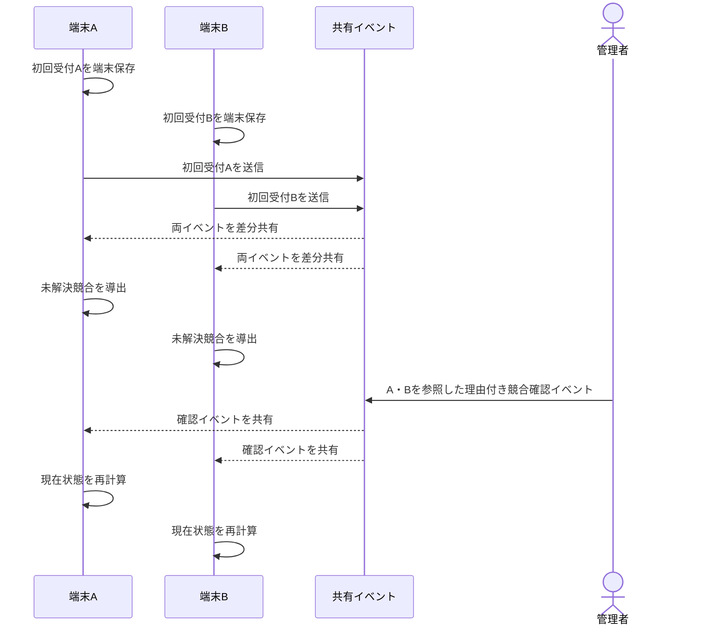

# オフライン同期・競合設計

## この文書について

| 項目 | 内容 |
|---|---|
| 目的 | 完全オフライン受付から復旧後統合まで、受付記録を失わず、重複反映や競合の隠蔽を防ぐ同期・状態導出・競合解消の基本方式を定める |
| 主な読者 | 依頼者、設計担当者、開発担当者、テスト担当者、運用担当者 |
| 前提 | 要件定義書と受入条件書は`CONF-044`を含めApproved、ADR-001とADR-002はAccepted、BD-01とBD-02はmainへ統合済みである。認証・権限と暗号化の詳細はBD-04・BD-05で定める |
| 関連文書 | [基本設計計画書](basic-design-plan.md)、[システム構成・環境分離設計](system-architecture.md)、[論理データモデル・データフロー・ライフサイクル設計](logical-data-model.md)、[ADR-001](decisions/ADR-001-product-platform.md)、[ADR-002](decisions/ADR-002-quota-emergency-response.md)、[POC-001実施結果](poc-001-result.md)、[POC-002実施結果](poc-002-result.md) |
| 関連Issue | [#34](https://github.com/EU0207/concert-reception-system/issues/34) |
| 設計ID | BD-03、BD-03-01～BD-03-12 |
| 関連ID | REQ-F-001、REQ-F-002、REQ-F-006、REQ-F-010、REQ-F-015～REQ-F-018、REQ-F-021、REQ-F-030、REQ-F-033～REQ-F-035、REQ-F-037、REQ-F-038、REQ-F-040～REQ-F-047、REQ-NF-001～REQ-NF-004、REQ-NF-010、REQ-NF-013～REQ-NF-015、REQ-NF-019、REQ-NF-020、AC-001、AC-003～AC-005、AC-009、AC-011、AC-012、AC-015、AC-018、AC-024、AC-025、AC-027～AC-029、AC-032、AC-034、AC-035、AC-037～AC-039、CON-001～CON-006、TBD-002、CONF-012、CONF-024、CONF-025、CONF-034、CONF-038、CONF-039、CONF-044 |
| 状態 | Approved |
| 承認情報 | 2026-09-24、BD-10で基本設計一式として承認。承認対象はPR #67の設計内容コミット `0f455cc` |

## 結論

受付、再読取り、訂正、連絡等の操作は、通信状態にかかわらず変更不能イベントとして端末のIndexedDBへ先に保存する。イベント本体と送信キューを同じ端末内トランザクションで確定した後だけ操作成功を表示し、Firestoreへの送信成功とは分離する。イベントIDを共有先の一意キーにして作成時だけ書込み、応答を失った再送でも同じ業務事実を増やさない。

現在状態はイベント集合から毎回同じ結果を導出できるようにし、明示参照、同一端末の発生順、業務規則を使用する。端末時刻やFirestore到達順だけで矛盾を自動上書きしない。異なる端末の複数初回受付、矛盾する訂正等は未解決競合として先頭に残し、管理者の理由付き競合確認イベントで解消する。

同期はFirebase固有SDKから分離した共通イベント形式と同期境界を通す。FirestoreのWeb永続キャッシュは正本や送信確認に使用せず、アプリケーション管理のIndexedDBを端末側の正本とする。将来Firebaseを交換する場合も、画面、業務規則、変更不能イベント、IndexedDB、競合規則を維持し、同期アダプター、認証、サーバー保存、配信だけを交換対象にできるようにする。

## 事実、設計判断、対象外

| 区分 | 内容 |
|---|---|
| 承認済みの事実 | 最初から通信がない場合を含め、6つ以上の独立環境で受付を継続する。競合は隠さず、回収不能端末だけの記録は復元できない。通常判定は2秒目標・10秒上限、オンライン共有は5秒目標・10秒上限とする。当日通信量は1端末20MB以下とする。`CONF-038`により、同じ端末の複数公演を公演・端末単位で分離する。`CONF-039`により、準備中へ戻したことを知らないオフライン端末の記録も削除せず、復旧時に管理者確認へ回す。`CONF-044`により、6環境試験の端末固有確認は最大3台の実機とし、残りを独立したブラウザープロファイルまたは自動試験クライアントで再現できる |
| 本書の設計判断 | イベント識別、端末キュー、受領確認、再送、順序、状態導出、競合判定・解消、紙照合、締め境界、同期アダプターの共通契約を定める。公演前編集の明示保存、版競合、読取り再利用、Firestoreアクセス境界は2026-09-21の開発者判断である。利用者向け表現方針とともに後続設計へ引き継ぎ、依頼者回答とは区別する |
| 後続設計へ渡す事項 | 役割・オフライン権限期限・サーバー拒否はBD-04、暗号化・鍵・入力保護はBD-05、利用者向け表示と操作見本はBD-06、紙の様式はBD-07、担当者・手順・回収不能時の業務判断はBD-08、具体的な試験はBD-09で定める。画面では内部用語の「競合」をそのまま出さず、発生した事実、受付への反映状況、確認の要否、次の操作を平易に示す |
| 対象外 | SDK呼出しコード、Firestoreコレクション名・索引、IndexedDBストア名、送信同時数等の性能最適化、本番アプリケーションコード、外部環境変更 |

## BD-03-01 同期対象と正本

| 情報 | 端末側の正本 | オンライン共有側の正本 | 方針 |
|---|---|---|---|
| 端末で発生した変更不能イベント | IndexedDBへ保存したイベント本体 | 受領確認前は存在しない。確認後は同一内容の共有イベント | 端末保存後に成功表示し、確認済みになるまで削除しない |
| 他端末で発生した共有イベント | 差分受信後の端末複製 | Firestoreの変更不能イベント | 受信複製は再構築可能とし、端末発生イベントと同じ業務規則で扱う |
| 送信状態・再試行情報 | 当該端末のIndexedDB | 保存しない | 業務イベントへ混在させず、他端末へ同期しない |
| 現在状態・競合一覧 | イベント集合から導出する投影 | 必要なら同じ規則で再構築する | 投影を受付事実の正本にせず、不一致時はイベントから再計算する |
| 同期カーソル・端末同期概要 | IndexedDBに端末単位で保持 | サーバー側は受領イベントと端末報告を保持可能 | カーソル消失時もページ単位の再取得とID重複排除で復旧可能にする |

Firestore SDKのメモリーキャッシュは同一セッション中の取得補助に限り使用できる。Web永続キャッシュは無効のままとし、キャッシュ応答だけを送信確認、締め条件、削除条件に使用しない。

同じ端末へ複数公演を準備する場合、イベント集合、送信キュー、同期カーソル、共有確認位置を公演ID・端末IDの組合せで分離する。選択中の公演だけを通常操作の送受信対象とし、別公演の未送信や再試行は保持する。1公演の同期失敗、停止、締め、削除を理由に、別公演のキューやカーソルを変更しない。

### 公演前編集の保存境界

公演前の名簿修正、購入者名・座席表示名の編集、会場席構成および席配置は、入力や座席移動のたびにFirestoreへアクセスしない。次の二段階を分離する。

| 段階 | 保存先と目的 | Firestore境界 |
|---|---|---|
| 画面上の編集中データ | メモリー上で入力、選択、検証、座席移動を反映する | 文字入力、席選択、座席移動、欠番・スペース配置では読取り・書込みを行わない |
| 共有・確定データ | 他端末と共有する版付きデータとしてFirestoreへ保存する | 利用者が`保存`、`下書きを保存`、`編集内容を確定`または席配置の`決定`を明示した時だけ送信する |

公演前編集の途中内容はIndexedDBへ自動保存しない。再読込み、ブラウザー終了、PWA終了、OSによる強制終了では失われる可能性があるため、未保存変更がある画面からの離脱確認とブラウザー標準警告を使用する。自動復元は初期版の対象外とし、UIモックまたは運用確認で必要性が判明した場合に別Issueで再検討する。

| 操作 | 共有前に端末内で行うこと | 共有境界 |
|---|---|---|
| 名簿Excel | 解析、文字数、重複、座席整合性の検証と500件までのプレビュー | 利用者が確認後に`確定`した変更一式を送る |
| 購入者名・座席表示名 | 入力、文字数検証、表示プレビュー | `保存`で対象変更を送る |
| 会場席構成 | 席の追加・移動、欠番、スペース配置、整合性検証 | `下書きを保存`または`編集内容を確定`で変更一式を送る |
| 席配置 | 席選択、必要席数、連続席、確保席等の検証 | `決定`した配置を1つの論理操作として送る |
| PDF・Excel・CSV・プレビュー | 取得済みの版付きデータから端末内生成する | 生成自体では書き込まない。出力監査は生成処理と分離する |
| 当日受付 | 業務イベントをIndexedDBへ先行保存する | 他端末との迅速な共有が必要な例外として、オンライン時は保存済み差分を速やかに同期する |

共有保存・確定は、開始時に保持した基準版と共有先の現在版を比較する。同じ版の場合だけ変更一式を1つの論理操作として保存し、新しい版を発行する。異なる場合は自動上書きせず、変更対象と共有先の更新を競合として表示する。1つの論理操作がサービス上限により複数要求へ分割される場合も、操作ID、期待版および完了状態で冪等に扱い、再試行で同じ変更を重複作成しない。座席を100回移動しても、明示保存前のFirestore書込みは0回とする。

対象公演の共有データは、端末準備または初回表示時に版情報とともに取得してIndexedDBへ保存する。画面遷移だけでは全件再取得しない。再表示・再接続時は小さな版情報を確認し、版が同じ場合はデータ本体を再取得しない。版が変わった場合も同期カーソル以後の差分だけを取得する。検索、並べ替え、絞込み、件数計算は取得済みの最大500件を端末内で行う。リアルタイム監視は選択中の公演と画面上必要な情報だけに限定し、画面終了時に不要な監視を解除する。

## BD-03-02 共通イベント形式と識別

イベントは、Firebaseに依存しない次の論理項目を持つ。物理名と型は詳細設計で決める。

| 論理項目 | 規則 |
|---|---|
| スキーマ版 | 読込み可能な共通イベント形式を識別する。未対応版は無視せず同期拒否として残す |
| イベントID | 端末で暗号学的乱数を用いたUUID v4を生成する。生成不能時は操作を成功扱いにしない。表示用番号や端末時刻をIDにしない |
| 環境ID・公演ID | 起動時に検証済みの所属を記録し、異なる環境・公演への送受信を拒否する |
| 操作種別・対象ID | BD-02のイベント分類と対象を記録する。不要な氏名、QR生データ、認証情報を複製しない |
| 発生者ID・端末ID | 操作主体と準備済み端末を参照する。役割スナップショットと許可判定はBD-04で定める |
| 公演状態版 | 操作時に端末が最後に確認した公演状態イベントIDまたは版を記録する。開催日時や端末時刻から状態を推測しない |
| 端末連番 | 端末・公演単位で単調増加させ、イベント保存と同じトランザクションで採番する。同一端末内の欠落・逆転確認に用いる |
| 端末観測時刻 | 受付表示と監査の材料として端末時刻を記録する。異なる端末間の優先順位の唯一の根拠にしない |
| 参照イベントID | 訂正、取消し、競合確認、再確認等が根拠とするイベントを明示する。参照先不明時は保留し、後続差分取得後に再評価する |
| 結果・理由・メモ | 操作別の承認済み制約に従う。再読取り理由は必須、任意メモは200文字以内とする |
| 共有確認時刻 | 共有先が初回作成時に受領メタデータとして1回付与する。端末作成時の業務イベント本体には含めず、業務上の発生順を上書きしない |

イベントIDは全環境での一意性を確率的に十分高く確保するためUUID v4を採用する。端末IDと連番をIDへ埋め込む案は、端末再準備や連番消失時の衝突管理が増えるため採用しない。時刻順UUIDを採用する案は、端末時刻ずれを識別と順序の両方へ持ち込むため採用しない。端末保存領域の消去や再準備後は新しい端末IDを発行し、古い端末IDと連番を再利用しない。古い端末は未確認としてBD-08の回収・削除確認対象に残す。

## BD-03-03 端末キューと保存状態

業務イベント本体と次の公演・端末固有同期情報を分離し、イベント作成、端末連番更新、`未送信`登録を1回のIndexedDBトランザクションで確定する。

| 状態 | 意味 | 次の遷移 |
|---|---|---|
| 未送信 | 端末保存済みで送信開始前 | 送信中 |
| 送信中 | 送信要求を開始済みで結果未確定 | 確認済み、再試行、拒否。アプリ再起動時は再試行へ戻す |
| 再試行 | 一時的失敗、タイムアウト、通信断、上限・サービス停止で未確認 | 接続回復、アプリ再開、待機時間到達、利用者の再試行で送信中 |
| 確認済み | 共有先に同一イベントが存在するとサーバー応答またはサーバー指定再取得で確認済み | 締め・削除条件成立まで端末イベントを保持 |
| 拒否 | 環境・公演不一致、未対応版、内容不一致、権限不足等で自動再送しても解消しない | 管理者確認後の訂正・再登録・運用対応。元イベントは失わない |

同期情報には、試行回数、最終試行時刻、次回試行可能時刻、最終エラー区分、共有確認時刻を保持する。エラー本文、認証トークン、個人情報は保持しない。`送信中`のまま停止しても再起動時に`再試行`へ戻せるため、応答受信前の端末停止で記録を失わない。

未送信一覧は`未送信`、`送信中`、`再試行`、`拒否`を対象とし、席番号、表示用チケット番号、読取時刻、操作種別、端末、同期状態を表示する。氏名とQR生データは含めない。表示用項目を持たない連絡等も件数と操作種別を隠さず表示する。

## BD-03-04 送信、受領確認、冪等性

1. 送信対象を状態と次回試行可能時刻で取得し、端末内で`送信中`へ更新する。
2. 同期アダプターはイベントIDを共有先の一意キーとして、変更不能イベントの作成を要求する。既存イベントの更新・置換は要求しない。
3. 初回作成成功時は、共有先が返す受領結果を確認して`確認済み`にする。
4. タイムアウト等で結果不明の場合は`再試行`へ戻す。再送先に同じイベントIDがある場合、保存済み内容を取得し、共有先が付与した受領メタデータを除く、スキーマ版を含む業務上の全項目が意味的に一致した時だけ既送信として`確認済み`にする。
5. 同じイベントIDで内容が異なる場合は上書きせず`拒否`とし、ID衝突または改変として管理者確認へ送る。
6. 一時的失敗は指数的に待機時間を延ばし、端末間集中を避ける揺らぎを加える。接続回復と利用者の明示操作では待機中でも安全に再試行できる。具体的な秒数と同時送信数は実装時の性能試験で決める。

この方式により、共有先が書込みを受理した直後に応答だけ失われても、再送で別イベントを作らない。受領確認はローカルキャッシュだけで済ませず、サーバー応答またはサーバー指定再取得を用いる。

## BD-03-05 差分受信と収束

- オンライン中は同一環境・公演の追加イベントを購読し、初期取得後は追加差分だけを受信する。
- 差分はイベントIDで重複排除し、端末内保存が完了してから同期カーソルを進める。保存途中の停止時は同じ差分を再取得してよい。
- カーソルが失われた場合は、共有確認時刻とイベントIDによる安定した境界でページ単位に再取得し、境界付近を重ねて取得してIDで重複排除する。全件再取得は障害復旧時の明示操作に限定し、通常受付ごとには行わない。
- 差分受信後は、影響する対象の現在状態と競合を再計算する。計算失敗または未対応イベントを成功扱いせず、同期異常として残す。
- 端末が生成したイベントと受信イベントに同じ導出規則を用い、全端末が同じイベント集合を持てば同じ状態へ収束する。

オンライン共有時間は、送信側の送信開始から、受信側の端末保存・状態再計算・画面反映までを測り、5秒以内を目標、10秒以内を上限とする。当日の外部通信量は開催前資産を除き1端末・1公演20MB以下とし、送受信件数・バイト数・全件再取得回数を観測可能にする。

## BD-03-06 順序と現在状態の導出

現在状態は次の順で導出する。

1. 環境、公演、スキーマ版、必須項目、操作種別を検証し、不正イベントを状態計算へ混ぜず異常として残す。
2. イベントIDで同一イベントを重複排除する。
3. 訂正、取消し、競合確認等の明示参照から因果関係を組み立てる。参照先未受信は保留し、欠落と断定しない。
4. 同一端末のイベントは端末連番で順序と欠番を確認する。連番重複や逆転は同期異常とする。
5. 相互に矛盾しない追記イベントはすべて反映する。表示上の安定した並びには端末観測時刻、端末ID、端末連番、イベントIDを用いるが、この並びだけで矛盾を解消しない。
6. 排他的な状態へ異なる端末から独立した変更がある場合、または同じ根拠への矛盾する変更がある場合は競合候補を作る。
7. 有効な競合確認イベントが全候補を参照している場合だけ、その判断を現在状態へ反映する。候補と確認イベントは履歴に残す。

端末観測時刻は利用者への時刻表示と調査に使う。オンライン時にサーバー時刻との差が許容範囲を超えた端末は時刻ずれとして警告するが、時刻補正で過去イベントを書き換えない。許容値と端末確認手順はBD-08・BD-09で定める。

## BD-03-07 競合の判定表

以下の座席変更・QR再発行をオンライン限定とし、通信断時は紙で対応する業務方針は`CONF-048`で依頼者回答を受領した。版競合と旧QRの技術検証、設計再レビューは未了である。

| 状況 | 自動処理 | 競合・異常 | 管理者の扱い |
|---|---|---|---|
| 同じイベントID・同じ内容の再送 | 1件として扱う | なし | 不要 |
| 同じイベントID・異なる内容 | 既存を上書きしない | 同期異常 | 端末、ID、内容不一致を調査し、必要なら新イベントで再登録 |
| 異なる端末の同一チケットに複数の初回受付 | 両方を保持し、初回時刻を自動上書きしない | 未解決競合 | 全候補の端末・時刻を確認し、初回、連続・誤読取り、正当な再入場等を理由付きで確定 |
| 受付済みと認識した上での理由付き再読取り | 再読取り履歴として追記 | それ自体は競合にしない | 理由・メモの訂正時だけ新イベントを追加 |
| 同じ元イベントに対する矛盾する訂正・取消し | 両方を保持し、一方を到着順で採用しない | 未解決競合 | 採用する状態と理由を競合確認イベントで記録 |
| 異なる端末から来場済み／未受付への並行変更 | 両方を保持し、件数へ確定反映しない | 未解決競合 | 元受付と各変更を確認して現在状態を確定 |
| 座席の追加・変更またはQR再発行をオフライン端末から要求 | 共有状態へ送信せず、端末内の確定操作も許可しない | オンライン必須 | 紙で一時対応し、回線復旧後に最新状態を確認して管理画面から確定 |
| オンラインの管理端末2台が同じ席を割り当てる | 先に確定した版だけを採用し、後の要求は現在版不一致で拒否 | 保存競合 | 両方の変更案を表示し、管理者が最新の空席から選び直す |
| オンラインの管理端末2台が同じチケットを再発行する | 先に確定した版だけを採用し、旧QR無効化と新QR有効化を一体で確定する | 後の要求は保存競合 | 有効なQRの版を再取得し、重複発行しない |
| 連絡等の独立した投稿 | 両方を表示 | なし | 不要。同じ原文への矛盾する訂正・取消しは競合 |
| 参照先イベントが未受信 | 判断を保留して追加差分を取得 | 参照待ち。期限後は同期異常 | 欠落確認後に再取得または運用対応 |
| 権限、環境、公演、版の不一致でサーバー拒否 | 業務状態へ共有済みとして反映しない | 同期拒否 | BD-04の権限規則に従い、元イベントを残して再認証・訂正・紙照合 |
| 受付停止後に古い公演状態版で作られた受付 | イベントを削除せず管理者確認用に受領し、通常の来場状態へ自動反映しない | 受付停止後到着 | 対象、端末上の発生時刻、サーバー到着時刻、状態版を確認し、採否を判断する |
| 紙記録とイベントが同一操作を示す | 照合キーと内容が一致すれば二重計上しない | なし。照合済みとして記録 | 紙記録照合イベントに根拠を残す |
| 紙記録とイベントの対象・時刻・結果が矛盾 | どちらも隠さない | 未解決競合 | 紙原本を確認し、理由付きで統合判断を記録 |

未解決競合は件数と一覧の先頭に残し、通常の成功状態だけを表示しない。競合確認イベントは候補イベントID、判断区分、理由・任意メモ、担当者、端末、端末観測時刻を持つ。判断を訂正する場合も既存の確認イベントを変更せず、新しい確認イベントから参照する。

座席変更とQR再発行は、対象席・チケットの現在版をオンラインで再取得してから確定する。旧QRの無効化と新QRの有効化が途中で分離しない保存方式を詳細設計で示す。再発行後の変更をまだ受信していない受付端末では、旧QRをオフラインで照合できる限界がある。このため管理者は、全稼働端末のQR受付停止を担当者に確認し、更新後の版を各端末が受信したことを確認してから受付を再開する。端末の停止や更新を確認できない間は再発行を保留し、紛失チケットを紙の例外記録で扱う。座席変更時も古い席表示を持つ端末へ変更前の席が示され得るため、同じ更新確認または紙照合を行う。

## BD-03-08 主なシーケンス

### 受付停止を知らないオフライン端末の復旧

復旧時の状態確認が失敗した場合、通常操作と新規受付を再開しない。未送信記録は端末に保持して再試行する。受領済みとなるのは、サーバーが通常受付または受付停止後到着として保存したことを確認した場合だけとする。

### 最初からオフラインの受付と復旧

### 応答喪失後の再送

### 複数初回受付の競合解消

## BD-03-09 Firebase上限・紙運用・復旧統合

Firebase上限接近・到達またはオンライン共有停止でも、端末保存済みイベントを削除せず、失敗を成功したオンライン共有として表示しない。管理者1名による紙運用または同一プロジェクトへの手動課金の選択はADR-002に従い、アプリケーションは課金、支払情報保存、新プロジェクトへの切替を行わない。

紙運用へ切り替えた場合は次の境界を守る。

1. 各端末は未送信一覧を固定し続けず、新しい端末イベントを含めて更新する。紙へ転記した行は端末内で照合対象として識別できるようにするが、元イベントの送信状態を確認済みにしない。
2. 紙にはBD-07で定める照合キー、席番号、表示用チケット番号、時刻、操作種別を記録し、QR生データを転記しない。
3. 復旧後は端末イベントを通常の冪等再送で共有し、共有済み件数、端末別確認済み・未送信・拒否件数を集計する。
4. 管理者は紙記録ごとに一致するイベント、紙だけの記録、矛盾する記録を区別する。一致は二重計上せず、紙だけの記録は権限確認後に新しい紙記録照合イベントとして追加し、矛盾は競合として解消する。
5. 端末別の未送信・拒否0件、紙記録の全行照合、未解決競合0件、件数一致を確認して、統合確認イベントを1回記録する。

## BD-03-10 端末停止・回収不能・締め処理

| 状況 | 同期上の扱い | 締めとの境界 |
|---|---|---|
| 送信中にアプリ停止 | 再起動時に再試行し、共有先の同一内容確認後に確認済みとする | 確認済みになるまで未送信0件に含めない |
| オフライン端末が後から復旧 | 未送信を再送し、締め要求を受信したら新規受付を止め、最終差分取得と状態再計算を行う | 端末の最終連番まで共有確認し、締め準備完了を報告する |
| 故障・紛失したが回収可能 | 端末回収・復旧を待ち、未送信と端末保存領域を確認する | 未送信0件を確認できるまで締めを成立させない |
| 完全オフライン中に回収不能 | 他端末から未送信内容を復元できない。端末を回収不能として記録し、紙の当日運営表等で損失範囲を照合する | 現行`REQ-F-040`の「全端末の未送信0件」を証明できないため、回収不能指定や紙照合だけで締め条件を満たした扱いにしない |
| 締め準備中の端末 | 新規受付を止め、端末連番の最終値、未送信0件、最終差分適用をサーバー確認付きで報告する | 全準備済み端末の報告と管理者確認が揃った場合だけ締め確定イベントを1回作成する |
| 締め後に主担当・代理管理者が公演後管理経路から訂正 | オンライン再認証と対象・理由を確認し、締め後の実績訂正として明示記録する | 締めを取り消さず、確定実績と集計を同じ操作で整合させる。M-01の正本設計に従う |
| 締め確定後に未知のイベントが到着 | 対象公演の通常状態へ黙って反映せず、締め後到着の異常として保持する | 締めの取消し・再締めを自動実行せず、BD-08の復旧手順または要件変更へ戻す。別公演の利用は止めない |

締め準備の報告には端末ID、公演ID、端末最終連番、共有確認済み最終連番、未送信・拒否件数、最終差分確認時刻を含める。締め確定後の端末削除は、当該端末が自分の最終イベントまで共有済みであることをサーバー指定再取得で再確認した後に限る。

締め条件、受領確認、削除完了は対象公演だけで集計する。前公演に未送信、再試行、管理者確認が残っても、そのキューを保持したまま別公演の同期を開始できる。同期アダプターは要求と応答の公演ID一致を検証し、別公演のイベント、カーソル、削除要求を混在させない。

回収不能端末の未送信0件を確認しないまま締めを許可する必要がある場合は、現行要件と受入条件の変更になる。BD-08またはBD-10で依頼者判断へ戻し、許容する損失、紙照合、監査、再接続時の扱いを承認なしに追加しない。

## BD-03-11 エラー分類、観測、性能引渡し

| 観測項目 | 用途 | 主な引渡し先 |
|---|---|---|
| QR提示から端末保存・判定表示まで | 2秒目標・10秒上限 | BD-06、BD-09、AC-004 |
| 送信開始から他端末の保存・状態反映まで | 5秒目標・10秒上限 | BD-09、AC-015 |
| 500件の受付開始から完了まで、同時端末数 | 30分・6環境以上 | BD-06、BD-09、AC-018 |
| 端末・公演単位の外部送受信バイト数 | 開催前資産を除く20MB上限 | BD-08、BD-09、AC-018 |
| 状態別キュー件数、最古未送信時刻、試行回数 | 通信断、上限、滞留、拒否の発見 | BD-06、BD-08、BD-09 |
| 差分受信件数、全件再取得回数、カーソル | 全データ反復取得防止と欠落調査 | BD-08、BD-09 |
| 操作別の同期アダプター読取り・書込み呼出し回数 | 公演前編集の入力単位送信と不要な再取得の防止 | BD-08、BD-09 |
| 版確認件数、差分0件、競合件数、購読開始・解除件数 | 版再利用、競合非上書き、不要なリアルタイム監視の発見 | BD-08、BD-09 |
| 未解決競合数、参照待ち数、締め後到着数 | 隠れた競合・欠落・締め異常の発見 | BD-06、BD-08、BD-09 |
| 端末別最終連番・共有確認済み連番 | 欠番、回収不能、締め可否の確認 | BD-08、BD-09、AC-028 |

エラーは少なくとも、一時的な通信失敗、認証再確認要、権限拒否、環境・公演不一致、未対応版、ID内容不一致、保存容量不足、端末時刻ずれ、参照待ち、上限・サービス停止へ分類する。利用者向け表示文と対応導線はBD-06、連絡・復旧手順はBD-08で定める。

## BD-03-12 外部サービス交換境界と後続設計

同期アダプターは次の製品非依存契約を業務層へ提供する。具体的な関数名は詳細設計で決める。

| 契約 | 入出力 | Firebase交換時の扱い |
|---|---|---|
| イベント追記 | 共通イベントの集合を受け、イベントごとの受領・既存一致・一時失敗・恒久拒否を返す | Firestore書込みだけを交換する |
| 既存確認 | 環境・公演・イベントIDを受け、サーバー由来のイベントまたは不存在を返す | キャッシュを避けた確認方法だけを交換する |
| 差分取得・購読 | 環境・公演・カーソルを受け、追加イベント、次カーソル、取得元を返す | Firestore購読・ページ取得だけを交換する |
| 版情報確認 | 環境・公演・編集対象を受け、現在版と変更有無を返す | 小さな版情報の読取り方法だけを交換する |
| 版付き編集保存 | 操作ID、期待版、変更一式、保存区分を受け、保存済み版・既存一致・版競合・失敗を返す | Firestoreのトランザクション、バッチまたは分割保存だけを交換する |
| 同期状態通知 | 接続、再認証要、上限、停止、再試行可能時刻を製品非依存区分で返す | Firebaseエラーコード変換だけを交換する |

共通イベント、端末キュー状態、競合規則、紙照合・締め確認の論理記録は、将来の出力・再取込でも意味を保てる版付き形式にする。移行が必要になった時点で、新しいADR、PoC、移行計画、承認を経て、旧・新共有先の二重書込みを通常運用へ持ち込まない。移行時はイベント件数・ID・内容、現在状態、未解決競合、端末別未送信を共通試験で照合し、不一致時は旧環境へ切り戻す。代替基盤の先行実装は行わない。

| 後続設計 | 引き渡す内容 |
|---|---|
| BD-04 認証・権限 | 公演別の役割・端末許可、有効期間、復旧後の権限再検証、拒否イベントの管理者対応、締め・競合確認権限 |
| BD-05 セキュリティ | 公演・端末専用の非抽出CryptoKey、複数公演の鍵分離、接続時の端末状態先行確認、停止中の画面非表示送信、条件付き削除、イベント改変検出、Rules制約 |
| BD-06 画面 | 公演名、日付、会場、未送信件数を示す切替確認を扱う。未送信、再試行、拒否、同じQRの複数読取りは、状態と次の操作を平易に示す。公演前編集では画面上の未保存変更、Firestoreへ保存した下書き、確定済みを区別し、版競合時は自動上書きしない。別公演へ切り替えても前公演の未処理が保持されることを案内する |
| BD-07 帳票 | 当日運営表と未送信転記の照合キー、項目、紙原本識別、紙だけの記録を復旧時に入力する形式 |
| BD-08 運用 | 開催前同期、端末時刻確認、障害・上限判断、紙切替、回収不能端末、復旧統合、締め、締め後到着、Firebase交換時の移行・切戻し手順を扱う。Firestoreの操作別読取り・書込み回数、全件再取得、差分件数、購読数を監視し、異常時の確認手順を定める |
| BD-09 テスト | 正常、再送、応答喪失、順序逆転、重複、競合、権限拒否、上限、回収不能、締め境界を確認する。同一端末の複数公演キュー、切替中の送受信、別公演ID拒否、1公演削除後の別公演継続も確認する。公演前編集100操作の書込み0件、画面往復時の全件再取得なし、変更なし再接続の差分0件、500件名簿の確定前送信なし、版競合非上書き、端末内帳票生成の書込み0件、再試行の重複なしを同期アダプター計測で確認する |

## 代替案、影響、残存リスク

### 採用しなかった主な代替案

| 代替案 | 採用しない理由 |
|---|---|
| 来場者やチケットの現在状態を端末から直接上書きする | Firestoreの最終書込み優先で先行操作と競合が消え、オフライン統合時の説明と再計算ができない |
| Firestore Web永続キャッシュを端末正本とする | アプリ管理のIndexedDBと責務が二重化し、サーバー受領とキャッシュ読取りを誤認しやすい |
| 端末時刻またはFirestore到着時刻の最後を常に採用する | 端末時刻ずれ、再送、回線差で業務上の正しさを決めてしまい、矛盾を隠す |
| 競合を検出したら片方を削除する | 受付事実と監査履歴を失い、正当な再入場や誤読取りの判断根拠が残らない |
| 上限時に新しいFirebaseプロジェクトへ同期する | ADR-002に反し、認証・Rules・データ・端末接続先が分裂する |

### 良い影響

- 通信断、タイムアウト、再起動、重複再送でも、端末保存済みの受付事実を失わず1件として共有できる。
- イベント集合から現在状態と競合を再計算でき、端末間の到着順が異なっても同じ結果へ収束できる。
- Firebase固有処理を同期アダプターへ閉じ込め、将来のサービス交換時に業務規則と端末データ形式を維持できる。

### 注意が必要な影響と残存リスク

- 完全オフライン中の端末間では重複受付を即時防止できず、復旧後の管理者確認が必要である。
- 受付停止・準備戻しも完全オフライン端末へ即時通知できない。停止を知らない期間の受付は、復旧後に管理者確認が必要である。
- 回収不能端末だけに残る未送信イベントは技術的に復元できない。紙照合で損失範囲を確認できても、現行要件の未送信0件は証明できず締めが止まる。
- 端末時刻ずれは表示時刻の信頼性へ影響する。自動上書きは避け、開催前確認と警告の具体値をBD-08・BD-09で決める必要がある。
- オフライン中に役割、端末または公演状態が失効していたことが復旧後に判明する場合がある。該当イベントは削除せず管理者確認対象として分離し、通常の来場状態へ自動反映しない。
- 保存容量不足では端末への先行保存が成立しないため、受付成功を表示できない。容量確認と紙切替の基準はBD-06・BD-08へ引き渡す。
- 紙記録とイベントの照合キー、時刻ずれ許容値、再試行間隔、送信同時数は後続設計・実装試験で具体化するが、本書の冪等性と競合非隠蔽を変更してはならない。

## 要件・受入条件の対応

| 設計範囲 | 主な要件 | 主な受入条件 | 設計ID |
|---|---|---|---|
| 端末先行保存、キュー、再送、冪等性 | REQ-F-021、REQ-F-030、REQ-F-042、REQ-NF-003、REQ-NF-004 | AC-015、AC-034 | BD-03-01～BD-03-05 |
| 順序、状態導出、再読取り、訂正、連絡 | REQ-F-010、REQ-F-015、REQ-F-016、REQ-F-034、REQ-F-037、REQ-F-041 | AC-005、AC-009、AC-024、AC-027、AC-029 | BD-03-02、BD-03-05～BD-03-08 |
| 競合検出・確認・紙照合 | REQ-F-017、REQ-F-042、REQ-NF-004、REQ-NF-020 | AC-011、AC-029、AC-034 | BD-03-06～BD-03-09 |
| 性能、容量、差分通信 | REQ-NF-001、REQ-NF-002、REQ-NF-013 | AC-004、AC-015、AC-018 | BD-03-04、BD-03-05、BD-03-11 |
| 公演前編集の明示保存、版競合、アクセス境界 | REQ-F-001、REQ-F-002、REQ-F-006、REQ-F-018、REQ-F-033、REQ-F-035、REQ-F-038、REQ-F-043、REQ-F-045、REQ-NF-013、REQ-NF-014 | AC-001、AC-003、AC-012、AC-025、AC-032、AC-035、AC-037 | BD-03-01、BD-03-04、BD-03-05、BD-03-11、BD-03-12 |
| 上限、回収不能、締め、端末削除境界 | REQ-F-040、REQ-F-042、REQ-NF-003、REQ-NF-010、REQ-NF-015、REQ-NF-019、REQ-NF-020 | AC-028、AC-034 | BD-03-09～BD-03-12 |
| 複数公演の同期分離 | REQ-F-040、REQ-F-046、REQ-NF-015、REQ-NF-020 | AC-028、AC-038 | BD-03-01～BD-03-05、BD-03-10～BD-03-12 |
| 受付開始・停止とオフライン復旧 | REQ-F-047、REQ-NF-020 | AC-039 | BD-03-02、BD-03-05～BD-03-08、BD-03-10 |
| 制約・未決定事項 | CON-001～CON-006、TBD-002、CONF-012、CONF-024、CONF-025、CONF-034、CONF-038、CONF-039、CONF-044 | AC-011、AC-015、AC-018、AC-028、AC-029、AC-034、AC-038、AC-039 | BD-03-01～BD-03-12 |

## 確認事項

**依頼者に確認してください**

- なし。`CONF-039`により、受付開始・停止を管理者のオンライン操作とし、停止を知らないオフライン期間の記録を保持して管理者確認へ回す方針が確認済みである。6環境試験のうち端末固有の確認を最大3台の実機とし、残りを独立したブラウザープロファイルまたは自動試験クライアントで再現できることは`CONF-044`で依頼者承認済みである。

**開発者が確認してください**

- イベント作成、端末保存、送信、受領確認が分離され、応答喪失後の再送でも同じ操作が二重反映されないことを確認してください。
- 端末時刻やFirestore到着順だけで競合を自動解消せず、複数初回受付、矛盾する訂正、紙との矛盾が未解決のまま隠れないことを確認してください。
- 回収不能端末について、技術的に復元不能な範囲と現行締め条件を混同していないことを確認してください。
- Firebase交換時に残す共通イベント、IndexedDB、業務規則、競合規則と、交換する同期アダプター、認証、サーバー保存、配信が区別されていることを確認してください。
- 公演前編集の入力・選択・座席移動がFirestoreへ逐次送信されず、画面メモリー上の編集と明示的な下書き保存・確定が分離されていることを確認してください。
- 同期アダプターの呼出し回数、版競合、再試行の冪等性をBD-09で自動計測できる境界になっていることを確認してください。
