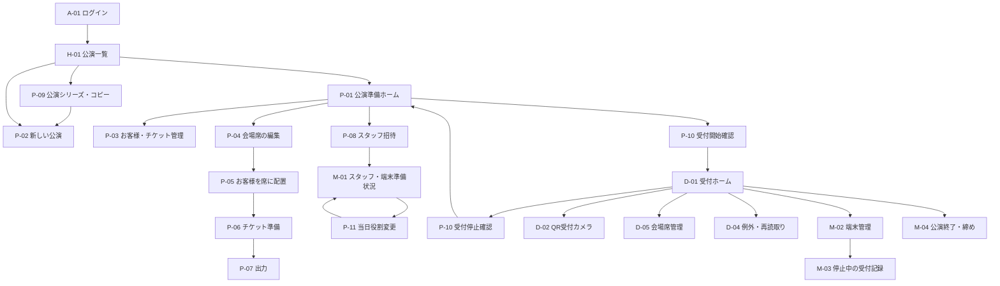

# 画面・画面遷移・操作見本設計

## CONF-066による承認済み追補

`M-02`の端末廃止と自己端末の削除確認では、操作対象が最後の利用可能な管理端末なら実行を無効にし、代替の準備と環境所有者の復旧手順を案内する。確認画面から確定する時も代替端末の状態を再判定する。公演締め後もこの表示と判定を維持する。[CONF-066](ui-mock-client-response.md#conf-066-最後の管理端末の廃止削除)に従う。

## CONF-060による承認済み追補

UIモックで承認された追加変更は、[本番引継ぎ台帳](ui-mock-production-handoff.md)を本書の追補として適用する。BD-06-01・04・06・08～10・13・15の表示と業務操作は台帳の最新内容を優先する。登録後の購入者名の誤字修正、確認付きの不参加・席解除、固定3項目と確認用項目を採用する。従来の読取り専用表示と旧4固定項目の見本は当該範囲で置換する。書面だけのQR結果・画像操作・席追加等も対象とし、詳細な状態遷移は#89～93で具体化する。

`CONF-063`により、従来の`P-06 チケット準備`は「お客様対応状況」と表示する。チェック一覧と交付方法を管理する画面であり、帳票操作は既存の`P-07 出力`に置く。後続の旧画面名は変更前の設計記録として読む。帳票の全要件は維持する。

`CONF-064`により、従来の「来場者管理」は「お客様情報」と表示する。不参加者も含む名簿画面を指し、来場・受付の状態語は維持する。画面識別子と保存処理は変更しない。

`CONF-065`により、`M-01 スタッフ・端末準備状況`から役割変更を行う。主担当は代理管理者以下、代理管理者は臨時管理者と一般受付担当者の間を変更できる。現在と変更後の役割、同じ利用者の端末への影響、臨時管理者の期限を確認画面に示す。画面上の端末行は操作の入口であり、役割の変更単位は利用者と公演である。

## この文書について

| 項目 | 内容 |
|---|---|
| 目的 | BD-06として、利用者別の情報設計、画面一覧、画面遷移、主要操作見本を定める |
| 主な読者 | 依頼者、画面設計担当者、開発担当者、テスト担当者、運用担当者 |
| 前提 | 要件定義書と受入条件書は`CONF-046`を含めApproved、BD-01～BD-05は基本設計一式としてApprovedである |
| 関連文書 | [基本設計計画書](basic-design-plan.md)、[論理データモデル](logical-data-model.md)、[オフライン同期・競合設計](offline-sync-conflict-design.md)、[認証・役割・権限設計](authentication-authorization-design.md)、[セキュリティ・プライバシー設計](security-privacy-design.md)、[座席表UI/UX引継ぎ](production-seat-map-ui-ux-notes.md)、[セキュリティ・UI/UX引継ぎ](production-security-ui-ux-notes.md) |
| 関連Issue | [#37](https://github.com/EU0207/concert-reception-system/issues/37)、[#57](https://github.com/EU0207/concert-reception-system/issues/57)、[#60](https://github.com/EU0207/concert-reception-system/issues/60) |
| 設計ID | BD-06、BD-06-01～BD-06-15 |
| 状態 | Approved |
| 対象 | 本番画面の情報構造、遷移、状態表示、操作見本、レスポンシブ基準 |
| 対象外 | 本番画面コード、最終的な色・書体・画像素材、帳票の印刷寸法、実装後の実機試験 |
| 承認情報 | 2026-09-24、PR #67の設計内容コミット`0f455cc`を基本設計一式として承認。2026-09-26、`CONF-054`でPR #84の設計内容コミット`c52b22706759af92f3a9a9646d6ec39df0616cfc`の是正変更を承認。既存承認は[変更承認記録](basic-design-remediation-approval.md)と区別する。 |

## 結論

画面体系は、次の4領域へ分ける。

1. 公演準備：公演作成、来場者取込、座席作成、席配置、チケット準備、出力。
2. スタッフ・端末準備：招待、登録、練習、端末承認、事前準備。
3. 当日受付：専用カメラ、判定、例外、会場席管理、スタッフ連絡。
4. 管理・終了処理：端末管理、停止中の受付記録、障害対応、締め、削除確認。

主担当と代理管理者はPCを中心に準備・管理を行い、スマートフォンでも同じ役割を維持する。一般受付担当者と臨時管理者はスマートフォンを中心に受付する。高影響操作は端末種別にかかわらず、オンライン接続、再認証、確認、監査を必須とする。

画面文言はIT知識を前提としない。原則として「短い見出し」「現在の状態」「次に必要な操作」の順に表示する。技術情報と詳細時刻は初期表示へ詰め込まず、必要な場合だけ展開する。

## 事実、設計判断、後続設計の境界

| 区分 | 内容 |
|---|---|
| 承認済みの事実 | 専用カメラ、座席・会場画像、来場状態を扱う。端末準備、端末停止、チケット準備状態を扱う。`REQ-F-024`により公演時点の会場名・住所を保持し、`REQ-F-032`により電子チケットへ表示する。`CONF-039`により、当日受付は主担当・代理管理者の明示操作で開始・停止する。`CONF-041`により、座席配置の舞台は左端、席番号は名前枠の左隣、座席表示名は空白を除いて最大6文字とする。`CONF-042`により、出力画面ではPDF・Excelを優先し、2種類のCSVは補助出力として残し、JSONは通常出力へ表示しない。`CONF-043`により、購入者名は前後の空白を除去後、内部の空白を含めて1～50文字とし、超過時は省略せずエラーにする |
| 本書の設計判断 | 4領域の画面体系、画面ID、主要導線、画面内の情報優先度、チェック操作、確認ダイアログ、レスポンシブ基準を定める。当日の臨時管理者任命フローと、基本設計承認後のUIモック工程は2026-09-19の開発者判断である。通信状態表示、App Checkエラー案内、座席キャンバス、ライト操作等は2026-09-20の開発者判断である。未保存変更の離脱確認、下書き保存・確定の画面境界は2026-09-21の開発者判断である。端末準備後の`差分更新待ち`と`再準備必要`の画面区分は2026-09-22の開発者判断である。会場名・住所の入力欄と電子チケット生成前確認への展開は2026-09-23の既存要件の明確化である。当日の共通ヘッダー、戻る先、連絡導線と一般受付担当者の会場席閲覧は2026-09-23の開発者UI提案であり、いずれも依頼者回答とは区別する |
| UIモックでの依頼者回答 | `CONF-055`でQR受付と会場席編集の戻り先、スタッフ連絡の表示順、重大操作の強調を確認した。`CONF-056`で未読マーク、管理者向け既読管理を設けないこと、回復不能な操作の2回確認を確認した。両回答に含まれない開発者UI提案とは区別する |
| BD-07へ渡す事項 | 電子チケット、Excel、CSV、印刷用座席表、当日運営表の用紙寸法とファイル見本 |
| BD-08へ渡す事項 | 招待送付、公演前確認、当日の臨時管理者任命・解除、紙切替、紛失・回収、締め、削除、問い合わせの運用手順を扱う。Firestoreの読取り・書込み回数確認も定める |
| BD-09へ渡す事項 | 臨時管理者任命のオンライン・オフライン・途中失敗・任期終了、画面状態、権限差、境界時刻、対象実機、表示文言、再試行、高影響操作を試験する。端末準備後の前日データ変更、`差分更新待ち`、更新前の受付拒否、更新後の`準備完了`復帰も確認する。通信状態表示、座席キャンバス、グループ配置、カメラライト、未保存変更の離脱確認、版競合、Firestoreアクセス回数も確認する。当日の共通ヘッダー、前日連絡、戻り先の有無、一般受付担当者の会場席閲覧権限も確認する |

## BD-06-01 情報設計と共通画面構造

### 利用者ごとの開始地点

| 利用者 | ログイン後の開始地点 | 主な操作 |
|---|---|---|
| 主担当 | 公演一覧 | 公演準備、スタッフ・端末管理、受付、締め、削除 |
| 代理管理者 | 公演一覧 | 主担当引継ぎと課金判断を除く管理操作 |
| 臨時管理者 | 担当公演ホーム | 受付、例外確認、手動受付、スタッフ連絡 |
| 一般受付担当者 | 担当公演ホーム | 受付、例外仮登録、会場席閲覧、スタッフ連絡の確認 |

### 共通ヘッダー

ログイン後の全画面で、次を確認できるようにする。当日の受付・管理画面では共通ヘッダーを設け、通信状態と未送信件数を右上端のアイコンから1回のタップで文字表示する。

- 現在の公演名、日付、会場と役割。
- オンライン・オフライン状態と未送信件数。
- 端末準備状態またはオフライン利用期限。

複数公演を準備済みの場合は`公演を切り替える`を表示する。管理画面では利用者メニューから端末ID、最終同期時刻、サインアウトを確認できる。一般受付画面で氏名、QR生データ、技術用語を常時表示しない。

当日の共通ヘッダーは左から戻る矢印、通知ベル、右端の通信状態アイコンを固定配置する。対象は受付ホーム`D-01`、カメラ`D-02`、会場席`D-05`、その他の当日受付画面`D-04`・`D-06`・`D-07`、当日利用する管理画面`M-02`～`M-04`・`M-06`とする。受付結果`D-03`の全面表示中は結果確認を優先する。公演準備`P-01`～`P-11`、端末準備`R-02`～`R-06`、準備状況`M-01`にはベルを表示しない。前日までに届いた連絡も見失わないよう、担当公演ホーム`R-01`と公演準備ホーム`P-01`の連絡メニューから`D-06`へ進める。

戻る矢印は原則として直前のアプリ内画面へ戻す。ただし`D-02`からは受付ホーム`D-01`へ、`P-04`からは遷移元の会場席確認画面へ戻す（`CONF-055`）。直接リンクや再起動でアプリ内の戻り先がない場合は、担当公演ホーム`R-01`へ戻す。未保存の編集中は移動前に後述の離脱確認を表示し、保存失敗や編集継続時は移動しない。カメラ中は、画面内矢印と端末・ブラウザーの戻る操作のどちらでも、離脱前にQR読取り、カメラ、ライトを停止する。アプリ外のページへ戻して公演を見失わせない。

実行後に元の状態とデータを回復できない操作だけを重大操作とする（`CONF-056`）。実行前に「重大操作」を文字と警告色で示し、対象と影響を示す独立した確認を2回表示する。どちらも中止できるようにする。通常の編集、復活可能な取消し、保存前の離脱確認には一律適用しない。

ベルの新着通知は赤い件数バッジで示す。0件はバッジなし、1～9件は件数、10件以上は`9+`とする。ベルを開いた時は公演のスタッフ連絡を表示し、オフライン中は新しい連絡を受信できない可能性を案内する。右端の通信アイコンは接続と切断で形を変え、色だけに依存しない。タップで状態名、未送信件数、保存先を文字表示する。通信状態の変化だけで確認ダイアログを出さず、短時間の変動では通知を反復しない。

オンライン復旧は、App Checkトークン取得とサーバー状態確認の両方が成功した時点で成立する。確認処理は重複起動せず、案内も反復しない。両方が完了するまではオフライン表示を維持する。有効なオフライン許可を持つ準備済み端末は受付を端末内へ保存し続ける。明示的な不正判定、端末停止、役割失効、許可期限切れを確認した場合は受付をロックする。信頼済み端末のオフライン継続は`CONF-040`で依頼者承認済みである。

### 共通状態表示

| 状態 | 初期表示 | 利用者が行えること |
|---|---|---|
| 読込み中 | 対象と処理名を表示する | 二重操作を防ぎ、取消可能な処理だけ取消す |
| 保存済み・未送信 | `この端末に保存しました`と件数を表示する | 受付を継続し、詳細一覧を開く |
| オフライン | 上部へ`通信できません`と小さく表示する | 許可期限内の受付、確認、端末保存 |
| 再試行可能 | 入力を保持し、失敗箇所と再試行操作を表示する | 同じ操作を安全に再試行する |
| 権限不足 | 実行できない理由と管理者への連絡を表示する | 前画面へ戻る。操作内容は送信しない |
| 保存失敗 | `受付は記録されていません`を明示する | 再試行または紙受付へ切り替える |
| 接続確認中 | 上部へ`接続を確認しています。受付はこの端末に保存します`と小さく表示する | 有効な準備済み端末はオフライン受付を続ける。通常同期とデータ取得は行わない |
| 利用開始確認失敗 | `この端末の利用を確認できません`と表示する | 設定を確認して再試行するか、管理者へ連絡する |

### 未保存変更の離脱確認

フォームまたは座席キャンバスで変更を保持し、明示操作でFirestoreへ保存する編集画面では、画面メモリー上の変更を`未保存`として表示する。Firestoreへ保存した下書きと確定済みの状態も区別する。対象例は次のとおりとし、同じ方式の編集画面を追加した場合も共通規則を適用する。

- 公演基本情報とお客様情報。
- 座席表示名と会場席構成。
- 座席配置。

入力、席選択、座席移動等は画面メモリーだけで反映し、IndexedDBへ自動保存しない。未保存変更があるまま次の移動を行おうとした場合は、移動前にモーダルダイアログを表示する。短時間で消える通知だけでは判断を求めない。

- アプリ内の別画面または前画面への移動。
- 公演切替。
- サインアウト。

```text
┌──────────────────────────────────┐
│ 変更が保存されていません           │
│ この画面で変更した内容があります。  │
│                                  │
│ [保存して移動] [保存せず移動]      │
│ [編集を続ける]                    │
└──────────────────────────────────┘
```

- `保存して移動`は入力検証後、通常の項目編集では`保存`、下書き対応画面では`下書きを保存`を実行し、成功後だけ移動する。離脱確認から`編集内容を確定`または席配置の`決定`は実行しない。検証エラー、版競合、権限失効、通信・保存失敗時は画面に残り、メモリー上の入力とエラー理由を保持する。
- `保存せず移動`は、その画面のメモリー上にある未保存変更だけを破棄して移動する。Firestoreへ保存済みの下書き、確定済みデータ、別端末の変更は取り消さない。
- `編集を続ける`とダイアログ外の閉じる操作は、移動を中止して編集内容を保持する。初期選択は破棄操作に置かない。
- 保存済み、変更なし、または`保存せず移動`を選択済みの場合は、同じ離脱確認を重ねて表示しない。

チケット準備状態、手動受付、来場状態訂正等、操作ごとに確認して直ちに記録する機能は未保存フォームとして扱わず、それぞれの確認画面と保存結果表示に従う。

ブラウザーの再読込み、タブ終了、PWA終了では、対応環境に限りブラウザー標準の離脱警告を使用する。ブラウザー標準警告の文言とボタン名はアプリから指定できない。OSによる強制終了、端末電源断、プロセス破棄では警告できず、未保存変更の自動保存・復元は保証しない。

## BD-06-02 画面一覧と権限

### 共通・認証

| 画面ID | 画面名 | 主な利用者 | 目的 |
|---|---|---|---|
| C-01 | 起動確認 | 全利用者 | 設定、認証、オンライン復旧時の端末状態を確認する |
| A-01 | ログイン | 全利用者 | Googleまたはメール・パスワードの導線を分離して本人認証する |
| A-02 | 招待受諾・登録 | 公演限定スタッフ | 招待先メール、メール確認、パスワード、招待受諾を完了する |
| A-03 | パスワード再設定 | 公演限定スタッフ | Firebase Authenticationの再設定メールを利用する |
| H-01 | 公演一覧・トップ | 全利用者 | 公演シリーズで整理された担当公演を選び、主担当は新しい公演を作成する |

### 公演準備

| 画面ID | 画面名 | 主な利用者 | 目的 |
|---|---|---|---|
| P-01 | 公演準備ホーム | 主担当・代理 | 準備状況と次の作業を確認する |
| P-02 | 公演基本情報 | 主担当・代理 | 公演名、日時、会場名、会場住所、会場タイムゾーンを登録する |
| P-03 | お客様・チケット管理 | 主担当・代理 | 名簿取込結果、購入者名、座席表示名、交付方法、準備状態を管理する |
| P-04 | 会場席の編集 | 主担当・代理 | 座席番号、欠番、スペースセル、配置を作成する |
| P-05 | お客様を席に配置 | 主担当・代理 | 個人・グループの自動配置と手動配置を行う |
| P-06 | チケット準備 | 主担当・代理 | 購入確定、入金確認、発行済み、交付済みを独立したチェックで個別・一斉管理する |
| P-07 | 出力 | 主担当・代理 | PDF・Excelを優先表示し、QR、座席表、当日運営表、補助出力のCSVを選択する |
| P-08 | スタッフ招待 | 主担当・代理 | 招待、メール確認、役割、登録状況を管理する |
| P-09 | 公演シリーズ・コピー | 主担当・代理 | 公演をシリーズへ整理し、選択した設定を新しい公演へコピーする |
| P-10 | 受付開始・停止 | 主担当・代理 | 受付を開始し、必要時は受付を停止して準備中へ戻す |
| P-11 | 当日役割変更 | 主担当・代理 | 主担当は代理管理者以下を変更し、代理管理者は一般受付担当者と期限付き臨時管理者の間を変更する。主担当の引継ぎは別手順 |

### 端末準備・練習

| 画面ID | 画面名 | 主な利用者 | 目的 |
|---|---|---|---|
| R-01 | 担当公演ホーム | 全利用者 | 受付、練習、事前準備、連絡へ進む |
| R-02 | 事前準備 | 全利用者 | データ、版、保存、カメラ、練習を端末単位で確認する |
| R-03 | 架空データ練習 | 全利用者 | 本番と分離したQR受付、再読取り、例外を練習する |
| R-04 | PWA追加案内 | 全利用者 | 対応環境でホーム画面追加手順を確認する |
| R-05 | 追加端末登録 | 主担当 | Google再認証と既存端末の1回限りリンクで追加端末を関連付ける |
| R-06 | 臨時管理者の追加準備 | 任命対象者 | 新しい役割と期限を確認し、当日管理用の差分データを準備する |

### 当日受付・管理

| 画面ID | 画面名 | 主な利用者 | 目的 |
|---|---|---|---|
| D-01 | 受付ホーム | 全利用者 | 当日運用中だけ、カメラ受付、会場席、例外、連絡へ進む |
| D-02 | QR受付カメラ | 全利用者 | 対象公演を固定表示し、スクロールしない専用モードでQRを読む |
| D-03 | 受付結果 | 全利用者 | 成功、再読取り、受付不可、特別対応を判定する |
| D-04 | 例外・再読取り | 権限による | 理由・メモ、仮登録、管理者確認を行う |
| D-05 | 会場席管理 | 全利用者 | 座席と来場状態を閲覧し、許可された管理者だけが座席表示名と状態を変更する |
| D-06 | スタッフ連絡 | 全利用者 | 通常・重要連絡の確認と、管理者の投稿を扱う |
| D-07 | 同じQRの複数読取り確認 | 管理者 | 複数端末の記録を確認し、判断を追記する |

### 端末・終了・障害

| 画面ID | 画面名 | 主な利用者 | 目的 |
|---|---|---|---|
| M-01 | スタッフ・端末準備状況 | 主担当・代理 | 招待から準備完了までをスタッフ・端末別に確認する |
| M-02 | 端末管理 | 主担当・代理 | 接続、同期、未送信、停止、廃止を公演・端末別に管理する |
| M-03 | 停止中の受付記録 | 主担当・代理 | 停止後に到着した記録を照合して採否を判断する |
| M-04 | 公演終了・締め | 主担当・代理 | 未送信、未確認、削除状況を確認して締める |
| M-05 | 同期・削除専用 | 対象端末利用者 | 対象公演の期限後に未送信の送信と端末内削除を完了する |
| M-06 | サービス上限・紙切替 | 権限による | 受付継続案内と管理者の紙・課金判断を分離する |

## BD-06-03 全体画面遷移

### 主担当・代理管理者



### 公演限定スタッフ


## BD-06-04 公演一覧と公演準備ホーム

`H-01`では、Firebaseプロジェクトと混同しないよう、業務上の単位を一貫して`公演`と表示する。複数日公演は日ごとの公演カードに分け、公演シリーズの見出しでまとめる。主担当・代理管理者には`新しい公演の準備を始める`を表示する。一般受付担当者には割り当てられた公演だけを表示する。

### 公演基本情報と会場情報

`P-02`では、公演名、開催日時、会場名、住所、会場タイムゾーンを公演ごとに入力する。画面上のラベルは`会場名`と`住所`を分け、住所が会場所在地であることを説明する。会場住所は購入者住所ではなく、お客様情報や名簿取込項目へ追加しない。

```text
┌──────────────────────────────────────┐
│ 公演基本情報                         │
├──────────────────────────────────────┤
│ 公演名          [秋のコンサート     ] │
│ 開催日時        [2027/10/10 18:00  ] │
│ 会場名          [架空市民ホール     ] │
│ 住所            [架空県架空市1-2-3 ] │
│ 会場タイムゾーン [Asia/Tokyo       ] │
│                                      │
│                         [保存]       │
└──────────────────────────────────────┘
```

保存した会場名と住所は会場スナップショットとして対象公演へ保持する。会場情報を別公演へコピーした場合も、コピー後は公演ごとの独立データとする。後日、別公演やコピー元の会場情報を変更しても、過去公演が保持する公演時点の会場名と住所を上書きしない。

### 公演シリーズとコピー

`P-09`では、公演シリーズ名と表示順を管理する。コピー元公演を選んだ後、コピー対象を次から選択する。

- スタッフ割当。
- 会場情報。
- 座席表。

確認画面にはコピー元と新しい公演を表示し、`コピー後は別々のデータとして管理されます`と案内する。来場者、チケット、QR、受付履歴はコピー対象にしない。コピー後の変更を元公演または同じシリーズの別公演へ自動反映しない。

### 複数公演の準備と切替

同じ端末へ複数公演を準備できる。公演一覧には、公演ごとの準備状態と未送信件数を表示する。現在の公演を主表示とし、切替候補はその下の別枠へ置く。切替候補は背景、枠線、文字の強さを抑え、現在の公演と誤認させない。色だけには依存しない。

```text
┌────────────────────────────────┐
│ 現在の公演                     │
│ 秋のコンサート 1日目            │
│ 2027/10/10  市民ホール         │
│ 未送信 4件                     │
│ [現在の公演を開く]              │
└────────────────────────────────┘

  別の公演へ切り替える
┌────────────────────────────────┐
│ 切替候補                       │
│ 秋のコンサート 2日目            │
│ 2027/10/11  市民ホール         │
│ 未送信 0件                     │
│ [内容を確認して切り替える]       │
└────────────────────────────────┘
```

切替ボタンの後に確認画面を表示する。現在の公演、切替先、両方の未送信件数を示し、現在公演の記録を保持することを明記する。切替処理は、切替先の本人、役割、端末承認を確認する。続いて公演状態、準備状態、オフライン許可期限を確認する。確認完了まで受付画面を開かない。別公演のQRを読んだ場合は`この公演のチケットではありません`と表示し、現在の公演名を示す。

`P-01`は作業を次の順で案内する。

1. 公演情報と会場を登録する。
2. 座席を作成し、会場画像と実会場に照合する。
3. 席番号を任意とする初回名簿を取り込み、席未割当の来場者は配置案を確認して確定する。
4. チケットとスタッフ・端末を準備する。

`P-01`と`R-01`のホームまたはメニューには`スタッフ連絡を見る`を置く。ベルが表示されない公演準備・端末準備中も、前日までに届いた通常・重要連絡を`D-06`で確認できる。オフライン時は取得済み連絡だけを表示し、新しい連絡を受信できない可能性を案内する。

`D-06`では重要連絡を一覧の先頭に表示し、その後の連絡を新しい順に並べる（`CONF-055`）。重要連絡は利用者ごとの確認が終わるまで既存要件どおり固定する。各連絡の左端に未読マークを表示し、読了後はマークを消す（`CONF-056`）。本人にはマークと別に読み上げで未読・既読を伝える。管理者向けの既読者一覧や読了管理操作は設けない。

公演前確認への導線では、`完成時に確認した無料枠`をFirestoreと完成時に採用したApp Check認証方式ごとに表示する。確認値・確認日・公式URLと、現在の公式条件・対象プロジェクトの利用量を確認する導線を分ける。確認結果の担当と未完了時の扱いは[BD-08の公演前確認表示](operations-recovery-design.md#無料条件の公演前確認表示)に従う。

### 受付開始と準備中への戻し

新しい公演は`準備中`で開始する。開催日時に到達した場合や全準備項目が完了した場合も、画面を自動的に当日受付へ切り替えない。主担当・代理管理者には、公演準備ホームで次の状態表示と操作を示す。

```text
┌────────────────────────────────────┐
│ 公演状態  準備中                    │
│ 本番受付はまだ始まっていません       │
├────────────────────────────────────┤
│ 事前準備と練習は利用できます         │
│ 開催日時  2027/10/10 18:00         │
│                                   │
│              [受付を開始]          │
└────────────────────────────────────┘
```

`受付を開始`の確認画面には、対象公演、現在の状態、実行後の状態を表示する。実行要求はオンライン時だけ送信し、サーバー確定後に`当日運用中`を表示する。開始後は同じ位置へ`受付を停止して準備に戻す`を表示する。この確認画面にも対象公演と変更前後の状態を示す。

準備中へ戻した後は本番受付画面をロックする。既存の受付結果、未送信件数、履歴は消さない。再度受付を開始すれば、本番受付を再開できる。臨時管理者と一般受付担当者には状態変更ボタンを表示せず、準備中は`受付開始を待っています`と案内する。

完全オフラインで本番受付する端末は、通信可能な場所で管理者の受付開始後の`当日運用中`を取得し、準備済みデータ版とオフライン許可を確認する。開始状態を取得できない端末はカメラ受付を開かず、`受付開始を確認できません。紙受付へ切り替えてください`と案内する。通信復旧時は最新状態を先に確認する。

完全オフライン端末へ停止を即時通知できないことを、停止確認画面に短く表示する。回線復旧時は最新状態を確認するまで通常操作を保留する。停止を知らない間の記録が到着した場合、管理画面では`受付停止後に届いた記録`として表示し、通常受付へ自動反映せず確認へ案内する。

電話、メール、LINE、SMS、郵送による来場者への連絡はシステム外で行う。画面には送信機能を設けず、管理者が外部作業後に準備状態を更新する。

```text
┌────────────────────────────────────────────────────┐
│ 公演準備  秋のコンサート                             │
│ 2027/10/10  会場タイムゾーン: Asia/Tokyo            │
├────────────────────────────────────────────────────┤
│ 次にすること                                        │
│ [お客様情報を取り込む]  未取込                       │
│ [会場席を作る]      下書き                          │
│ [席に配置する]      0 / 300席                       │
├────────────────────────────────────────────────────┤
│ チケット準備  購入済 210 / 発行済 180 / 送付済 150   │
│ スタッフ準備  準備完了 5 / 8  差分更新待ち 2         │
│ 当日運営表    [ ] 予備印刷を確認                     │
└────────────────────────────────────────────────────┘
```

### 出力

`P-07`では、日常運用で使うPDF・Excelを主要な選択肢として先に表示する。通常CSVと任意項目選択CSVは`補助出力`へまとめ、必要な場合に開いて選択できるようにする。JSONは通常出力へ表示しない。

```text
┌────────────────────────────────────┐
│ 出力                               │
├────────────────────────────────────┤
│ PDF                                │
│ [電子チケット] [座席表] [当日運営表] │
│ Excel                              │
│ [名前付き座席表] [印刷業者向け]       │
├────────────────────────────────────┤
│ 補助出力                           │
│ [通常CSV] [任意項目選択CSV]          │
└────────────────────────────────────┘
```

各選択後は、対象公演、形式、件数、個人情報の有無を確認してから生成する。補助出力の配置は主要選択肢より弱くするが、通常CSVと任意項目選択CSVの機能は維持する。

電子チケットを選択した場合は、生成前の確認に公演名、開催日時、会場名、会場住所を表示する。会場名と会場住所には対象公演の会場スナップショットを使用し、購入者住所を参照しない。電子チケットPDF上でも、会場名と会場住所を別の表示項目として確認できるようにする。

```text
┌──────────────────────────────────────┐
│ 電子チケットを生成                   │
├──────────────────────────────────────┤
│ 公演名    秋のコンサート              │
│ 開催日時  2027/10/10 18:00           │
│ 会場名    架空市民ホール              │
│ 会場住所  架空県架空市1-2-3           │
│ 対象      210席                       │
│                                      │
│ [戻る]                    [生成する] │
└──────────────────────────────────────┘
```

## BD-06-05 招待、登録、練習、端末準備

### 招待・登録

公開トップ、ログイン、パスワード再設定は、表示しただけでは公演データへ接続しない。ログイン前に公演一覧、利用者情報、端末情報を表示しない。

招待URLを開いた時は、公演名や招待先メールアドレスをURLから表示しない。認証とメール確認の完了後に、招待の有効・使用済み・期限切れを確認する。招待先と異なるメールでログインした場合は、業務データを表示せず、招待されたメールで続けるよう案内する。

パスワード入力欄には`半角英字と数字を含む6～20文字`を常時表示する。条件不足は満たしていない条件だけを表示し、パスワードと入力メールアドレス全文をログやエラー詳細へ残さない。管理者がパスワードを設定・閲覧する画面は作らない。

### 担当公演ホーム

```text
┌───────────────────────────────────┐
│ 秋のコンサート                     │
│ 一般受付  通信あり                 │
├───────────────────────────────────┤
│ ! 事前準備が完了していません        │
│ Wi-Fi環境での実行をおすすめします   │
│ 予定ダウンロード量: 約XX MB        │
│ [事前準備を開始]                   │
├───────────────────────────────────┤
│ [操作説明] [練習する]              │
│ [ホーム画面へ追加する方法]          │
└───────────────────────────────────┘
```

Wi-Fiか確実に判定できない場合も開始ボタンを無効にしない。想定通信量を示し、利用者が開始を選ぶ。

### 事前準備

| 項目 | 完了条件 | 失敗時の表示 |
|---|---|---|
| 本人・役割・端末 | 本人、メール確認、招待、役割、端末承認、期限が有効 | 不足項目と管理者への連絡を示す |
| アプリ・データ | アプリ版、データ版、件数、整合性、保存可否が合格 | 完了済み項目を保持して失敗項目から再試行する |
| カメラ・練習 | カメラ起動、架空QR、再読取り、例外、理由・メモを確認 | 権限設定または再試行手順を示す |
| オフライン準備 | 期限と端末用暗号鍵を保存し、オフライン起動を確認 | 本番受付を許可せず再試行する |

全項目成功後、大きなバナーを隠す。画面上部へ`準備完了`、対象公演、最終確認時刻、オフライン利用期限を小さく表示する。

### 準備完了後の確定データ更新

名簿、座席、座席表示名等の確定済みデータ版が更新された場合は、影響する準備済み端末へ`差分更新待ち`を表示する。これは端末登録、カメラ練習、CryptoKey生成等を最初からやり直す状態ではない。

```text
┌──────────────────────────────────────┐
│ ! 差分更新待ち                       │
│ 前回準備版 12 / 最新確定版 13         │
│ 変更分を取得するまで本番受付できません │
│                                      │
│ [変更分を取得]                       │
│ 更新できない場合は管理者へ連絡         │
└──────────────────────────────────────┘
```

`変更分を取得`はオンライン時だけ実行できる。処理中は取得件数、最新データ版、参照整合性、保存結果を順に表示する。すべて成功した場合は`準備完了`へ戻し、準備済みデータ版と最終確認時刻を更新する。失敗時は完了済みの準備項目を維持し、失敗した差分更新から再試行できるようにする。

最新の確定済みデータ版と端末の準備済みデータ版が一致しない間は、当該端末の本番受付画面を開けない。更新できない場合は、管理者へ更新済みの代替端末または紙運用への切替を案内する。ブラウザーデータ消去、端末ID変更、CryptoKey欠損、非互換アプリ版、役割・端末承認失効、整合性異常の場合だけ`再準備必要`を表示する。

### 主担当の追加端末

既存の承認済み主担当端末で`追加端末を登録`を選ぶ。1回限りQRと短時間リンクを表示し、新端末では同じGoogleアカウントで再認証する。成功しても新端末は`未準備`から開始する。既存端末と新端末の役割は、どちらも主担当と表示する。

## BD-06-06 専用カメラと受付結果

### QR受付カメラ

`D-02`はスクロールしない専用モードとする。通常ナビゲーションを隠し、対象公演名・日付を固定表示する。上部は共通ヘッダーの戻る矢印、連絡ベル、通信状態アイコンとする。戻る先は受付ホーム`D-01`とする（`CONF-055`）。画面内の矢印と端末・ブラウザーの戻る操作では、離脱前にQR読取り、カメラ、ライトを停止する。カメラ権限拒否時は、設定方法と確認コードによる管理者対応への導線を表示する。

ブラウザー更新やPWA再起動後は、カメラの読取り開始前に対象公演、端末状態、端末内の未確認受付結果と送信キューを確認する（`CONF-057`）。保存済みの結果があれば前面に復元し、担当者が`次へ`を選ぶまで読取りを再開しない。端末保存を確認できない間は成功・失敗を断定せず、カメラを止めて`受付状態を確認しています`と表示する。確認不能が続く場合は管理者確認または紙受付へ案内する。

ベルには未読連絡数を赤いバッジで表示する。0件ならバッジを隠し、1～9件は数値、10件以上は`9+`とする。ベルを開くと画面内へスタッフ連絡を重ね、開いている間はQR読取りを一時停止する。閉じた後だけQR読取りを再開する。連絡画面`D-06`へ遷移する場合はカメラとライトを停止する。オフライン中のベルは取得済み連絡を表示できるが、`オフライン中は新しい連絡を受信できない場合があります`と案内し、未読0件を最新の連絡なしと断定しない。受付結果`D-03`の表示中は結果確認を優先し、ベル操作で結果を閉じたり読取りを再開したりしない。

通信状態は色だけでなく、接続中は電波の弧、切断中は斜線入り電波など、形の異なるアイコンを使う。右上端のアイコンをタップすると、`オンライン`または`オフライン`の文字、未送信件数、保存先の案内を表示する。接続確認中はオンラインに戻ったと誤認させず、共通ヘッダーの復旧条件に従う。通信状態を開いている間もQR読取りの妨げにならない配置とし、操作領域はスマートフォンで約44px以上を確保する。矢印、ベル、通信状態には操作を説明する読み上げ名を付け、ベルの読み上げでは`9+`ではなく実際の未読件数を伝える。

カメラの映像トラックがライト制御に対応する場合だけ、`ライトを点ける`を表示する。操作後は`ライトを消す`へ変える。受付結果表示中は直前の状態を維持できる。

ライトを消す契機は次のとおりとする。

- 戻る操作または別画面への遷移。
- カメラ映像の停止。
- PWAのバックグラウンド移行。

画面離脱時は消灯を要求し、その成否にかかわらず映像トラックを停止する。カメラ画面を離れた状態でライト点灯を許容しない。制御失敗時は受付を中断せず、端末のライト操作を案内する。非対応端末には無効ボタンを表示しない。

```text
┌──────────────────────────────────┐
│ [←]            [🔔 9+]  [電波×]  │
│ 受付  秋公演2日目 10/11           │
│ [ライトを点ける]                  │
├──────────────────────────────────┤
│                                  │
│      ┌────────────┐              │
│      │ QRを枠内へ │              │
│      └────────────┘              │
│                                  │
├──────────────────────────────────┤
│ 暗い場合は端末を近づけてください    │
└──────────────────────────────────┘
```

上図のベル記号は配置を示す仮記号であり、最終アイコンではない。戻る・ベル・通信状態の視認性と押しやすさ、赤いバッジと通信アイコンの判別性は、基本設計承認後のUIモックでスマートフォン表示を実操作して確認する。

### 受付結果

QRを検出した時点で追加読取りを停止し、`D-03`をカメラ全面へ重ねる。`次へ`で閉じるまでカメラへ戻さない。結果は色だけに依存せず、見出し、記号、文章を組み合わせる。

初回受付の成功は、BD-03の端末内トランザクションでイベントと送信キューが確定した後だけ表示する（`CONF-057`）。更新が保存後から結果表示前に起きた場合も、同じイベントの結果を復元する。端末保存済みで共有待ちの状態と、共有先で受領確認済みの状態を区別する。画面復帰だけで新しい受付イベントを作らない。詳細な中断時点と試験条件は[QR受付中断・誤更新への対策設計](qr-reception-recovery-review.md)で追跡する。

`受付は記録されていません`は、対象操作のイベントが端末内に存在しないと確認できた場合に限って表示する。保存領域を読み取れない場合には使用しない。

```text
┌───────────────────────────┐
│ ✓ 受付しました            │
│ 1階 A列 A-12              │
│ 特別案内: 受付で確認       │
│                           │
│       [次へ]              │
└───────────────────────────┘
```

| 結果 | 見出し | 状態と次の操作 |
|---|---|---|
| 初回受付 | `受付しました` | 席番号と必要な案内を示し、`次へ`で再開する |
| 受付済み | `すでに受付されています` | 初回時刻を示し、理由選択へ進む |
| 登録なし・別公演・無効 | `受付できません` | 管理者確認または例外仮登録へ進む |
| 特別案内 | `確認が必要です` | 必要な案内だけを表示し、対応済みにする |
| 保存失敗 | `受付は記録されていません` | 同じQRの再試行または紙受付へ進む |
| 保存状態未確認 | `受付状態を確認しています` | 読取りを止め、端末内の保存結果を確認する。確認不能なら管理者確認または紙受付へ進む |

通常結果へ氏名を表示しない。例外画面では役割上必要な氏名と対応内容だけを表示する。

## BD-06-07 再読取り、例外、複数端末の読取り

受付済みQRでは、理由を次から1つ選択する。

- 正当な再入場。
- 連続・誤読取り。
- 管理者確認またはその他。

任意メモは200文字以内とし、入力中の内容を画面遷移や再認証で失わない。一般受付担当者は未承認例外を仮登録し、管理者の手動確定・取消しを表示しない。

同じQRが複数端末で初回受付された場合、利用者向け見出しは`同じQRコードが別の端末でも読み取られています`とする。続けて`受付状況を確認してください`と表示する。詳細を開いた時だけ端末、端末上の時刻、サーバー到着時刻を表示する。

## BD-06-08 会場席の編集と席配置

### 会場席の編集

本書では、会場席の編集、席配置、会場席管理で使う広い座席表示を`座席キャンバス`と呼ぶ。座席キャンバスは表示領域へ収めて縮小せず、ドラッグまたはスワイプへ追随して上下左右へ滑らかに移動できるようにする。ズームに加え、標準倍率と座席表の左上へ戻す操作、選択席を表示領域の中央へ戻す操作を設ける。

`P-04`はPCを主対象とする。左側の設定欄と主要操作を固定し、右側の座席キャンバスだけを移動できるようにする。座席配置内の舞台は左端に固定し、その右側へ管理者が座席セルとスペースセルを配置する。スマートフォンでは設定欄を上端または下端へ固定し、最小化できるパネルとする。上固定と下固定の採用はUIモックで比較し、片手操作と座席表示面積の両方を確認する。広い表を編集する場合はPC推奨を表示する。

```text
┌──────────────┬───────────────────────────────┐
│ 会場席の編集  │ 座席キャンバス  ↔ 全方向移動   │
│ 階・区画 [1階]│ 1列 [1-4][1-5][空間][1-7]     │
│ 列名     [1列]│ 2列 [2-2][2-3][2-4][2-5]     │
│ 接頭部   [1- ]│                              │
│ 開始番号 [4  ]│ 選択: 1階 / 1列 / 1-7         │
│ 席数     [4  ]│                              │
│ [欠番を設定]  │ ! 欠番1件、スペース1個         │
│ [空間を追加]  │ [－] [選択席へ戻る] [＋]       │
├──────────────┴───────────────────────────────┤
│ [下書きを保存]               [編集内容を確定]  │
└──────────────────────────────────────────────┘
```

欠番は座席を作らない操作、スペースセルは配置上の空間を追加する操作とする。スペースセルは座席と異なる形・文言で表示し、来場者割当、QR発行、空席数・座席数へ含めない。

配置済みまたはチケット発行済みの座席を変更する場合は、影響する席、来場者、チケットを確認画面へ表示する。チケット発行後は自動配置へ戻さず、理由付きの個別座席変更として扱う。

当日は主担当・代理管理者が個別の座席を追加できる。追加する席番号と配置、既存席との重複、変更による来場者・チケット・端末への影響を確認してから確定する。変更前後、理由、担当者、時刻を履歴に残し、事前取得済み端末には差分更新が必要なことを示す。更新前のオフライン端末では追加席のQRを確定受付せず、紙受付または管理者確認へ案内する。会場画像と座席表の全体配置を一括で作り直す操作とは区別する。

席の追加・移動、欠番、スペース配置は画面メモリー上で処理する。`下書きを保存`はFirestoreへ版付き下書きを保存し、他端末から再開できるようにする。`編集内容を確定`は同じ基準版に対する変更一式を確定する。どちらも編集開始時の版と現在版が異なる場合は保存せず、共有先で変更された対象と再読込み後の影響を表示する。座席を繰り返し移動している間はFirestoreへ書き込まない。

### お客様を席に配置

席未割当の来場者を配置対象にする経路は、`CONF-048`と第三者品質レビューM-04に従い、基本設計の再レビューとUIモックで確認する。

`P-03`で席番号を任意とする公演用テンプレートを初回取込する。空欄行は来場者として保持し、`P-05`の未配置一覧へ示す。購入者名、座席表示名、名簿順、グループIDと取込行識別子を維持し、同名の複数行を統合しない。座席作成前の取込も許可するが、配置確定まではチケットとQRを発行しない。

`P-05`は座席キャンバスを主領域とし、下部に未配置のお客様一覧を表示する。PCでは一覧と選択状況を固定し、スマートフォンでは折りたたみパネルとする。座席キャンバスは`P-04`と同じ全方向移動を使用する。

未配置席は`□`で示す。配置済み席には、名前枠の左隣へ表示用座席番号を自動表示する。名前枠内の座席表示名は空白を除いて最大6文字とし、空白がある場合はその位置、ない場合は3文字ごとで2行へ分ける。確保済み席は、座席表示名の代わりに`スタッフ`等の管理用表示ラベルを表示できる。選択中の席は太い枠と選択記号を付け、補助的に赤色を使う。赤色だけで選択状態を表さない。

```text
┌────────────────────────────────────────────────┐
│ お客様を席に配置  未配置 12 / 300                │
│ [グループを配置] [個人を名簿順] [ランダム]        │
├────────────────────────────────────────────────┤
│ 座席キャンバス  ↔ 全方向移動                    │
│ 1列 [山田][鈴木][□][◆□]  2列 [佐藤][□][□]      │
├────────────────────────────────────────────────┤
│ 選択中: 購入者A / 3席   配置先: 1階 1列 1-7      │
├────────────────────────────────────────────────┤
│ お客様一覧                                     │
│ [ ] 購入者A 3席  未配置                         │
│ [ ] 購入者B 1席  1階 2列 2-3                    │
└────────────────────────────────────────────────┘
```

`グループを配置`は専用画面へ移る。対象グループの必要席数、選択済み席数、残り席数を固定表示する。必要数を選択するまで`決定`を無効にし、選択完了後も利用者が`決定`を押すまで配置を確定しない。

```text
┌────────────────────────────────────┐
│ グループの席を選択                 │
│ 購入者A  必要5席   選択 0 / 5      │
├────────────────────────────────────┤
│ 座席キャンバス  ↔ 全方向移動       │
│ 1列 [□][□][山田][□] 2列 [□][□]    │
│ 選んだ席は ◆ と太い枠で表示        │
├────────────────────────────────────┤
│ あと5席選んでください               │
│ [戻る]                    [決定]    │
└────────────────────────────────────┘
```

同じ購入者名の複数席をまとめて確認できるが、割当、チケット、QRは1席単位とする。未配置、配置案、確定、発行後変更を文字でも区別する。

席を選択している間はFirestoreへ送信しない。`決定`時に必要席数、重複割当、確保席、現在版を再確認し、選択した配置全体を1つの論理操作として共有する。版競合または保存失敗時は選択内容を画面メモリー上に保持し、自動上書きしない。

配置案には、対象人数、配置済み数、未配置数と理由を表示する。`配置案を確定`で現在の座席版を再検証し、既存の席未割当来場者IDと席の対応を確定する。既存の割当を組み替える場合は、影響する来場者と旧席・新席を一覧で確認する。チケット発行前だけ取消し・再配置を許可し、発行後は理由付きの個別座席変更へ進む。確定後のチケット準備では未配置対象への発行を拒否する。

## BD-06-09 お客様・チケット管理

### 購入者名と座席表示名

購入者名の取込・入力時は、前後の空白を除去した値と文字数を確認する。内部の空白を含めて1～50文字だけを許可し、空白だけまたは50文字超過の場合は省略せず、修正が必要な理由を表示する。登録後の管理者向け画面では、購入者名を読取り専用の`購入者名`として表示する。編集可能な`座席表示名`を別欄に置き、空白を除いた6文字の上限と改行結果を入力中に示す。購入者名が6文字を超える場合は略称入力を必須とし、購入者名を切り詰めない。代理来場時は座席表示名だけを変更する。確認画面では`購入者名と購入状態は変更されません`と示す。

購入者名と座席表示名は入力中にFirestoreへ送信しない。文字数、重複、座席整合性は取得済みデータを用いて端末内で検証し、`保存`時だけ基準版を確認して共有する。版が変わっていた場合は入力内容を画面メモリー上に保持し、共有先の現在値を自動上書きしない。

### 名簿Excelの取込

Excelの解析、文字数、重複、座席整合性の検証と最大500件のプレビューは端末内で行う。検証中とプレビュー中はFirestoreへ送信しない。利用者が対象件数とエラー0件を確認して`確定`した時だけ、基準版を確認して変更一式を共有する。版競合または確定失敗時は、解析結果と修正内容を画面メモリー上に保持する。

初回取込では席番号が空欄でもエラーにしない。席未割当の件数を示し、会場席作成と席配置へ案内する。席番号がある行は実在する座席と照合する。席未割当の行にはチケット・QRを発行しない。

### 交付方法と準備状態

交付方法は`未選択`、`電子チケット`、`紙チケット`から選択する。購入確定、入金確認、発行済み、交付済みは独立したチェックとし、各項目を済み・未済みで並べ替える。未入金でも発行・交付できる。

| 操作 | 設計 |
|---|---|
| チェック・解除 | 4項目を互いに独立して切り替える。対象、現在値、変更後の値を確認する |
| 一斉操作 | 対象席と変更する項目、対象件数を確認する |
| 並べ替え | 各項目の済み・未済みを昇順・降順で切り替え、同値の席は席番号順に表示する |
| 確認日時 | 各項目の最新チェック日時を詳細展開で表示する |
| 案内情報 | 備考、特別対応、例外情報がある行へ`要確認`を表示し、詳細パネルで内容を確認できるようにする |

入金確認を外しても発行済み・交付済みのチェックは変更しない。チェック操作では決済や発送は実行しない。準備状態操作の担当者は記録・表示しない。

状態の業務上の意味は次のとおりとする。

| チェック項目 | 共通 | 電子チケット | 紙チケット |
|---|---|---|---|
| 購入確定 | 購入の約束を管理者が確認済み。入金確認とは別 | 同左 | 同左 |
| 入金確認 | システム外で代金の受領を確認済み | 同左 | 同左 |
| 発行済み | 席とチケットが確定済み | QR付きPDFを生成・保存後に管理者が確認 | 印刷業者へ対象一覧を送付後に管理者が確認 |
| 交付済み | 来場者への交付作業が完了 | メール・LINE等のシステム外送付後に確認 | 完成した紙チケットの郵送・手渡し後に確認 |

システムは入金、メール、LINE、SMS、郵送、印刷業者への送信を自動実行しない。

```text
┌─────────────────────────────────────────────────────────┐
│ チケット準備  [交付方法▼] [チェック項目▼] [済/未で並べ替え] │
│ 選択 3件  [入金確認をチェック] [発行済みをチェック]         │
├────┬────────┬──────┬────────────┬──────────────┬────────┤
│選択│購入者名 │席番号│交付方法     │購入 入金 発行 交付│案内   │
│[ ] │購入者A │A-12  │電子チケット │ ✓   □   ✓   ✓  │要確認 │
│[ ] │購入者A │A-13  │未選択       │ ✓   □   □   □  │－     │
│[ ] │購入者B │A-14  │紙チケット   │ ✓   ✓   ✓   ✓  │詳細   │
└────┴────────┴──────┴────────────┴──────────────┴────────┘
```

## BD-06-10 会場席管理と来場状態

公演中の`D-05`では、実際の会場画像を座席キャンバスの上へ表示する。画像は折りたたみ可能とし、座席確認中も必要な時に再表示できる。座席キャンバスと一覧を切り替えられ、座席キャンバスは全方向へ滑らかに移動できる。座席キャンバスは舞台を左端に固定し、配置した座席・欠番・スペースセルの位置関係を名前付き座席表のPDF・Excel出力と共通にする。各席は左隣の席番号、枠内の座席表示名または管理用表示ラベル、受付状態を同時に識別できるようにする。状態は`未受付`と`来場済み`を表示し、締め後は残る未受付を`未来場`として表示する。

一般受付担当者も会場席と来場状態を閲覧できる。ただし座席表示名、席配置、受付状態を直接編集する操作は表示しない。購入者名も一般受付担当者には表示しない。主担当、代理管理者、臨時管理者が席を選ぶと、管理操作として手動受付と座席表示名変更を利用できる。来場済みを未受付へ戻す場合は理由入力を必須とする。

```text
┌────────────────────────────────┐
│ 会場席  未受付 42 / 来場済 258  │
│ [座席表] [一覧]                │
├────────────────────────────────┤
│ [会場画像を表示／隠す]           │
│ 座席キャンバス  ↔ 全方向移動     │
│ 1列 [済][未][済][◆未]           │
│ 2列 [済][済][未][未]            │
├────────────────────────────────┤
│ 選択中  1階 1列 1-7            │
│ 状態: 未受付                   │
│ 座席表示名: 招待者C             │
│ 購入者名: 購入者A（管理者のみ）  │
│ [表示名を変更] [来場済みにする]  │
└────────────────────────────────┘
```

上図の変更ボタンは許可された管理者だけに表示する。一般受付担当者には閲覧情報だけを示し、無効化した変更ボタンも置かない。

座席の追加・変更とQR再発行はオンラインの管理操作とする。通信不能時はボタンを実行不可にし、対象、旧席・旧QRの状態、紙の例外記録への導線を示す。オンラインで確定する前に最新の席・チケット版を取得し、版が変わっていれば変更案を保持したまま再確認を求める。QR再発行では全稼働端末の受付停止確認を先に求め、確認できない間は発行を保留して紙の例外記録へ進める。確定後は旧QRの無効化と新QRの有効化の結果を表示し、全稼働端末の更新確認後に受付再開と新QRの利用を案内する。

選択中の席は太い枠と選択記号で強調し、補助的に色を変える。`選択`という席内文字は表示しない。表示名変更と来場状態変更を別ボタン・別確認画面にする。どちらの操作も元の受付イベントや購入者名を上書きしない。

## BD-06-11 スタッフ・端末管理

### 準備状況

`M-01`はスタッフ行を展開すると、公演・端末別の状態を表示する。PCが準備済みでも、同じ主担当のスマートフォンは別の準備状態として扱う。同じ端末の別公演も、独立した準備状態と未送信件数を表示する。

| 一覧の列 | 内容 |
|---|---|
| スタッフ | 表示名、役割、招待、メール確認、登録 |
| 端末 | 端末IDの短縮表示、承認、データ取得、カメラ、練習 |
| 準備 | 未準備、準備途中、準備完了、差分更新待ち、再準備必要、停止中 |
| 確認 | 準備済みデータ版、最新データ版、最終接続、最終同期、最終準備確認、未送信件数 |

### 当日の臨時管理者任命

主担当・代理管理者が一般受付担当者の行を選ぶと、`当日の臨時管理者に任命`を表示する。臨時管理者と一般受付担当者にはこの操作を表示しない。任命前にオンライン状態と再認証を確認し、次の確認画面を表示する。

```text
┌──────────────────────────────────────────┐
│ 当日の臨時管理者に任命します               │
├──────────────────────────────────────────┤
│ 対象者    受付スタッフA                   │
│ 対象公演  秋のコンサート                  │
│ 現在      一般受付担当者                  │
│ 変更後    臨時管理者                      │
│ 有効期限  2027/10/11 23:59               │
├──────────────────────────────────────────┤
│ 対象者の端末で追加準備が必要です           │
│ [戻る]              [任命する]            │
└──────────────────────────────────────────┘
```

任命後、管理画面には端末ごとに`追加準備待ち`、`準備中`、`利用可能`、`失敗`を表示する。役割変更が確定しても、追加準備が完了していない端末を臨時管理者として利用可能とは表示しない。

対象者の承認済み端末では、通常画面の上部に次を表示する。完全オフライン中は開始ボタンを無効にし、通信回復後の操作を案内する。

```text
┌──────────────────────────────────────────┐
│ 臨時管理者として使う準備が必要です          │
│ 現在は一般受付の操作だけ利用できます        │
├──────────────────────────────────────────┤
│ 通信できる状態で追加準備を行います          │
│ アプリの入れ直しは必要ありません            │
│                                          │
│             [追加準備を開始]              │
└──────────────────────────────────────────┘
```

`R-06`は、本人と対象公演を確認する。続いて端末承認、新しい役割、有効期限を確認する。差分データの件数、データ版、保存結果、整合性を順に表示し、失敗した項目から再試行できるようにする。全項目の完了後に`臨時管理者として利用できます`と表示し、次の操作を有効化する。

| 利用可能になる操作 | 利用できない操作 |
|---|---|
| 来場状況・会場席の確認 | スタッフの役割変更 |
| 手動受付・理由付き訂正 | 端末の承認・停止・停止解除 |
| 座席表示名・当日座席状態の変更 | 受付開始・受付停止・準備戻し |
| 例外記録の確認・処理 | 公演の締め、端末廃止・データ削除 |
| スタッフ向け連絡 | 任意項目、全件ZIP、管理者専用出力 |
| 当日業務範囲の監査確認 | 認証・役割管理の監査履歴 |

任期終了または役割解除を検知した端末は、`臨時管理者の利用期間が終了しました`と表示して管理者用操作をロックする。未送信の手動受付、訂正、例外記録がある場合は件数を示し、削除せず送信を続ける。全件受領後に臨時管理者用データを削除し、一般受付担当者として続ける場合は、オンラインで役割と端末状態を確認してから通常画面へ戻す。

期限前の解除を完全オフライン端末へ即時通知できないことは、解除確認画面に表示する。回線復旧時は最新役割を確認するまで通常操作を保留する。解除後に届いた未送信記録は削除せず、管理者確認へ案内する。

### 端末停止・解除・廃止

`M-02`では、対象公演を固定してから、`停止`、`停止解除`、`端末廃止・データ削除`を表示する。停止確認には`この公演の端末内データは削除されません`と表示する。端末廃止では`この公演では再利用できなくなります`と表示し、同じ端末の別公演は変更されないことを示す。

| 表示名 | 意味 |
|---|---|
| 有効 | 通常利用できる |
| 停止待ち（オフライン） | 停止指示済みだが端末の検知を確認できない |
| 停止済み・未同期あり | ロック済みで、管理者確認用の送信が残っている |
| 停止中 | データを保持したままロックされている |
| 停止解除確認中 | 再ログイン、版、整合性、差分同期の確認中 |
| 廃止・削除待ち | 廃止指示済みだが端末内削除を確認できない |
| 廃止・削除完了 | ログアウトと端末内削除を確認済み |

内部状態の`停止検知済み`は、利用者向けには`停止中`と表示する。`隔離記録確認待ち`は`停止中の受付記録を確認してください`と表示する。技術上の状態値を利用者向け画面へ直接表示しない。

## BD-06-12 停止中の受付記録

`M-03`の見出しは`停止中の受付記録`とする。説明は`ロック端末が停止期間中にスキャンした受付記録です。受付には未反映です。内容を確認してください`とする。

一覧には次を表示する。

- 席番号、表示用チケット番号、操作種別。
- 停止指示時刻、端末上の発生時刻、サーバー到着時刻。
- 端末連番、停止前の最終同期時刻、照合状態。

判断は`採用`、`重複`、`誤操作`、`不正使用の疑い`から選択し、紙記録等との照合メモを入力する。正式な受付へ自動反映しない。採用時だけ、管理者の判断イベントを経て通常記録へ反映する。

## BD-06-13 公演終了、期限切れ、削除

### 公演終了・締め

`M-04`は、通常終了の対象公演の終了、未送信0件、管理者確認の3条件を別々に表示する。未達条件がある間は通常の締めボタンを無効にし、端末または確認画面への導線を表示する。回収不能端末が原因の場合は主担当・代理管理者へ別の`例外終了`導線を示す。端末停止、紙記録等との照合、未確認記録の範囲と理由、再認証を順に確認する。完了画面には`未確認の記録が残る例外終了`と表示し、全件受領済みと表示しない。回収不能端末は削除未確認のまま示す。別公演の準備・受付ボタンは無効にしない。

通常終了と例外終了は、実行後に元へ戻せない重大操作として「重大操作」の文字と警告色で強調する（`CONF-055`・`CONF-056`）。実行前に独立した確認を2回表示する。1回目で対象公演と実行後の影響を示し、2回目で締めの種類と実行対象を再確認する。各確認には中止操作を設ける。色だけに依存しない。

### 公演翌日の確認期間

公演終了後から会場タイムゾーンの翌日23:59:59までは、受付結果、未同期、同じQRの複数読取り、停止中の受付記録を確認できる。当日受付の新規操作は表示しない。主担当・代理管理者は別の公演後管理画面から、オンライン再認証後に紙記録入力と理由付き訂正へ進める。

### 期限切れと削除専用画面

期限後は対象公演の通常画面をロックする。未送信がある場合は`この公演には送信待ちの受付があります`と表示し、件数、送信、管理者への連絡を示す。全件受領確認に加え、締め処理または端末廃止・データ削除の条件が成立した後に、対象公演の端末内データ削除へ進む。別公演へ切り替える操作は残す。

主担当・代理管理者の公演一覧には期限後も`公演後の管理`を残す。Google再認証後に対象公演の役割と端末承認を確認し、来場実績の閲覧、紙記録入力、理由付き訂正、削除希望、バックアップへ進める。締め済みでもQR受付を再開せず、訂正の変更前後と集計への影響を確認画面へ示す。一般受付担当者と臨時管理者にはこの導線を表示しない。履歴削除後の確定実績を変更する方法はIssue #72のM-01と整合させる。

未送信・隔離対象が残る間は、主担当・代理管理者にも端末内データの削除を表示しない。端末廃止を要求する場合は再認証して対象と未受領件数を確認し、送信・管理者確認専用状態へ移す。全件受領を確認できた後だけ削除へ進む。

完全削除へ進む場合は重大操作として、1回目に削除対象と回復できない影響を示し、2回目に対象を再確認してから実行する。既存の権限、保存期限、受領確認の条件は省略しない。

紛失端末がある場合は公演管理画面から例外締めの確認へ進む。送信不能の端末は暗号化データとCryptoKeyを保持し、管理者へ連絡する。

```text
┌────────────────────────────┐
│ データを送信できていません   │
│ 未送信 4件                 │
│ 受領までデータを保持します   │
│                            │
│ [送信を再試行]              │
│ [管理者に連絡]              │
│                            │
│ 管理者用: [端末状態を確認]   │
└────────────────────────────┘
```

## BD-06-14 サービス上限、紙切替、復旧

一般受付画面では、課金判断を表示しない。`この端末に受付を保存しています`、未送信件数、受付継続可否、管理者への連絡を表示する。未送信一覧は席番号と表示用チケット番号を主列とし、QR生データと氏名を表示・印刷しない。

課金判断者の管理画面では、次の2つを並列に示す。

1. 予備印刷した当日運営表へ切り替える。
2. Firebase Consoleで同じプロジェクトを手動課金する。

アプリから課金を実行せず、新しいFirebaseプロジェクトへの切替を案内しない。復旧後は未送信の再送、同じQRの複数読取り、紙記録との照合へ順に案内する。

## BD-06-15 レスポンシブ、アクセシビリティ、レビュー

### レイアウト基準

| 対象 | 基準 |
|---|---|
| スマートフォン | 受付、結果、例外、連絡、会場席の主要操作を1列で表示する。主要ボタンの押下領域を約44px以上とする |
| PC | 準備、座席編集、席配置、チケット準備、端末管理で一覧と詳細を同時表示する |
| 折りたたみ端末 | 狭い状態はスマートフォン1列、広い状態はPC寄りの2領域へ切り替える |
| 固定状態表示 | 挙動が通信状態に依存する画面では、オンライン・オフライン表示を右上へ固定し、スクロールへ追随させる |
| 座席キャンバス | 指またはポインターへの追随、全方向移動、ズーム、固定パネルの最小化を確認する |

文字はブラウザーの拡大を妨げない。色だけで状態を示さず、記号と文言を併用する。キーボード操作順は表示順と一致させ、フォーカスを見失わせない。処理中表示は読み上げへ通知する。ただし、短時間の通信状態変化は反復して読み上げない。

会場画像は1枚を大きく表示する。100%未満では中央を基準に配置する。スマートフォンの操作部品は画像下へ置き、前後操作とズーム操作を分ける。動きを減らす設定では切替アニメーションを抑制する。

### 基本設計で確認する操作見本

BD-10では、少なくとも次の操作見本を確認する。文字ワイヤーフレームでは、次の範囲を確認する。

- 必要な情報と操作順。
- 画面状態と権限制御。

最終的な見た目の詳細は固定しない。配色、余白、文字サイズ等は、基本設計承認後のUIモックで確認する。

1. 公演シリーズ、新しい公演、コピー、公演切替。
2. 受付開始、受付停止、準備中への戻し、再開。
3. 臨時管理者の任命、追加準備、利用開始、解除。
4. 名簿取込、座席編集、席配置。
5. チケット準備、スタッフ招待、端末準備。
6. 専用カメラ、受付結果、例外、会場席管理。
7. 端末停止、停止中の受付記録、停止解除、端末廃止。
8. 公演終了、期限切れ、未送信、削除、紙切替。

### 基本設計承認後の操作可能なUIモック

基本設計全体の承認後、本番アプリケーションの実装前に、操作可能なUIモックを別Issueで作成する。モックは架空データだけを使用し、次の内容を確認できるものとする。

- 画面遷移と入力。
- 選択と確認ダイアログ。
- お客様情報と座席系編集画面での未保存表示、保存して移動、保存せず移動、編集継続。
- `下書きを保存`と`編集内容を確定`、共有先の版競合表示。
- PC表示とスマートフォン表示。
- 当日の受付ホーム、カメラ、会場席、管理画面に共通する戻る矢印、未読ベル、通信状態アイコンの見やすさと押しやすさ。ベルを置かない準備画面からの連絡導線。
- ベル表示中のQR読取り停止、戻る時のカメラ・ライト停止、未保存変更の離脱確認、戻り先がない直接リンクからの担当公演ホームへの復帰。
- 一般受付担当者の会場席閲覧と、座席・受付状態の直接編集操作が表示されないこと。

Firebase接続、実データ保存、本番の認証・同期は実装しない。モックは本番コードから分離し、そのまま本番へ流用することを前提としない。

優先対象は次のとおりとする。

| 業務領域 | 優先画面 |
|---|---|
| 公演準備 | 来場者管理、会場席編集、座席配置、チケット準備 |
| 当日運用 | 当日受付、会場席管理 |
| 端末準備 | 端末事前準備 |

開発者と依頼者がモックを実際に操作し、使いやすさを確認する。確認結果は必要に応じて画面設計、受入条件、詳細設計へ反映してから、本番アプリケーションの実装へ進む。

見た目だけの微調整は、UI改善としてまとめて管理する。業務手順、権限、データ、安全性に影響する変更は、変更Issueを作成する。変更Issueでは関連文書と試験条件も更新する。

本番実装中はPC、iPhone 17、iPhone 13 mini、Galaxy Z Fold8で小さな画面単位のレビューを行う。OS・ブラウザー版は検証時の最新安定版を使用し、BD-09で記録する。

カメラライトは映像トラックの対応能力を実行時に確認する。対応端末だけ操作を表示する。対象実機では、次を確認する。

- 点灯と手動消灯。
- 画面遷移とバックグラウンド移行時の消灯。
- エラー発生時の映像トラック停止と消灯。

API対応状況は実装時とリリース前に再確認する。

### 技術参考

- [W3C MediaStream Image Capture](https://w3c.github.io/mediacapture-image/)
- [MDN MediaStreamTrack.getCapabilities()](https://developer.mozilla.org/docs/Web/API/MediaStreamTrack/getCapabilities)
- [MDN MediaStreamTrack.applyConstraints()](https://developer.mozilla.org/docs/Web/API/MediaStreamTrack/applyConstraints)

## 主要メッセージ一覧

| 場面 | 短い見出し | 現在の状態 | 次に必要な操作 |
|---|---|---|---|
| 端末準備前 | 事前準備が完了していません | この端末では本番受付を開始できない | 通信環境を確認して事前準備を開始する |
| 差分更新待ち | 確定データの変更分を取得してください | 最新版と一致するまで本番受付を開始できない。端末登録、カメラ練習、暗号鍵は維持される | オンラインで変更分を取得する。失敗時は管理者へ連絡して代替端末または紙へ切り替える |
| 再準備必要 | この端末は再準備が必要です | 本番受付を開始できない。理由と再実行が必要な項目を表示する | 管理者へ連絡し、案内された準備項目を再実行する |
| オンライン復旧確認中 | 接続を確認しています | 受付はこの端末に保存される。通常送信はまだ再開していない | 受付を続け、未送信件数を確認する |
| オンライン復旧完了 | オンラインに戻りました | 端末と公演の利用状態を確認済み | 通常受付を続ける |
| 利用停止確認 | この端末では受付できません | 端末の停止、役割終了、または利用期限終了を確認した | 管理者に連絡する |
| 未送信 | この端末に保存しました | サーバーへの送信が残っている | 受付を続けるか未送信一覧を確認する |
| 複数端末読取り | 同じQRコードが別の端末でも読み取られています | 受付状況の確認が必要 | 管理者が記録を確認する |
| 停止端末 | この端末はロックされています | 通常の受付と閲覧はできない | 管理者に連絡する |
| 停止中記録 | 停止中の受付記録 | 受付には未反映 | 紙記録等と照合して判断する |
| 保存失敗 | 受付は記録されていません | 端末への保存に失敗した | 再試行または紙受付へ切り替える |
| 期限切れ | この公演の通常利用期間は終了しました | 新しい受付・訂正はできない | 未送信確認または削除へ進む |
| 廃止・削除 | この公演では端末を再利用できなくなります | 実行後は元に戻せない | 対象と未送信を確認して再認証する |
| 公演切替 | 公演を切り替えます | 前の公演の未送信記録は保持される | 公演名、日付、会場、未送信件数を確認する |
| 別公演QR | この公演のチケットではありません | 選択中の公演では受付できない | 現在の公演名を確認する |
| 受付開始前 | 受付開始を待っています | 本番受付はまだ始まっていない | 事前準備または練習を行う |
| 受付停止 | 受付を停止して準備に戻します | 新しい本番受付を止める。保存済み記録は消えない | 対象公演と変更後の状態を確認する |
| 停止後到着 | 受付停止後に届いた記録 | 受付には未反映 | 内容を確認して判断する |
| 臨時管理者追加準備 | 臨時管理者として使う準備が必要です | 現在は一般受付の操作だけ利用できる | 通信できる状態で追加準備を開始する |
| 臨時管理者期限終了 | 臨時管理者の利用期間が終了しました | 管理者用操作は利用できない。未送信記録は保持される | 通信状態を確認して送信を完了する |
| 利用開始確認失敗 | この端末の利用を確認できません | 公演データはまだ取得していない | 通信・ブラウザー設定を確認して再試行する。続く場合は管理者へ連絡する |
| 送信先利用不可 | 現在サーバーへ送信できません | 準備済み端末の受付記録は端末に保存される | 受付を続け、通信回復後に未送信件数を確認する |

## 要件・受入条件の対応

| 設計範囲 | 主な要件 | 主な受入条件 | 設計ID |
|---|---|---|---|
| 情報設計、共通状態、レスポンシブ | REQ-F-029、REQ-NF-001、REQ-NF-006、REQ-NF-007、REQ-NF-009、REQ-NF-014、REQ-NF-020 | AC-004、AC-017、AC-018、AC-032、AC-033 | BD-06-01～BD-06-03、BD-06-15 |
| 未保存変更の離脱確認 | REQ-F-001、REQ-F-006、REQ-F-035、REQ-F-038、REQ-F-043、REQ-NF-007、REQ-NF-008、REQ-NF-014 | AC-001、AC-003、AC-025、AC-032、AC-035 | BD-06-01、BD-06-15 |
| 下書き保存・確定、版競合 | REQ-F-001、REQ-F-002、REQ-F-006、REQ-F-033、REQ-F-035、REQ-F-038、REQ-F-043、REQ-NF-013、REQ-NF-014 | AC-001、AC-003、AC-025、AC-032、AC-035 | BD-06-01、BD-06-08、BD-06-09、BD-06-15 |
| 公演・来場者・座席・チケット準備 | REQ-F-001～REQ-F-007、REQ-F-019、REQ-F-022～REQ-F-025、REQ-F-035、REQ-F-036、REQ-F-038、REQ-F-039、REQ-F-043、REQ-F-044、REQ-F-046 | AC-001～AC-003、AC-009、AC-010、AC-013、AC-023、AC-025、AC-026、AC-035、AC-036、AC-038 | BD-06-04、BD-06-08～BD-06-10 |
| 会場情報・電子チケット表示 | REQ-F-024、REQ-F-032 | AC-013、AC-022 | BD-06-04 |
| 受付、再読取り、例外、訂正、連絡 | REQ-F-008～REQ-F-017、REQ-F-034、REQ-F-037、REQ-F-041、REQ-F-047 | AC-004～AC-011、AC-019、AC-024、AC-027、AC-029、AC-032、AC-039 | BD-06-04、BD-06-06、BD-06-07、BD-06-10 |
| 招待、端末準備、端末管理 | REQ-F-028、REQ-F-031、REQ-F-040、REQ-NF-015、REQ-NF-016、REQ-NF-019 | AC-014、AC-017、AC-028、AC-030、AC-031、AC-033 | BD-06-05、BD-06-11～BD-06-13 |
| 当日の臨時管理者任命 | REQ-F-028、REQ-F-031、REQ-NF-012、REQ-NF-015、REQ-NF-017、REQ-NF-018 | AC-014、AC-023、AC-030、AC-031 | BD-06-03、BD-06-05、BD-06-11、BD-06-15 |
| 未送信、障害、上限、紙切替 | REQ-F-020、REQ-F-030、REQ-F-042、REQ-NF-003、REQ-NF-004、REQ-NF-010、REQ-NF-013 | AC-012、AC-015、AC-018、AC-020、AC-021、AC-034 | BD-06-01、BD-06-13、BD-06-14 |
| 確認事項 | TBD-005、TBD-008、CONF-022、CONF-023、CONF-025、CONF-029、CONF-032、CONF-034～CONF-044 | AC-001、AC-012、AC-015、AC-023、AC-025、AC-029、AC-030、AC-032～AC-039 | BD-06-04～BD-06-15 |

## 代替案、影響、残存リスク

### 採用しなかった主な代替案

| 代替案 | 採用しない理由 |
|---|---|
| 準備・受付・管理を1画面へ集約する | 年1回利用する担当者が目的と次の操作を見失い、スマートフォンで情報過多になる |
| 技術状態をそのまま表示する | `競合`、`隔離`、`認可`等では、利用者が起きた事実と次の操作を判断できない |
| チケット準備を順序状態のまま扱う | 未入金での発行・交付を表せず、依頼者回答`CONF-049`と矛盾する |
| スマートフォンで高影響操作を簡略化する | 主担当権限を端末種別で弱めず、安全条件も同じにする要件へ反する |

### 良い影響

- 年1回の利用でも、次の作業と未完了箇所を公演準備ホームから確認できる。
- 当日受付はカメラと判定へ集中し、管理操作を別画面へ分離できる。
- 購入者名、座席表示名、来場状態を誤って同時変更しにくくなる。

### 注意が必要な影響と残存リスク

- 本書の文字ワイヤーフレームは情報、操作順、状態、権限制御の確認用であり、最終的な視覚品質を保証しない。基本設計承認後のUIモックと、本番実装中の実機レビューが必要である。
- 座席数が多い会場では、PCでも座席表と一覧の同時表示が狭くなる。ズーム、区画切替、選択固定の具体寸法を実装見本で調整する。
- チケット準備の一斉操作は対象誤りの影響が大きい。対象件数、除外理由、変更後状態の確認が必要である。
- 回収不能端末の未送信を確認できない場合、通常の締めは停止する。`CONF-048`の例外終了では未確認範囲と削除未確認を残し、全件受領済みと混同させない。
- 複数公演を準備した端末では、公演の取り違えが重大な誤受付につながる。全受付画面で現在の公演を固定表示し、切替確認と別公演QRの拒否を実機で確認する。
- 受付停止を完全オフライン端末へ即時通知できない。停止確認で限界を示し、復旧後の記録を管理者が見落とさない表示が必要である。
- 臨時管理者の期限前解除も完全オフライン端末へ即時通知できない。復旧時確認までの記録を保持し、管理者確認へ案内する必要がある。
- 通信状態が不安定な時に通知を繰り返すと、受付操作を妨げる。接続変化は上部の状態表示へ集約し、安全上必要な状態確認と業務上の案内だけを操作制限の理由にする。
- App Checkまたはサーバー状態確認の障害中は停止指示の検知が遅れる。この残存リスクは`CONF-040`で依頼者が受容した。画面ではオフライン保存中であることを示し、オンライン復旧済みと誤認させない。
- カメラライトは端末とブラウザーによって利用できない。能力確認後だけボタンを表示し、消灯失敗時もカメラ停止を続ける設計と実機確認が必要である。
- 広い座席キャンバスでは、固定パネルが表示領域を狭める。スマートフォンの上固定・下固定と最小化操作はUIモックで比較する。
- ブラウザー再読込み・終了時の警告文言はブラウザーに依存し、OSの強制終了では警告できない。公演前編集はIndexedDBへ自動保存しないため、未保存内容が失われる可能性がある。

## 確認事項

**依頼者に確認してください**

- なし。信頼済み端末のオフライン継続と、サービス障害中に停止等の検知が遅れる残存リスクは`CONF-040`で依頼者承認済みである。6環境試験の実機範囲は`CONF-044`で依頼者承認済みである。

**開発者が確認してください**

- 画面一覧と遷移がBD-02～BD-05の状態、権限、保存、削除条件と一致することを確認してください。
- 利用者向け文言に内部用語を直接表示せず、受付への反映状況と次の操作を省略していないことを確認してください。
- 本書の文字ワイヤーフレームを本番コードまたは最終的な視覚装飾として扱わないことを確認してください。
- 基本設計承認後、本番アプリケーション実装前に、操作可能なUIモックのIssueを作成してください。
- UIモックとBD-09で、通信状態の短時間変動が受付操作を不必要に遮らないことを確認してください。
- UIモックで、現在公演と切替候補の主従、座席キャンバスの操作、スマートフォン固定パネルを確認してください。
- UIモックとBD-09で、お客様情報と座席系編集画面の未保存表示、3つの選択肢、`下書きを保存`・`編集内容を確定`、版競合時の入力保持、二重ダイアログ防止を確認してください。
- BD-09で、文字入力・座席移動100回のFirestore書込み0件、画面往復時の全件再取得なし、変更なし再接続の差分0件を同期アダプターで計測してください。
- BD-09で、端末準備後に前日の確定データを変更し、`差分更新待ち`中は本番受付不可、変更分取得と再確認後は`準備完了`へ戻ることを確認してください。
- BD-09で、カメラライトの対応・非対応と、画面離脱時の消灯を対象実機ごとに確認してください。
- UIモックとBD-09で、ベルの未読0件・9件・10件以上、オフライン中の連絡案内、通信状態タップ時の文字・未送信件数表示を確認してください。
- UIモックとBD-09で、当日の共通ヘッダー、準備画面でのベル非表示、前日連絡への導線、直前画面と戻り先なしの分岐、一般受付担当者の会場席閲覧専用表示を確認してください。
