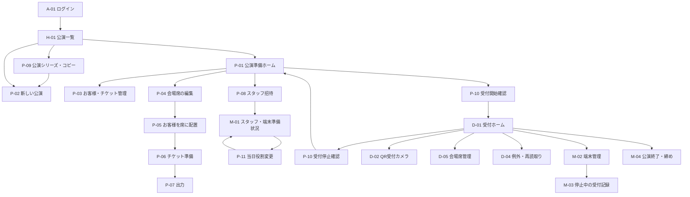
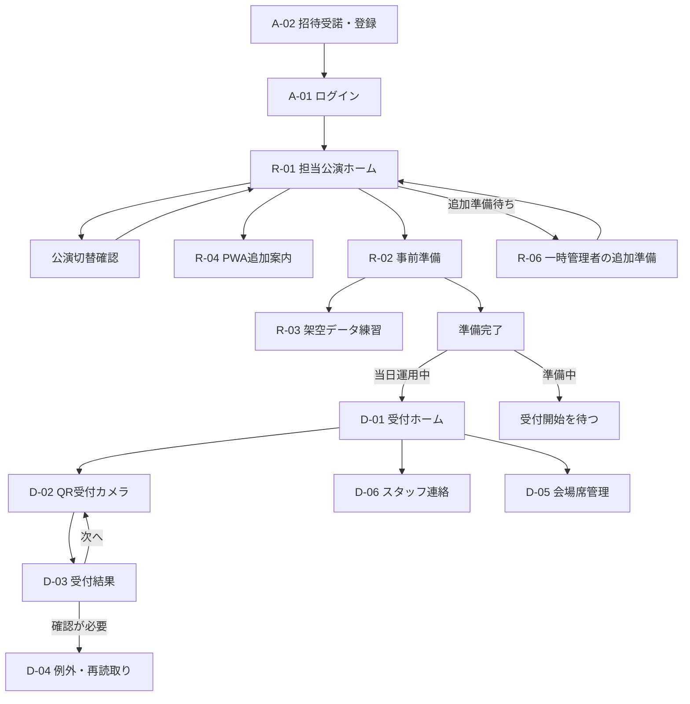

# 画面・画面遷移・操作見本設計

## この文書について

| 項目 | 内容 |
|---|---|
| 目的 | BD-06として、利用者別の情報設計、画面一覧、画面遷移、主要操作見本を定める |
| 主な読者 | 依頼者、画面設計担当者、開発担当者、テスト担当者、運用担当者 |
| 前提 | 要件定義書と受入条件書は`CONF-039`を含めApproved、BD-01～BD-05はIn Reviewである |
| 関連文書 | [基本設計計画書](basic-design-plan.md)、[論理データモデル](logical-data-model.md)、[オフライン同期・競合設計](offline-sync-conflict-design.md)、[認証・役割・権限設計](authentication-authorization-design.md)、[セキュリティ・プライバシー設計](security-privacy-design.md)、[座席表UI/UX引継ぎ](production-seat-map-ui-ux-notes.md)、[セキュリティ・UI/UX引継ぎ](production-security-ui-ux-notes.md) |
| 関連Issue | [#37](https://github.com/EU0207/concert-reception-system/issues/37)、[#57](https://github.com/EU0207/concert-reception-system/issues/57) |
| 設計ID | BD-06、BD-06-01～BD-06-15 |
| 状態 | In Review |
| 対象 | 本番画面の情報構造、遷移、状態表示、操作見本、レスポンシブ基準 |
| 対象外 | 本番画面コード、最終的な色・書体・画像素材、帳票の印刷寸法、実装後の実機試験 |
| 承認情報 | 未承認。BD-10で主要操作見本を基本設計一式として依頼者に確認する |

## 結論

画面体系は、次の4領域へ分ける。

1. 公演準備：公演作成、来場者取込、座席作成、席配置、チケット準備、出力。
2. スタッフ・端末準備：招待、登録、練習、端末承認、事前準備。
3. 当日受付：専用カメラ、判定、例外、会場席管理、スタッフ連絡。
4. 管理・終了処理：端末管理、停止中の受付記録、障害対応、締め、削除確認。

主担当と代理管理者はPCを中心に準備・管理を行い、スマートフォンでも同じ役割を維持する。一般受付担当者と一時管理者はスマートフォンを中心に受付する。高影響操作は端末種別にかかわらず、オンライン接続、再認証、確認、監査を必須とする。

画面文言はIT知識を前提としない。原則として「短い見出し」「現在の状態」「次に必要な操作」の順に表示する。技術情報と詳細時刻は初期表示へ詰め込まず、必要な場合だけ展開する。

## 事実、設計判断、後続設計の境界

| 区分 | 内容 |
|---|---|
| 承認済みの事実 | 専用カメラ、座席・会場画像、来場状態を扱う。端末準備、端末停止、チケット準備状態を扱う。`CONF-039`により、当日受付は主担当・代理管理者の明示操作で開始・停止する |
| 本書の設計判断 | 4領域の画面体系、画面ID、主要導線、画面内の情報優先度、チェック操作、確認ダイアログ、レスポンシブ基準を定める。当日の一時管理者任命フローは2026-09-19の開発者判断であり、依頼者回答とは区別する |
| BD-07へ渡す事項 | 電子チケット、Excel、CSV、印刷用座席表、当日運営表の用紙寸法とファイル見本 |
| BD-08へ渡す事項 | 招待送付、公演前確認、当日の一時管理者任命・解除、紙切替、紛失・回収、締め、削除、問い合わせの運用手順 |
| BD-09へ渡す事項 | 一時管理者任命のオンライン・オフライン・途中失敗・任期終了、画面状態、権限差、境界時刻、対象実機、表示文言、再試行、高影響操作の試験 |

## BD-06-01 情報設計と共通画面構造

### 利用者ごとの開始地点

| 利用者 | ログイン後の開始地点 | 主な操作 |
|---|---|---|
| 主担当 | 公演一覧 | 公演準備、スタッフ・端末管理、受付、締め、削除 |
| 代理管理者 | 公演一覧 | 主担当引継ぎと課金判断を除く管理操作 |
| 一時管理者 | 担当公演ホーム | 受付、例外確認、手動受付、スタッフ連絡 |
| 一般受付担当者 | 担当公演ホーム | 受付、例外仮登録、スタッフ連絡の確認 |

### 共通ヘッダー

ログイン後の全画面で、次を確認できるようにする。

- 現在の公演名、日付、会場と役割。
- オンライン・オフライン状態と未送信件数。
- 端末準備状態またはオフライン利用期限。

複数公演を準備済みの場合は`公演を切り替える`を表示する。管理画面では利用者メニューから端末ID、最終同期時刻、サインアウトを確認できる。一般受付画面で氏名、QR生データ、技術用語を常時表示しない。

### 共通状態表示

| 状態 | 初期表示 | 利用者が行えること |
|---|---|---|
| 読込み中 | 対象と処理名を表示する | 二重操作を防ぎ、取消可能な処理だけ取消す |
| 保存済み・未送信 | `この端末に保存しました`と件数を表示する | 受付を継続し、詳細一覧を開く |
| オフライン | `通信できません`と利用可能な操作を表示する | 許可期限内の受付、確認、端末保存 |
| 再試行可能 | 入力を保持し、失敗箇所と再試行操作を表示する | 同じ操作を安全に再試行する |
| 権限不足 | 実行できない理由と管理者への連絡を表示する | 前画面へ戻る。操作内容は送信しない |
| 保存失敗 | `受付は記録されていません`を明示する | 再試行または紙受付へ切り替える |
| オンライン確認中 | 通常画面を隠して端末状態の確認中と表示する | 結果が確定するまで業務操作を行わない |

## BD-06-02 画面一覧と権限

### 共通・認証

| 画面ID | 画面名 | 主な利用者 | 目的 |
|---|---|---|---|
| C-01 | 起動確認 | 全利用者 | 設定、認証、オンライン復旧時の端末状態を確認する |
| A-01 | ログイン | 全利用者 | Googleまたはメール・パスワードの導線を分離して本人認証する |
| A-02 | 招待受諾・登録 | 公演限定スタッフ | 招待先メール、メール確認、パスワード、招待受諾を完了する |
| A-03 | パスワード再設定 | 公演限定スタッフ | Firebase Authenticationの再設定メールを利用する |
| H-01 | 公演一覧・トップ | 全利用者 | 公演シリーズで整理された担当公演を選び、主担当は新しい公演を作成する |

### 公演準備

| 画面ID | 画面名 | 主な利用者 | 目的 |
|---|---|---|---|
| P-01 | 公演準備ホーム | 主担当・代理 | 準備状況と次の作業を確認する |
| P-02 | 公演基本情報 | 主担当・代理 | 公演名、日時、会場、会場タイムゾーンを登録する |
| P-03 | お客様・チケット管理 | 主担当・代理 | 名簿取込結果、購入者名、座席表示名、交付方法、準備状態を管理する |
| P-04 | 会場席の編集 | 主担当・代理 | 座席番号、欠番、スペースセル、配置を作成する |
| P-05 | お客様を席に配置 | 主担当・代理 | 個人・グループの自動配置と手動配置を行う |
| P-06 | チケット準備 | 主担当・代理 | 購入済み、発行済み、送付済みを個別・一斉管理する |
| P-07 | 出力 | 主担当・代理 | QR、PDF、Excel、CSV、座席表、当日運営表を選択する |
| P-08 | スタッフ招待 | 主担当・代理 | 招待、メール確認、役割、登録状況を管理する |
| P-09 | 公演シリーズ・コピー | 主担当・代理 | 公演をシリーズへ整理し、選択した設定を新しい公演へコピーする |
| P-10 | 受付開始・停止 | 主担当・代理 | 受付を開始し、必要時は受付を停止して準備中へ戻す |
| P-11 | 当日役割変更 | 主担当・代理 | 一般受付担当者を期限付き一時管理者へ任命し、解除する |

### 端末準備・練習

| 画面ID | 画面名 | 主な利用者 | 目的 |
|---|---|---|---|
| R-01 | 担当公演ホーム | 全利用者 | 受付、練習、事前準備、連絡へ進む |
| R-02 | 事前準備 | 全利用者 | データ、版、保存、カメラ、練習を端末単位で確認する |
| R-03 | 架空データ練習 | 全利用者 | 本番と分離したQR受付、再読取り、例外を練習する |
| R-04 | PWA追加案内 | 全利用者 | 対応環境でホーム画面追加手順を確認する |
| R-05 | 追加端末登録 | 主担当 | Google再認証と既存端末の1回限りリンクで追加端末を関連付ける |
| R-06 | 一時管理者の追加準備 | 任命対象者 | 新しい役割と期限を確認し、当日管理用の差分データを準備する |

### 当日受付・管理

| 画面ID | 画面名 | 主な利用者 | 目的 |
|---|---|---|---|
| D-01 | 受付ホーム | 全利用者 | 当日運用中だけ、カメラ受付、会場席、例外、連絡へ進む |
| D-02 | QR受付カメラ | 全利用者 | 対象公演を固定表示し、スクロールしない専用モードでQRを読む |
| D-03 | 受付結果 | 全利用者 | 成功、再読取り、受付不可、特別対応を判定する |
| D-04 | 例外・再読取り | 権限による | 理由・メモ、仮登録、管理者確認を行う |
| D-05 | 会場席管理 | 権限による | 来場状態を確認し、管理者は座席表示名と状態を変更する |
| D-06 | スタッフ連絡 | 全利用者 | 通常・重要連絡の確認と、管理者の投稿を扱う |
| D-07 | 同じQRの複数読取り確認 | 管理者 | 複数端末の記録を確認し、判断を追記する |

### 端末・終了・障害

| 画面ID | 画面名 | 主な利用者 | 目的 |
|---|---|---|---|
| M-01 | スタッフ・端末準備状況 | 主担当・代理 | 招待から準備完了までをスタッフ・端末別に確認する |
| M-02 | 端末管理 | 主担当・代理 | 接続、同期、未送信、停止、廃止を公演・端末別に管理する |
| M-03 | 停止中の受付記録 | 主担当・代理 | 停止後に到着した記録を照合して採否を判断する |
| M-04 | 公演終了・締め | 主担当・代理 | 未送信、未確認、削除状況を確認して締める |
| M-05 | 同期・削除専用 | 対象端末利用者 | 対象公演の期限後に未送信の送信と端末内削除を完了する |
| M-06 | サービス上限・紙切替 | 権限による | 受付継続案内と管理者の紙・課金判断を分離する |

## BD-06-03 全体画面遷移

### 主担当・代理管理者



### 公演限定スタッフ



## BD-06-04 公演一覧と公演準備ホーム

`H-01`では、Firebaseプロジェクトと混同しないよう、業務上の単位を一貫して`公演`と表示する。複数日公演は日ごとの公演カードに分け、公演シリーズの見出しでまとめる。主担当・代理管理者には`新しい公演の準備を始める`を表示する。一般受付担当者には割り当てられた公演だけを表示する。

### 公演シリーズとコピー

`P-09`では、公演シリーズ名と表示順を管理する。コピー元公演を選んだ後、コピー対象を次から選択する。

- スタッフ割当。
- 会場情報。
- 座席表。

確認画面にはコピー元と新しい公演を表示し、`コピー後は別々のデータとして管理されます`と案内する。来場者、チケット、QR、受付履歴はコピー対象にしない。コピー後の変更を元公演または同じシリーズの別公演へ自動反映しない。

### 複数公演の準備と切替

同じ端末へ複数公演を準備できる。公演一覧には、公演ごとの準備状態と未送信件数を表示する。現在の公演から切り替える前に、切替先を次の確認画面で示す。

```text
┌────────────────────────────────┐
│ 公演を切り替えます             │
├────────────────────────────────┤
│ 切替先: 秋のコンサート 2日目   │
│ 2027/10/11  市民ホール         │
│ この端末の未送信: 0件          │
├────────────────────────────────┤
│ 現在の公演                     │
│ 秋のコンサート 1日目           │
│ 未送信 4件                     │
│ 記録を保持したまま切り替えます │
│                                │
│ [戻る] [2日目へ切り替える]     │
└────────────────────────────────┘
```

切替処理は、切替先の本人、役割、端末承認を確認する。続いて公演状態、準備状態、オフライン許可期限を確認する。確認完了まで受付画面を開かない。別公演のQRを読んだ場合は`この公演のチケットではありません`と表示し、現在の公演名を示す。

`P-01`は作業を次の順で案内する。

1. 公演情報と会場を登録する。
2. お客様を取り込み、座席を作成して配置する。
3. チケットとスタッフ・端末を準備する。

### 受付開始と準備中への戻し

新しい公演は`準備中`で開始する。開催日時に到達した場合や全準備項目が完了した場合も、画面を自動的に当日受付へ切り替えない。主担当・代理管理者には、公演準備ホームで次の状態表示と操作を示す。

```text
┌────────────────────────────────────┐
│ 公演状態  準備中                   │
│ 本番受付はまだ始まっていません     │
├────────────────────────────────────┤
│ 事前準備と練習は利用できます       │
│ 開催日時  2027/10/10 18:00         │
│                                    │
│              [受付を開始]          │
└────────────────────────────────────┘
```

`受付を開始`の確認画面には、対象公演、現在の状態、実行後の状態を表示する。実行要求はオンライン時だけ送信し、サーバー確定後に`当日運用中`を表示する。開始後は同じ位置へ`受付を停止して準備に戻す`を表示する。この確認画面にも対象公演と変更前後の状態を示す。

準備中へ戻した後は本番受付画面をロックする。既存の受付結果、未送信件数、履歴は消さない。再度受付を開始すれば、本番受付を再開できる。一時管理者と一般受付担当者には状態変更ボタンを表示せず、準備中は`受付開始を待っています`と案内する。

完全オフライン端末へ停止を即時通知できないことを、停止確認画面に短く表示する。回線復旧時は最新状態を確認するまで通常操作を保留する。停止を知らない間の記録が到着した場合、管理画面では`受付停止後に届いた記録`として表示し、通常受付へ自動反映せず確認へ案内する。

電話、メール、LINE、SMS、郵送による来場者への連絡はシステム外で行う。画面には送信機能を設けず、管理者が外部作業後に準備状態を更新する。

```text
┌────────────────────────────────────────────────────┐
│ 公演準備  秋のコンサート                           │
│ 2027/10/10  会場タイムゾーン: Asia/Tokyo           │
├────────────────────────────────────────────────────┤
│ 次にすること                                       │
│ [お客様を取り込む]  未取込                         │
│ [会場席を作る]      下書き                         │
│ [席に配置する]      0 / 300席                      │
├────────────────────────────────────────────────────┤
│ チケット準備  購入済 210 / 発行済 180 / 送付済 150 │
│ スタッフ準備  準備完了 5 / 8端末                   │
│ 当日運営表    [ ] 予備印刷を確認                   │
└────────────────────────────────────────────────────┘
```

## BD-06-05 招待、登録、練習、端末準備

### 招待・登録

招待URLを開いた時は、公演名や招待先メールアドレスをURLから表示しない。サーバー確認後に、招待の有効・使用済み・期限切れを表示する。招待先と異なるメールでログインした場合は、業務データを表示せず、招待されたメールで続けるよう案内する。

パスワード入力欄には`半角英字と数字を含む6～20文字`を常時表示する。条件不足は満たしていない条件だけを表示し、パスワードと入力メールアドレス全文をログやエラー詳細へ残さない。管理者がパスワードを設定・閲覧する画面は作らない。

### 担当公演ホーム

```text
┌───────────────────────────────────┐
│ 秋のコンサート                    │
│ 一般受付  通信あり                │
├───────────────────────────────────┤
│ ! 事前準備が完了していません      │
│ Wi-Fi環境での実行をおすすめします │
│ 予定ダウンロード量: 約XX MB       │
│ [事前準備を開始]                  │
├───────────────────────────────────┤
│ [操作説明] [練習する]             │
│ [ホーム画面へ追加する方法]        │
└───────────────────────────────────┘
```

Wi-Fiか確実に判定できない場合も開始ボタンを無効にしない。想定通信量を示し、利用者が開始を選ぶ。

### 事前準備

| 項目 | 完了条件 | 失敗時の表示 |
|---|---|---|
| 本人・役割・端末 | 本人、メール確認、招待、役割、端末承認、期限が有効 | 不足項目と管理者への連絡を示す |
| アプリ・データ | アプリ版、データ版、件数、整合性、保存可否が合格 | 完了済み項目を保持して失敗項目から再試行する |
| カメラ・練習 | カメラ起動、架空QR、再読取り、例外、理由・メモを確認 | 権限設定または再試行手順を示す |
| オフライン準備 | 期限と端末用暗号鍵を保存し、オフライン起動を確認 | 本番受付を許可せず再試行する |

全項目成功後、大きなバナーを隠す。画面上部へ`準備完了`、対象公演、最終確認時刻、オフライン利用期限を小さく表示する。

### 主担当の追加端末

既存の承認済み主担当端末で`追加端末を登録`を選ぶ。1回限りQRと短時間リンクを表示し、新端末では同じGoogleアカウントで再認証する。成功しても新端末は`未準備`から開始する。既存端末と新端末の役割は、どちらも主担当と表示する。

## BD-06-06 専用カメラと受付結果

### QR受付カメラ

`D-02`はスクロールしない専用モードとする。通常ナビゲーションを隠し、対象公演名・日付を固定表示する。終了、通信状態、未送信件数も常に表示する。カメラ権限拒否時は、設定方法と確認コードによる管理者対応への導線を表示する。

```text
┌──────────────────────────────────┐
│ QR受付  秋公演2日目 10/11        │
│ オフライン        未送信 3       │
│                    [終了]        │
├──────────────────────────────────┤
│                                  │
│      ┌────────────┐              │
│      │ QRを枠内へ │              │
│      └────────────┘              │
│                                  │
├──────────────────────────────────┤
│ 暗い場合は端末を近づけてください │
└──────────────────────────────────┘
```

### 受付結果

QRを検出した時点で追加読取りを停止し、`D-03`をカメラ全面へ重ねる。`次へ`で閉じるまでカメラへ戻さない。結果は色だけに依存せず、見出し、記号、文章を組み合わせる。

```text
┌───────────────────────────┐
│ ✓ 受付しました            │
│ この端末に記録しました    │
│ 1階 A列 A-12              │
│ 特別案内: 受付で確認      │
│                           │
│       [次へ]              │
└───────────────────────────┘
```

| 結果 | 見出し | 状態と次の操作 |
|---|---|---|
| 初回受付 | `受付しました` | 端末保存済みを示し、`次へ`で再開する |
| 受付済み | `すでに受付されています` | 初回時刻を示し、理由選択へ進む |
| 登録なし・別公演・無効 | `受付できません` | 管理者確認または例外仮登録へ進む |
| 特別案内 | `確認が必要です` | 必要な案内だけを表示し、対応済みにする |
| 保存失敗 | `受付は記録されていません` | 同じQRの再試行または紙受付へ進む |

通常結果へ氏名を表示しない。例外画面では役割上必要な氏名と対応内容だけを表示する。

## BD-06-07 再読取り、例外、複数端末の読取り

受付済みQRでは、理由を次から1つ選択する。

- 正当な再入場。
- 連続・誤読取り。
- 管理者確認またはその他。

任意メモは200文字以内とし、入力中の内容を画面遷移や再認証で失わない。一般受付担当者は未承認例外を仮登録し、管理者の手動確定・取消しを表示しない。

同じQRが複数端末で初回受付された場合、利用者向け見出しは`同じQRコードが別の端末でも読み取られています`とする。続けて`受付状況を確認してください`と表示する。詳細を開いた時だけ端末、端末上の時刻、サーバー到着時刻を表示する。

## BD-06-08 会場席の編集と席配置

### 会場席の編集

`P-04`はPCを主対象とし、設定欄、座席表プレビュー、検証結果を同時に確認できるようにする。スマートフォンでも役割に応じた同じ操作を利用できる。ただし、広い表を編集する場合はPC推奨を表示する。

```text
┌──────────────┬───────────────────────────────┐
│ 会場席の編集 │ プレビュー                    │
│ 階・区画 [1階]│ 1列 [1-4][1-5][空間][1-7]    │
│ 列名     [1列]│ 2列 [2-2][2-3][2-4][2-5]     │
│ 接頭部   [1- ]│                              │
│ 開始番号 [4  ]│ 選択: 1階 / 1列 / 1-7        │
│ 席数     [4  ]│                              │
│ [欠番を設定]  │ ! 欠番1件、スペース1個       │
│ [空間を追加]  │ [会場画像と照合]             │
├──────────────┴───────────────────────────────┤
│ [下書きを保存]                 [構成を確定]  │
└──────────────────────────────────────────────┘
```

欠番は座席を作らない操作、スペースセルは配置上の空間を追加する操作とする。スペースセルは座席と異なる形・文言で表示し、来場者割当、QR発行、空席数・座席数へ含めない。

配置済みまたはチケット発行済みの座席を変更する場合は、影響する席、来場者、チケットを確認画面へ表示する。チケット発行後は自動配置へ戻さず、理由付きの個別座席変更として扱う。

### お客様を席に配置

`P-05`は上部に座席表、下部にお客様一覧を表示する。どちらかが長い場合も、選択中のお客様と席を固定領域へ表示する。

```text
┌────────────────────────────────────────────────┐
│ お客様を席に配置  未配置 12 / 300              │
│ [グループを自動配置] [個人を名簿順] [ランダム] │
├────────────────────────────────────────────────┤
│ 座席表                                         │
│ 1列 [済][済][空][選択中]  2列 [済][空][空]     │
├────────────────────────────────────────────────┤
│ 選択中: 購入者A / 3席   配置先: 1階 1列 1-7    │
├────────────────────────────────────────────────┤
│ お客様一覧                                     │
│ [ ] 購入者A 3席  未配置                        │
│ [ ] 購入者B 1席  1階 2列 2-3                   │
└────────────────────────────────────────────────┘
```

同じ購入者名の複数席をまとめて確認できるが、割当、チケット、QRは1席単位とする。未配置、配置案、確定、発行後変更を文字で区別する。

## BD-06-09 お客様・チケット管理

### 購入者名と座席表示名

管理者向け画面では、購入者名を読取り専用の`購入者名`として表示する。編集可能な`座席表示名`を別欄に置き、代理来場時は座席表示名だけを変更する。確認画面では`購入者名と購入状態は変更されません`と示す。

### 交付方法と準備状態

交付方法は`未選択`、`電子チケット`、`紙チケット`から選択する。準備状態はチェックボックス状に表示するが、内部では1つの順序状態として扱う。

| 操作 | 設計 |
|---|---|
| 次へ進める | 現在状態の次だけを選択可能にする |
| 元へ戻す | 現在の最新状態だけを解除可能にする |
| 一斉操作 | 同じ次状態へ進められる対象だけを選び、対象件数と除外理由を確認する |
| 到達日時 | 購入済み、発行済み、送付済みの各日時を詳細展開で表示する |

`未`から`発行済み`へ飛ばす操作や、`送付済み`を残して`購入済み`だけを解除する操作は許可しない。確認ダイアログには対象、現在状態、変更後状態を表示する。準備状態操作の担当者は記録・表示しない。

状態の業務上の意味は次のとおりとする。

| 状態 | 共通 | 電子チケット | 紙チケット |
|---|---|---|---|
| 購入済み | 入金等をシステム外で確認済み | 同左 | 同左 |
| 発行済み | 席とチケットが確定済み | QR付きPDFを生成・保存後に管理者が確認 | 印刷業者へ対象一覧を送付後に管理者が確認 |
| 送付済み | 来場者への交付作業が完了 | メール・LINE等のシステム外送付後に確認 | 完成した紙チケットの郵送・手渡し後に確認 |

システムは入金、メール、LINE、SMS、郵送、印刷業者への送信を自動実行しない。

```text
┌─────────────────────────────────────────────────────────┐
│ チケット準備  [交付方法▼] [状態▼] [未完了のみ]          │
│ 選択 3件  [購入済みにする] [発行済みにする]             │
├────┬────────┬──────┬──────────────┬─────────────────────┤
│選択│購入者名│席番号│交付方法      │準備状態             │
│[ ] │購入者A │A-12  │電子チケット  │✓購入 ✓発行 □送付    │
│[ ] │購入者A │A-13  │未選択        │✓購入 □発行 □送付    │
│[ ] │購入者B │A-14  │紙チケット    │✓購入 ✓発行 ✓送付    │
└────┴────────┴──────┴──────────────┴─────────────────────┘
```

## BD-06-10 会場席管理と来場状態

公演中の`D-05`では、座席表と一覧を切り替えられる。状態は`未受付`と`来場済み`を表示し、締め後は残る未受付を`未来場`として表示する。

一般受付担当者は状態を直接変更しない。主担当、代理管理者、一時管理者が席を選ぶと、管理操作として手動受付と座席表示名変更を利用できる。来場済みを未受付へ戻す場合は理由入力を必須とする。

```text
┌────────────────────────────────┐
│ 会場席  未受付 42 / 来場済 258 │
│ [座席表] [一覧]                │
├────────────────────────────────┤
│ 1列 [済][未][済][選択]         │
│ 2列 [済][済][未][未]           │
├────────────────────────────────┤
│ 選択中  1階 1列 1-7            │
│ 状態: 未受付                   │
│ 座席表示名: 招待者C            │
│ 購入者名: 購入者A（管理者のみ）│
│ [表示名を変更] [来場済みにする]│
└────────────────────────────────┘
```

表示名変更と来場状態変更を別ボタン・別確認画面にする。どちらの操作も元の受付イベントや購入者名を上書きしない。

## BD-06-11 スタッフ・端末管理

### 準備状況

`M-01`はスタッフ行を展開すると、公演・端末別の状態を表示する。PCが準備済みでも、同じ主担当のスマートフォンは別の準備状態として扱う。同じ端末の別公演も、独立した準備状態と未送信件数を表示する。

| 一覧の列 | 内容 |
|---|---|
| スタッフ | 表示名、役割、招待、メール確認、登録 |
| 端末 | 端末IDの短縮表示、承認、データ取得、カメラ、練習 |
| 準備 | 未準備、準備途中、準備完了、再準備必要、停止中 |
| 確認 | 最終接続、最終同期、最終準備確認、未送信件数 |

### 当日の一時管理者任命

主担当・代理管理者が一般受付担当者の行を選ぶと、`当日の一時管理者に任命`を表示する。一時管理者と一般受付担当者にはこの操作を表示しない。任命前にオンライン状態と再認証を確認し、次の確認画面を表示する。

```text
┌──────────────────────────────────────────┐
│ 当日の一時管理者に任命します             │
├──────────────────────────────────────────┤
│ 対象者    受付スタッフA                  │
│ 対象公演  秋のコンサート                 │
│ 現在      一般受付担当者                 │
│ 変更後    一時管理者                     │
│ 有効期限  2027/10/11 23:59               │
├──────────────────────────────────────────┤
│ 対象者の端末で追加準備が必要です         │
│ [戻る]              [任命する]           │
└──────────────────────────────────────────┘
```

任命後、管理画面には端末ごとに`追加準備待ち`、`準備中`、`利用可能`、`失敗`を表示する。役割変更が確定しても、追加準備が完了していない端末を一時管理者として利用可能とは表示しない。

対象者の承認済み端末では、通常画面の上部に次を表示する。完全オフライン中は開始ボタンを無効にし、通信回復後の操作を案内する。

```text
┌──────────────────────────────────────────┐
│ 一時管理者として使う準備が必要です       │
│ 現在は一般受付の操作だけ利用できます     │
├──────────────────────────────────────────┤
│ 通信できる状態で追加準備を行います       │
│ アプリの入れ直しは必要ありません         │
│                                          │
│             [追加準備を開始]             │
└──────────────────────────────────────────┘
```

`R-06`は、本人と対象公演を確認する。続いて端末承認、新しい役割、有効期限を確認する。差分データの件数、データ版、保存結果、整合性を順に表示し、失敗した項目から再試行できるようにする。全項目の完了後に`一時管理者として利用できます`と表示し、次の操作を有効化する。

| 利用可能になる操作 | 利用できない操作 |
|---|---|
| 来場状況・会場席の確認 | スタッフの役割変更 |
| 手動受付・理由付き訂正 | 端末の承認・停止・停止解除 |
| 座席表示名・当日座席状態の変更 | 受付開始・受付停止・準備戻し |
| 例外記録の確認・処理 | 公演の締め、端末廃止・データ削除 |
| スタッフ向け連絡 | 任意項目、全件ZIP、管理者専用出力 |
| 当日業務範囲の監査確認 | 認証・役割管理の監査履歴 |

任期終了または役割解除を検知した端末は、`一時管理者の利用期間が終了しました`と表示して管理者用操作をロックする。未送信の手動受付、訂正、例外記録がある場合は件数を示し、削除せず送信を続ける。全件受領後に一時管理者用データを削除し、一般受付担当者として続ける場合は、オンラインで役割と端末状態を確認してから通常画面へ戻す。

期限前の解除を完全オフライン端末へ即時通知できないことは、解除確認画面に表示する。回線復旧時は最新役割を確認するまで通常操作を保留する。解除後に届いた未送信記録は削除せず、管理者確認へ案内する。

### 端末停止・解除・廃止

`M-02`では、対象公演を固定してから、`停止`、`停止解除`、`端末廃止・データ削除`を表示する。停止確認には`この公演の端末内データは削除されません`と表示する。端末廃止では`この公演では再利用できなくなります`と表示し、同じ端末の別公演は変更されないことを示す。

| 表示名 | 意味 |
|---|---|
| 有効 | 通常利用できる |
| 停止待ち（オフライン） | 停止指示済みだが端末の検知を確認できない |
| 停止済み・未同期あり | ロック済みで、管理者確認用の送信が残っている |
| 停止中 | データを保持したままロックされている |
| 停止解除確認中 | 再ログイン、版、整合性、差分同期の確認中 |
| 廃止・削除待ち | 廃止指示済みだが端末内削除を確認できない |
| 廃止・削除完了 | ログアウトと端末内削除を確認済み |

内部状態の`停止検知済み`は、利用者向けには`停止中`と表示する。`隔離記録確認待ち`は`停止中の受付記録を確認してください`と表示する。技術上の状態値を利用者向け画面へ直接表示しない。

## BD-06-12 停止中の受付記録

`M-03`の見出しは`停止中の受付記録`とする。説明は`ロック端末が停止期間中にスキャンした受付記録です。受付には未反映です。内容を確認してください`とする。

一覧には次を表示する。

- 席番号、表示用チケット番号、操作種別。
- 停止指示時刻、端末上の発生時刻、サーバー到着時刻。
- 端末連番、停止前の最終同期時刻、照合状態。

判断は`採用`、`重複`、`誤操作`、`不正使用の疑い`から選択し、紙記録等との照合メモを入力する。正式な受付へ自動反映しない。採用時だけ、管理者の判断イベントを経て通常記録へ反映する。

## BD-06-13 公演終了、期限切れ、削除

### 公演終了・締め

`M-04`は、対象公演の終了、未送信0件、管理者確認の3条件を別々に表示する。未達条件がある間は対象公演の締めボタンを無効にし、端末または確認画面への導線を表示する。別公演の準備・受付ボタンは無効にしない。

### 公演翌日の確認期間

公演終了後から会場タイムゾーンの翌日23:59:59までは、受付結果、未同期、同じQRの複数読取り、停止中の受付記録を確認できる。新規受付と新たな訂正は表示しない。

### 期限切れと削除専用画面

期限後は対象公演の通常画面をロックする。未送信がある場合は`この公演には送信待ちの受付があります`と表示し、件数、送信、管理者への連絡を示す。全件受領確認に加え、締め処理または端末廃止・データ削除の条件が成立した後に、対象公演の端末内データ削除へ進む。別公演へ切り替える操作は残す。

未同期を残す強制削除は主担当・代理管理者だけに表示する。再認証、理由入力、復元不能警告、再確認を別段階にする。

```text
┌────────────────────────────┐
│ データを送信できていません │
│ 未送信 4件                 │
│ 削除すると復元できません   │
│                            │
│ [送信を再試行]             │
│ [管理者に連絡]             │
│                            │
│ 管理者用: [強制削除へ進む] │
└────────────────────────────┘
```

## BD-06-14 サービス上限、紙切替、復旧

一般受付画面では、課金判断を表示しない。`この端末に受付を保存しています`、未送信件数、受付継続可否、管理者への連絡を表示する。未送信一覧は席番号と表示用チケット番号を主列とし、QR生データと氏名を表示・印刷しない。

課金判断者の管理画面では、次の2つを並列に示す。

1. 予備印刷した当日運営表へ切り替える。
2. Firebase Consoleで同じプロジェクトを手動課金する。

アプリから課金を実行せず、新しいFirebaseプロジェクトへの切替を案内しない。復旧後は未送信の再送、同じQRの複数読取り、紙記録との照合へ順に案内する。

## BD-06-15 レスポンシブ、アクセシビリティ、レビュー

### レイアウト基準

| 対象 | 基準 |
|---|---|
| スマートフォン | 受付、結果、例外、連絡、会場席の主要操作を1列で表示する。主要ボタンの押下領域を約44px以上とする |
| PC | 準備、座席編集、席配置、チケット準備、端末管理で一覧と詳細を同時表示する |
| 折りたたみ端末 | 狭い状態はスマートフォン1列、広い状態はPC寄りの2領域へ切り替える |

文字はブラウザーの拡大を妨げない。色だけで状態を示さず、記号と文言を併用する。キーボード操作順は表示順と一致させ、フォーカスを見失わせない。処理中表示は読み上げへ通知し、継続的な通信状態の変化を過剰に読み上げない。

会場画像は1枚を大きく表示する。100%未満では中央を基準に配置する。スマートフォンの操作部品は画像下へ置き、前後操作とズーム操作を分ける。動きを減らす設定では切替アニメーションを抑制する。

### 実装前レビュー対象

BD-10では、少なくとも次の操作見本を確認する。

1. 公演シリーズ、新しい公演、コピー、公演切替。
2. 受付開始、受付停止、準備中への戻し、再開。
3. 一時管理者の任命、追加準備、利用開始、解除。
4. 名簿取込、座席編集、席配置。
5. チケット準備、スタッフ招待、端末準備。
6. 専用カメラ、受付結果、例外、会場席管理。
7. 端末停止、停止中の受付記録、停止解除、端末廃止。
8. 公演終了、期限切れ、未送信、削除、紙切替。

実装中はPC、iPhone 17、iPhone 13 mini、Galaxy Z Fold8で小さな画面単位のレビューを行う。OS・ブラウザー版は検証時の最新安定版を使用し、BD-09で記録する。

## 主要メッセージ一覧

| 場面 | 短い見出し | 現在の状態 | 次に必要な操作 |
|---|---|---|---|
| 端末準備前 | 事前準備が完了していません | この端末では本番受付を開始できない | 通信環境を確認して事前準備を開始する |
| オンライン復旧 | 接続状態を確認しています | 端末の利用可否を確認中 | 完了するまで待つ |
| 未送信 | この端末に保存しました | サーバーへの送信が残っている | 受付を続けるか未送信一覧を確認する |
| 複数端末読取り | 同じQRコードが別の端末でも読み取られています | 受付状況の確認が必要 | 管理者が記録を確認する |
| 停止端末 | この端末はロックされています | 通常の受付と閲覧はできない | 管理者に連絡する |
| 停止中記録 | 停止中の受付記録 | 受付には未反映 | 紙記録等と照合して判断する |
| 保存失敗 | 受付は記録されていません | 端末への保存に失敗した | 再試行または紙受付へ切り替える |
| 期限切れ | この公演の通常利用期間は終了しました | 新しい受付・訂正はできない | 未送信確認または削除へ進む |
| 廃止・削除 | この公演では端末を再利用できなくなります | 実行後は元に戻せない | 対象と未送信を確認して再認証する |
| 公演切替 | 公演を切り替えます | 前の公演の未送信記録は保持される | 公演名、日付、会場、未送信件数を確認する |
| 別公演QR | この公演のチケットではありません | 選択中の公演では受付できない | 現在の公演名を確認する |
| 受付開始前 | 受付開始を待っています | 本番受付はまだ始まっていない | 事前準備または練習を行う |
| 受付停止 | 受付を停止して準備に戻します | 新しい本番受付を止める。保存済み記録は消えない | 対象公演と変更後の状態を確認する |
| 停止後到着 | 受付停止後に届いた記録 | 受付には未反映 | 内容を確認して判断する |
| 一時管理者追加準備 | 一時管理者として使う準備が必要です | 現在は一般受付の操作だけ利用できる | 通信できる状態で追加準備を開始する |
| 一時管理者期限終了 | 一時管理者の利用期間が終了しました | 管理者用操作は利用できない。未送信記録は保持される | 通信状態を確認して送信を完了する |

## 要件・受入条件の対応

| 設計範囲 | 主な要件 | 主な受入条件 | 設計ID |
|---|---|---|---|
| 情報設計、共通状態、レスポンシブ | REQ-F-029、REQ-NF-001、REQ-NF-006、REQ-NF-007、REQ-NF-009、REQ-NF-014、REQ-NF-020 | AC-004、AC-017、AC-018、AC-032、AC-033 | BD-06-01～BD-06-03、BD-06-15 |
| 公演・来場者・座席・チケット準備 | REQ-F-001～REQ-F-007、REQ-F-019、REQ-F-022～REQ-F-025、REQ-F-035、REQ-F-036、REQ-F-038、REQ-F-039、REQ-F-043、REQ-F-044、REQ-F-046 | AC-001～AC-003、AC-009、AC-010、AC-013、AC-023、AC-025、AC-026、AC-035、AC-036、AC-038 | BD-06-04、BD-06-08～BD-06-10 |
| 受付、再読取り、例外、訂正、連絡 | REQ-F-008～REQ-F-017、REQ-F-034、REQ-F-037、REQ-F-041、REQ-F-047 | AC-004～AC-011、AC-019、AC-024、AC-027、AC-029、AC-032、AC-039 | BD-06-04、BD-06-06、BD-06-07、BD-06-10 |
| 招待、端末準備、端末管理 | REQ-F-028、REQ-F-031、REQ-F-040、REQ-NF-015、REQ-NF-016、REQ-NF-019 | AC-014、AC-017、AC-028、AC-030、AC-031、AC-033 | BD-06-05、BD-06-11～BD-06-13 |
| 当日の一時管理者任命 | REQ-F-028、REQ-F-031、REQ-NF-012、REQ-NF-015、REQ-NF-017、REQ-NF-018 | AC-014、AC-023、AC-030、AC-031 | BD-06-03、BD-06-05、BD-06-11、BD-06-15 |
| 未送信、障害、上限、紙切替 | REQ-F-020、REQ-F-030、REQ-F-042、REQ-NF-003、REQ-NF-004、REQ-NF-010、REQ-NF-013 | AC-012、AC-015、AC-018、AC-020、AC-021、AC-034 | BD-06-01、BD-06-13、BD-06-14 |
| 確認事項 | TBD-005、TBD-008、CONF-022、CONF-023、CONF-025、CONF-029、CONF-032、CONF-034～CONF-039 | AC-025、AC-029、AC-032～AC-036、AC-038、AC-039 | BD-06-04～BD-06-15 |

## 代替案、影響、残存リスク

### 採用しなかった主な代替案

| 代替案 | 採用しない理由 |
|---|---|
| 準備・受付・管理を1画面へ集約する | 年1回利用する担当者が目的と次の操作を見失い、スマートフォンで情報過多になる |
| 技術状態をそのまま表示する | `競合`、`隔離`、`認可`等では、利用者が起きた事実と次の操作を判断できない |
| チケット準備の任意チェックを許す | 送付済みだけが残る等の矛盾が発生し、現在状態を説明できない |
| スマートフォンで高影響操作を簡略化する | 主担当権限を端末種別で弱めず、安全条件も同じにする要件へ反する |

### 良い影響

- 年1回の利用でも、次の作業と未完了箇所を公演準備ホームから確認できる。
- 当日受付はカメラと判定へ集中し、管理操作を別画面へ分離できる。
- 購入者名、座席表示名、来場状態を誤って同時変更しにくくなる。

### 注意が必要な影響と残存リスク

- 本書の文字ワイヤーフレームは情報構造の確認用であり、最終的な視覚品質を保証しない。BD-10と実装中の実機レビューが必要である。
- 座席数が多い会場では、PCでも座席表と一覧の同時表示が狭くなる。ズーム、区画切替、選択固定の具体寸法を実装見本で調整する。
- チケット準備の一斉操作は対象誤りの影響が大きい。対象件数、除外理由、変更後状態の確認が必要である。
- 回収不能端末の未送信を確認できない場合、現行の締め条件では処理が停止する。この要件変更が必要ならBD-08またはBD-10へ戻す。
- 複数公演を準備した端末では、公演の取り違えが重大な誤受付につながる。全受付画面で現在の公演を固定表示し、切替確認と別公演QRの拒否を実機で確認する。
- 受付停止を完全オフライン端末へ即時通知できない。停止確認で限界を示し、復旧後の記録を管理者が見落とさない表示が必要である。
- 一時管理者の期限前解除も完全オフライン端末へ即時通知できない。復旧時確認までの記録を保持し、管理者確認へ案内する必要がある。

## 確認事項

**依頼者に確認してください**

- なし。`CONF-039`までの正式回答と、2026-09-19の開発者判断による当日の一時管理者任命フローを画面設計へ展開した。主要操作見本はBD-10で一括確認を依頼する。

**開発者が確認してください**

- 画面一覧と遷移がBD-02～BD-05の状態、権限、保存、削除条件と一致することを確認してください。
- 利用者向け文言に内部用語を直接表示せず、受付への反映状況と次の操作を省略していないことを確認してください。
- 本書の文字ワイヤーフレームを本番コードまたは最終的な視覚装飾として扱わないことを確認してください。
