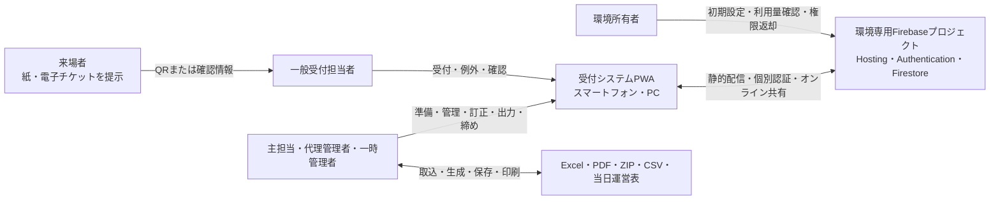
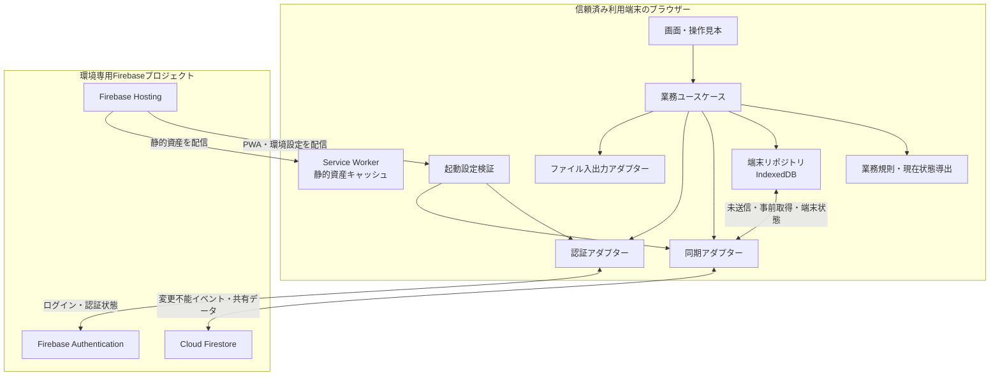

# システム構成・環境分離設計

## この文書について

| 項目 | 内容 |
|---|---|
| 目的 | ADR-001を基本設計へ展開し、PWA、端末保存、Firebase、ファイル入出力、利用者、各環境の責務と接続境界を定める |
| 主な読者 | 依頼者、設計担当者、開発担当者、テスト担当者、運用担当者 |
| 前提 | 要件定義書と受入条件書は`CONF-034`を含めApproved、ADR-001とADR-002はAcceptedであり、個別のデータ項目、同期規則、権限、暗号化、画面は後続基本設計で定める |
| 関連文書 | [基本設計計画書](basic-design-plan.md)、[ADR-001](decisions/ADR-001-product-platform.md)、[ADR-002](decisions/ADR-002-quota-emergency-response.md)、[要件定義書](../client/requirements.md)、[受入条件書](../client/acceptance-criteria.md)、[トレーサビリティ表](traceability-matrix.md) |
| 関連Issue | [#32](https://github.com/EU0207/concert-reception-system/issues/32) |
| 設計ID | BD-01、BD-01-01～BD-01-10 |
| 関連ID | REQ-B-001～REQ-B-006、REQ-F-020、REQ-F-030、REQ-F-042、REQ-NF-002～REQ-NF-004、REQ-NF-009～REQ-NF-011、REQ-NF-013、REQ-NF-019～REQ-NF-021、AC-015、AC-017、AC-018、AC-020、AC-021、AC-031、AC-033、AC-034、TBD-002、TBD-011、TBD-012、CONF-031～CONF-034 |
| 状態 | In Review |
| 承認情報 | 未承認。基本設計一式はBD-10で確認する |

## 結論

本システムは、スマートフォンとPCのブラウザーで動く静的なPWAをFirebase Hostingから配信し、個別認証をFirebase Authentication、オンライン共有をCloud Firestore Standard edition、端末内の変更不能イベントと送信状態をアプリケーション管理のIndexedDB、静的資産の事前取得をService Workerが担当する構成とする。Cloud Functions等の常駐サーバー処理は設けない。

依頼者用、開発用、第三者評価用、将来の各主催者用は、Firebaseプロジェクト、Webアプリ設定、Authentication利用者、Firestoreデータ、Hosting配信先を共有しない。設定はGitへ固定せず環境ごとの配布物として生成する。不足、不正、別環境への切替を検出した場合は、Firebase初期化と業務操作を開始せず安全に停止する。

## 事実、設計判断、後続設計の境界

| 区分 | 内容 |
|---|---|
| 承認済みの事実 | PWA、TypeScript、Firebase Hosting、Firebase Authentication、Cloud Firestore、IndexedDBイベント方式、Service Worker、Sparkプラン、環境所有者ごとのFirebase分離をADR-001で採用済みである |
| 本書の設計判断 | コンポーネント責務、接続方向、環境単位、設定の読込みと安全停止、配布単位、評価環境、外部サービス停止時の境界を定める |
| 本書で決めない事項 | 論理データ項目と保存期間はBD-02、同期・競合規則はBD-03、認証運用と権限表はBD-04、暗号化・鍵・秘密情報はBD-05、画面はBD-06、帳票はBD-07、運用・復旧はBD-08、テスト詳細はBD-09で定める |

## BD-01-01 システムコンテキスト

- 来場者はシステム利用者ではなく、受付担当者へチケットまたは確認情報を提示する外部の関係者とする。
- 一般受付担当者と管理者は、信頼済みとして準備されたスマートフォンまたはPCのブラウザーからPWAを利用する。
- 環境所有者はFirebase管理画面を初期設定、利用量・重要通知確認、障害対応、権限返却に限定して利用する。通常業務はPWAの管理画面で行う。
- Excel等のファイルは利用者端末で読み込みまたは生成し、原本や生成物をサーバーへ恒久保存しない。

## BD-01-02 コンポーネントと責務

| 構成要素 | 責務 | 保持・処理しないもの | 後続設計 |
|---|---|---|---|
| 画面 | 利用者の入力、状態、次の操作、エラーを表示する | 権限の最終判定、同期結果の上書き | BD-06 |
| 業務ユースケース | 画面操作を業務規則、保存、同期、出力へ振り分ける | Firebase SDK固有処理 | BD-02、BD-03 |
| 業務規則 | イベントから現在状態と競合候補を導出する | 端末・Firestoreへの直接入出力 | BD-02、BD-03 |
| 端末リポジトリ | 変更不能イベント、送信状態、事前取得データ、端末状態をIndexedDBへ保存する | 他端末との直接通信、最終的な権限判定 | BD-02、BD-03、BD-05 |
| 同期アダプター | 端末イベントの送信、共有イベントの受信、再試行状態を業務層へ返す | 現在状態の破壊的上書き、競合の自動消去 | BD-03 |
| 認証アダプター | Firebase Authenticationと業務層の境界を持つ | 業務役割の画面だけによる許可 | BD-04、BD-05 |
| ファイル入出力 | Excelを端末内で検証し、PDF・ZIP・Excel・CSV・印刷用資料を端末内で生成する | 原本・生成物の恒久的なサーバー保存 | BD-07 |
| Service Worker | バージョン付き静的資産を事前取得し、オフライン起動を補助する | 認証・業務データの独自判断、秘密情報の保存 | BD-03、BD-05、BD-08 |
| 起動設定検証 | 環境設定の完全性、環境種別、版、端末の環境結付きを検証してからFirebaseを初期化する | 既定のFirebase接続先への自動補完 | BD-01-04、BD-05 |
| Firebase Hosting | PWA静的資産と環境別の非秘密設定をHTTPS配信する | 動的業務処理、個人情報のファイル保管 | BD-01-06 |
| Firebase Authentication | 利用者を個別に識別し、認証状態を提供する | 公演役割だけで決まる業務認可 | BD-04 |
| Cloud Firestore | 環境内のオンライン共有とSecurity Rulesによるサーバー側拒否の境界となる | 課金必須のTTL、PITR、管理バックアップ、管理エクスポート | BD-02～BD-05、BD-08 |

## BD-01-03 端末保存とオンライン共有の境界

| 情報・処理 | 端末 | Firebase | ファイル | 方針 |
|---|---|---|---|---|
| PWA静的資産 | Service Workerで事前取得 | Hostingが版を配信 | なし | 開催前に信頼済み端末へ取得する |
| 環境設定 | 検証済み設定と環境指紋を保持可能 | Hostingから環境別に配信 | ローカル評価用設定を使用可能 | 設定不備または環境不一致時はFirebase初期化前に停止する |
| 認証状態 | Firebase SDKと後続セキュリティ設計の範囲で保持 | Authenticationが本人識別を行う | 保存しない | 初回ログイン、失効確認、オフライン限界はBD-04・BD-05で定める |
| 受付等の変更不能イベント | IndexedDBへ先に保存し送信状態を持つ | Firestoreへ追記し環境内で共有する | 復旧用出力の対象になり得る | 端末保存と送信成功を分離し、現在状態を直接上書きしない |
| 事前取得した当日データ | 必要最小限をIndexedDBへ保持 | Firestoreが正本の共有元となる | 当日運営表を代替に使用する | 配布範囲と削除はBD-02・BD-05で定める |
| Excel原本 | 選択時だけ端末内で読み取る | 原本を保存しない | 利用者が管理する | 検証後は必要な構造化データだけを業務層へ渡す |
| PDF・ZIP・Excel・CSV | 要求時に端末内生成する | 生成物を保存しない | 利用者が明示的に保存・印刷する | 一時生成物の破棄と出力権限はBD-07で定める |

Firestore SDKのWeb永続キャッシュは既定で無効であり、同一文書の複数変更は最終書込み優先になる。このため、信頼済み端末での永続化可否はBD-03・BD-05で決め、受付の正しさをSDKの最終書込み優先へ依存させない。アプリケーション管理の変更不能イベントを同期単位とし、Firestore SDKのキャッシュは共有データ取得を補助する実装詳細として分離する。

## BD-01-04 起動設定と安全停止

Firebase Web設定はプロジェクトとWebアプリを識別する非秘密情報だが、依頼者環境の識別子を公開リポジトリへ含めない。配布物は、共通のレビュー済みPWA資産と、環境所有者が管理する環境別設定を組み合わせて作る。

環境別設定には、少なくとも次の論理項目を持たせる。具体的なファイル名とスキーマは実装開始前に決める。

| 項目 | 用途 | 扱い |
|---|---|---|
| 設定スキーマ版 | 必須項目と読込み互換性の判定 | 対応外なら停止する |
| 環境種別 | production、development、evaluation-local、evaluation-firebase等の表示と誤操作防止 | 未知の値なら停止する |
| 環境表示名 | 利用者が接続先を識別する | production以外は画面へ常時識別表示する |
| Firebase Web設定 | FirebaseプロジェクトとWebアプリの識別 | production、development、evaluation-firebaseで必須。Gitへ実値を保存しない |
| 環境識別子・設定指紋 | 端末を1つの環境へ結び付ける | 端末データがある状態で変化したら停止する |
| 対応アプリ版 | 設定と配布資産の互換性確認 | 不一致時は更新手順を案内して停止する |

起動順は次のとおりとする。

1. PWAの最小起動画面を表示する。
2. 同一配布元の環境別設定、またはローカル評価用設定を読み込む。
3. 必須項目、形式、環境種別、対応アプリ版を検証する。
4. 端末内に保存した環境識別子・設定指紋と比較する。
5. 不足、不正、不一致があればFirebaseを初期化せず、業務画面へ進ませず、原因と安全な再設定手順を表示する。
6. 検証合格後だけ、対象環境のFirebaseを初期化する。ローカル評価ではFirebaseを初期化しない。
7. BD-04で定める認証と公演権限を確認し、BD-03で定める事前取得・同期を開始する。

環境切替は通常操作として提供しない。別環境を使用する場合は、BD-08で定める送信完了、出力、ログアウト、端末データ削除、再準備を経る。

## BD-01-05 環境分離

Firebaseは環境ごとに別プロジェクトを用意する。1つのFirebaseプロジェクト内で主催者IDだけを分けるマルチテナント方式は採用しない。

| 環境 | 所有者 | Firebase | 使用データ | 接続・共有 |
|---|---|---|---|---|
| 依頼者用本番 | 依頼者 | 依頼者所有の専用プロジェクト | 実在データを扱える唯一の環境 | 他環境から接続、読取り、書込み、認証利用者共有をしない |
| 開発 | 開発者 | 開発者所有の専用プロジェクト | 架空データのみ | 本番設定、利用者、データを複製しない |
| Firebase評価 | 評価者 | 評価者所有の専用プロジェクト | 架空データのみ | 依頼者用・開発用環境へ接続しない |
| ローカル評価 | 評価者 | 使用しない | 配布された架空データのみ | Firebase初期化と外部データ送信を行わない |
| 将来の各主催者 | 各主催者 | 主催者ごとの専用プロジェクト | 当該主催者が管理するデータ | 他主催者および依頼者と共有しない |

分離対象は、プロジェクトIDだけでなく、Hosting配信先、Webアプリ設定、Authentication利用者、FirestoreデータとRules、所有者・管理者権限、利用量、ログ、出力・復旧ファイルを含む。環境間の自動同期、データ参照、認証共有、共通管理者アカウントを設けない。

Firebaseは、開発、テスト、本番等の環境ごとに別プロジェクトを使用することを推奨しており、独立したアプリを1プロジェクトで扱うマルチテナントは設定とプライバシーの問題につながるとしている。本設計はADR-001とこの境界を一致させる。

## BD-01-06 配布・デプロイ単位

| 単位 | 内容 | 管理方針 |
|---|---|---|
| ソース | TypeScript、静的資産、設定スキーマ、架空サンプル、文書 | Gitでレビューする。実環境設定、秘密情報、実在データを含めない |
| 共通PWA成果物 | HTML、JavaScript、CSS、画像、Service Worker等 | 同じ承認済みソースから生成し、版と内容を追跡する |
| 環境別設定 | 非秘密のFirebase Web設定、環境種別、環境識別子、互換版 | 環境所有者が管理し、リポジトリへ実値を保存しない |
| 環境別配布物 | 共通PWA成果物と環境別設定の組合せ | 環境ごとに別Hostingへ明示的に配信する。別環境への連続自動配信を前提にしない |
| ローカル評価物 | 共通PWA成果物、ローカル設定、架空データ、評価手順 | Firebase設定を含めず、外部環境へ接続しない |

初期設計ではCloud Functions、Cloud Run、Firebase Storage、独自APIサーバーを配布単位へ含めない。追加が必要になった場合は、費用、運用、セキュリティ、データフローへの影響を新しいADRで提示し、承認前に追加しない。

## BD-01-07 接続と信頼境界

| 境界 | 許可する通信 | 拒否・禁止する通信 | 主な防御・確認先 |
|---|---|---|---|
| ブラウザー－Hosting | 同一環境のPWA資産と環境別設定のHTTPS取得 | 他環境の設定取得、動的個人データ配信 | BD-01-04、BD-05、BD-09 |
| ブラウザー－Authentication | 対象環境での個別ログイン、認証状態確認 | 共通アカウント、自動的な別環境ログイン | BD-04、BD-05 |
| ブラウザー－Firestore | 認証済み利用者の公演・役割・操作対象に許可された要求 | 未認証、別公演、役割外、別環境の要求 | BD-02、BD-04、BD-05 |
| PWA－IndexedDB | 当該環境・端末の必要最小限データの保存・削除 | 異なる環境IDのデータ混在、秘密鍵の無期限保存 | BD-02、BD-03、BD-05、BD-08 |
| PWA－利用者ファイル | 利用者が明示選択した取込、明示実行した出力 | 自動アップロード、恒久的サーバー保存 | BD-07、BD-05 |
| 環境－環境 | なし | 認証、データ、設定、ログ、出力・復旧ファイルの自動共有 | BD-01-05、BD-05、BD-09 |

## BD-01-08 公開評価と第三者資産のゲート

公開リポジトリは閲覧・評価を目的とし、現時点で第三者への本番利用、利用許諾、個別サポート、動作保証を提供しない。公開物には次を含めない。

- 依頼者、開発者、評価者、将来の主催者が所有するFirebase設定の実値。
- 認証情報、秘密情報、暗号鍵、共有情報、実在する来場者データ。
- 実環境から生成したログ、スクリーンショット、出力・復旧ファイル。
- 既存環境へ接続できる既定値、フォールバックURL、実プロジェクトID。

第三者資産または依存関係は、採用前に名称、版、目的、直接・推移依存、ライセンス、配布物への含まれ方、更新・脆弱性確認方法を記録する。権利条件が不明、現在の公開目的と両立しない、または費用・外部サービスを追加するものは導入せず、代替案または新しいADRへ戻す。`TBD-011`の確認が終わるまで、実装開始条件を満たしたと判断しない。

## BD-01-09 無料条件、障害、方式見直し

| 状況 | システム構成上の扱い | 後続設計 |
|---|---|---|
| Firebaseが正常 | Hosting、Authentication、Firestoreを環境内で使用する | BD-03、BD-04、BD-08 |
| 受付中の通信停止 | 準備済み端末のPWA、IndexedDB、事前取得データで受付を継続し、復旧後に同期する | BD-03、BD-06、BD-08 |
| 未準備端末・初回ログイン時の通信停止 | 新規準備や本人確認を成功扱いにせず、準備済み端末または紙運用へ切り替える | BD-04、BD-06、BD-08 |
| Hosting停止 | 事前取得済みPWAだけ継続候補とし、新規起動不能時は紙運用へ切り替える | BD-06、BD-08、BD-09 |
| Authentication・Firestore停止 | 新規ログインやオンライン共有を成功扱いにせず、準備済み端末の許容範囲と紙運用へ切り替える | BD-03～BD-06、BD-08 |
| 無料枠接近・超過、条件変更 | 課金を自動実行しない。未送信を端末へ保持し、Firebaseプロジェクト作成者である管理者1名へ、紙運用または同じプロジェクトへの手動課金を案内する。別プロジェクトへ緊急移行しない | BD-03、BD-04、BD-06～BD-09 |
| 要件不適合が判明 | Cloudflare候補等へ自動移行せず、影響、費用、移行・再検証を新しいADRで提示する | ADR、BD-09 |

利用量の確認担当、時期、警告基準、紙切替、連絡、再開、データ返却・削除はBD-08で定める。構成上は、停止中に失敗を成功として扱わないこと、未送信と未確認を残すこと、外部サービス復旧だけで業務上の競合を自動解決しないことを保証する。

`CONF-034`と[ADR-002](decisions/ADR-002-quota-emergency-response.md)により、通常運用は無料枠を使用し、公演中の上限時だけ次の二分岐を許可する。

- Firebaseプロジェクトを作成した管理者1名が、状況に応じて紙運用または同じプロジェクトへの手動課金を選択する。アプリケーションは課金を実行せず、新しいFirebaseプロジェクトへの切替も行わない。
- 紙運用に備え、開催前の管理画面で当日運営表の予備印刷と完了確認を促す。
- Firestoreへ届いていない記録は管理画面から参照できないため、各受付端末自身が未送信一覧を保持して表示する。
- 未送信一覧は席番号と表示用チケット番号を中心に、読取時刻、操作種別、端末、同期状態を短時間で確認・転記できる簡潔なリストとする。QR生データと氏名は表示・印刷しない。
- 復旧後は端末イベントを再送し、紙記録を含む重複と件数を確認してから統合完了とする。

## BD-01-10 後続基本設計への引渡し

| 後続設計 | 本書から引き渡す境界 | 後続設計で決める事項 |
|---|---|---|
| BD-02 データ | PWA、IndexedDB、Firestore、ファイルの所有境界 | エンティティ、表示用チケット番号、未送信項目、保存先、期間、削除、データフロー |
| BD-03 同期 | 端末イベントを先に保存し、Firestoreへ追記する同期アダプター | ID、順序、冪等性、再送、競合、上限時の保持、復旧統合、SDKキャッシュ利用 |
| BD-04 権限 | Authenticationは本人識別、Firestoreはサーバー側拒否の境界 | セッション、役割、公演、操作、データ単位の権限表、課金判断者とFirebase所有者の一致確認 |
| BD-05 セキュリティ | 環境、端末、Firebase、ファイル、公開物の信頼境界 | 暗号化、鍵、秘密情報、QR生データ・支払情報の非表示と非保存、入力・出力保護、監査、脅威対策 |
| BD-06 画面 | 起動停止、環境識別、オフライン、未送信、サービス停止の状態 | 予備印刷案内、端末内未送信リスト、管理者用二分岐、遷移、再試行、主要操作見本 |
| BD-07 帳票 | ファイルは端末内で明示的に取込・生成し、恒久保存しない | 当日運営表、未送信転記項目、形式、寸法、検証、一時生成物、出力権限 |
| BD-08 運用 | 環境所有者、環境別配布、手動確認、紙切替の境界 | 初期設定、開催前印刷確認、利用量監視、管理者1名の判断、紙・課金分岐、障害、締め、削除、復旧、返却 |
| BD-09 テスト | 環境分離、安全停止、各障害状態、見直し条件 | 上限時の紙・課金両分岐、端末別未送信、復旧統合、試験環境、証跡、合否、直接API・誤設定・分離試験 |

## 要件・受入条件の対応

| 対象ID | 主な設計項目 |
|---|---|
| REQ-B-001～REQ-B-004 | BD-01-01～BD-01-03 |
| REQ-B-005 | BD-01-09、BD-01-10 |
| REQ-B-006 | BD-01-04～BD-01-06、BD-01-08 |
| REQ-F-030 | BD-01-02、BD-01-03、BD-01-09 |
| REQ-NF-002～REQ-NF-004 | BD-01-02、BD-01-03、BD-01-09 |
| REQ-NF-009～REQ-NF-011 | BD-01-05、BD-01-06、BD-01-09、BD-01-10 |
| REQ-NF-013 | BD-01-03、BD-01-09 |
| REQ-NF-019 | BD-01-04～BD-01-06、BD-01-09、BD-01-10 |
| REQ-NF-021 | BD-01-04、BD-01-05、BD-01-08 |
| AC-015、AC-018 | BD-01-02、BD-01-03、BD-01-09 |
| AC-017、AC-020、AC-021 | BD-01-05、BD-01-06、BD-01-09、BD-01-10 |
| AC-031、AC-033 | BD-01-04～BD-01-08、BD-01-10 |
| CON-001～CON-006 | BD-01-01～BD-01-06、BD-01-09 |
| TBD-002 | BD-01-02、BD-01-03、BD-01-10。詳細はBD-02・BD-03へ引き渡す |
| TBD-011 | BD-01-04、BD-01-05、BD-01-08。実装開始前ゲートとして残す |
| TBD-012 | BD-01-05、BD-01-06、BD-01-09。サービス変更時は新ADRへ戻す |

## 残存リスクと見直し条件

| リスク | 現在の扱い | 確認先 |
|---|---|---|
| 設定ファイルの取違え | 起動検証、環境表示、端末の環境指紋、通常の環境切替禁止 | BD-05、BD-06、BD-08、BD-09 |
| 事前取得前の通信停止 | 新規準備を成功扱いにせず、準備済み端末または紙へ切り替える | BD-04、BD-08、BD-09 |
| Firestore SDKキャッシュとアプリIndexedDBの二重管理 | SDKキャッシュを正本にせず、変更不能イベントと送信状態の責務をBD-03で一意にする | BD-02、BD-03、BD-05 |
| Firebase無料枠・提供条件の変更 | 自動課金せず、管理者1名が紙運用または同一プロジェクトへの手動課金を判断する。条件自体の変更はADRを再検討する | BD-08、BD-09、ADR-001見直し条件、ADR-002 |
| ローカル評価と本番相当動作の差 | ローカルは外部接続なしの主要機能確認、環境分離とオンライン共有は評価者所有環境でも確認する | BD-08、BD-09、AC-033 |
| 第三者資産の権利・脆弱性が未確認 | 依存関係採用前かつ実装開始前のTBD-011ゲートで確認する | BD-05、BD-09、BD-10 |

構成要素、外部サービス、環境共有、課金条件を変更する必要が生じた場合は、本書だけを変更して採用せず、要件・費用・セキュリティ・運用への影響をADRで比較する。

## 公式情報

2026-09-10時点で、次のFirebase公式情報を設計根拠として確認した。

- [Firebaseプロジェクト設定のベストプラクティス](https://firebase.google.com/docs/projects/dev-workflows/general-best-practices): 開発工程の環境ごとに別Firebaseプロジェクトを使用し、独立したアプリのマルチテナントを避けることを推奨している。
- [Firebase Web設定](https://firebase.google.com/docs/web/learn-more): Web設定はプロジェクトとアプリを識別する非秘密情報であり、必須値の不足・不正は問題を起こすため正しい設定を使用する必要がある。
- [Firestoreのオフライン利用](https://firebase.google.com/docs/firestore/manage-data/enable-offline): Web永続化は既定で無効、キャッシュはセッション後も自動削除されず、同一文書の複数変更は最終書込み優先である。
- [Firebase Hostingの設定](https://firebase.google.com/docs/hosting/full-config): Hostingは静的ファイル、404、リダイレクト、ヘッダー等を設定できる。本設計では動的バックエンドへのrewriteを使用しない。

## 確認事項

**依頼者に確認してください**

- なし。`CONF-034`は2026-09-11に開発者を連絡窓口として依頼者承認を受領済み。基本設計一式はBD-10で確認を依頼する。

**開発者が確認してください**

- ADR-001の採用範囲を広げず、PWA、IndexedDB、Firebase、ファイルの責務が分離されていることを確認してください。
- 依頼者用、開発用、評価用、将来の各主催者用で、Firebase、設定、認証、データ、配布先、出力・復旧物が共有されないことを確認してください。
- `TBD-011`を解決済みにせず、第三者資産・依存関係の採用前かつ実装開始前ゲートとしてBD-05、BD-09、BD-10へ引き渡していることを確認してください。
