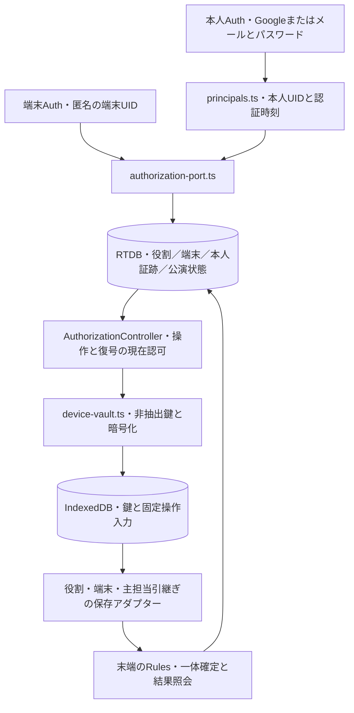

# 本人・端末認可基盤の実装・試験記録

| 項目 | 内容 |
|---|---|
| 状態 | Draft。#110は実装中。完了・実機合格ではない |
| 読者・目的 | 実装・試験担当者が、共通部品と未接続の業務を区別する |
| 確認日 | 2026-11-06 |
| 対象 | `codex/issue-110-device-authorization`。main未統合 |
| 根拠 | [BD-04](../basic-design/authentication-authorization-design.md)、[ADR-005](../decisions/ADR-005-device-principal-authorization.md)、[DD-96](../detailed-design/staff-role-change-detail-design.md)、[DD-98](../detailed-design/temporary-admin-permissions-detail-design.md) |

## 結論と境界

本人・端末の認証と、現在の認可を分けて実装している。
同じ本人の端末Aを停止しても、端末Bを止めないためである。
認可はTypeScriptとRTDB Rulesの両方で検査する。

現在の共通画面には、認証部品をまだ接続していない。
非ローカル環境の起動は、引き続き安全側で停止する。
製品SDKの結合試験は、試験専用のローカル配信で行う。

**初回登録・追加端末の所持確認と、準備完了の業務接続は未完了。**
現在のRulesを、そのまま実環境へ配備しない。
全受入条件と#220の無料受入も、合格扱いにしない。

## 作った部品とデータの流れ



図の実線は、ローカル試験から呼び出した共通部品の流れである。
共通画面からのログインや、席保存の完了を示していない。

| 部品 | 守る条件と理由 |
|---|---|
| `src/domain/authorization/` | 本人・端末と現在役割を照合する。画面の表示だけで権限を決めない |
| `principals.ts` | 本人と端末を別のFirebase Appへ分ける。生トークンとパスワードを独自保存しない |
| `authorization-port.ts` | 現在値を二度取得し、購読値とも照合する。切断をキャッシュからのオンライン復帰と扱わない |
| `authorization-controller.ts` | 確認前・停止・失効・期限到達時に利用をロックする。古い非同期結果を新しい確認へ混ぜない |
| `device-vault.ts` | AES-GCM 256ビットの非抽出鍵を公演・端末へ結ぶ。再生成による既存暗号文の喪失を防ぐ |
| `authorization-operations.ts` | 固定入力を送信より先に暗号化保存する。同じIDへの別入力を拒否する |
| 各管理アダプター | 現在認可で再確認し、役割・操作結果と監査を一体更新する。応答不明では同じIDを照会する |
| `firebase/*-rules.mjs` | Rulesの生成元。共通条件の転記漏れを防ぐため、判定式を共用する |
| `firebase/database.rules.json` | 生成した部分Rules。手で編集せず、ビルド時に生成元との一致を確認する |

## 具体的な保存契約

公演ルートは`environments/{environmentId}/performances/{performanceId}`とする。
PoCの名前空間は使用しない。
台帳の初期投入は、現在の試験では管理用の架空データで行う。
通常の登録手順が完成したことには読み替えない。

| 領域 | 実装の対応 |
|---|---|
| `roles/{humanUid}` | 現在役割と共通版`revision`。変更時は`lastOperationId`で結果へ結ぶ |
| `devices/{deviceUid}` | 本人への結合、承認・停止・廃止、`storageEpoch`と準備版。未準備の`preparedRole`はnull相当で、RTDBでは子が欠落する |
| `sessions/{deviceUid}` | 形式版2。本人Authだけが発行・失効する。通常業務は端末Authで要求する |
| `control` | 認可部品は`state`と`staffDeadline`を読む。主担当引継ぎは`ownerUid`と`ownerHandoverOperationId`を一体更新する |
| `roleChangeRequests`・`roleChangeAcceptances` | 固定した役割変更案と、対象者のGoogle本人確認。作成後は不変 |
| `roleChangeResults`・`temporaryPermissionOperations` | 確定または取消しの不変結果。同じIDの別内容や自動再実行を認めない |
| `temporaryPermissionProfiles/{humanUid}/{revision}` | 固定9項目の版付き設定。取消しは全OFFの新しい版で、旧版を消さない |
| `authorizationAudit` | 結果と同じ確定で、変更前後の役割・期間と9項目を保持する |
| `deviceAuthorizationOperations` | 端末状態の変更前後と期待版を不変にする。鍵と準備版は便乗更新しない |
| `ownerHandover*` | 現主担当の開始、後任のGoogle受諾と結果・監査。主担当UIDと役割2件を一体更新する |

端末台帳の既存行に`revision`がない場合は、初期版1として扱う。
新しい状態変更では、版2以降と操作IDを必須にする。
通常承認で主担当の追加端末を承認する経路は拒否する。
BD-04-07の一回限りの所持確認を、通常承認へ混ぜないためである。

## 認可と期限

- 最近の再認証は、トークンの`auth_time`とサーバー時刻で判定する。
  15分ちょうどを含み、未来時刻と15分超を拒否する。
- 本人証跡の通常期限は最大12時間とする。
  別に準備したオフライン許可を、通常証跡の期限だけでは短縮しない。
- 公演限定スタッフの期限は、会場の翌日終了をUTCへ変換する。
  終了境界を含めず、固定24時間・48時間では計算しない。
- 役割版が変わった端末では、新しい管理権限を拒否する。
  一般受付から臨時への変更では、確認済みの旧受付範囲だけを残す。
- 停止・失効時は、暗号文と鍵を保持して利用をロックする。
  全件受領前の削除や、古い許可への自動復帰を行わない。

`currentAuthorization()`の参照先は、同じ公演内の4領域である。
役割・端末・本人証跡と、公演状態のスタッフ期限を参照する。
`preparedAuthorization()`は、同じ参照先で準備版も照合する。
RTDBの参照を、Firestoreの文書取得回数へ読み替えない。
通信量と無料枠は、#220の実測で別途判定する。

## ローカルの試験方法

Node.js 24.19.0以上とpnpm 11.25.0を使用する。
エミュレーターにはJavaとfirebase-tools 15.28.2を使用する。
既存のCLIを道具として再利用し、PoCの製品外コードはimportしない。

```powershell
pnpm install --frozen-lockfile --ignore-scripts
pnpm typecheck
pnpm test
pnpm build
pnpm test:browser

# 既に確認した15.28.2のCLIファイルを指定する。
$env:FIREBASE_CLI_PATH = '<firebase-tools>/lib/bin/firebase.js'
pnpm test:authorization
```

Authは127.0.0.1:9291、RTDBは127.0.0.1:9100で起動する。
プロジェクト名は`demo-concert-reception-product`へ固定する。
使用中のポートは奪わず、試験を中止する。
Rulesは生成後、設定配下のGit管理外領域へ同一内容をコピーする。

SDK試験は、Viteの127.0.0.1:4181から製品モジュールを読む。
PC幅とスマートフォン幅のChromiumは、実機と区別する。
架空の認証資格でも、通信トレースへトークンを保存しない。

Googleの資格は、Authエミュレーターだけで使える架空の資格である。
同UIDの連携と再認証は、下位のSDK呼出しで確認した。
製品のポップアップ用ラッパーと、実Googleの挙動は未確認である。

## 確認した範囲

2026-11-06に、次のローカル確認が通った。

| 確認 | 結果 |
|---|---|
| 型検査・ビルド・生成Rulesの一致 | 合格 |
| 製品の単体と既存モック回帰 | 172件合格 |
| 共通画面・PWAと暗号化保存のブラウザー試験 | 40件合格 |
| Auth・RTDBへの直接要求 | 17件合格。役割64通りと設定512通りの内部反復を含む |
| 製品SDKのブラウザー結合 | 14件合格。7経路を2つの画面幅で確認 |
| 依存監査 | 186記録、既知の問題0件 |

DD-96・98のケース名を一部試験へ対応させている。
そのケース全体の合格を意味しない。

| 対応する設計 | 今回の確認 | 残る結合 |
|---|---|---|
| DD96-T01・02 | 許可表の全64通りと、許可8方向の直接確定 | 操作画面・別実機 |
| DD96-T03～07・13・14 | 本人証跡、Google連携・再認証のSDK経路と現在役割の拒否 | 実Googleの連携失敗・取消し、本人によるパスワード設定 |
| DD96-T08～10 | 部分送信・便乗更新・取消し・同ID結果照会 | 応答喪失直後の実機再起動を含む全経路 |
| DD96-T11・12・15・16 | 準備版・暗号化失敗・期限と現在認可の判定 | 差分取得、永続的な失効状態と隔離回収。#104・233 |
| DD96-T17・18 | 最後の主担当端末と引継ぎの直接拒否・SDK確定 | 公演後管理、実機の認証寿命と#220 |
| DD98-T01～06・08・09 | 設定・取消しと固定9項目、部分送信・期間・版の拒否 | 各業務経路への接続 |
| DD98-T03・04 | 512設定の判定・保存と、禁止操作の共通判定 | 個々の本文の最小取得。#106・233・234等 |
| DD98-T07・10～12 | 固定入力・同ID照会、準備版・鍵保持と復帰の先行確認 | 準備・隔離の永続化。#104・233 |
| DD98-T13～21 | 共通認可の受渡しまで | 連絡・正式業務・出力・監査の各結合と実機。各担当Issue |

## 未完了と後続への引渡し

1. 初期主担当の割当、通常登録と主担当追加端末の所持確認を完成させる。
   現在の管理アダプターは、既存の登録台帳を対象にする。
2. #104で、暗号鍵と準備結果を業務の保存へ接続する。
   検知済み失効の永続化、所有タブと受領照合も必要である。
3. #111で、正式な公演初期化と開始・停止の版を接続する。
   試験用の初期台帳を、本番の初期設定に流用しない。
4. #263で、ログイン・登録・追加準備と管理操作を画面へ接続する。
   本人のログアウトは、証跡失効と画面ロックを先に行う。
   オフラインで未送信がある場合は、完了扱いにしない。
5. 対象実機で、実Google・App Checkと認証寿命を確認する。
   外部試行は、新しい対象範囲と予算の提示後に行う。

この記録のローカル結果だけで、#110全体の完了としない。
本番配備・公開と課金登録は行わない。
完成アプリの本番利用は、#220の無料受入合格まで認めない。
